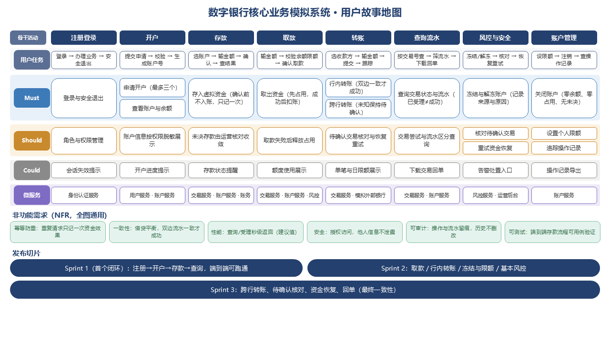
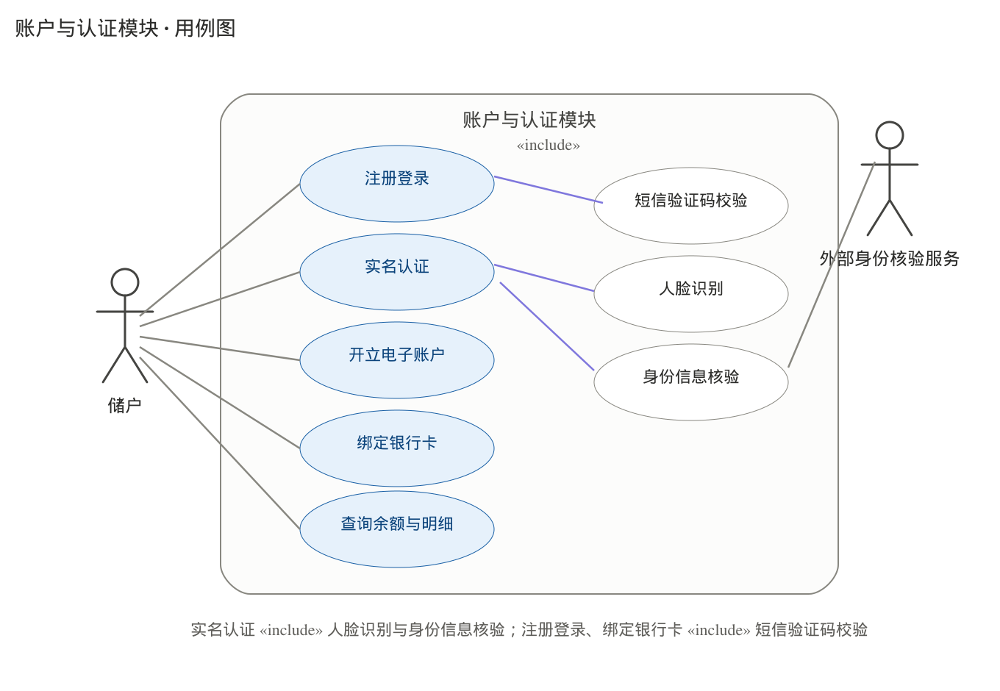
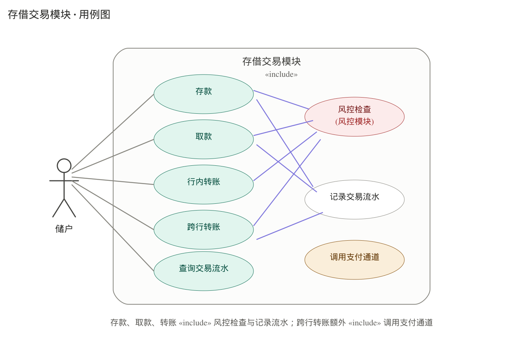
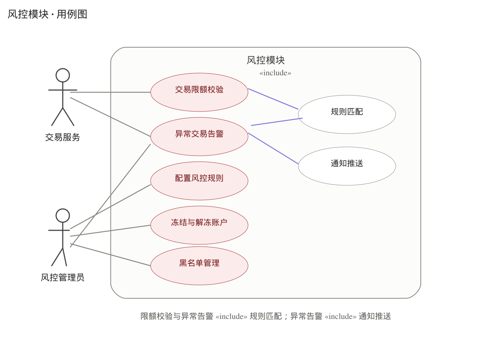
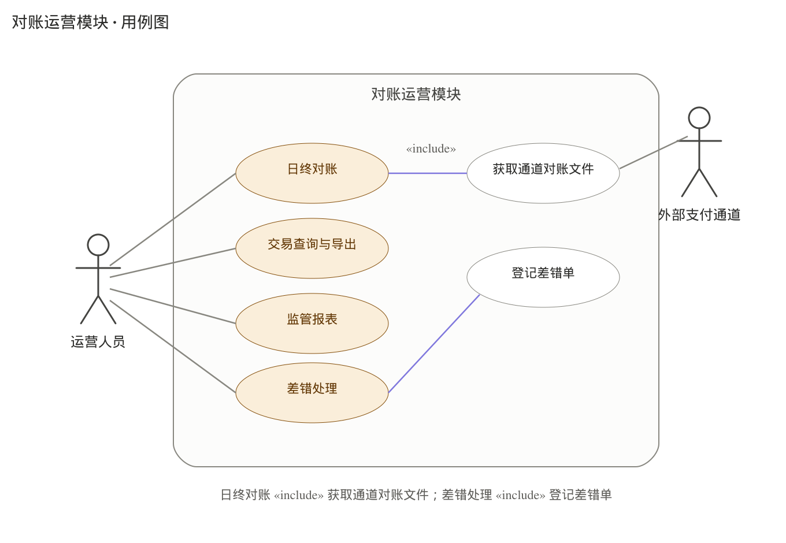
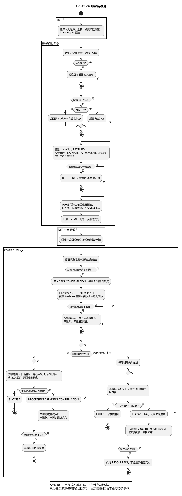
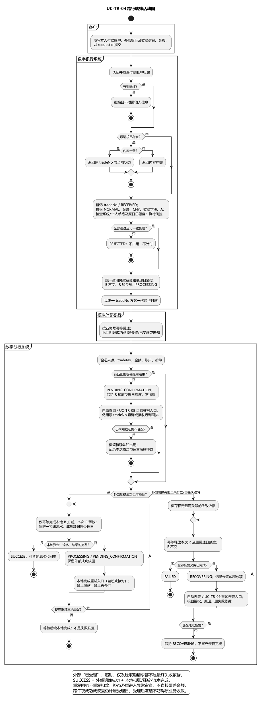
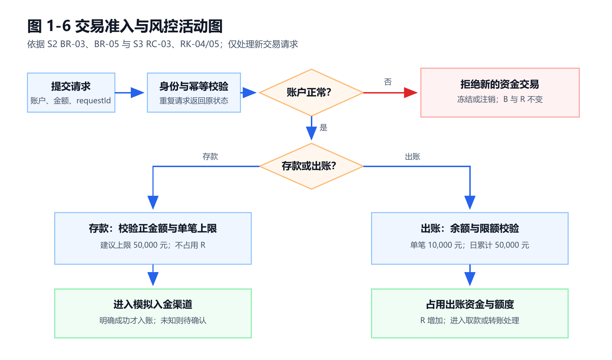
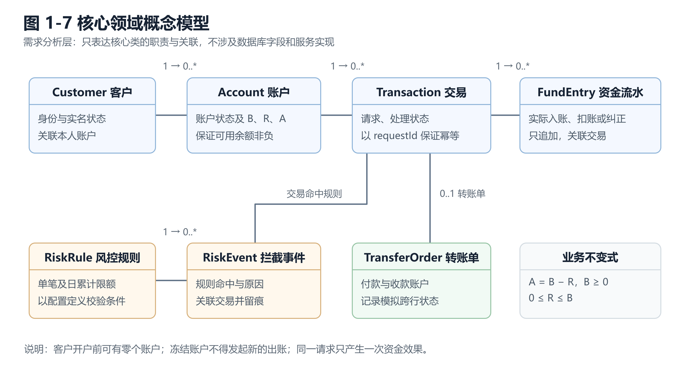

# 数字银行核心业务模拟系统需求规格说明书

实验一：需求分析与迭代规划｜整合版 v1.2

本说明书整合 S2 的账户与交易专项稿、S3 的角色与风控稿、S4 的《用户故事清单》及故事地图、S5 的候选类与 CRC；[Backlog](../../BACKLOG.md)用于跟踪这些材料，不作为覆盖组员原稿的独立依据。[需求讨论纪要](需求确认会议纪要.md)中的不同编号和建议值仍须组内复核。各组员的完整分析稿作为需求追溯材料保留。

## 1 项目概述与迭代规划

### 1.1 项目背景与目标

本项目选择选题一，拟开发数字银行核心业务模拟系统。随着常见银行业务转向线上，客户需要随时查看账户并办理资金业务，管理人员需要识别异常交易、限制风险账户。本项目用课程原型描述这些业务的正常与异常流程，重点验证账户资金变动的正确性、重复请求的处理方式，以及每笔资金变化的可追溯性。

系统面向客户、系统管理员、风控专员及运营人员。客户可以注册登录、维护实名信息、开立和注销符合条件的活期账户、查询账户状态与余额，办理存款、取款、本行转账和模拟跨行转账，并查询交易结果与流水。授权人员可冻结账户，运营人员依据解除结论解冻；风控人员可查看拦截记录。冻结账户不能发起新存款、取款、转账或接收新的行内转入，已受理交易仍须继续确认或恢复。同一请求重复提交不得产生第二次资金效果；本行转账双方资金变化必须同时成立；跨行转账通过模拟外部结果区分处理中、待确认、成功、恢复中和失败。

项目不对接真实银行、人民银行支付系统或银联，不涉及真实资金清算、利息、贷款、理财和生产级合规认证。实验一形成可检验的需求基线、用户故事、用例、活动图与领域概念，后续实验依据本说明书逐步完成架构设计、原型实现和测试。数字、限额及性能目标均为课程演示设定，不代表真实金融机构的业务标准。

### 1.2 范围与优先级

| 类别      | 内容                                                                      |
| ------- | ----------------------------------------------------------------------- |
| 纳入分析    | 客户注册与认证、账户开立/注销及查询、冻结/解冻、存取款、本行及模拟跨行转账、交易结果与流水查询、未决核对和失败恢复、基本风控。        |
| 待评审候选   | S4 综合草稿和 S5 候选类稿中的银行卡绑定、人脸识别、独立日终对账、监管报表等；专项材料尚未形成一致范围。                 |
| P0（专项稿） | US-01、02、10—14、20—24、25、26、30、40—43；实验一的故事地图、用例与领域模型。S2 与 S4 建议先完成存款闭环。 |
| P1（专项稿） | US-03—05、15、16、28、29、31、33；资料维护、授权管理、个人限额、操作记录、待确认核对和资金恢复等。             |
| P2（专项稿） | US-27、32、36；模拟回单、高频标记及风险告警处置。US-34、35 的实现优先级待组内确认。                      |

这些优先级来自 S2、S3 和 S4 的专项材料，仍须小组统一；不表示实验一就要实现所有 P0 功能。跨行转账、账户注销及未决处理均须在实验一分析。前端故事 US-40—43 是上述业务的交互入口，不重复列为独立业务用例。

### 1.3 用户故事地图

图 1-1 引用 S4 的完整故事地图。其 Must/Should/Could 分层与 S4《用户故事清单》共同作为优先级依据；S4 较早的综合草稿有不同口径，待组内复核。

| 用户活动 | 主要任务            | P0 故事                   | P1 故事             | P2 故事       |
| ---- | --------------- | ----------------------- | ----------------- | ----------- |
| 进入系统 | 注册、实名、登录        | US-01、US-02、US-40       | US-03 维护资料        | —           |
| 管理账户 | 开户、查询、冻结及注销     | US-10—14、US-41          | US-04、US-15、US-16 | —           |
| 办理交易 | 存款、取款、本行与模拟跨行转账 | US-20—23、US-25、US-42    | US-28、US-29       | —           |
| 查看结果 | 查询交易结果与资金流水     | US-11、US-24、US-26、US-43 | —                 | US-27       |
| 控制风险 | 限额、拦截与风险记录      | US-13、US-30             | US-31、US-33       | US-32、US-36 |

图 1-1 S4 用户故事地图。账户注销属 Must，回单属 Could；图中的发布切片是产品增量规划，与下文按课程实验划分的 Sprint 不逐项等同。其他候选故事与《用户故事清单》不一致时保留待评审。

### 1.4 迭代规划

| 迭代            | 周期      | 目标与验收切片                  | 交付物                   |
| ------------- | ------- | ------------------------ | --------------------- |
| Sprint 0      | 第 1 周   | 选题、协作规范和初始需求             | 项目说明、初始 Backlog       |
| Sprint 1（实验一） | 第 1—2 周 | 确认业务范围，完成需求分析与规划         | 本说明书、故事地图、用例及分析模型     |
| Sprint 2（实验二） | 第 3 周   | 比较架构方案，完成设计模型            | 架构决策、包图、部署图、序列图、数据库设计 |
| Sprint 3（实验三） | 第 4-5 周 | 先打通注册/开户/存款/查询，再扩展其他核心业务 | 可运行原型及存款端到端演示         |
| Sprint 4（实验四） | 第 6-7 周 | 验证成功和异常场景，整理部署方案         | 测试用例、记录、部署方案和定稿报告     |

每轮结束核对可展示的增量及文档，发现的范围或规则变更由 S1 统一记录并通知相关负责人。

## 2 系统用例分析

### 2.1 角色分析

表 1-1 角色列表。系统内部的账户、交易和风控模块是功能边界，不作为外部参与者。

| 编号    | 角色     | 所属部门或身份   | 职责与权限边界                                   |
| ----- | ------ | --------- | ----------------------------------------- |
| ACT-C | 客户     | 个人用户      | 办理本人账户与交易，查询本人余额、状态和流水。                   |
| ACT-S | 系统管理员  | 模拟银行系统管理  | 分配角色与数据授权范围，不直接读取客户业务明细或修改资金余额。           |
| ACT-R | 风控专员   | 模拟银行风控    | 在授权范围内查看风险记录、因风险冻结账户并记录原因；可提供解除依据，但不直接解冻。 |
| ACT-O | 运营人员   | 模拟银行运营    | 在授权范围内查看客户列表、执行冻结/解冻；不得手工改余额或凭超时认定交易成功。   |
| ACT-F | 模拟资金渠道 | 系统外的教学模拟器 | 为存取款返回受理、成功、失败或结果未知，不代表真实银行通道。            |
| ACT-B | 模拟外部银行 | 系统外的教学模拟器 | 为跨行转账返回模拟清算结果。                            |

S3 原稿还列出柜员、风控主管和审计员，用于规则审批、只读查询等用例；是否纳入首个原型由小组确认。客户资料及交易仅本人可见；后台人员还须检查具体数据授权范围。

### 2.2 基本用例列表

表 1-2 沿用 S2 的 `UC-AC-*`、`UC-TR-*` 编号，并列出 S3 的认证与风控用例。幂等、余额与限额校验是多个用例共享的步骤，不另算客户基本用例。S3 的规则配置、风险名单和告警处置已列为候选用例，优先级仍待小组确认。

| 编号       | 基本用例     | 主要角色      | 优先级 | 对应故事        | 简要描述                   |
| -------- | -------- | --------- | --- | ----------- | ---------------------- |
| UC-ID-01 | 注册与实名认证  | 客户        | P0  | US-01       | 建立客户身份与模拟实名信息。         |
| UC-AU-01 | 登录系统     | 客户、后台人员   | P0  | US-02       | 校验身份并进入授权功能。           |
| UC-ID-03 | 维护个人资料   | 客户        | P1  | US-03       | 查询和修改允许变更的本人资料。        |
| UC-AU-02 | 管理角色与权限  | 系统管理员     | P1  | US-05       | 分配岗位、角色与数据授权范围。        |
| UC-AC-01 | 开立活期账户   | 客户        | P0  | US-10       | 建立唯一账户号；最多三个未注销账户。     |
| UC-AC-02 | 查询账户列表   | 客户、授权后台人员 | P0  | US-12       | 按本人或授权范围返回账户列表。        |
| UC-AC-03 | 查询账户详情   | 客户、授权后台人员 | P0  | US-11       | 查询归属、币种、状态和适当信息。       |
| UC-AC-04 | 查询余额     | 客户、授权后台人员 | P0  | US-11、US-41 | 展示账面余额、占用金额与可用余额。      |
| UC-AC-05 | 冻结账户     | 风控专员、运营人员 | P0  | US-13       | 记录来源和原因，禁止新收付；已受理业务继续。 |
| UC-AC-06 | 解冻账户     | 运营人员      | P0  | US-13       | 全部有效限制解除后恢复账户并留痕。      |
| UC-AC-07 | 注销账户     | 客户        | P0  | US-14       | 零余额、零占用且无未决业务时关闭账户。    |
| UC-AC-08 | 设置个人交易限额 | 客户        | P1  | US-15       | 在系统上限内设置本人付款账户限额。      |
| UC-AC-09 | 查询账户操作记录 | 客户、授权后台人员 | P1  | US-16       | 查询开户、冻结、解冻、注销等操作记录。    |
| UC-OP-01 | 查看客户列表   | 运营人员      | P1  | US-04       | 在授权范围内查看客户及账户状态。       |
| UC-TR-01 | 存款       | 客户、模拟资金渠道 | P0  | US-20、US-42 | 渠道明确成功后只入账一次并生成流水。     |
| UC-TR-02 | 取款       | 客户、模拟资金渠道 | P0  | US-21、US-42 | 校验余额与风控；成功扣款，失败释放占用。   |
| UC-TR-03 | 本行转账     | 客户        | P0  | US-22、US-42 | 付款与收款账户资金及流水一致。        |
| UC-TR-04 | 跨行转账     | 客户、模拟外部银行 | P0  | US-23、US-42 | 区分处理、待确认、成功、恢复中和失败。    |
| UC-TR-05 | 查询交易结果   | 客户、运营人员   | P0  | US-26       | 查询有权访问的交易当前状态。         |
| UC-TR-06 | 查询交易流水   | 客户、运营人员   | P0  | US-24、US-43 | 查询实际资金记录，区别于处理记录。      |
| UC-TR-07 | 下载交易回单   | 客户、运营人员   | P2  | US-27       | 为已成功交易生成模拟凭证。          |
| UC-TR-08 | 核对待确认交易  | 运营人员、模拟渠道 | P1  | US-28       | 查询外部稳定结果，推进未决业务。       |
| UC-TR-09 | 重试资金恢复   | 运营人员      | P1  | US-29       | 对有明确失败依据的交易重试恢复。       |
| UC-RK-01 | 配置风控规则   | 风控专员、风控主管 | 待定  | US-34       | 申请、审批和留痕，按授权执行。        |
| UC-RK-02 | 维护风险名单   | 风控专员、风控主管 | 待定  | US-35       | 申请、审批和留痕，按授权执行。        |
| UC-RK-03 | 处置风险告警   | 风控专员      | P2  | US-36       | 跟踪并记录风险告警处置结果。         |
| UC-RK-04 | 查询风险记录   | 风控专员、授权人员 | P1  | US-33       | 查看规则命中、原因和关联交易。        |

### 2.3 用例关系与关键事件流

图 1-2a—1-2d 引用组员按模块绘制的用例图。表 1-2 汇总 S2 和 S3 的专项用例；原图与用例表尚有不同：原图含银行卡绑定、人脸识别、独立日终对账等候选功能，S2 清单则含注销、待确认核对和资金恢复等原图未画的用例。两者都保留供小组评审，不用 Backlog 单方面删改原稿。交易用例共用身份与对象权限校验、请求幂等和必要的风控检查；资金流水仅记录实际资金事件。

图 1-2a 账户与认证模块用例图，引用组员原图。人脸识别和银行卡绑定见原图及 S4 综合草稿，是否纳入需与 S2 的模拟渠道方案统一；S2 的账户注销、个人限额和操作记录见表 1-2。

图 1-2b 存储交易模块用例图，引用组员原图。模拟渠道的成功、失败和未知结果均需分析；存款适用自身单笔上限，取款与转账共用出账限额。待确认核对和失败恢复详见 S2 用例清单。

图 1-2c 风控模块用例图，引用组员原图。S3 清单包含规则配置、风险名单、告警处置和风险记录查询；是否在首个原型实现管理界面由小组确定。存款单笔上限与出账限额分开校验。

图 1-2d 对账运营模块用例图，引用组员原图。S2 专项稿列有待确认交易核对与失败资金恢复；原图另有独立日终对账、监管报表和差错单处理，是否纳入当前范围待小组核对。跨行明确失败时仍须完成资金恢复。

**存款 UC-TR-01。** 客户提交本人账户、正金额和请求标识；系统先验证身份、账户归属和请求幂等，再校验账户为正常状态及存款单笔上限。冻结账户的新存款被拒绝；冻结前已受理的存款仍继续确认。模拟入金明确成功后余额增加一次并追加一条资金流水；明确失败不入账；结果未知保持待确认，不显示“已到账”。

图 1-3 存款活动图，引用 S2 分析材料中的原图。账户状态、存款单笔上限、请求幂等和渠道结果按 S2 原图及 S3 规则核对；重复请求不得产生第二条入账流水。

**取款 UC-TR-02。** 客户发起取款后先验证身份、账户归属和请求幂等；新请求再检查账户非冻结、金额不超过可用余额和适用限额，通过后预留可用资金。渠道明确成功才扣减账面余额并追加扣账流水；明确失败释放预留；未知结果保持占用并供后续核对。

图 1-4 取款活动图，引用 S2 分析材料中的原图。余额不足、冻结或超限均在实际出账前结束；限额数值按 BR-05。

**跨行转账 UC-TR-04。** 付款账户的可用余额在模拟清算期间被占用；“已受理”不等于成功。模拟外部银行明确成功且本地扣账及流水完整后显示成功；明确失败且完成资金释放后显示失败；超时或结果未知继续显示待确认，不自动退款。S2 用例清单与 S4《用户故事清单》将其列为 P0/Must。

图 1-5 跨行转账活动图，引用 S2 分析材料中的原图。明确失败但释放未完成时保持“恢复中”，不可先报告最终失败；S2 用例清单及 S4 故事清单将跨行转账列为 P0/Must。

**交易准入与风控。** 图 1-6 展示新存款与出账请求的账户状态、金额和限额校验。风控拒绝记录为拦截事件，不能伪造成实际资金流水。具体限额和异常条件见第 2.4 节表 1-3；角色与权限说明见 [S3 角色与风控需求说明](S3-角色与风控与非功能需求说明.md)。

图 1-6 依据 S2、S3 规则重新整理的交易准入与风控活动图，原图保留在 `photo` 目录。任一新请求校验失败均拒绝并留痕，B/R 不变；冻结账户禁止新存款、取款、转账及接收新的行内转入，冻结前已受理业务继续确认或恢复。

### 2.4 业务规则与异常处理

表 1-3 沿用 S2《00-需求基线与规则》的 BR 编号，内容与 S3 风控规则对应；《需求确认会议纪要》中的业务规则决议已同步使用同一编号体系。以 `B` 表示账面余额，`R` 表示待完成出账的占用资金，`A` 表示可用余额，始终要求 `A=B-R` 且 `B≥0、0≤R≤B`。冻结是账户状态，不等同于资金占用。

| 规则               | 内容                                                                                     | 可验证的异常结果                 |
| ---------------- | -------------------------------------------------------------------------------------- | ------------------------ |
| BR-01 币种与金额      | 仅模拟人民币 CNY 和虚拟资金；金额大于零、最多两位小数，不计息费、不允许透支。                                              | 非法金额拒绝，资金不变。             |
| BR-02 开户数量       | 每名客户最多三个未注销账户，正常与冻结账户均计入；新账户初始 B=R=A=0。                                                | 达到上限拒绝再次开户。              |
| BR-03 账户状态       | 冻结账户禁止新存款、取款、转账及接收新的行内转入；已受理交易继续确认、核对或恢复。                                              | 新收付被拒绝；旧交易不会永久悬挂。        |
| BR-04 余额口径       | 账面余额 B、占用 R、可用余额 A 满足 A=B-R，且 B≥0、0≤R≤B。                                               | 并发及恢复后仍满足不变式。            |
| BR-05 交易限额       | 存款单笔上限建议 50,000 元；取款及两类转账共用出账单笔 10,000 元、每账户自然日累计 50,000 元。日累计含已成功及仍占用的出账，失败恢复后释放原日额度。 | 超限拒绝，B/R 不变；数值为组员稿的课堂建议。 |
| BR-09 冻结权限       | 运营人员或风控专员可记录原因并冻结；全部有效原因解除后由运营人员解冻，风控冻结须有风险解除依据。                                       | 无依据不得解冻，操作留痕。            |
| BR-11/12 幂等      | 同一身份、业务类型和 requestId 的相同请求只产生一次效果；tradeNo 贯穿资金及外部处理，同号不同内容返回冲突。                        | 重试和重复回执不产生第二次资金变化。       |
| BR-13 存款入账       | 渠道明确成功后 B 增加并追加入账流水；失败不入账，未知结果待确认。                                                     | 不能凭提交或超时显示已到账。           |
| BR-14 出账处理       | 取款与转账受理后先占用资金及额度；明确成功后扣账并释放占用，明确失败且恢复完成后释放。                                            | 未知结果保留占用，失败不造成重复资金效果。    |
| BR-15 本行转账       | 付款方扣账、收款方入账及双方关联流水必须一致后才能报告成功。                                                         | 一方失败时不能展示单边成功。           |
| BR-16/17 模拟跨行与恢复 | 外部明确成功且本地完成才报告成功；外部明确失败且释放完成才报告失败；未知保持待确认，恢复未完成保持恢复中。                                  | 超时不能直接退款或判成功。            |
| BR-19 资金流水       | 只记录实际入账、扣账或纠正；拒绝与处理过程另存，历史流水不修改或删除。                                                    | 资金变化可按交易号追溯。             |
| BR-20 权限与审计      | 客户仅访问本人数据；后台人员按角色及对象范围授权，重要操作记录操作者、时间、原因与结果。                                           | 越权访问被拒绝，审计可追溯。           |

交易处理状态采用“已接收、已拒绝、处理中、待确认、成功、恢复中、失败”。资金流水与处理状态分开：前者仅记录实际资金事件，后者记录受理及异常处理过程。详细异常检查清单见 [S2 异常场景](数字银行账户与交易模块需求分析/04-交易异常场景与验收.md)。

### 2.5 候选类、CRC 与领域模型

从“客户开立账户”“账户发生交易”“交易命中规则”“跨行转账等待结果”等用例中的名词短语提取候选类。登录页面、表单和数据库连接属于界面或实现细节，不进入实验一的分析类模型。S5 的[候选类与 CRC 原稿](候选类-CRC与领域模型.md)提供了候选概念；其中银行卡、告警、独立对账等概念须随功能范围评审，不能直接删除原稿。原稿的一客户一账户关系与 S2、S4 的最多三个未注销账户规则不一致，本图暂按业务专项材料表达为一对多，待 S5 复核。

表 1-4 核心 CRC 卡。

| 候选类               | 职责                         | 协作者                             |
| ----------------- | -------------------------- | ------------------------------- |
| Customer 客户       | 持有身份与实名状态，关联本人账户           | Account                         |
| Account 账户        | 维护归属、状态、账面余额与预留金额，保证可用余额非负 | Customer、Transaction            |
| Transaction 交易    | 标识请求和交易结果，关联资金流水与幂等标识      | Account、TransferOrder、RiskEvent |
| FundEntry 资金流水    | 记录一次实际入账、扣账或纠正，保留交易号与账户关联  | Transaction、Account             |
| TransferOrder 转账单 | 描述付款、收款、金额及模拟跨行处理状态        | Transaction、Account             |
| RiskRule 风控规则     | 定义单笔及日累计限额条件               | RiskEvent                       |
| RiskEvent 拦截事件    | 记录规则命中、原因和关联交易             | RiskRule、Transaction            |

核心领域概念及关系见图 1-7 和 [S5 候选类、CRC 与领域模型分析](候选类-CRC与领域模型.md)。一名客户可以在开户前拥有零个账户，一个账户可以关联多条资金交易。分析类只表达职责与关联，不涉及数据库字段类型或服务实现方法。账户与交易的不变式为：`A=B-R`、余额不得为负、同一请求只产生一次资金效果、冻结账户不得新出账、每笔实际资金变化均可追溯。

图 1-7 核心领域概念模型。

## 3 非功能需求

以下采用 S3 的 NFR 编号和口径，均为拟验证目标，不是已完成的测试结论。统一测试环境和实际结果在实验四记录。

| 编号     | 类别      | 可验证要求                                                | 验证方法            |
| ------ | ------- | ---------------------------------------------------- | --------------- |
| NFR-01 | 权限隔离    | 客户无法通过替换账户号、交易号或请求标识访问他人数据；后台操作检查对象范围。               | 双客户与后台越权用例。     |
| NFR-02 | 资金一致性   | 始终满足 A=B-R；重复请求、回执及恢复重试不造成第二次资金效果；限额不被并发穿透。          | 并发、幂等与故障注入用例。   |
| NFR-03 | 可追溯     | tradeNo、requestId 串联交易状态、资金记录、外部结果及恢复日志；日志不存密码和完整令牌。 | 日志抽查。           |
| NFR-04 | 响应目标    | 10 名并发模拟客户、预热 1 分钟、持续 2 分钟时，受理和查询 P95 不超过 2 秒。       | 接口压测，记录环境与 P95。 |
| NFR-05 | 超时与持续核对 | 外部调用 5 秒无明确结果返回待确认；按 S3 建议持续查询，仍未知时转运营待处理。           | 模拟超时与迟到回执。      |
| NFR-06 | 可解释反馈   | 区分已接收、处理中、待确认、成功、失败和恢复中；已接收不得显示已到账。                  | 界面与状态查询走查。      |
| NFR-07 | 身份认证    | 密码加盐哈希存储，会话失效规则明确；未登录与越权分别返回 401、403。                | 代码审查与接口测试。      |
| NFR-09 | 数据保护    | 卡号、证件号和手机号按权限脱敏；日志不含密码与令牌。                           | 界面及日志核查。        |
| NFR-10 | 操作审计    | 冻结、解冻、限额变更、核对和恢复记录操作者、时间、对象、原因与结果。                   | 审计记录抽查。         |
| NFR-12 | 可维护性    | 限额与规则参数配置化，调整无需修改交易核心逻辑。                             | 配置变更演示。         |
| NFR-14 | 兼容性     | 页面在 Chrome、Edge 最近两个大版本及 1366×768 以上分辨率可用。           | 手工浏览器检查。        |

## 4 整合追溯与版本说明

| 来源                                                                                    | 本文采用的内容                      | 整合处理                                              |
| ------------------------------------------------------------------------------------- | ---------------------------- | ------------------------------------------------- |
| [S2 账户与交易材料](数字银行账户与交易模块需求分析/README.md)                                               | 账户与交易用例编号、事件流、业务规则及异常分支      | 保留注销、个人限额、回单、待确认核对与恢复用例；BR 编号和模拟金额以 S2 专项稿为准。     |
| [S3 角色与风控](S3-角色与风控与非功能需求说明.md)                                                       | 角色权限、风控规则、NFR 编号与指标          | 冻结与限额规则同 S2；规则配置、名单及告警用例保留，原型实现优先级待确认。            |
| [S4 故事地图](数字银行核心业务用户故事地图/数字银行核心业务用户故事地图_完整版.png)及[用户故事清单](数字银行核心业务用户故事地图/用户故事清单.docx) | 用户活动、Must/Should/Could 和验收要点 | 纳入注销与跨行转账的 Must 故事；回单、核对和恢复分别按清单跟踪。               |
| [S5 候选类与 CRC](候选类-CRC与领域模型.md)                                                        | 名词短语筛选、CRC 职责与候选领域关系         | 保留银行卡、告警及对账等候选概念供范围评审；账户基数与 S2/S4 有分歧，待 S5 复核。    |
| [讨论纪要](需求确认会议纪要.md)与 [Backlog](../../BACKLOG.md)                                      | 跨组整合与任务跟踪                    | 两者先前使用的 BR 编号、范围和优先级与组员专项稿不一致，以专项稿为本版依据；最终仍需小组统一。 |

本说明书供小组按图表和规则继续开展实验二至实验四。若后续变更账户冻结、限额或跨行状态规则，应同步更新故事、用例、活动图、领域模型与验收用例，避免同一业务出现两种口径。
