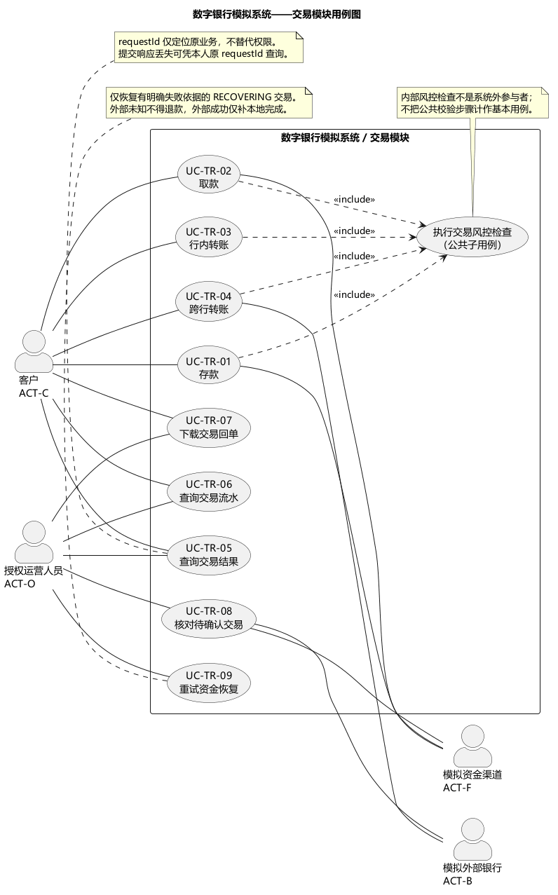
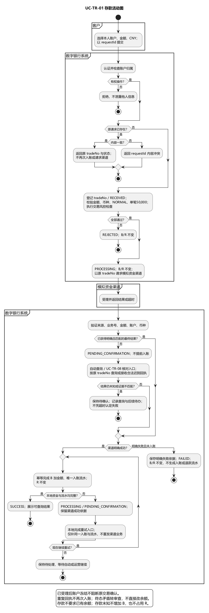
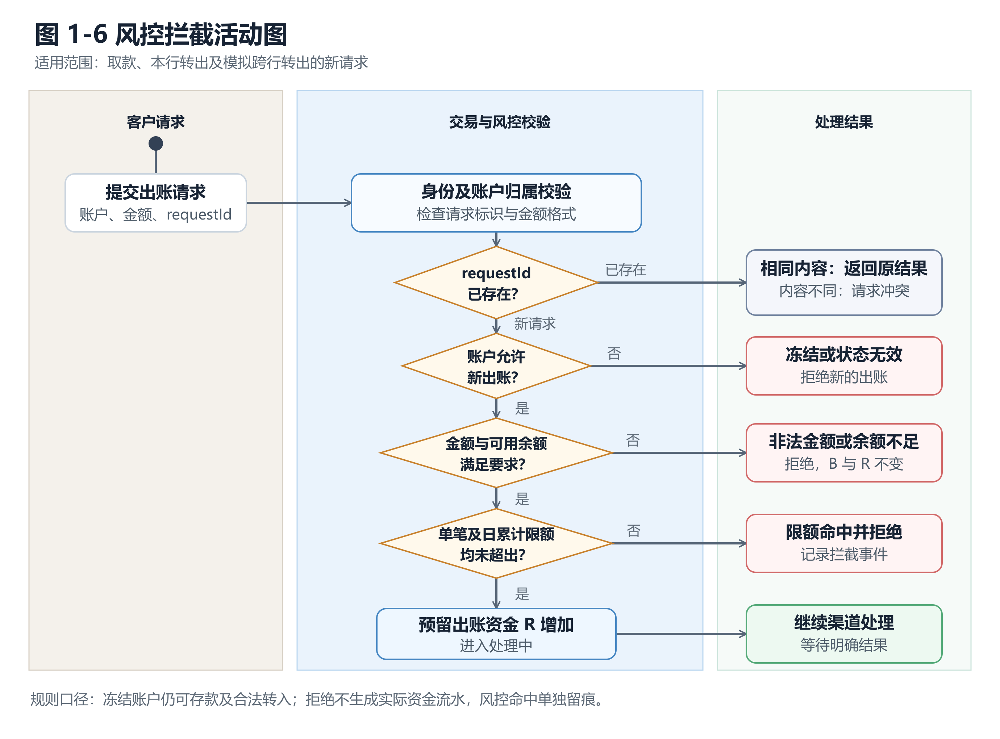

# 数字银行核心业务模拟系统需求规格说明书

实验一：需求分析与迭代规划｜整合版 v1.1

本说明书以[需求讨论纪要](需求确认会议纪要.md)和项目 [Backlog](../../BACKLOG.md) 为待确认的工作基线，整合 S2 的账户与交易用例、S3 的角色与风控及非功能需求、S4 的用户故事地图、S5 的候选类与 CRC。各组员的完整分析稿作为需求追溯材料保留。

## 1 项目概述与迭代规划

### 1.1 项目背景与目标

本项目选择选题一，拟开发数字银行核心业务模拟系统。随着常见银行业务转向线上，客户需要随时查看账户并办理资金业务，管理人员需要识别异常交易、限制风险账户。本项目用课程原型描述这些业务的正常与异常流程，重点验证账户资金变动的正确性、重复请求的处理方式，以及每笔资金变化的可追溯性。

系统面向客户、系统管理员、风控管理员及必要的运营人员。客户可以注册登录、维护实名信息、开立活期账户、查询账户状态与余额，办理存款、取款、本行转账和模拟跨行转账，并查询交易流水。管理员依据授权冻结或解冻账户、查看拦截记录。系统在出账前检查账户状态、可用余额和限额；同一请求重复提交不得重复扣款或入账。本行转账的双方资金变化必须同时成立；跨行转账通过模拟外部结果呈现处理中、成功或失败，并在失败时释放预留资金。

项目不对接真实银行、人民银行支付系统或银联，不涉及真实资金清算、利息、贷款、理财和生产级合规认证。实验一形成可检验的需求基线、用户故事、用例、活动图与领域概念，后续实验依据本说明书逐步完成架构设计、原型实现和测试。数字、限额及性能目标均为课程演示设定，不代表真实金融机构的业务标准。

### 1.2 范围与优先级

| 类别     | 内容                                                                      |
| ------ | ----------------------------------------------------------------------- |
| 纳入     | 客户注册与认证、活期账户开立及查询、账户冻结/解冻、存取款、本行及模拟跨行转账、交易结果与流水查询、基础风控。                 |
| 排除     | 真实支付与清算接口、真实资金、计息、贷款、理财、生产级合规认证。独立对账功能、银行卡绑定、人脸识别、监管报表等不列为本次交付。         |
| P0 必须  | US-01、02、10—13、20—22、24、25、30、40—43；实验一的故事地图、用例与领域模型。存款 US-20 是原型的必验流程。 |
| P1 应完成 | US-03、04、23、31、33；资料维护、客户列表、模拟跨行转账、日累计限额和风险记录查询。                        |
| P2 视工期 | US-32 高频交易可疑标记。                                                         |

优先级表示整个项目的验收次序，不表示实验一就要实现所有 P0 功能。P1 的跨行转账虽可晚于核心业务实现，但实验一仍需分析其事件流。前端故事 US-40—43 是上述业务的交互入口，不重复列为独立业务用例。

### 1.3 用户故事地图

图 1-1 以“用户活动→任务→故事”的层次整理 S4 的故事地图。此处统一为本项目 Backlog 的优先级；原始故事地图中的账户注销、回单等扩展项不进入当前核心验收线。

| 用户活动 | 主要任务           | P0 故事                | P1 故事         | P2 故事 |
| ---- | -------------- | -------------------- | ------------- | ----- |
| 进入系统 | 注册、实名、登录       | US-01、US-02、US-40    | US-03 维护资料    | —     |
| 管理账户 | 开户、查账户与余额、处理冻结 | US-10—13、US-41       | US-04 管理员查看客户 | —     |
| 办理交易 | 存款、取款、本行与跨行转账  | US-20—22、US-25、US-42 | US-23 模拟跨行转账  | —     |
| 查看结果 | 查看余额、状态与交易流水   | US-11、US-24、US-43    | 跨行状态查询        | —     |
| 控制风险 | 限额、拦截与风险记录     | US-13、US-30          | US-31、US-33   | US-32 |

图 1-1 S4 用户故事地图。图片保留小组初稿的完整候选故事；账户注销、回单和图中原有的迭代划分不属于本版验收口径，最终范围与优先级以本节故事表和第 1.2 节为准。

### 1.4 迭代规划

| 迭代            | 周期      | 目标与验收切片                  | 交付物                   |
| ------------- | ------- | ------------------------ | --------------------- |
| Sprint 0      | 第 1 周   | 选题、协作规范和初始需求             | 项目说明、初始 Backlog       |
| Sprint 1（实验一） | 第 1—2 周 | 确认业务范围，完成需求分析与规划         | 本说明书、故事地图、用例及分析模型     |
| Sprint 2（实验二） | 第 3 周   | 比较架构方案，完成设计模型            | 架构决策、包图、部署图、序列图、数据库设计 |
| Sprint 3（实验三） | 第 4-5 周 | 先打通注册/开户/存款/查询，再扩展其他核心业务 | 可运行原型及存款端到端演示         |
| Sprint 4（实验四） | 第 6-7 周 | 验证成功和异常场景，整理部署方案         | 测试用例、记录、部署方案和定稿报告     |

每轮结束核对可展示的增量及文档，发现的范围或规则变更由 S1 统一记录并通知相关负责人。

## 2 系统用例分析

### 2.1 角色分析

表 1-1 角色列表。系统内部的账户、交易和风控模块是功能边界，不作为外部参与者。

| 编号     | 角色     | 所属部门或身份   | 职责与权限边界                                   |
| ------ | ------ | --------- | ----------------------------------------- |
| ACT-C  | 客户     | 个人用户      | 办理本人账户与交易，查询本人余额、状态和流水。                   |
| ACT-SA | 系统管理员  | 模拟银行系统管理  | 维护账号与基础授权，不直接读取客户业务明细或修改资金余额。             |
| ACT-R  | 风控管理员  | 模拟银行风控    | 在授权范围内查看拦截记录、因风险冻结账户并记录原因；可提供解除依据，但不直接解冻。 |
| ACT-O  | 运营人员   | 模拟银行运营    | 在授权范围内查看客户列表、执行冻结/解冻；不得手工改余额或凭超时认定交易成功。   |
| ACT-F  | 模拟资金渠道 | 系统外的教学模拟器 | 为存取款返回受理、成功、失败或结果未知，不代表真实银行通道。            |
| ACT-B  | 模拟外部银行 | 系统外的教学模拟器 | 为跨行转账返回模拟清算结果。                            |

S3 原稿提出的柜员、风控主管、审计员可用于后续扩展，但没有对应的本次 Backlog 核心故事，故不作为当前用例图的必需角色。客户资料及交易仅本人可见；后台人员还须检查具体数据授权范围。

### 2.2 基本用例列表

表 1-2 用例列表只列参与者主动追求的业务目标；幂等、余额与限额校验是多个用例共享的规则，不单独充作基本用例。编号沿用 S2 已建立的 `UC-AC-*`、`UC-TR-*` 系列。

| 编号       | 基本用例     | 主要角色       | 优先级 | 对应故事        | 简要描述                       |
| -------- | -------- | ---------- | --- | ----------- | -------------------------- |
| UC-ID-01 | 注册与实名认证  | 客户         | P0  | US-01       | 建立客户身份并维护开户所需的模拟实名信息。      |
| UC-ID-02 | 登录       | 客户、管理员     | P0  | US-02       | 校验身份后进入授权范围内的功能。           |
| UC-ID-03 | 维护个人资料   | 客户         | P1  | US-03       | 查询和修改允许变更的本人资料。            |
| UC-AC-01 | 开立活期账户   | 客户         | P0  | US-10       | 建立唯一账户号与初始零余额。             |
| UC-AC-02 | 查询账户列表   | 客户         | P0  | US-12       | 仅返回本人账户及状态。                |
| UC-OP-01 | 查看客户列表   | 运营人员       | P1  | US-04       | 在授权范围内查看客户及账户状态，以便识别待处置账户。 |
| UC-AC-04 | 查询余额与状态  | 客户         | P0  | US-11、US-41 | 展示账面余额、预留金额与可用余额。          |
| UC-AC-05 | 冻结账户     | 风控管理员、运营人员 | P0  | US-13、US-04 | 记录原因并阻止新的出账。               |
| UC-AC-06 | 解冻账户     | 运营人员       | P0  | US-13       | 依据解除结论恢复出账资格并留痕。           |
| UC-TR-01 | 存款       | 客户、模拟资金渠道  | P0  | US-20、US-42 | 模拟成功后增加余额并生成入账流水。          |
| UC-TR-02 | 取款       | 客户、模拟资金渠道  | P0  | US-21、US-42 | 校验余额与风控；成功扣款，失败释放预留。       |
| UC-TR-03 | 本行转账     | 客户         | P0  | US-22、US-42 | 付款与收款账户同时完成资金变化。           |
| UC-TR-04 | 跨行转账     | 客户、模拟外部银行  | P1  | US-23、US-42 | 展示处理中、成功/失败；未知结果保持待确认。     |
| UC-TR-05 | 查询交易结果   | 客户         | P1  | US-23       | 查询模拟跨行等交易的当前状态。            |
| UC-TR-06 | 查询交易流水   | 客户         | P0  | US-24、US-43 | 按时间、金额、类型筛选本人资金流水。         |
| UC-RK-04 | 查看风控拦截记录 | 风控管理员      | P1  | US-33       | 查看规则命中、原因和关联交易。            |

### 2.3 用例关系与关键事件流

图 1-2 按账户与交易模块展示参与者和用例。对交易用例，身份与对象权限校验、请求幂等、必要的风控检查和流水记录均是共享步骤。详细前置条件、成功保证和异常路径由 S2 的分析材料提供；其中超出本说明书范围或与本说明书冲突的建议值不作为最终验收标准。

图 1-2a 账户模块用例图，引用 S2 分析材料中的原图；正式用例范围以表 1-2 为准。

图 1-2b 交易模块用例图，引用 S2 分析材料中的原图。两张用例图均以表 1-2 的正式用例清单为准；账户注销、个人限额、回单和恢复操作仍保留在 S2 分析材料中作为候选扩展。

**存款 UC-TR-01。** 客户提交本人账户、正金额和请求标识；系统先验证身份、账户归属和请求幂等，再校验新请求的金额。冻结账户可入账，不能因冻结拒绝存款。模拟入金明确成功后余额增加一次并追加一条资金流水；明确失败不入账；结果未知保持待确认，不显示“已到账”。

图 1-3 存款活动图，引用 S2 分析材料中的原图。图中的初稿校验分支以本版规则为准：冻结账户允许存款，出账限额不用于存款；重复请求不得产生第二条入账流水。

**取款 UC-TR-02。** 客户发起取款后先验证身份、账户归属和请求幂等；新请求再检查账户非冻结、金额不超过可用余额和适用限额，通过后预留可用资金。渠道明确成功才扣减账面余额并追加扣账流水；明确失败释放预留；未知结果保持占用并供后续核对。

图 1-4 取款活动图，引用 S2 分析材料中的原图。余额不足、冻结或超限均在实际出账前结束；限额数值按 BR-05。

**跨行转账 UC-TR-04。** 付款账户的可用余额在模拟清算期间被预留；“已受理”不等于成功。模拟外部银行明确成功且本地扣账及流水完整后显示成功；明确失败且完成资金释放后显示失败；超时或结果未知继续显示待确认，不自动退款。跨行功能优先级为 P1。

图 1-5 跨行转账活动图，引用 S2 分析材料中的原图。明确失败但释放未完成时保持“恢复中”，不可先报告最终失败；跨行转账优先级按本版定为 P1。

**风控拦截。** 图 1-6 展示出账前的校验与拒绝分支。风控拒绝记录为拦截事件，不能伪造成实际资金流水。具体限额和异常条件以第 2.4 节的表 1-3 为准；角色与权限说明见 [S3 角色与风控需求说明](S3-角色与风控与非功能需求说明.md)。

图 1-6 风控拦截活动图。冻结账户仍可存款及合法转入，但不得发起新的出账。

### 2.4 业务规则与异常处理

表 1-3 统一 S1 纪要、S2 交易异常场景及 S3 风控规则。以 `B` 表示账面余额，`R` 表示待完成出账的预留资金，`A` 表示可用余额，始终要求 `A=B-R` 且 `B≥0、0≤R≤B`。冻结是账户状态，不等同于将全部余额预留。

| 规则         | 内容                                                                                                         | 可验证的异常结果                  |
| ---------- | ---------------------------------------------------------------------------------------------------------- | ------------------------- |
| BR-01 冻结   | 冻结账户禁止新的取款及本行/跨行转出；允许存款和合法转入。冻结前已受理交易继续确认或释放。                                                              | 冻结后出账被拒绝；入账成功仍生成流水。       |
| BR-02 金额   | 仅处理模拟人民币，金额大于零、最多两位小数；出账不得超过可用余额，不得透支。                                                                     | 非法金额或余额不足时拒绝，`B、R` 不变。    |
| BR-03 幂等   | 同一身份、业务类型和 `requestId` 的相同请求只产生一次效果并返回原状态或结果；内容不同时返回冲突。已受理请求的重试不因账户后来冻结或限额变化而重新执行。                         | 重复点击或回执不增加第二次资金变化。        |
| BR-04 流水   | 实际入账、扣账和必要的纠正都追加资金流水，不修改、删除旧记录；拒绝与处理中记录单独保存。                                                               | 资金变化可按交易号追溯，拒绝不会伪造成扣账流水。  |
| BR-05 限额   | 出账单笔上限暂定 50,000 元（P0），每账户每日出账累计上限暂定 100,000 元（P1）；取款和转账共用。日累计按北京时间自然日统计已成功及仍占用资金的出账，明确失败并释放后不计入；存款不适用出账限额。 | 超限交易拦截，余额和预留不变；数值为课程演示参数。 |
| BR-06 本行转账 | 付款方扣账、收款方入账及关联流水必须同时成立。                                                                                    | 一方失败时双方余额保持原状，不能展示单边成功。   |
| BR-07 模拟跨行 | 受理时预留付款方资金；明确成功才扣账，明确失败且释放完成后才报告失败；未知结果保持待确认。                                                              | 超时不能直接退款或判成功；失败不造成资金损失。   |
| BR-08 权限   | 客户仅访问本人数据；运营、风控按角色和对象授权操作，重要操作记录操作者与原因。                                                                    | 替换他人账户号或交易号不能读写他人数据。      |

交易处理状态采用“已接收、已拒绝、处理中、待确认、成功、恢复中、失败”。资金流水与处理状态分开：前者仅记录实际资金事件，后者记录受理及异常处理过程。详细异常检查清单见 [S2 异常场景](数字银行账户与交易模块需求分析/04-交易异常场景与验收.md)。

### 2.5 候选类、CRC 与领域模型

从“客户开立账户”“账户发生交易”“交易命中规则”“跨行转账等待结果”等用例中的名词短语提取候选类。登录页面、表单和数据库连接属于界面或实现细节，不进入实验一的分析类模型。S5 的[候选类与 CRC 原稿](候选类-CRC与领域模型.md)提供了分析过程；整合时仅保留与当前范围一致的核心概念。

表 1-4 核心 CRC 卡。

| 候选类               | 职责                         | 协作者                             |
| ----------------- | -------------------------- | ------------------------------- |
| Customer 客户       | 持有身份与实名状态，关联本人账户           | Account                         |
| Account 账户        | 维护归属、状态、账面余额与预留金额，保证可用余额非负 | Customer、Transaction            |
| Transaction 交易    | 标识请求和交易结果，关联资金流水与幂等标识      | Account、TransferOrder、RiskEvent |
| FundEntry 资金流水    | 记录一次实际入账、扣账或纠正，保留交易号与账户关联  | Transaction、Account             |
| TransferOrder 转账单 | 描述付款、收款、金额及模拟跨行处理状态        | Transaction、Account             |
| RiskRule 风控规则     | 定义单笔及日累计限额条件               | RiskEvent                       |
| RiskEvent 拦截事件    | 记录规则命中、原因和关联交易             | RiskRule、Transaction            |

核心领域概念及关系见图 1-7 和 [S5 候选类、CRC 与领域模型分析](候选类-CRC与领域模型.md)。一名客户可以在开户前拥有零个账户，一个账户可以关联多条资金交易。分析类只表达职责与关联，不涉及数据库字段类型或服务实现方法。账户与交易的不变式为：`A=B-R`、余额不得为负、同一请求只产生一次资金效果、冻结账户不得新出账、每笔实际资金变化均可追溯。

图 1-7 核心领域概念模型。

## 3 非功能需求

以下指标为后续原型需要验证的目标，不是已完成的测试结论。统一测试环境和实际结果在实验四记录。

| 编号     | 类别     | 可验证要求                                                                 | 验证方法              |
| ------ | ------ | --------------------------------------------------------------------- | ----------------- |
| NFR-01 | 性能     | 10 名并发模拟客户、预热 1 分钟、持续 2 分钟时，普通查询和交易受理响应的 P95 不超过 2 秒；异步跨行最终结果不计入受理响应。 | 接口压测，记录环境与 P95。   |
| NFR-02 | 资金可靠性  | 余额满足 `A=B-R`；重复请求、重复回执不造成第二次资金效果；本行转账双方一致。                            | 并发、幂等及故障注入用例。     |
| NFR-03 | 未决处理   | 模拟外部结果未知时返回“待确认”，保留必要资金预留；获得明确结果后才能结算或释放。                             | 模拟超时、迟到回执和失败恢复。   |
| NFR-04 | 身份与权限  | 密码不存明文；客户无法通过替换账户号或交易号读取他人数据；后台角色受对象授权限制。                             | 代码审查和双客户越权测试。     |
| NFR-05 | 隐私与审计  | 手机号、证件信息适当脱敏；日志不含密码和完整令牌；资金及管理员操作保留交易号、时间、结果。                         | 界面、日志与审计记录抽查。     |
| NFR-06 | 可用与可解释 | 故障时明确提示失败、处理中或待确认；不得把“已受理”显示为“已到账”，不得静默丢失请求。                          | 停止模拟渠道并检查界面和状态查询。 |
| NFR-07 | 可维护性   | 风控限额作为配置参数，调整演示阈值不修改交易核心逻辑；用例、图和规则编号可互相追踪。                            | 改配置演示及文档检查。       |
| NFR-08 | 兼容性    | 页面在 Chrome、Edge 的课程测试版本和 1366×768 及以上分辨率可用。                           | 手工浏览器检查。          |

## 4 整合追溯与版本说明

| 来源                                                                    | 本文采用的内容                  | 整合处理                                          |
| --------------------------------------------------------------------- | ------------------------ | --------------------------------------------- |
| [S1 需求纪要](需求确认会议纪要.md)、[Backlog](../../BACKLOG.md)                    | 范围、非目标、BR-01—08、P0/P1/P2 | 作为待小组确认的优先级与边界工作基线；对账信息仅作为流水查询的延伸，不设独立对账功能。   |
| [S2 账户与交易材料](数字银行账户与交易模块需求分析/README.md)                               | 用例编号、事件流、幂等、资金预留与异常分支    | 原稿中的账户注销、个人限额、回单及恢复管理为扩展；与纪要不同的冻结和限额建议值未进入本版。 |
| [S3 角色与风控](S3-角色与风控与非功能需求说明.md)                                       | 数据授权、拦截记录、可测量非功能需求       | 柜员、风控主管、审计员和规则审批为候选扩展；限额数值按 S1 统一。            |
| [S4 故事地图](数字银行核心业务用户故事地图/数字银行核心业务用户故事地图_完整版.png)、[综合草稿](需求分析与迭代规划.md) | 用户活动顺序、故事切片和模块划分         | 不采纳真实通道、绑定银行卡、计息、人脸识别及未经证实的调研或已完成测试陈述。        |
| [S5 候选类与 CRC](候选类-CRC与领域模型.md)                                        | 名词短语筛选、CRC 职责、领域关系       | 将技术适配器和超范围的银行卡/日终差错实体留待后续设计；领域模型采用本版核心概念。     |

本说明书供小组按图表和规则继续开展实验二至实验四。若后续变更账户冻结、限额或跨行状态规则，应同步更新故事、用例、活动图、领域模型与验收用例，避免同一业务出现两种口径。
