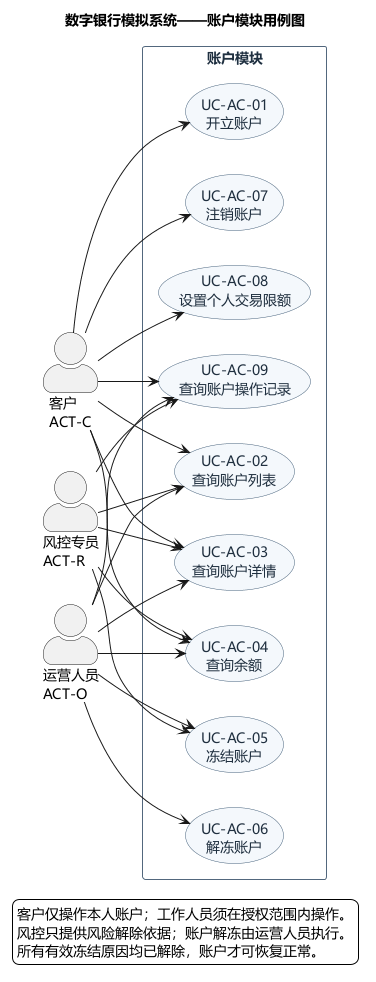
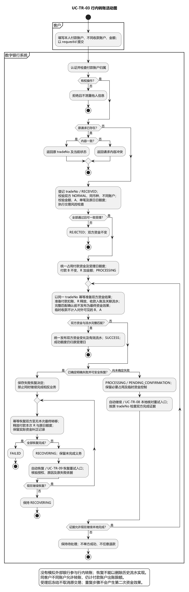

# 数字银行账户与交易模块需求分析

**实验一 S2 完整成果评审稿**

适用选题：数字银行核心业务模拟系统。整理日期：2026 年 10 月 20 日。

本稿覆盖 S2 的 E1-05—E1-08，将账户、交易的需求目录、详细用例、异常和图表整理为一份可供组内评审的材料。完整分析十八个基本用例，包含十四条用户故事、七十一条分类异常及六张 UML 图。

具体限额、账户数量、时间参数、冻结与恢复政策、优先级均为本稿提出的小组评审方案，不是教师规定或现实银行规则。验收内容为未来检查的预期结果，尚未运行银行系统测试；本稿也不声称学生人工评审或 Git 提交已经完成。

## 阅读顺序

先确认第一部分的业务规则与状态，再看第二部分的用例目录；账户内容在第三部分，四个核心交易及运营闭环在第四部分，异常与验收在第五部分。第六部分说明如何交接与评审，最后集中展示六张图。

合入课程报告时，用例目录放入 2.2，用例表和图放入 2.3，异常明细可列为附录。用户故事、状态和质量要求分别交给 S1/S4、S5、S3 对齐。整张用户故事地图和最终领域模型由相应负责人汇总。

## 依据

- 《2026版〈软件工程实验〉实验指导书》中的实验一、选题一及报告模板。
- 老师关于用户故事地图、按功能模块分别绘制用例图和编写用例表、Git 协作记录的补充公告。
- 《第三讲 需求工程》：用户故事第 57、60 页；用例图第 94—105 页；用例表第 112—120 页；活动图第 133—137 页；需求评审第 181—182 页。
- 小组《选题一 四个实验任务清单与五人分工表》中 S2 的 E1-05—E1-08。其用例与异常数量为组内目标，本文在该目标基础上完成账户模块补充和更多异常分析。

## 第一部分 需求基线与规则

本成果供数字银行模拟系统的小组需求评审使用，覆盖实验一 S2 的 E1-05—E1-08。本文给出完整且一致的课堂模拟规则，属于建议的需求基线；限额、账户数量、时间参数和优先级须由小组评审后确认，不是教师规定或现实银行规则。各文件依据此基线编写，尚未发生的评审、测试、Git 提交不表述为已完成。

### 范围和编号

账户模块九个基本用例：UC-AC-01 开立账户；02 查询账户列表；03 查询账户详情；04 查询余额；05 冻结账户；06 解冻账户；07 注销账户；08 设置个人交易限额；09 查询账户操作记录。

交易模块九个基本用例：UC-TR-01 存款；02 取款；03 行内转账；04 跨行转账；05 查询交易结果；06 查询交易流水；07 下载交易回单；08 核对待确认交易；09 重试资金恢复。前七项面向客户，08—09 面向运营人员。这十八项都是业务目标，不以校验步骤凑基本用例数量。风控、认证和权限管理的全系统目录另列协作条目，详细材料由相应负责人提供。

故事编号：US-AC-01 申请账户；02 查看账户与余额；03 管理账户冻结状态；04 关闭账户；05 调整个人限额；06 追踪账户操作。US-TR-01 存入资金；02 取出资金；03 行内付款；04 跨行付款；05 查询交易与流水；06 下载回单；07 核对未决交易；08 恢复失败交易资金。故事与用例允许多对多映射。

### 参与者和权限

ACT-C 客户：已注册登录的个人客户，仅操作本人账户，查询本人账户及其交易；可自行开户、注销符合条件的账户、设置本人限额、下载本人回单。

ACT-O 运营人员：在授权范围内查询账户、余额、操作记录、交易结果、资金流水和成功回单，冻结或解冻账户，核对待确认交易、重试已确认失败交易的资金恢复；必须填写原因并留审计。不能手工直接改余额，也不能把未知交易直接标为成功或失败。

ACT-R 风控专员：可因风险原因冻结账户、查授权账户及操作记录；风控冻结的解冻需先由风控侧记录解除风险限制的结论，再由运营人员执行。风控规则配置和告警处理属于 S3。

ACT-F 模拟资金渠道：用于存取款的教学模拟外部系统，支持受理、成功、明确失败、超时和结果查询。

ACT-B 模拟外部银行：用于跨行转账，支持受理、明确成功、明确失败、暂时未知、按唯一业务号查询结果及重复回执。

登录和角色分配由其他模块提供。风控检查是系统内部业务活动，不将内部微服务冒充整套系统的外部参与者。

### BR 业务规则

- BR-01：仅模拟人民币 CNY、虚拟资金，不计利息和手续费、不允许透支；金额必须大于 0 且小数不超过两位。客户端输入与服务端均需校验，金额计算应保持精确，技术选型留到实验二。
- BR-02：一名客户最多持有三个未注销账户，正常和冻结均计入。开户后余额、资金占用额均为 0，状态为 NORMAL；账户号唯一、不重复使用，归属客户不可变。
- BR-03：账户状态为 NORMAL 正常、FROZEN 冻结、CLOSED 注销。冻结账户禁止发起新存款、取款、转账及接收新的行内转入，但允许本人查询；已受理交易的确认、核对、资金释放继续进行，避免资金被永久占用。注销账户只能查询历史，不可恢复或复用。
- BR-04：账面余额 B、资金占用额 R、可用余额 A 满足 A=B-R，B≥0、0≤R≤B。账户冻结状态与资金占用是两件事，名称不可混用。
- BR-05：存款单笔上限 50,000 元；取款及两类转账共用出账单笔上限 10,000 元、每个付款账户每自然日出账累计上限 50,000 元。自然日按 Asia/Shanghai 的 00:00—24:00 计算。这些是课堂建议值。
- BR-06：客户为本人指定付款账户设置个人出账单笔限额 L1、日限额 Ld，默认等于系统上限；必须大于 0、不高于系统上限且 L1≤Ld。该账户个人新日限额不能低于当天已成功与已占用的合计。正常或冻结账户均可调整本人限额，但调整不解除冻结；注销账户不可调整。修改仅作用于新申请，不取消已受理交易；本稿不另做客户跨账户总额度。
- BR-07：当日已成功出账与已受理未决出账均计入其受理日的额度占用；明确失败且资金恢复完成后释放原受理日额度。跨午夜完成仍归原受理日，不转占新一天额度。不得靠并发申请超额。
- BR-08：行内转账不可向同一账户转入；同一客户的不同账户之间可转账并计入付款账户出账限额。收付款账户受理时均须正常，收款账户存在且币种一致。
- BR-09：冻结账户由运营人员或风控专员在授权范围内操作并填写原因。冻结是对新业务的限制，不改变资金所有权或已有余额；同一请求重复冻结不重复改变状态，但不同来源的有效冻结原因须分别保留。解冻由运营执行，须确认全部有效冻结原因均解除，其中风控冻结须已有风险解除依据；注销账户不可冻结、解冻。
- BR-10：客户只能注销本人正常账户，且 B=R=0，无任何以该账户为参与方的处理中、待确认或恢复中交易。校验与关闭之间不得出现新资金业务穿入。保留历史交易及操作记录。
- BR-11：所有产生资金或状态变化的请求具备业务请求标识 requestId；同一发起身份、操作类型和 requestId 对同一业务内容只能产生一次效果。同标识不同业务内容应报冲突，不能覆盖原结果。先校验身份权限，再返回重复请求的原结果或当前状态。
- BR-12：交易号 tradeNo 唯一且贯穿资金处理、外部请求、回执、流水和核对。幂等必须覆盖账户入账、扣账、占用、释放和外部请求；不能仅靠交易记录不重复就认为资金不重复。
- BR-13：存款在模拟资金渠道明确成功后，账面余额 B 增加金额并记一笔入账流水；未确认之前 B 不变、R 不变。明确失败不入账，渠道结果未知则待确认，禁止凭点击按钮或重复回执多次入账。
- BR-14：取款、行内转账、跨行转账通过校验和风控后，受理时对付款账户占用资金及额度：B 不变，R 增加金额。随后明确成功时 B 减少金额、R 同时减少金额，记扣账流水；明确失败则释放占用及额度且 B 不变。资金与额度占用必须作为一次业务效果保持一致。
- BR-15：行内转账最终成功时，付款方扣账、释放占用、收款方入账及双方流水必须匹配，不能以单方到账作为成功。双边资金与流水尚未完整匹配前，内部临时处理结果不得发布为最终资金效果，临时收款金额不计入对外可见的 B 与 A；确认匹配后才发布资金变化与有效流水，避免出现 A=B-R 允许消费临时入款的漏洞。失败时恢复到双方均未发生本次资金转移的状态。受理后账户冻结不取消已受理交易，仍按原交易继续确认。
- BR-16：跨行转账的 SUCCESS 必须同时具备外部银行明确成功依据及本地入扣账、资金占用释放、流水等完成条件；仅外部成功而本地未完成时仍为 PROCESSING 或 PENDING_CONFIRMATION，只重试本地完成，不退款、不重新发起外部付款。外部仅“已受理”或通信超时均不是成功或失败。结果未知时保持资金及额度占用，进入 PENDING_CONFIRMATION，通过查询、回执或核对收敛；禁止超时直接退款而随后又让外部入账。
- BR-17：模拟渠道或银行明确失败且确认未付款/未入账（或取消已经确认）后，才能释放资金。若资金释放失败，交易标为 RECOVERING；运营可重试同一次恢复，恢复完成后才能为 FAILED。不得重新发起外部付款来解决恢复问题。
- BR-18：同一合法回执重复到达不改变资金第二次；越权、无法关联、金额或账户不符的回执应拒绝并记录。与既有终态矛盾的回执不直接覆盖终态，不直接更改余额，进入异常审查。模拟器需保证正常协议中最终结果稳定。
- BR-19：资金流水只记录实际入账、扣账或恢复纠正的资金事件，不能修改、删除历史记录；交易尝试、拒绝、处理过程及审计事件另行保留。资金释放只改变 R 而不改变 B，不应伪造成再次存款；行内成功至少有关联的付款、收款两条资金流水。
- BR-20：运营查询、账户状态变更、限额变更、核对和恢复操作保留操作者、时间、对象、原因、结果及关联号；客户可查本人操作记录的适当内容，敏感后台信息不向客户泄露。

### 交易状态口径

| 状态 | 含义 | 资金口径 |
|---|---|---|
| RECEIVED 已接收 | 已登记身份与请求，正在校验 | 尚未产生资金变化 |
| REJECTED 已拒绝 | 业务或权限检查未通过 | 无资金或额度占用；对无权限请求不泄露他人交易 |
| PROCESSING 处理中 | 已受理并处理 | 存款未确认不入账；出账已占用资金与额度 |
| PENDING_CONFIRMATION 待确认 | 不能确定外部/业务最终结果 | 保留原占用；存款不提前入账 |
| SUCCESS 已成功 | 已获得成功依据并完成本地资金与流水处理 | 入扣账正确，出账占用已消除 |
| RECOVERING 恢复中 | 已获明确失败依据，本地释放或恢复未完成 | 仍存在未完成的占用/恢复义务，禁止冒充终结 |
| FAILED 已失败 | 受理后确认失败并完成必要恢复 | 本次资金占用为零，额度已释放，账面余额无本次转移 |

主要合法流转为 RECEIVED→REJECTED 或 PROCESSING；PROCESSING→SUCCESS / PENDING_CONFIRMATION / FAILED / RECOVERING；PENDING_CONFIRMATION→SUCCESS / FAILED / RECOVERING；RECOVERING→FAILED，恢复未完成继续保持 RECOVERING。不能把通信失败等同于业务失败。SUCCESS、FAILED、REJECTED 是终态，同笔交易不能重新开始；独立新业务必须使用新请求标识。

### NFR 质量需求

- NFR-01 权限隔离：客户不能通过修改账户号、交易号、请求标识访问他人数据；所有运营与风控操作检查授权范围。以 A/B 两客户和运营角色的越权用例验证。
- NFR-02 金额与一致性：所有资金场景保持 BR-04；重复请求、重复回执、恢复重试不产生重复资金效果；可用余额和日剩余额度不被并发申请穿透。
- NFR-03 可追溯：通过 tradeNo、requestId 能串联用例输入、交易状态、资金记录、外部结果和恢复日志；不记录密码、完整认证令牌等敏感信息。
- NFR-04 响应目标：建议在统一记录配置的课程测试机上，以十名并发模拟客户、预热一分钟后持续测试两分钟，提交申请与查询的 P95 响应时间不超过两秒；外部未决业务可返回处理中，此目标不等同于资金最终到账时限。该指标尚需评审及实际测试，不声称已达到。
- NFR-05 超时与持续核对：建议外部调用五秒未获明确结果返回待确认，自动每十秒查询一次，连续三次仍未知则进入运营待处理清单；仍可接收合法迟到回执，不自动释放资金。具体调度实现属实验二，数值为课堂建议。
- NFR-06 可解释反馈：界面区分已接收、处理中、待确认、成功、失败、恢复中，提供可查询交易号；“已接收”不能显示为“已到账”。金额和账户显示需与 S4 界面说明一致。

### 评审须确认的建议值

| 项目 | 本稿建议 | 主要对接 |
|---|---|---|
| 账户范围 | 个人 CNY、虚拟资金、最多三个未注销账户、不计费 | S1、S3、S5 |
| 账户冻结 | 禁止新收付，已受理业务继续确认与恢复 | S3、S5 |
| 系统限额与个人限额 | 采用 BR-05—07 的数值与占用口径 | S1、S3 |
| 外部模拟器 | 独立业务号、幂等受理、稳定最终结果、查询和迟到回执 | S1、S3 |
| 待确认资金 | 出账保持占用，存款不提前入账 | S1、S3、S5 |
| 时间和性能参数 | 采用 NFR-04—05 的建议值并实际验证 | S1、S4、S5 |
| 实现顺序 | 先账户与存款查询闭环，再补取款、转账、恢复功能 | S1、S4 |

来源：本地指导书中实验一、选题一和报告模板；老师关于故事地图、分模块用例与 Git 的公告；《第三讲 需求工程》中的用户故事、用例表、活动图及评审方法；组内 S2 分工表。

## 第二部分 用例清单与用户故事

本文件对应 E1-05，并给 E1-06—08 提供稳定编号。规则、角色和金额口径以《00-需求基线与规则》为准。本稿提出十八个账户与交易基本用例，另附其他模块目录供全组汇总；校验步骤和被包含的公共行为不计入十八个基本用例。

P0 表示核心业务或安全闭环优先，P1 表示管理与可靠性增强，P2 表示交互便利性增强。这是本稿的需求优先级建议；首轮实现范围另由 S1 排期，不代表全部 P0 都要在实验一编码实现。

### 一 参与者列表

| 编号 | 角色或外部系统 | 所属部门或身份 | 主要工作 |
|---|---|---|---|
| ACT-C | 个人客户 | 银行服务使用者 | 管理本人账户，办理存取转，查询本人余额、交易和流水，下载回单 |
| ACT-O | 运营人员 | 模拟银行运营部门 | 在授权范围内管理账户冻结、解冻，查询操作记录，核对待确认交易，重试已确认失败交易的资金恢复 |
| ACT-R | 风控专员 | 模拟银行风控部门 | 冻结风险账户、查询授权记录，提供风险解除依据；不直接拥有解冻权限 |
| ACT-F | 模拟资金渠道 | 外部教学模拟系统 | 提供存取款受理、明确结果、查询和回执 |
| ACT-B | 模拟外部银行 | 外部教学模拟系统 | 提供跨行转账受理、明确结果、结果查询和回执 |

运营人员和风控专员均需授权范围，不能仅凭角色名访问所有账户。管理员负责角色分配，属于其他模块协作目录。内部账户、交易、风控微服务不作为整套银行系统的外部参与者。

### 二 表 1-2 账户模块基本用例列表

| 编号 | 用例名称 | 角色 | 优先级 | 描述 |
|---|---|---|---|---|
| UC-AC-01 | 开立账户 | 客户 | P0 | 为已登录客户开立本人 CNY 模拟账户，检查未注销账户数量，生成唯一账户号 |
| UC-AC-02 | 查询账户列表 | 客户、运营人员、风控专员 | P0 | 客户查看本人账户；后台角色在授权范围内按条件查询，包含状态与脱敏信息 |
| UC-AC-03 | 查询账户详情 | 客户、运营人员、风控专员 | P0 | 查询有权访问的账户归属、币种、状态及适当信息，不泄露他人数据 |
| UC-AC-04 | 查询余额 | 客户、运营人员、风控专员 | P0 | 查询授权账户的账面余额、资金占用额和可用余额，并解释占用状态 |
| UC-AC-05 | 冻结账户 | 运营人员、风控专员 | P0 | 记录冻结来源与原因，限制账户的新资金业务，保留已受理交易的确认与恢复能力 |
| UC-AC-06 | 解冻账户 | 运营人员 | P0 | 在全部有效冻结原因已解除且有相应依据时恢复账户正常状态，保留审计 |
| UC-AC-07 | 注销账户 | 客户 | P0 | 关闭本人满足零余额、零占用、无未决业务等条件的正常账户，保留历史记录 |
| UC-AC-08 | 设置个人交易限额 | 客户 | P1 | 在系统上限内设置本人指定付款账户的出账单笔和日限额，不影响已受理业务 |
| UC-AC-09 | 查询账户操作记录 | 客户、运营人员、风控专员 | P1 | 查询本人或授权范围内的开户、冻结、解冻、注销、限额变更等记录 |

### 三 表 1-2 交易模块基本用例列表

| 编号 | 用例名称 | 角色 | 优先级 | 描述 |
|---|---|---|---|---|
| UC-TR-01 | 存款 | 客户、模拟资金渠道 | P0 | 通过渠道确认向本人正常账户存入虚拟资金，确认前不入账，成功后只记一次资金效果 |
| UC-TR-02 | 取款 | 客户、模拟资金渠道 | P0 | 核验账户、余额、限额与风控，先占用出账资金和额度，渠道明确成功后完成扣账 |
| UC-TR-03 | 行内转账 | 客户 | P0 | 在系统内两个不同正常账户之间转移资金，双方余额和流水一致后才能成功 |
| UC-TR-04 | 跨行转账 | 客户、模拟外部银行 | P0 | 向模拟外部银行付款，区分受理、明确成功、明确失败和结果未知，正确核对及恢复 |
| UC-TR-05 | 查询交易结果 | 客户、运营人员 | P0 | 按有权访问的交易号查询业务状态、资金处理状态及可执行的后续动作 |
| UC-TR-06 | 查询交易流水 | 客户、运营人员 | P0 | 按授权账户、时间和类型查询实际资金记录，行内转账的双方流水可关联追踪 |
| UC-TR-07 | 下载交易回单 | 客户、运营人员 | P2 | 为已成功且有权访问的交易生成回单，明确它是课程模拟凭证 |
| UC-TR-08 | 核对待确认交易 | 运营人员、模拟资金渠道、模拟外部银行 | P1 | 查询外部稳定结果，推进本地完成或失败恢复；不得凭超时手工认定结果 |
| UC-TR-09 | 重试资金恢复 | 运营人员 | P1 | 对已有明确失败依据的 RECOVERING 交易重试本地资金及额度恢复，完成后为 FAILED |

完整详细用例见账户、交易两份说明；账户和交易分别有用例图，四个核心交易分别有活动图。

### 四 其他模块的全系统协作目录

下表供 E1-05 合并全系统目录时使用，属于协作建议。其权限、名称和详细描述需与 S1、S3 核对，不能视为 S3 已交付的材料；不把它们算作本账户与交易模块的十八个用例。

| 建议编号 | 用例名称 | 主要角色 | 建议优先级 | 描述及责任对接 |
|---|---|---|---|---|
| UC-AU-01 | 登录系统 | 客户、运营人员、风控专员、管理员 | P0 | 提供身份认证与退出后的会话失效规则；对接身份认证负责人 |
| UC-AU-02 | 管理角色与权限 | 管理员 | P1 | 分配岗位、角色与数据授权范围；对接 S3 |
| UC-RK-01 | 配置风控规则 | 风控专员 | P1 | 管理交易检查规则、优先级与生效条件；对接 S3 |
| UC-RK-02 | 维护风险名单 | 风控专员 | P1 | 管理风险对象、原因和有效期；对接 S3 |
| UC-RK-03 | 处置风险告警 | 风控专员 | P1 | 审核风险事件，形成处理或解除限制的依据；对接 S3 |
| UC-RK-04 | 查询风险记录 | 风控专员 | P1 | 查询规则命中、处置和关联交易；对接 S3 |

### 五 可管理的用户故事和验收标准

这些故事供 S1 的 Backlog 和 S4 的故事地图使用，优先级按对应基本用例协调。这里的故事编号是提议编号，合稿时可映射到全组统一编号。

| 故事编号 | 用户故事 | 可验证的验收标准摘要 |
|---|---|---|
| US-AC-01 | 作为客户，我希望开立本人账户，以便使用模拟银行资金服务 | 未注销账户少于三个时成功开户，初始 B=R=A=0；达到三个时拒绝；重复同请求只产生一个账户 |
| US-AC-02 | 作为客户，我希望查看自己的账户与余额，以便了解可用资金 | 本人可查列表、详情、B/R/A；B=1000、R=300 时 A=700；替换他人账户号被拒绝 |
| US-AC-03 | 作为运营或风控人员，我希望管理风险账户限制，以便阻止新的风险资金活动 | 记录来源与原因并冻结；本人仍可查；已受理交易可继续确认；全部限制解除后运营才可解冻 |
| US-AC-04 | 作为客户，我希望关闭不再使用的账户，以便结束该账户服务 | B=R=0、正常且无未决交易时关闭；有待确认入款时即使 B=0 也拒绝；关闭后历史可查 |
| US-AC-05 | 作为客户，我希望设置本人付款账户的限额，以便控制出账范围 | 限额不超系统上限、单笔不高于日限额；低于当天成功与占用合计时拒绝；未决业务不被撤销 |
| US-AC-06 | 作为客户或授权后台人员，我希望追踪账户操作，以便核实状态变化原因 | 能查询适当范围的时间、操作和结果；越权不可见；重复请求不会产生重复状态效果 |
| US-TR-01 | 作为客户，我希望向本人账户存入模拟资金，以便增加余额并留下记录 | 明确成功后 B 增加一次；外部未决时 B 不变；重复成功回执不重复入账 |
| US-TR-02 | 作为客户，我希望取出模拟资金，以便减少账户余额完成取款 | 受理先占用；成功 B 减少且 R 释放；失败恢复后 B 不变；余额不足无占用 |
| US-TR-03 | 作为客户，我希望向行内另一账户付款，以便完成资金转移 | A 原有1000、B原有200，转300成功后为700和500；同账户转账被拒绝；双方未一致不得成功或消费临时入款 |
| US-TR-04 | 作为客户，我希望向模拟外部银行转账，以便完成跨行付款 | 超时保持待确认和占用；外部成功但本地未完不显示成功；明确失败且恢复完成才释放占用并终结 |
| US-TR-05 | 作为客户，我希望查询交易状态与流水，以便确认每次业务结果 | 仅显示本人可见记录；“已受理”不等于成功；交易尝试与实际资金流水可区分；资金占用不伪装扣账流水 |
| US-TR-06 | 作为客户，我希望下载成功交易的回单，以便保存模拟付款凭证 | 只有成功交易可生成；信息与交易及流水一致；标明教学模拟；越权或未决交易不可生成成功回单 |
| US-TR-07 | 作为运营人员，我希望核对待确认业务，以便让未决结果收敛 | 按原业务号查询；成功只推进本地未完成步骤；明确失败进入恢复；仍未知不能直接退款 |
| US-TR-08 | 作为运营人员，我希望重试已确认失败交易的资金恢复，以便释放客户的无效占用 | 只有 RECOVERING 且有失败依据可执行；成功后 R 与额度归还；重复重试不再次入款或重复释放 |

### 六 故事与用例映射

| 故事 | 对应用例 |
|---|---|
| US-AC-01 | UC-AC-01 |
| US-AC-02 | UC-AC-02、03、04 |
| US-AC-03 | UC-AC-05、06 |
| US-AC-04 | UC-AC-07 |
| US-AC-05 | UC-AC-08；约束 UC-TR-02、03、04 |
| US-AC-06 | UC-AC-09；追踪 UC-AC-01、05、06、07、08 |
| US-TR-01—04 | 分别对应 UC-TR-01—04 |
| US-TR-05 | UC-TR-05、06 |
| US-TR-06 | UC-TR-07 |
| US-TR-07 | UC-TR-08，并关联所有有外部或本地未决结果的核心交易 |
| US-TR-08 | UC-TR-09，并关联取款、行内转账、跨行转账的失败恢复 |

### 七 给故事地图和迭代规划的输入

故事地图建议按“使用账户、办理存取款、办理转账、查询结果”组织客户活动，运营与风控管理活动另成相应分组；横向不表示每次必须按固定顺序办理所有业务。

实现顺序建议如下，但需求分析和模型覆盖上述全部核心范围：

| 增量 | 建议范围 | 可演示结果 |
|---|---|---|
| 首个闭环 | 开户/预置账户、余额、模拟存款、交易及流水查询、基本权限与重复保护 | 从申请存款到渠道结果、账户入账及查询结果，正常和重复请求均可说明 |
| 第二步 | 取款、行内转账、冻结限制、个人与系统限额、基本风控 | 资金只转移一次，余额不足和冻结被拒绝，双方记录可核对 |
| 第三步 | 跨行模拟、待确认核对、恢复重试、回单等 | 能演示明确成功、明确失败、未知后收敛和恢复重试 |

S1 应将这些增量安排到每轮一至两周的正式 Sprint 中，选择符合团队时间的实现子集，不把上述三行机械当成三个已经确定的 Sprint。S4 负责整张故事地图，S2 提供故事及业务先后依赖；S3 提供风险规则，S5据用例建立领域模型。

## 第三部分 账户模块完整用例

> 适用项目：数字银行核心业务模拟系统。对应实验一的基本用例分析、分模块用例建模、详细用例描述和异常分析。本稿为可供小组评审的完整需求方案；其中的业务范围、数量、限额、优先级和质量目标尚需小组确认，不代表已评审、已开发或已测试。统一规则见 [00-需求基线与规则.md](./00-需求基线与规则.md)。

### 1. 模块范围与共同约定

账户模块负责开立、查询、冻结、解冻、注销个人模拟人民币账户，管理本人账户的个人出账限额并保留操作记录。登录、角色分配和风控规则配置由协作模块负责；交易模块负责存取款、转账及交易核对与资金恢复。账户模块不提供运营人员手工修改余额的功能。

#### 1.1 参与者与权限

| 编号 | 参与者 | 本模块权限 |
|---|---|---|
| ACT-C | 客户 | 开立本人账户；查询本人账户列表、详情、余额、操作记录；注销符合条件的本人账户；设置本人指定付款账户的个人出账限额 |
| ACT-O | 运营人员 | 在授权范围内查询账户、余额和操作记录；填写原因后冻结账户；核查全部冻结原因及解除依据后解冻账户 |
| ACT-R | 风控专员 | 在授权范围内查询账户、余额和操作记录；因风险原因冻结账户。风控侧记录风险解除结论后，仍由运营人员执行解冻 |

客户无直接冻结、解冻权限；运营人员和风控专员无代客户开户、注销或设置个人限额的权限。三个角色均不得越过对象授权范围。

#### 1.2 统一口径

1. 仅使用 CNY 虚拟资金；不计息、无手续费、不允许透支。所有金额保留精确的分单位，展示两位小数。
2. 每名客户最多三个未注销账户；`NORMAL` 与 `FROZEN` 均计入，`CLOSED` 不计入。账户号唯一，注销后不复用，归属不可变。
3. 账面余额为 `B`，资金占用额为 `R`，可用余额为 `A=B-R`；始终满足 `B≥0、0≤R≤B`。账户被冻结不意味着 `R=B`，也不会直接改动余额。
4. 正常账户为 `NORMAL`；冻结账户为 `FROZEN`，限制新存款、取款、转账和新的行内转入；注销账户为 `CLOSED`，只能查询历史。已受理交易的确认、核对、资金释放不因随后冻结而中断。
5. 同一账户可同时有多个有效冻结原因。全部原因均已解除且依据齐全，才可由运营人员使账户恢复 `NORMAL`；风控专员不能执行解冻。
6. 个人出账单笔限额 `L1`、日限额 `Ld` 按本人指定的付款账户设置，默认分别为 `10,000.00` 元、`50,000.00` 元，均大于零且不高于系统上限，并满足 `L1≤Ld`。日限额按 Asia/Shanghai 自然日计算。
7. 当天额度占用为该账户当天受理的已成功出账与已受理未决出账之和，包含取款、行内转账、跨行转账。明确失败且恢复完成后，释放原受理日额度；跨午夜完成仍归原受理日。降低限额不得撤销已经受理的交易。
8. 开户、冻结、解冻、注销、设置限额均要求 `requestId`。同一身份、操作类型和请求标识提交相同内容，仅产生一次业务效果；内容不同则报冲突。先校验身份和权限，再返回重复请求原结果或当前状态。
9. 每次状态或限额变更保留操作者、时间、对象、原因、结果和关联标识。查询结果按角色裁剪：客户不看到风控策略细节、他人信息或后台敏感处理记录。
10. 后文验收场景均是**待执行的验收条件**。P0/P1 为需求排序建议，P0 不代表所有功能都要在第一轮迭代实现。

#### 1.3 用例目录与用户故事映射

| 用例编号 | 基本用例 | 主要参与者 | 优先级建议 | 用户故事 |
|---|---|---|---|---|
| UC-AC-01 | 开立账户 | 客户 | P0 | US-AC-01 申请账户 |
| UC-AC-02 | 查询账户列表 | 客户；授权运营、风控 | P0 | US-AC-02 查看账户与余额 |
| UC-AC-03 | 查询账户详情 | 客户；授权运营、风控 | P0 | US-AC-02 查看账户与余额 |
| UC-AC-04 | 查询余额 | 客户；授权运营、风控 | P0 | US-AC-02 查看账户与余额 |
| UC-AC-05 | 冻结账户 | 授权运营、风控 | P0 | US-AC-03 管理账户冻结状态 |
| UC-AC-06 | 解冻账户 | 授权运营 | P0 | US-AC-03 管理账户冻结状态 |
| UC-AC-07 | 注销账户 | 客户 | P0 | US-AC-04 关闭账户 |
| UC-AC-08 | 设置个人交易限额 | 客户 | P1 | US-AC-05 调整个人限额 |
| UC-AC-09 | 查询账户操作记录 | 客户；授权运营、风控 | P1 | US-AC-06 追踪账户操作 |

用例图源文件：[账户模块用例图.puml](./diagrams/账户模块用例图.puml)。图中每个椭圆对应一个完整业务目标；校验余额、检查权限、记录审计等步骤不另算基本用例。

### 2. UC-AC-01 开立账户

| 字段 | 完整说明 |
|---|---|
| 目标 | 客户获得一个归属于本人的正常模拟人民币账户 |
| 主要参与者 | ACT-C 客户 |
| 优先级与故事 | P0；US-AC-01：作为客户，我希望开立本人的模拟银行账户，以便存入、取出和转移虚拟资金 |
| 前置条件 | 客户已注册并通过登录模块认证；具备客户身份；本次业务无需真实银行实名或银行卡绑定 |
| 触发 | 客户在账户页面确认“开立账户” |
| 输入 | `requestId`、币种 CNY；归属客户取自当前认证身份，不允许由请求指定其他客户 |
| 成功后置条件 | 新账户号唯一，归属当前客户；状态 `NORMAL`；`B=R=A=0.00`；`L1=10,000.00、Ld=50,000.00`；开户操作记录可追溯；未注销账户总数不超过三个 |
| 最小保证 | 失败或重复提交不产生额外账户，不产生资金流水；结果暂未收到时可使用原请求标识重试 |
| 业务规则 | BR-01、02、04、06、11、20；账户数量校验与开户生效构成不可被并发穿透的一次业务判定 |
| 质量要求 | NFR-01 权限隔离、NFR-02 并发与幂等、NFR-03 可追溯、NFR-04 响应目标、NFR-06 反馈明确 |

主事件流：

1. 客户进入账户页面并选择开立 CNY 账户，系统展示适用范围、账户数量限制和初始状态。
2. 客户确认提交，系统检查登录身份及开户权限，并检查本次请求是否已处理。
3. 系统核定该客户当前未注销账户数量，将正在竞争的开户请求纳入同一数量限制判定。
4. 未达到三个时，系统分配不重复的账户号，建立归属当前客户的账户，设定零余额、正常状态和默认限额。
5. 系统保存本次请求的业务结果及开户操作记录，返回账户号、币种、状态与开户时间。
6. 客户刷新账户列表，可以查询到该账户。该操作只建立账户，不产生“存款”流水。

扩展与异常：

- **A1 未登录或身份不具备客户权限：**停止开户，不返回其他客户的账户信息。
- **A2 已有三个未注销账户：**拒绝开户，提示当前数量及上限。冻结账户仍占名额，历史注销账户不占名额。
- **A3 并发开户争抢最后一个名额：**例如原有两个账户时两个请求同时到达，最多一个成功；另一个收到数量已达上限的业务结果。
- **A4 重复请求或同标识不同内容：**相同内容返回首次开户结果；原请求为 CNY 而相同标识改为其他内容时报告冲突，不创建新账户。
- **A5 保存失败或返回中断：**未生效时不得留下可被使用的半个账户；若开户已生效但响应丢失，原请求重试返回同一账户。

验收场景：

- **AC01-1 正常开户：**客户甲原有一个未注销账户；提交合法新请求后账户总数为二，新账户 `NORMAL、B=R=A=0.00`，两项限额为默认值。
- **AC01-2 并发边界：**客户甲原有两个未注销账户，同时发送两个不同请求；最终总数恰为三，只新增一个账户，另一个拒绝。
- **AC01-3 冻结计数：**甲有两个正常账户、一个冻结账户；再开户被拒绝，不能因冻结而获得第四个名额。
- **AC01-4 幂等与权限：**原开户请求重复三次返回同一账户号；客户乙尝试携带甲的客户标识时，不能在甲名下开户或读取甲的原请求结果。

### 3. UC-AC-02 查询账户列表

| 字段 | 完整说明 |
|---|---|
| 目标 | 查看本人或授权范围内的账户集合，定位要操作或查看的账户 |
| 主要参与者 | ACT-C；ACT-O、ACT-R 在授权范围内查询 |
| 优先级与故事 | P0；US-AC-02：作为账户使用者，我希望看到可访问的账户及状态，以便选择正确的账户继续业务 |
| 前置条件 | 已登录；系统能够识别当前身份及对象授权范围 |
| 触发 | 进入“我的账户”，或授权工作人员发起账户检索 |
| 输入 | 状态筛选（默认未注销，可显式选择历史注销账户）、分页信息；工作人员可输入授权范围内客户或账户检索条件及查询事由 |
| 成功后置条件 | 返回授权范围内匹配的账户编号、币种、状态与开户时间；展示未注销账户数量；未改变任何账户与资金状态 |
| 最小保证 | 无匹配结果返回空列表；无权限请求不泄露账户是否存在及所属客户 |
| 业务规则 | BR-02、03、20；客户查询范围始终由当前身份限定；运营查询保留操作者、对象范围、事由与结果 |
| 质量要求 | NFR-01 权限隔离、NFR-03 查询审计、NFR-04 响应目标、NFR-06 状态可解释 |

主事件流：

1. 参与者打开账户列表。客户默认查看本人未注销账户；工作人员先提供授权查询条件和事由。
2. 系统校验身份、对象范围和筛选参数，并将检索范围限定在本次授权之内。
3. 系统检索符合条件的账户，以开户时间倒序、账户号作为同时间次序依据稳定分页。
4. 系统返回账户标识、CNY 币种、状态、开户时间和结果条数；需要显示账户号的界面按角色采取适当展示。
5. 客户可切换“历史已注销”筛选；工作人员的查询记录进入审计。参与者选择账户后可另行执行详情或余额查询。

扩展与异常：

- **A1 客户尚无账户或筛选无结果：**返回空列表和可理解的提示，不将空列表当成系统故障。
- **A2 篡改客户检索条件或越权工作人员检索：**拒绝越权请求，不返回他人账户条目、数量或存在性线索。
- **A3 分页大小、状态值等参数非法：**明确提示参数错误，不用未受控的大范围查询替代。
- **A4 查询过程中账户状态变化：**本次结果附查询时间；下一次查询反映新状态，后续写操作仍重新检查实时状态，不能凭旧列表绕过冻结。
- **A5 数据服务暂不可用：**报告查询未完成并允许重试，不能用“无账户”冒充查询失败。

验收场景：

- **AC02-1 状态筛选：**甲有正常、冻结、注销账户各一；默认返回前两者且未注销数为二，选择历史筛选可查到注销账户。
- **AC02-2 对象隔离：**甲传入乙的客户标识或越权账户筛选值，响应不含乙的账户或条目数。
- **AC02-3 空结果：**新注册客户查询得到空列表及零个未注销账户，可以继续发起开户。
- **AC02-4 授权工作人员：**授权运营可查分配范围内客户列表并留下查询事由；超出范围的检索被拒绝。

### 4. UC-AC-03 查询账户详情

| 字段 | 完整说明 |
|---|---|
| 目标 | 查看单个账户的业务资料、状态及适用限制 |
| 主要参与者 | ACT-C；ACT-O、ACT-R 在授权范围内查询 |
| 优先级与故事 | P0；US-AC-02 查看账户与余额 |
| 前置条件 | 已登录；目标账户存在且对当前身份可访问 |
| 触发 | 从账户列表选择账户，或工作人员按账户号打开详情 |
| 输入 | 账户号；工作人员查询事由 |
| 成功后置条件 | 返回账户号、归属的适当信息、币种、开户时间、状态、个人出账限额；冻结状态显示角色可见的限制说明，注销账户显示注销时间；不改变任何数据 |
| 最小保证 | 越权或不可访问对象不返回敏感信息；账户详情未加载成功时不显示为正常账户 |
| 业务规则 | BR-02、03、06、09、20；客户可查询冻结与注销账户；详细风险规则和他人信息按角色隐藏 |
| 质量要求 | NFR-01 对象授权、NFR-03 可追溯、NFR-04 响应目标、NFR-06 状态与限制反馈 |

主事件流：

1. 参与者选择目标账户，工作人员同时填写查询事由。
2. 系统校验身份及账户对象权限，读取账户业务资料。
3. 系统整理状态及适用限制：正常账户可申请新业务；冻结账户限制新收付；注销账户只保留历史查询。
4. 系统按角色裁剪归属信息、冻结原因和后台处理信息，返回详情和查询时间。
5. 参与者可继续查询余额、操作记录或发起其有权限的其他业务。按钮可见性不替代服务端权限与实时状态校验。

扩展与异常：

- **A1 账户不存在或当前身份无权访问：**使用不泄露他人账户存在性的反馈，不返回归属信息。
- **A2 多个冻结原因同时存在：**展示账户仍冻结及允许当前角色看到的原因摘要，不能仅显示最新一条原因造成误判。
- **A3 账户已注销：**展示历史详情和注销时间，不提供重新激活或复用账户号的操作。
- **A4 状态与冻结依据读取不一致或服务故障：**报告本次详情未能完整获取，不能把缺失冻结依据解释成可交易。
- **A5 以详情页旧状态发起业务：**写操作重新核验状态；详情页曾显示正常不能作为绕过后续冻结的依据。

验收场景：

- **AC03-1 正常资料：**甲打开本人正常账户，看到 CNY、开户时间、`NORMAL` 及当前个人限额；详情查询不新增资金流水。
- **AC03-2 冻结脱敏：**同一冻结账户，客户看到可理解的交易限制，授权风控看到其授权范围内的风险依据；客户不能获取后台策略细节。
- **AC03-3 注销历史：**已注销账户可被本人查看，但不能从详情发起资金业务或恢复账户。
- **AC03-4 状态变动：**甲打开正常账户详情后账户被冻结，甲再提交取款，交易模块依据当前冻结状态拒绝申请。

### 5. UC-AC-04 查询余额

| 字段 | 完整说明 |
|---|---|
| 目标 | 清楚区分账面余额、资金占用额与可用余额，避免误以为全部账面余额都可再次支出 |
| 主要参与者 | ACT-C；ACT-O、ACT-R 在授权范围内查询 |
| 优先级与故事 | P0；US-AC-02 查看账户与余额 |
| 前置条件 | 已登录；目标账户可访问；余额记录可读 |
| 触发 | 参与者打开或刷新余额页面 |
| 输入 | 账户号；工作人员查询事由 |
| 成功后置条件 | 返回同一业务读取时点的 `B、R、A`、币种、账户状态与查询时间；满足 `A=B-R`，无余额或状态变化 |
| 最小保证 | 查询失败、读取不一致时不显示未经确认的余额为可消费金额；越权请求无他人金额信息 |
| 业务规则 | BR-03、04、14—17、20；冻结不等同于资金占用；冻结账户仍可查余额，注销历史账户应为零余额 |
| 质量要求 | NFR-01 权限隔离、NFR-02 余额一致性、NFR-03 查询审计、NFR-04 响应目标、NFR-06 准确标注 |

主事件流：

1. 参与者选择账户并发起余额查询。
2. 系统校验登录身份、对象权限及工作人员查询事由。
3. 系统取得一致读取口径的账面余额与资金占用额，计算可用余额，读取相应账户状态。
4. 系统以元和两位小数展示 `B、R、A`，注明查询时间与“当前账户状态”。
5. 若账户冻结，另行提示新收付受限；若有未决出账，解释资金占用并提供查询相应交易的入口，不能把占用称为再次扣款。

扩展与异常：

- **A1 越权账户号：**拒绝查询，不返回任何一个余额字段或关联交易信息。
- **A2 存在待确认交易：**如 `B=1,000.00、R=300.00`，显示 `A=700.00`，不得将 `B` 当作可用金额。
- **A3 账户被冻结：**继续返回合法余额并标注冻结；`R` 保持实际资金占用值，不能自动设为全部余额。
- **A4 读到负余额、`R>B` 或拼接结果不一致：**本次查询失败并登记一致性异常，不展示错误的可消费余额，不自行修正账目。
- **A5 页面结果已过时：**允许刷新；后续取款、转账按受理时的资金与额度校验，不能保证页面查询金额一直有效。

验收场景：

- **AC04-1 占用口径：**账户 `B=1,000.00、R=300.00`，查询必须得到 `A=700.00`，三个值对应同一业务读取时点。
- **AC04-2 冻结与占用分离：**上述账户被冻结后再次查询仍为 `1,000.00/300.00/700.00`，另有冻结限制提示。
- **AC04-3 恢复后刷新：**原 300.00 元交易明确失败并完成释放，刷新得到 `B=1,000.00、R=0.00、A=1,000.00`，不新增一笔“存款”流水。
- **AC04-4 数据隔离：**乙不能通过替换账户号查询甲的金额；授权运营查询可追溯到操作者及事由。

### 6. UC-AC-05 冻结账户

| 字段 | 完整说明 |
|---|---|
| 目标 | 阻止风险账户继续受理新收付业务，并保留可审计的冻结原因 |
| 主要参与者 | ACT-O 运营人员；ACT-R 风控专员 |
| 优先级与故事 | P0；US-AC-03：作为授权工作人员，我希望根据明确原因限制账户新业务，以便控制风险并保留处理依据 |
| 前置条件 | 工作人员已登录且具备目标账户的冻结权限；账户未注销；存在具体可记录的冻结原因 |
| 触发 | 工作人员确认冻结目标账户 |
| 输入 | `requestId`、账户号、原因类别、具体原因及相应业务或风险依据；操作者与来源由认证身份确定 |
| 成功后置条件 | 账户为 `FROZEN`；本次有效冻结原因被独立保存；新收付受限；`B、R、A` 不因冻结本身改变；已有交易继续核对、完成或恢复 |
| 最小保证 | 未授权、原因缺失、账户注销时不改变状态；重复请求不增加同一冻结原因或重复效果 |
| 业务规则 | BR-03、04、09、11、20；不同来源的有效冻结原因叠加保留，账户已冻结也可登记新的有效原因 |
| 质量要求 | NFR-01 角色及对象权限、NFR-02 幂等与业务边界一致性、NFR-03 审计、NFR-06 限制反馈 |

主事件流：

1. 授权工作人员打开目标账户，查看当前状态和其有权查看的有效冻结原因。
2. 工作人员填写本次冻结原因及依据，确认提交。
3. 系统校验角色、对象授权、原因有效性及请求幂等；确认账户不是 `CLOSED`。
4. 系统保存本次有效冻结原因，使账户保持或进入 `FROZEN`，并明确冻结生效的业务顺序边界。
5. 自冻结生效后，系统不再受理该账户新的存款、取款、转账及新的行内转入；冻结前已受理的交易仍继续确认、核对和资金恢复。
6. 系统保存操作者、来源、原因、状态前后值、时间及请求关联号，返回冻结状态和本次处理结果。

扩展与异常：

- **A1 客户、越权工作人员发起冻结：**拒绝执行，不可通过隐藏的接口绕过角色或对象权限。
- **A2 未填原因或目标已注销：**拒绝并说明合法的业务原因；不建立有效冻结记录。
- **A3 相同请求重试：**返回原处理结果；不再新增一条相同冻结原因，不重复改变状态。
- **A4 账户已有其他来源冻结：**保留既有原因，再独立添加本次原因；账户继续冻结。不能用“已冻结”忽略新的有效风险依据。
- **A5 与新交易并发：**在业务顺序上先受理的交易继续完成；冻结先生效的，新申请被拒绝。不得出现已占款却因冻结永久停止恢复的情况。

验收场景：

- **AC05-1 余额不变：**账户 `B=1,000.00、R=300.00`，冻结后仍为 `1,000.00/300.00/700.00`，新取款与新行内转入均被拒绝。
- **AC05-2 旧交易继续：**跨行转账 300.00 元在冻结前已受理，冻结后收到合法失败依据，仍可完成释放，账户保持冻结且 `R` 降为零。
- **AC05-3 多原因：**运营冻结后风控以另一有效原因再次冻结，两个原因均保留；仅消除运营原因不能使账户变正常。
- **AC05-4 幂等：**同一合法冻结请求重复提交三次，只存在一项本请求产生的有效冻结原因及一次业务变更效果，重试审计可另行保留。

### 7. UC-AC-06 解冻账户

| 字段 | 完整说明 |
|---|---|
| 目标 | 在全部有效冻结原因均解除后，由运营人员恢复账户受理新业务的资格 |
| 主要参与者 | ACT-O 运营人员；风控专员提供其职责内的风险解除依据，不执行账户解冻 |
| 优先级与故事 | P0；US-AC-03 管理账户冻结状态 |
| 前置条件 | 运营人员已登录并在目标账户授权范围内；目标为冻结账户；可核验全部有效冻结原因及相应解除依据 |
| 触发 | 运营人员完成核查并确认解冻 |
| 输入 | `requestId`、账户号、解冻原因、被冻结原因的解除依据；存在风控冻结时必须关联风控侧风险解除结论 |
| 成功后置条件 | 已核验全部有效冻结原因解除，账户从 `FROZEN` 变为 `NORMAL`；保留冻结历史与解冻审计；余额、资金占用与既有交易状态不因解冻改变 |
| 最小保证 | 有任一原因未解除、依据缺失、越权或账户已注销时，不能恢复为正常；不得把“已登记部分解除材料”显示为“账户已解冻” |
| 业务规则 | BR-03、04、09、11、20；风险解除依据不是风控专员的直接解冻权限；状态判定须覆盖并发新增冻结原因 |
| 质量要求 | NFR-01 权限隔离、NFR-02 并发与幂等、NFR-03 解除依据可追溯、NFR-06 明确结果 |

主事件流：

1. 运营人员打开冻结账户，查看其当前全部有效冻结原因。
2. 运营人员取得相应解除材料；对于风险原因，核验风控侧记录的风险解除结论与目标账户、原因的关联。
3. 运营人员填写解冻原因和依据，提交解冻请求。
4. 系统校验运营角色、对象授权和请求幂等，核对当前账户及全部有效冻结原因。
5. 确认全部原因均解除，且判定过程中没有未处理的新有效冻结原因后，系统将账户状态设为 `NORMAL`。
6. 系统保留冻结、解除与解冻历史，返回成功结果；后续新业务仍需通过余额、额度与风控等检查。

扩展与异常：

- **A1 客户或风控专员直接解冻：**拒绝执行，即使风控专员提交了风险解除结论，也不能代替运营权限。
- **A2 仍有有效冻结原因：**保持冻结，告知授权运营尚未解除的原因；不得以清除某一条原因替代全账户条件检查。
- **A3 风控原因缺少解除依据，或依据属于其他账户：**拒绝解冻，记录核查失败结果。
- **A4 账户已正常或已注销：**原请求已成功重试时返回原结果；新的请求面对正常账户提示无需解冻，面对注销账户拒绝，均不产生虚构的状态变化。
- **A5 解冻与新增冻结原因并发：**按可解释的业务先后顺序处理。若新冻结先成立，则本次解冻不能遗漏它；若解冻先完成而后新增冻结成立，最终应为冻结，响应包含本次结果及可查询的当前状态。

验收场景：

- **AC06-1 全部解除：**账户有运营与风控两个原因，二者均有有效解除依据；授权运营解冻成功，账户 `NORMAL`，原余额和 `R` 不变。
- **AC06-2 部分解除：**只有运营原因解除，风险原因未解除；提交解冻后仍为 `FROZEN`，能在审计中定位未满足的依据。
- **AC06-3 权限边界：**风控专员提交相同有效材料，直接解冻仍被拒绝；运营核验后才可执行。
- **AC06-4 重试与新增原因：**解冻成功后原请求重试不新增解冻效果；若此后出现新有效冻结原因，原请求重试不能清除新原因，当前状态仍为 `FROZEN`。

### 8. UC-AC-07 注销账户

| 字段 | 完整说明 |
|---|---|
| 目标 | 客户永久关闭无余额、无占用且无未决业务的本人正常账户 |
| 主要参与者 | ACT-C 客户 |
| 优先级与故事 | P0；US-AC-04：作为客户，我希望关闭不再使用且已结清业务的账户，以便整理账户并释放持有名额 |
| 前置条件 | 客户已登录；账户归本人且为 `NORMAL`；`B=R=0.00`；没有以该账户为收款方或付款方的处理中、待确认、恢复中等未终结资金业务 |
| 触发 | 客户查看注销影响后确认注销 |
| 输入 | `requestId`、账户号、注销确认；客户身份取自登录会话 |
| 成功后置条件 | 状态为 `CLOSED`，保留注销时间与操作记录；不可恢复、不可复用账户号；历史交易及操作记录继续可查；未注销账户数减少一个 |
| 最小保证 | 任一条件不满足时账户保持原状，不清空余额、不取消未决交易；条件校验与关闭生效间不能插入新资金业务 |
| 业务规则 | BR-02、03、04、10、11、20；未决检查覆盖入账和出账，不能只检查 `R=0` |
| 质量要求 | NFR-01 归属校验、NFR-02 并发关闭边界与幂等、NFR-03 保留历史、NFR-06 永久关闭提示 |

主事件流：

1. 客户选择本人正常账户，阅读不可恢复、历史保留等注销说明并确认。
2. 系统校验身份、归属和请求幂等。
3. 系统核验实时状态、`B=R=0.00`，并检查所有以该账户为参与方的未终结资金业务，包括未确认存款和作为收款方的处理中转账。
4. 系统在同一业务关闭判定中阻止新的资金业务穿入，确认可关闭后设为 `CLOSED`，登记注销时间。
5. 系统保存请求结果与注销审计，保留历史交易和账户号。
6. 客户看到注销结果；在历史账户中仍可查看账户与交易，新增开户按未注销账户数量重新判断。

扩展与异常：

- **A1 非本人或工作人员代客户注销：**拒绝，不泄露账户余额与未决业务详情。
- **A2 存在余额或资金占用：**拒绝关闭，提示先按正规业务结清；系统不能自动抹零、转走资金或直接释放占用。
- **A3 `B=R=0` 但存在未决入账：**如存款渠道结果未知，仍拒绝关闭；需等待结果核对与本地处理完成。
- **A4 冻结账户或已注销账户：**冻结时拒绝，须按本稿流程解除全部原因后再评估；已注销的原请求返回原结果，新的关闭请求仅提示已注销。
- **A5 并发新交易与关闭：**业务先受理则关闭失败，关闭先生效则新申请被拒绝。不能产生“已注销但仍新受理资金业务”的状态。

验收场景：

- **AC07-1 正常关闭：**本人正常账户 `B=R=0` 且无未决业务，关闭后 `CLOSED`，账户号不复用，历史记录可查，持有名额减少一个。
- **AC07-2 未决零余额：**账户 `B=R=0`，有一笔待确认存款；注销被拒绝。该存款明确失败且处理完成后才重新评估注销。
- **AC07-3 收款方检查：**目标账户作为一笔未终结行内转账的收款方，即使尚未记账且 `B=R=0`，也不能注销。
- **AC07-4 并发互斥：**对空账户同时发起注销和存款申请；结果只能是先受理存款而拒绝注销，或先注销而拒绝存款，不能两者同时生效。

### 9. UC-AC-08 设置个人交易限额

| 字段 | 完整说明 |
|---|---|
| 目标 | 客户在系统上限之内调整本人指定付款账户的新出账申请限额 |
| 主要参与者 | ACT-C 客户 |
| 优先级与故事 | P1；US-AC-05：作为客户，我希望降低或调整账户个人出账限额，以便控制新取款与转账的资金风险 |
| 前置条件 | 已登录；目标为本人未注销账户。冻结状态下可以调整个人限额，但调整不解除冻结或允许新资金业务 |
| 触发 | 客户在限额页面确认保存新限额 |
| 输入 | `requestId`、账户号、新单笔限额 `L1`、新日限额 `Ld`；金额以元为单位、小数不超过两位 |
| 成功后置条件 | `0<L1≤10,000.00`，`0<Ld≤50,000.00`，`L1≤Ld`；新 `Ld` 不低于该账户当天已成功及已占用出账合计；保存生效时间与变更记录；只作用于后续新申请 |
| 最小保证 | 非法、越权、额度口径无法确认或并发条件不满足时保留原限额；不取消已受理交易，不改变 `B、R、A` |
| 业务规则 | BR-01、05—07、11、20；取款及两类转账共用出账限额；跨午夜交易计入原受理日；恢复完成才释放原日额度 |
| 质量要求 | NFR-01 本人权限、NFR-02 金额/并发/幂等、NFR-03 限额变更审计、NFR-06 生效范围说明 |

主事件流：

1. 客户选择本人未注销账户，系统展示当前限额、系统上限、当天已成功和未决占用合计以及时间口径。
2. 客户填写 `L1、Ld`，确认仅影响后续新申请。
3. 系统校验身份、归属、请求幂等、金额格式、系统上限和 `L1≤Ld`。
4. 系统按 Asia/Shanghai 的受理自然日计算当天已成功与已占用额度，确认新日限额不低于该合计。
5. 系统将额度校验、限额生效和并发新交易受理纳入一致业务判定，保存新限额及旧值、时间和请求关联号。
6. 系统返回限额及生效结果；既有受理交易继续按原受理条件确认或恢复，新申请采用新限额。

扩展与异常：

- **A1 非本人、已注销或越权工作人员修改：**拒绝，不改变限额；后台管理人员不能用本用例代替客户设置。
- **A2 零值、负值、超过两位小数、超系统上限或 `L1>Ld`：**拒绝并指出相应字段；不得静默截断、四舍五入或放大权限。
- **A3 新日限额小于当天合计：**如已成功 8,000.00 元、占用 2,000.00 元，新日限额 9,000.00 元被拒绝。
- **A4 并发新出账：**若交易先受理，其占用计入本次限额检查；若新限额先生效，交易按新限额受理，不得两边都按旧数据放行。
- **A5 重复与冲突：**同请求同限额只保存一次业务变更；同请求改成另一组限额返回冲突。已受理交易超过新单笔限额也不追溯取消。

验收场景：

- **AC08-1 合法降额：**当天合计 10,000.00 元，设置 `L1=3,000.00、Ld=12,000.00` 成功；后续 3,500.00 元新出账被拒绝，2,000.00 元仍须通过余额与其他检查。
- **AC08-2 下边界：**当天合计 10,000.00 元，新 `Ld=10,000.00` 可保存；`Ld=9,999.99` 拒绝，原限额保留。
- **AC08-3 原交易不撤销：**已有一笔 5,000.00 元交易受理且未决，将 `L1` 降至 3,000.00 元且日限额满足条件，不取消原交易、不释放原占用。
- **AC08-4 日期与冻结：**昨日受理未决交易今日继续占用资金，但额度仍归昨日；今日限额检查按今日受理合计。冻结账户可改限额，但改后仍不能申请新资金业务。

### 10. UC-AC-09 查询账户操作记录

| 字段 | 完整说明 |
|---|---|
| 目标 | 追踪账户开户、状态、限额及授权处理的时间和结果，支持客户理解账户变化与工作人员审计 |
| 主要参与者 | ACT-C；ACT-O、ACT-R 在授权范围内查询 |
| 优先级与故事 | P1；US-AC-06：作为客户或授权工作人员，我希望查询账户操作记录，以便理解并核对账户变化 |
| 前置条件 | 已登录；目标账户在当前身份可访问范围内；历史记录保留 |
| 触发 | 打开“账户操作记录”并提交筛选条件 |
| 输入 | 账户号、起止时间、操作类型、处理结果、分页；授权工作人员可按请求关联号检索并填写查询事由 |
| 成功后置条件 | 返回授权可见的操作时间、类型、对象、原因摘要、结果和关联标识；工作人员看到其授权范围内的操作者与必要证据；历史不被修改 |
| 最小保证 | 空结果如实返回；越权不泄露；查询失败不伪造成“从未发生操作”；无修改、删除记录能力 |
| 业务规则 | BR-11、19、20；操作审计和资金流水分开；客户只见适当内容，密码、完整令牌和后台敏感信息不进入输出 |
| 质量要求 | NFR-01 权限与脱敏、NFR-03 可追溯、NFR-04 响应目标、NFR-06 结果表达 |

主事件流：

1. 参与者打开目标账户的操作记录页面，填写时间、类型等条件；工作人员同时提交查询事由。
2. 系统校验身份、对象范围、时间区间与分页条件。
3. 系统检索开户、冻结、原因解除及解冻、注销、个人限额变更和授权后台处理等适用记录；与交易处理有关时保留可追溯关联号。
4. 系统按操作时间倒序、记录标识作为同时间次序依据稳定返回结果，并按角色裁剪操作者和原因敏感内容。
5. 参与者查看具体记录或按允许条件继续筛选。查询行为自身按审计要求记录，不能修改被查询的历史记录。

扩展与异常：

- **A1 越权账户号或关联号：**拒绝，不因关联号全局唯一而跨客户或跨授权范围返回记录。
- **A2 时间范围倒置、非法类型或分页参数：**提示修正条件，不扩大检索范围。
- **A3 无匹配记录：**显示筛选范围内无记录，区别于系统异常或审计数据读取失败。
- **A4 记录包含风控敏感依据：**对客户仅显示允许的摘要；授权风控或运营仍按最小必要原则查看。
- **A5 重复请求产生多个访问日志：**可展示多次请求尝试，但必须区分“请求次数”与“一次业务效果”，不能把重试解释成多次开户或多次解冻。

验收场景：

- **AC09-1 状态追踪：**账户先开户、后冻结、后解冻，按时间查询可还原这三项业务效果及关联请求，原冻结记录仍保留。
- **AC09-2 限额审计：**限额从 `10,000.00/50,000.00` 改为 `3,000.00/12,000.00`，授权审计能定位旧值、新值、操作者、时间和结果。
- **AC09-3 历史与隔离：**本人已注销账户仍能查历史；乙不能靠甲的账户号或请求关联号获得甲的记录。
- **AC09-4 不混淆流水：**冻结、解冻、限额变更可在操作记录中查询，但不会因此产生存款、扣款或资金恢复流水。

### 11. 账户异常场景汇总

本表用于与交易模块、风控模块共同检查业务边界。资金状态栏表达处理完成后或拒绝时应保持的资金口径，不代表已执行测试。

| 编号 | 关联用例与触发 | 系统处理 | 资金/账户状态 | 验证要点 |
|---|---|---|---|---|
| EX-AC-01 | AC01：客户已有三个正常或冻结账户再次开户 | 拒绝并给出数量上限提示 | 不新增账户，不产生资金流水 | 冻结也占名额，注销不占名额 |
| EX-AC-02 | AC01：已有两户，两个不同请求并发开户 | 最多一个成功，另一个因数量上限失败 | 最终未注销总数不超过三，新账户余额为零 | 并发请求不会得到两个有效新账户 |
| EX-AC-03 | AC01/05/06/07/08：同身份同操作同请求标识重复 | 返回原结果或当前状态，不重做业务 | 状态与资金仅产生原有一次效果 | 重试响应与首次业务号一致，审计可区分尝试次数 |
| EX-AC-04 | AC01/05/06/07/08：同请求标识改业务内容 | 报请求冲突，不覆盖原结果 | 账户、限额、资金保持原处理结果 | 变更账户号、原因或限额都不能冒充原请求 |
| EX-AC-05 | AC02/03/04/09：客户替换成他人账户号或关联号 | 权限校验失败，返回不泄露存在性的反馈 | 他人账户和资金不受影响 | 无账户归属、金额、条目数、请求结果泄漏 |
| EX-AC-06 | AC04：余额与占用读取结果不满足 `0≤R≤B` | 查询失败并登记一致性异常，不自动改账 | 不展示错误可用余额，不更改资金 | 不能将故障显示成零余额或正常可用余额 |
| EX-AC-07 | AC05：缺少原因、越权或注销账户被冻结 | 拒绝状态变更，记录适当审计 | 原状态、`B/R/A` 不变 | 冻结只有运营、风控且必须在对象授权范围 |
| EX-AC-08 | AC05：冻结账户收到新来源的有效冻结原因 | 添加独立原因，保留原原因 | 保持 `FROZEN`；资金不因冻结变化 | 两个原因均可追溯，不能只保留最后一条 |
| EX-AC-09 | AC05：冻结与新取款/转账/行内转入并发 | 按受理与冻结先后判定，冻结生效后不再受理新业务 | 冻结前已受理占用继续确认/恢复 | 无冻结后新受理，也无旧交易永久卡死 |
| EX-AC-10 | AC06：仍有一个有效原因未解除 | 拒绝全账户解冻，保留未解除原因 | 保持 `FROZEN`；`B/R/A` 不变 | 部分原因解除不能恢复正常 |
| EX-AC-11 | AC06：风控直接解冻或运营缺少风险解除依据 | 拒绝并记录权限/依据不满足 | 保持 `FROZEN` | 风控结论与运营执行角色边界清晰 |
| EX-AC-12 | AC06：成功解冻后新增冻结，旧解冻请求再次重试 | 返回原业务结果及可查询当前状态，不重做解冻 | 新冻结继续有效 | 旧请求不能清除后来的原因 |
| EX-AC-13 | AC07：注销时账面余额大于零或有占用 | 拒绝，提示按正常业务结清 | 不抹零、不转移、不直接释放资金 | `B>0` 或 `R>0` 均不能关闭 |
| EX-AC-14 | AC07：`B=R=0`，但存在待确认存款或未决收款 | 拒绝，待相关交易收敛后再评估 | 账户不关闭，原交易继续处理 | 检查以账户为任一参与方的未终结交易 |
| EX-AC-15 | AC07：关闭与新资金业务同时发生 | 二者按业务顺序互斥，不能都生效 | 先受理业务则不关闭；先关闭则不受理 | 校验与关闭之间无业务穿入窗口 |
| EX-AC-16 | AC08：非法金额、超上限或 `L1>Ld` | 指出错误并保留旧限额 | `B/R/A` 不变 | 不静默截断小数，不放大系统上限 |
| EX-AC-17 | AC08：新日限额小于当天成功与占用合计 | 拒绝变更；如并发新业务先受理，一并计入 | 旧限额、已受理交易与占用保留 | 例：8,000 成功+2,000 占用时不能降到9,000 |
| EX-AC-18 | AC08：跨午夜存在昨日受理的未决交易 | 今日限额按今日受理合计，昨日占用仍归昨日 | 资金占用持续，额度不转占今日 | 不因换日释放资金，也不把昨日业务计两天 |
| EX-AC-19 | AC09：账户注销后查询操作历史 | 允许本人/授权角色查询，禁止修改删除 | `CLOSED` 不恢复，无资金变化 | 注销不删除开户、冻结、限额及关联记录 |
| EX-AC-20 | 任一查询：数据服务异常或读取未完成 | 返回查询未完成并允许重试 | 不更改账户，不伪造空数据/正常状态 | 区分空结果与故障；不回传内部敏感错误 |

### 12. 状态边界与组员交接

#### 12.1 账户状态判定

| 当前状态 | 允许的账户状态变化 | 约束 |
|---|---|---|
| 尚无账户 | 开户后为 `NORMAL` | 当前未注销数量不足三，并发判定不穿透 |
| `NORMAL` | 冻结为 `FROZEN`；满足结清条件时注销为 `CLOSED` | 冻结保留原因，注销必须无余额、无占用、无未决交易 |
| `FROZEN` | 全部原因解除后由运营解冻为 `NORMAL` | 可叠加新的有效原因；不能直接注销；旧交易继续确认与恢复 |
| `CLOSED` | 无恢复或复用转换 | 只保留适当历史查询 |

账户状态与交易状态分别管理。`FROZEN` 不等于交易失败，`R>0` 不等于账户冻结，`B=0` 也不证明不存在未决交易。

#### 12.2 对接事项

| 对接对象 | 本稿明确提供 | 需共同评审与落实 |
|---|---|---|
| S1 需求与迭代负责人 | 九项基本用例、六项故事映射、P0/P1建议与验收条件 | 放入全系统用例清单和用户故事地图；确定迭代切片及需求版本 |
| S3 风控与安全负责人 | 冻结原因叠加、风险解除依据、风控不能直接解冻、对象权限要求 | 风控结论如何关联账户与原因；客户可见摘要及工作人员授权范围 |
| S4 界面负责人 | 正常/冻结/注销说明，余额三字段，限额与未决提示 | 每个入口对应业务权限；显示查询时点、幂等请求反馈和当前状态 |
| S5 领域模型与集成负责人 | 账户归属、余额/占用/状态分离、原因历史、操作记录、并发业务不变量 | 在领域模型表达这些概念与职责；不把本稿直接当作数据库表结构 |
| 交易模块负责人 | 受理前状态校验、占用/扣账/释放口径、注销未决检查范围 | 覆盖存款和收付款两端；冻结后继续旧交易；限额修改与受理保持一致 |

评审应逐项核对本文的用例、图、异常表和验收场景是否使用同一规则；评审通过后记录版本与修改原因，再由各成员在 Git 中提交实际完成的文档和图源。本文不预填虚构 Commit、评审意见或测试通过记录。

## 第四部分 交易模块完整用例

> 用途：实验一需求分析成果，可用于小组评审和汇入需求规格说明书。规则以[需求基线](00-需求基线与规则.md)为准；金额、限额和时间参数是课堂建议，等待小组确认。本稿描述预期行为，未声称系统已实现或测试通过。

### 1. 模块边界、参与者和用例目录

交易模块提供存款、取款、行内转账、跨行转账及结果查询、流水查询、回单下载、未决交易核对、失败资金恢复。账户状态管理属于账户模块；认证、风控规则配置由协作模块提供。风控检查属于本系统内部业务，不把内部微服务画成系统外的参与者。

| 参与者 | 本模块职责 |
|---|---|
| ACT-C 客户 | 发起本人账户交易，查询本人交易和流水，下载本人成功交易回单 |
| ACT-O 运营人员 | 在授权范围内查询结果与流水、下载回单、核对待确认交易，重试有明确失败依据的资金恢复，填写原因并留审计 |
| ACT-F 模拟资金渠道 | 存取款受理、明确成功或失败、暂时未知及按唯一业务号查询 |
| ACT-B 模拟外部银行 | 跨行转账受理、明确成功或失败、暂时未知、结果查询及重复回执 |

| 编号 | 基本用例 | 主要参与者 | 优先级 | 用户故事 |
|---|---|---|---|---|
| UC-TR-01 | 存款 | ACT-C；协作 ACT-F | P0 | US-TR-01 |
| UC-TR-02 | 取款 | ACT-C；协作 ACT-F | P0 | US-TR-02 |
| UC-TR-03 | 行内转账 | ACT-C | P0 | US-TR-03 |
| UC-TR-04 | 跨行转账 | ACT-C；协作 ACT-B | P0 | US-TR-04 |
| UC-TR-05 | 查询交易结果 | ACT-C、授权 ACT-O | P0 | US-TR-05 |
| UC-TR-06 | 查询交易流水 | ACT-C、授权 ACT-O | P0 | US-TR-05 |
| UC-TR-07 | 下载交易回单 | ACT-C、授权 ACT-O | P2 | US-TR-06 |
| UC-TR-08 | 核对待确认交易 | ACT-O；协作 ACT-F/ACT-B | P1 | US-TR-07 |
| UC-TR-09 | 重试资金恢复 | ACT-O | P1 | US-TR-08 |

P0 为业务核心，P1 为配套运营支持，P2 为便利增强；P0 不等于首轮全部实现。建议首轮先交付“账户—存款—余额—结果与流水查询”闭环，再分轮扩展其他资金链路。优先级不等于可以从完整需求中删除恢复能力：相应出账业务进入演示前，必须同时具备它所依赖的恢复或核对能力。

用例图：[交易模块用例图](diagrams/交易模块用例图.puml)。其中“执行交易风控检查”是四个资金用例共同包含的非基本子用例，不计入九个基本用例。

### 2. 共同业务约定

1. 仅处理 CNY 虚拟资金，不计手续费、不允许透支。金额大于 0，小数最多两位；数字示例均以元为单位。
2. B 为账面余额，R 为资金占用额，A 为可用余额，始终满足 A=B−R、B≥0、0≤R≤B。账户 FROZEN 是状态限制，不能与 R 的资金占用混称为“冻结余额”。
3. 存款单笔最多 50,000；取款和两类转账共用系统出账单笔上限 10,000、每付款账户每自然日累计 50,000，并受该付款账户个人限额约束，个人限额不跨账户汇总。成功和受理未决金额均占受理日额度；恢复完成的明确失败金额才释放原日额度。
4. 新资金业务只允许正常账户。已受理交易之后发生账户冻结，仍继续确认、核对和恢复，不得因此永久占用资金。注销必须排除涉及该账户的未决业务。
5. 身份和权限检查先于重复请求返回。同一身份、操作类型、requestId 与相同内容只产生一次业务效果；同标识不同内容报冲突。tradeNo 贯穿外部请求、回执、资金变化、流水及恢复。
6. 幂等覆盖每一项资金动作与外部付款。只让交易表 requestId 唯一，不能证明不会重复入账、扣账或释放。
7. SUCCESS 代表成功依据充分，且本地资金和流水完整；“外部受理”“通信成功”“按钮点击成功”都不等于交易成功。外部未知不能直接失败退款。
8. RECEIVED、REJECTED、PROCESSING、PENDING_CONFIRMATION、SUCCESS、RECOVERING、FAILED 的含义及合法流转采用基线定义。交易资金失败必须先完成必要恢复，才能进入 FAILED。
9. 拒绝和过程事件单独留痕，资金流水仅记录实际资金事件；占用释放不改变 B，不应伪造存款流水。

### 3. UC-TR-01 存款

#### 3.1 用例属性

| 字段 | 内容 |
|---|---|
| 目标 | 将经模拟资金渠道明确确认的资金一次性记入本人正常账户，并可查询结果和流水 |
| 主要/次要参与者 | ACT-C 客户；ACT-F 模拟资金渠道 |
| 优先级、关联故事 | P0；US-TR-01 存入资金 |
| 前置条件 | 客户已登录；存款账户属于本人且为 NORMAL；渠道已接入教学模拟协议 |
| 触发条件 | 客户确认存款申请 |
| 输入 | requestId、本人账户号、金额、币种 CNY；渠道交互携带 tradeNo、账户关联信息与金额 |
| 成功后置条件 | 获得渠道明确成功依据；B 增加金额、R 不变；新增唯一入账流水；交易 SUCCESS |
| 失败/未决后置条件 | 拒绝或渠道明确失败均不入账；渠道未知时 PENDING_CONFIRMATION，B/R 不变；渠道已成功而本地未完成时保持处理中或待确认，仅继续本地入账 |
| 业务规则 | BR-01、03—05、11—13、17—20 |
| 质量要求 | NFR-01—06；重点是回执和本地入账幂等、状态反馈与资金准确 |

#### 3.2 主事件流

1. 客户选择本人账户，输入金额，确认模拟存款说明，提交 requestId。
2. 系统认证客户并验证账户归属；未经授权不得返回账户或旧交易信息。
3. 系统判断请求是否已处理：内容相同则返回原 tradeNo 及当前状态，不新建业务或再次请求渠道；内容不同则返回请求冲突。
4. 系统登记唯一 tradeNo 和 RECEIVED，校验金额、币种、账户状态、单笔存款上限，并执行交易风控检查。
5. 校验通过后置为 PROCESSING，以同一 tradeNo 向模拟资金渠道提出存款确认请求；此时不改变 B/R。
6. 渠道明确返回成功，系统核对消息来源、tradeNo、账户、金额、币种和最终结果。
7. 系统一次性完成账户入账及唯一资金流水，B 增加金额、R 不变，保存成功依据和状态 SUCCESS；若失败则不把局部状态显示为成功。
8. 返回 tradeNo、金额、成功状态，客户可继续查询交易结果、余额和流水。

#### 3.3 扩展及异常

| 分支 | 发生位置与处理 |
|---|---|
| D1 权限或业务校验失败 | 步骤 2/4：拒绝越权、非正常账户、非法金额、超存款单笔上限或风控拒绝；不得请求渠道或入账。对可登记的业务拒绝记录 REJECTED；越权不泄露信息 |
| D2 渠道明确失败 | 步骤 6：保存明确失败依据，置 FAILED；B/R 不变，不生成入账流水 |
| D3 外部超时或只有受理确认 | 步骤 6：PENDING_CONFIRMATION，不入账；按 NFR-05 查询，仍未知列入运营待处理清单。超过等待时间不是失败依据 |
| D4 成功回执重复 | 步骤 6/7：对同一业务返回原结果，不再入账、不再生成第二条资金流水 |
| D5 外部成功、本地入账或流水未完成 | 步骤 7：PROCESSING 或 PENDING_CONFIRMATION，保留成功依据；自动或通过 UC-TR-08 重试同一次本地入账，禁止重新发起外部存款或误报 SUCCESS |
| D6 账户受理后被冻结 | 步骤 5 后：继续确认原交易并完成合法入账，账户保持 FROZEN；不允许发起新的资金业务 |
| D7 回执无法关联或矛盾 | 拒绝不匹配回执并审计；与终态矛盾不直接改余额，转异常审查 |

#### 3.4 具体验收

- 账户初始 B=1,000、R=100、A=900，存款 300 且渠道明确成功：最终 B=1,300、R=100、A=1,200，一条入账 300 流水，交易 SUCCESS。
- 相同 requestId 与内容连续提交三次，再回放两次成功回执：仅一个 tradeNo、一次渠道业务效果、一次入账和一条资金流水。
- 初始 B=0，存款 500 应可以成功；余额不足不适用于存款拒绝判断。
- 渠道超时：B/R 均不变且显示待确认；迟到成功并完成本地入账后仅增加一次；明确失败则不入账。
- 注入“渠道成功、本地流水未完成”故障：不得显示 SUCCESS，不再次请求渠道；恢复完成后余额、流水、状态一致。

活动图：[存款活动图](diagrams/存款活动图.puml)。更多异常见[异常与验收](04-交易异常场景与验收.md)。

### 4. UC-TR-02 取款

#### 4.1 用例属性

| 字段 | 内容 |
|---|---|
| 目标 | 从本人账户将虚拟资金提取到模拟资金渠道，资金及出账额度正确变化 |
| 主要/次要参与者 | ACT-C；ACT-F |
| 优先级、关联故事 | P0；US-TR-02 取出资金 |
| 前置条件 | 客户已登录；本人付款账户 NORMAL；渠道可按唯一业务号受理和查询 |
| 触发条件 | 客户确认取款 |
| 输入 | requestId、付款账户号、金额、币种 CNY、模拟取款渠道标识 |
| 成功后置条件 | 渠道已确认支付成功；付款方 B 减少金额，R 释放对应金额；唯一扣账流水；交易 SUCCESS；成功金额继续占受理日额度 |
| 失败/未决后置条件 | 未受理拒绝不占资金；未知保留 R 和额度；有明确失败依据但释放未完成为 RECOVERING；完成释放后 FAILED，B 不受本次影响 |
| 业务规则 | BR-01、03—07、11—12、14、16—20；BR-16 的外部成功及本地完成原则同样适用渠道支付 |
| 质量要求 | NFR-01—06；重点为并发余额/额度、外部幂等及未决保留占用 |

#### 4.2 主事件流

1. 客户选择本人账户，填写取款金额和模拟渠道，确认提交 requestId。
2. 系统验证身份及账户归属，然后处理重复请求/内容冲突，登记 tradeNo 与 RECEIVED。
3. 校验 NORMAL、金额、币种、A 足够、系统与个人单笔限额、当日已成功与未决额度，并执行风控检查。
4. 系统一次性受理并占用资金与受理日额度：B 不变、R 增加金额，交易 PROCESSING；并发请求不能重复消费 A 或剩余额度。
5. 以 tradeNo 向模拟资金渠道发起一次取款支付。
6. 收到渠道明确成功并验证结果合法、匹配。
7. 一次性完成 B 减少金额、R 减少对应金额及唯一扣账流水；成功金额保留在原受理日已成功额度中，状态 SUCCESS。
8. 返回 tradeNo 与可解释结果，客户可查询余额、状态和流水。

#### 4.3 扩展及异常

| 分支 | 发生位置与处理 |
|---|---|
| W1 校验或风控失败 | 步骤 2/3：REJECTED，不占资金、不调用支付、不生成扣账流水 |
| W2 占用未完成或并发冲突 | 步骤 4：不得产生“只占额度”或“只占资金”的可观察受理结果；安全重试同一受理或拒绝；未确认受理前不得发起渠道支付 |
| W3 渠道明确失败且确认未支付 | 步骤 6：按同一交易释放资金及原日额度；完成后 FAILED，B 不变 |
| W4 渠道未知、超时、只受理 | 步骤 6：PENDING_CONFIRMATION，保留 R 与原日额度，继续查询；不退款、不再次创建支付 |
| W5 已明确失败但释放中断 | 恢复阶段：RECOVERING，保留未完成义务；自动或 UC-TR-09 幂等重试恢复，完成后 FAILED |
| W6 渠道成功、本地扣账/流水未完成 | 步骤 7：保持 PROCESSING 或 PENDING_CONFIRMATION，保留占用与成功依据，只重试本地完成，不走退款恢复 |
| W7 重复或矛盾回执 | 合法重复回执无新增效果；信息不匹配拒绝；终态矛盾进入审查，不能再扣一次或直接返还 |
| W8 受理后被冻结 | 已受理业务继续处理；冻结只阻止新交易，原业务仍可成功、失败释放或待确认 |

#### 4.4 具体验收

- 初始 B=1,000、R=100、A=900，取款 300：受理后 B=1,000、R=400、A=600；成功后 B=700、R=100、A=600，唯一扣账 300。
- 同样初始状态，渠道明确失败且恢复完成：B=1,000、R=100、A=900，原受理日相应额度恢复，无伪造存款流水。
- A=500，两个并发取款各 400：最多一个被受理；任何观察点不允许 R>B。
- 渠道已支付、模拟本地处理故障：不得退款或再次支付；修复后仅完成一次本地扣账与流水。

活动图：[取款活动图](diagrams/取款活动图.puml)。

### 5. UC-TR-03 行内转账

#### 5.1 用例属性

| 字段 | 内容 |
|---|---|
| 目标 | 在本系统两个不同账户之间完成一致的虚拟资金转移 |
| 主要/次要参与者 | ACT-C 客户；无外部资金参与者 |
| 优先级、关联故事 | P0；US-TR-03 行内付款 |
| 前置条件 | 客户已登录并拥有付款账户；收款账户存在，双方均为 NORMAL 且币种相同 |
| 触发条件 | 客户确认行内转账 |
| 输入 | requestId、付款账户、收款账户、金额、CNY、可选用途备注 |
| 成功后置条件 | 付款 B 减少金额、对应 R 释放，收款 B 增加相同金额；两条关联资金流水一致，状态 SUCCESS；该金额计入付款方原受理日出账额度 |
| 失败/未决后置条件 | 拒绝无资金变化；受理后本地状态未明保持处理中/待确认及付款占用；明确失败但恢复未完成 RECOVERING；FAILED 时双方无本次资金转移且占用及原日额度已释放 |
| 业务规则 | BR-01、03—08、11—12、14—15、17—20 |
| 质量要求 | NFR-01—04、06；重点为双边一致、过程不可消费入账和并发安全 |

#### 5.2 主事件流

1. 客户选择付款账户，填写收款账户、金额和用途，确认收款信息后提交 requestId。
2. 系统验证付款方身份与归属，再判断幂等重复或内容冲突，登记 tradeNo 与 RECEIVED。
3. 校验账户存在、双方 NORMAL、同币种且不同账户，金额合法、A 足够，检查系统/个人单笔及当日额度并执行风控。
4. 系统受理，统一占用付款资金及原受理日额度，B 不变、付款 R 增加金额，交易 PROCESSING。
5. 系统按同一 tradeNo 幂等准备双边资金结果及关联流水：付款 B 减少、对应 R 释放，收款 B 增加，双方资金变化金额一致。
6. 系统确认两边资金与流水完整匹配后，统一发布资金变化和有效流水。在此之前，内部临时处理结果不得发布为最终资金效果，临时收款不计入对外可见的 B、A，不允许被收款方消费。
7. 双边处理完整后置 SUCCESS 并展示结果；客户查询本人付款流水，收款客户查询本人收款流水。

#### 5.3 扩展及异常

| 分支 | 发生位置与处理 |
|---|---|
| I1 业务或风控拒绝 | 步骤 2/3：REJECTED；收款不存在、同账户、非 NORMAL、余额或额度不足均不得占用或转移 |
| I2 同客户不同账户 | 步骤 3：允许，仍计入付款账户出账限额，不因同一客户豁免 |
| I3 受理时账户状态变化 | 步骤 4：校验与受理应有一致结果；冻结先于受理则拒绝，受理成功后冻结则原业务继续完成 |
| I4 双边处理/流水暂未完整 | 步骤 5/6：PROCESSING 或 PENDING_CONFIRMATION，保留必要资金控制，只幂等重试同一次本地业务；不得把单方入账显示为 SUCCESS，临时收款不计入对外可见的 B、A |
| I5 判定明确失败 | 已确定本次无法完成且可安全撤销：恢复双方至无本次转移的状态，释放占用和原日额度；完成后 FAILED |
| I6 恢复中断 | I5 的任一恢复义务未完成则 RECOVERING，通过 UC-TR-09 重试；恢复和继续完成必须遵循已确认的处理决定，不并行走相反方向 |
| I7 重复提交/内部重放 | 同一业务的付款、收款、流水、占用、恢复各环节幂等；不能仅去重交易记录 |
| I8 并发双向转账 | 分别占用各自付款 A 和额度；每笔成功双边金额相等，不能重复扣款或丢失更新 |

#### 5.4 具体验收

- 付款账户初始 B=1,000、R=100；收款账户 B=200、R=0，转账 300：受理时付款 B=1,000、R=400；完成后付款 B=700、R=100、A=600，收款 B=500、R=0、A=500，两条金额 300 的关联流水。
- 在双方落账之间注入故障：不得返回 SUCCESS；收款方尝试消费临时入账应失败，重试完成后才能消费；或明确失败并完整恢复至原始资金状态。
- 完整恢复后双方账面余额与本次之前一致，付款占用归还、日额度释放；实际发生过资金纠正时保留原流水与纠正流水，不能删历史伪装“没有发生”。
- 同一客户两个不同账户允许转账；同一账户向自身转账拒绝，资金不变。

活动图：[行内转账活动图](diagrams/行内转账活动图.puml)。

### 6. UC-TR-04 跨行转账

#### 6.1 用例属性

| 字段 | 内容 |
|---|---|
| 目标 | 从本人账户向模拟外部银行账户转出资金，正确处理外部结果未知和恢复 |
| 主要/次要参与者 | ACT-C；ACT-B 模拟外部银行 |
| 优先级、关联故事 | P0；US-TR-04 跨行付款 |
| 前置条件 | 客户已登录；本人付款账户 NORMAL；外部银行模拟器支持唯一业务号、结果查询与稳定终态 |
| 触发条件 | 客户确认跨行付款信息 |
| 输入 | requestId、付款账户、收款银行标识、外部收款账户及姓名、金额、CNY、可选用途 |
| 成功后置条件 | 有匹配的外部银行明确成功依据；本地付款 B 扣减、R 释放、扣账流水完成；SUCCESS，成功金额保留原受理日额度 |
| 失败/未决后置条件 | 未受理拒绝无占用；未知保持占用和待确认；有明确未付款/取消依据才可恢复；恢复未完 RECOVERING、恢复完成 FAILED；外部已成功仅能继续本地完成 |
| 业务规则 | BR-01、03—07、11—12、14、16—20 |
| 质量要求 | NFR-01—06；重点为未知不退款、外部请求幂等、跨午夜额度、终态一致 |

#### 6.2 主事件流

1. 客户填写付款账户、外部银行和收款账户、收款人、金额、用途，核对后提交 requestId。
2. 系统验证身份及付款账户归属，再处理幂等或内容冲突，登记 tradeNo 和 RECEIVED。
3. 校验付款 NORMAL、金额与币种、收款字段格式、A 足够、系统/个人单笔及当日额度，执行风控检查。外部账户是否真实存在，以外部银行明确结果为准。
4. 系统受理并统一占用付款资金与受理日额度：B 不变、R 增加金额，PROCESSING。
5. 以同一 tradeNo 向外部银行发出付款请求；网络重试不得形成另一笔外部付款。
6. 外部银行返回匹配的明确成功结果；系统核验来源、业务号、账户、金额、币种和终态。
7. 系统幂等完成本地 B 扣减、R 释放和唯一扣账流水，保存外部成功依据；已成功额度继续计入原受理日。
8. 仅在外部成功且本地资金及流水均完整时置 SUCCESS；向客户展示可查询结果和回单入口。

#### 6.3 扩展及异常

| 分支 | 发生位置与处理 |
|---|---|
| X1 申请验证失败 | 步骤 2/3：REJECTED，不占资金、不向外部付款；越权不泄露第三方信息 |
| X2 外部明确失败 | 步骤 6：如账户不存在、银行明确拒绝且确认未付款，保存失败依据；释放 R 与原日额度；完成后 FAILED |
| X3 外部超时、仅受理、结果暂时未知 | 步骤 6：PENDING_CONFIRMATION，保持 R 和原日额度；自动查询、接收回执或 UC-TR-08 核对，不凭等待超时直接退款 |
| X4 已确认外部成功、本地尚未完成 | 步骤 7：PROCESSING 或 PENDING_CONFIRMATION，只重试本地扣账/流水；不能标记“付款失败”并退款，也不能再发起一笔外部付款 |
| X5 明确失败但恢复未完成 | X2：RECOVERING；通过同一交易和恢复操作重试，完成所有释放后 FAILED |
| X6 回执重复或不匹配 | 合法重复无第二次扣账；来源、金额、账户不匹配则拒绝审计；与本地终态矛盾则异常审查，不能覆盖终态或直接改变资金 |
| X7 跨午夜完成或失败 | 成功仍计原受理日；明确失败且恢复完成只释放原受理日占用，不篡改新一天额度 |
| X8 核对确认已取消 | 仅有外部银行明确、可关联的取消且未付款依据时按失败路径恢复；“已发送取消请求”不构成失败依据 |
| X9 受理后账户被冻结 | 不阻断原交易的合法确认及恢复；冻结状态不因本次成功或失败而自动解除 |

#### 6.4 具体验收

- 初始 B=1,000、R=100、A=900，跨行转账 300：受理后 B=1,000、R=400、A=600；最终成功 B=700、R=100、A=600，本地扣账一次、外部收款一次。
- 发起后外部超时，连续三次查询仍未知：交易待确认、进入运营清单，B=1,000、R=400，不退款；迟到成功后按成功路径收敛。
- 外部成功而本地落账中断：页面仍处理中/待确认；本地重试不再对外付款，最终只有一条扣账流水。
- 明确外部失败，首次释放故障：RECOVERING；运营重试三次只释放一次，最终 B=1,000、R=100、A=900，原受理日额度归还，FAILED。
- 23:59 受理、次日 00:01 成功：额度归原受理日；若明确失败并恢复，也仅释放原日额度。

活动图：[跨行转账活动图](diagrams/跨行转账活动图.puml)。

### 7. UC-TR-05 查询交易结果

#### 7.1 用例属性

| 字段 | 内容 |
|---|---|
| 目标 | 客户知道本人交易当前状态、金额和后续处理方式，运营在授权范围核查，避免把受理当到账 |
| 参与者 | ACT-C、授权 ACT-O |
| 优先级、关联故事 | P0；US-TR-05 查询交易与流水 |
| 前置条件 | 已登录；客户只能查询本人账户交易，运营须有对象授权并填写查询原因；requestId仅用于定位，不能作为权限凭据 |
| 触发条件 | 打开交易详情或刷新状态，或申请响应丢失后定位原请求 |
| 输入 | tradeNo，或在已验证发起身份与操作类型下的原 requestId；运营另填原因 |
| 成功后置条件 | 返回授权范围内的一致状态快照，不新增支付、入扣账、资金占用或流水 |
| 失败后置条件 | 未找到或未授权时给出不泄露归属信息的提示；查询失败不改变交易状态 |
| 业务规则 | BR-03—04、11—12、16—20；采用基线全部交易状态语义 |
| 质量要求 | NFR-01、03—04、06；状态与资金意义一致、敏感数据适当遮盖 |

#### 7.2 主事件流

1. 客户从本人交易列表或提交结果进入详情，携带交易号；若提交响应丢失、不知道tradeNo，可凭原requestId定位或用原内容安全重试。运营在授权范围填原因后进入查询。
2. 系统先校验身份和客户归属/运营对象授权，检索交易及其当前完整业务状态；requestId不替代权限检查。
3. 系统展示类型、金额、适当遮盖的账户、时间、当前状态、可公开原因及后续提示；待确认或恢复中不能展示已成功。
4. 对 SUCCESS 提供流水与回单入口；对未决状态提示稍后查询，后台核对独立继续进行。运营查询记录操作者、对象、时间、原因与结果。

#### 7.3 异常与验收

- 交易不存在、客户猜测他人 tradeNo：返回无可访问记录，不暴露对方金额、账号或状态。
- 外部已有成功回执但本地流水未完成：查询保持 PROCESSING/PENDING_CONFIRMATION，不误报 SUCCESS。
- 连续刷新十次：无新增交易、外部支付、资金流水或资金变化；只返回当前授权状态。
- 提交响应丢失后，客户凭本人原requestId取回原tradeNo与状态；改用他人身份不得获得原交易内容。运营缺少对象授权或原因不得查询。
- RECEIVED、PROCESSING、PENDING_CONFIRMATION、RECOVERING 均有不同说明；未知不能写成失败，恢复中不能写成已退款。

### 8. UC-TR-06 查询交易流水

#### 8.1 用例属性

| 字段 | 内容 |
|---|---|
| 目标 | 按账户、时间、收支方向等条件追踪本人或运营授权范围实际资金变化 |
| 参与者 | ACT-C、授权 ACT-O |
| 优先级、关联故事 | P0；US-TR-05 查询交易与流水 |
| 前置条件 | 已登录；客户有本人账户，运营有对象授权并填原因；冻结和注销账户允许查授权历史 |
| 触发条件 | 客户打开流水页并提交筛选 |
| 输入 | 本人或授权账户号、起止时间、可选收支方向/交易类型/tradeNo、分页参数；运营另填原因 |
| 成功后置条件 | 返回授权范围内资金流水及关联号，无资金修改；可稳定翻页和查看详情 |
| 失败后置条件 | 无匹配时显示空结果；非法筛选或越权请求被拒绝且不泄露数据 |
| 业务规则 | BR-03—04、12、19—20；处理过程、拒绝、仅占用和释放不能伪装资金流水 |
| 质量要求 | NFR-01、03—04、06；金额准确、查询顺序稳定、脱敏 |

#### 8.2 主事件流

1. 客户选择本人账户、时间区间及其他条件；运营选择授权账户并填写原因。
2. 系统验证客户归属或运营对象授权、时间和分页输入，从授权范围检索实际资金记录。
3. 按发生时间和唯一流水号形成稳定顺序，展示资金流水号、tradeNo、收支方向、金额、发生时间和允许公开的摘要。
4. 参与者翻页或打开关联交易详情，系统重复校验权限；运营操作记录原因、对象、操作者、时间及结果。

#### 8.3 异常与验收

- 起始时间晚于结束时间、分页非法：提示修正，不放宽到全库查询；无记录正常返回空页。
- 付款方只能查看本人扣账流水，收款方只能查看本人入账流水；不能获得对方完整账号或其他余额。
- 存款成功 300 后新增一条入账 300；行内成功 300 双方各有相应流水且 tradeNo 相同。
- 出账 300 待确认，仅占用 R：不得生成“扣款已完成”资金流水；失败后释放 R 也不生成存款 300。
- 实际已出现资金纠正时保留原记录及纠正关联，不删除历史记录来伪装一致。

### 9. UC-TR-07 下载交易回单

#### 9.1 用例属性

| 字段 | 内容 |
|---|---|
| 目标 | 获取本人或运营授权范围已成功交易的可读凭据，供小组演示和业务核对 |
| 参与者 | ACT-C、授权 ACT-O |
| 优先级、关联故事 | P2；US-TR-06 下载回单 |
| 前置条件 | 已登录，交易已 SUCCESS；客户仅限本人，运营须对象授权并填写下载原因 |
| 触发条件 | 客户点击下载回单 |
| 输入 | tradeNo；如发起生成请求可携带 requestId（生成不改变交易资金）；运营另填原因 |
| 成功后置条件 | 生成或返回与成功交易一致的回单，不变更资金或交易终态 |
| 失败后置条件 | 未授权、未成功或生成故障时不提供成功回单；允许安全重试生成 |
| 业务规则 | BR-11—12、16、19—20；回单必须标注模拟系统、虚拟资金，不宣称现实银行凭证 |
| 质量要求 | NFR-01、03—04、06；内容准确、脱敏、下载可重试 |

#### 9.2 主事件流

1. 客户进入本人成功交易并申请回单；运营进入授权成功交易，填写原因后申请。
2. 系统认证身份、核验客户归属或运营对象授权与 SUCCESS 状态，读取已完成的资金及交易信息。
3. 生成含 tradeNo、类型、金额、币种、交易时间、脱敏收付款信息、成功结果及“教学模拟”标识的可下载回单；文件格式交实验二选定。
4. 参与者下载并核对；重复下载返回相同业务内容，不再触发支付或落账；运营下载记录操作者、时间、对象、原因、结果和关联号。

#### 9.3 异常与验收

- 待确认、处理中、恢复中或失败交易：明确不能提供成功回单，可返回当前状态说明。
- 用户 A 下载用户 B 的回单：拒绝且不泄露内容；已冻结/注销账户的本人历史成功回单仍可访问。
- 回单生成或下载中断：交易保持 SUCCESS，可重试生成；不回滚交易、不重复扣款。
- 回单金额与流水一致，收款账户适当遮盖，含教学模拟标识；连续下载三次不新增资金流水。

### 10. UC-TR-08 核对待确认交易

#### 10.1 用例属性

| 字段 | 内容 |
|---|---|
| 目标 | 用可关联的业务证据收敛未决交易，避免凭人工判断直接改余额或终态 |
| 参与者 | ACT-O；协作 ACT-F/ACT-B，行内交易则核对本地双方业务证据 |
| 优先级、关联故事 | P1；US-TR-07 核对未决交易 |
| 前置条件 | 运营已登录且有对象授权；交易为 PENDING_CONFIRMATION 或异常滞留的 PROCESSING |
| 触发条件 | 自动查询连续未知进入清单，或运营按交易号发起核对 |
| 输入 | 核对 requestId、tradeNo、原因；核对过程中按原 tradeNo 查询外部/本地业务依据 |
| 成功后置条件 | 证据充分时沿既定成功或失败恢复路径推进；未知继续待确认；保存核对人、证据、时间、结论、结果 |
| 失败后置条件 | 查询失败或证据矛盾不释放资金、不覆盖终态；保留原状态/待确认并转后续处理 |
| 业务规则 | BR-03—04、07、11—20；外部成功只重试本地完成，外部明确失败才可恢复 |
| 质量要求 | NFR-01—06；核对幂等、可追溯、证据匹配且不可手改余额 |

#### 10.2 主事件流

1. 运营查看授权范围的未决清单，选择 tradeNo，填写原因并提交核对请求。
2. 系统检查角色、范围、幂等请求和当前状态；同一交易的核对、回执、自动确认必须协调成同一业务结果。
3. 系统按原 tradeNo 查询外部渠道/银行；行内转账核对双方资金和流水完成证据；不得创建新外部付款。
4. 校验依据来源、关联号、账户、金额、币种、最终性与既有状态。
5. 明确成功：幂等继续本地完成；资金及流水完整后 SUCCESS。本地尚未完成保持处理中或待确认。
6. 明确失败且确认未付款/已取消：执行必要恢复，完成后 FAILED，未完成则 RECOVERING。行内按确认的完成或恢复决定推进，不做互相冲突的处理。
7. 仍未知：保持 PENDING_CONFIRMATION 与原占用，记本次查询结果和后续待办；不能因运营点击“核对”就结束交易。
8. 记录审计并返回可解释结果，客户查询相应反映业务状态。

#### 10.3 异常与验收

- 运营越权或未填原因：不执行核对；同核对请求重复不产生第二次资金效果。
- 外部查询返回成功而本地未完成：仅重试本地完成，不退款、不再外付。
- 外部返回“查无此单”但协议不能证明永不受理/未付款：不能据此直接退款，保持未知并继续查证；只有明确稳定失败依据才进入恢复。
- 核对与迟到成功回执同时到达：最终仅一次扣账/入账；外部已成功不能被另一核对分支误退款。
- 核对三次仍未知：状态与占用保留，三次操作审计可追溯；不宣称核对已解决。

### 11. UC-TR-09 重试资金恢复

#### 11.1 用例属性

| 字段 | 内容 |
|---|---|
| 目标 | 将已明确失败但资金/额度释放或纠正未完成的交易恢复到一致失败终态 |
| 参与者 | ACT-O；无重新外部付款参与者 |
| 优先级、关联故事 | P1；US-TR-08 恢复失败交易资金 |
| 前置条件 | 运营已登录并有范围授权；交易 RECOVERING；有明确失败与未付款/取消依据或行内已确定失败恢复决定 |
| 触发条件 | 运营在恢复清单选择重试 |
| 输入 | 恢复 requestId、tradeNo、原因；原恢复任务及明确失败证据由系统引用 |
| 成功后置条件 | 本次相关占用和原日额度释放，实际需纠正的双方资金/流水匹配，交易 FAILED；完整保留恢复记录 |
| 失败后置条件 | 任一义务未完成则继续 RECOVERING；不得重复释放、越过失败依据、重新付款或伪造完成 |
| 业务规则 | BR-03—04、07、11—12、14—20 |
| 质量要求 | NFR-01—04、06；恢复可重试、按资金动作幂等、无额外退款 |

#### 11.2 主事件流

1. 运营选择 RECOVERING 交易，查看明确失败依据及尚未完成的恢复项，填写原因并提交 requestId。
2. 系统认证并检查授权范围、请求幂等、当前状态与失败依据；仅对合法恢复任务执行。
3. 系统检查已完成和未完成的资金释放、原受理日额度释放、必要资金纠正与关联记录，只补做未完成项。
4. 按原 tradeNo/恢复任务执行一次业务效果；本来仅占用的出账只减少 R，不增加 B，不伪造存款流水。
5. 确认所有恢复义务完成并满足 B/R/A 不变量；行内明确失败须双方均无本次最终资金转移、纠正记录可追溯。
6. 置 FAILED，记录操作者、原因、时间、各项结果及关联号；返回恢复完成。

#### 11.3 异常与验收

- PENDING_CONFIRMATION 且外部未知：拒绝恢复请求，引导 UC-TR-08；不得放开占用。
- 已外部成功但本地未完成：拒绝“失败恢复”，应走本地完成重试，不能退款。
- 恢复项再次故障：继续 RECOVERING、保留已完成进度，重试不能再次返还已经释放的 R 或额度。
- 已 FAILED 再次提交同恢复请求：返回已完成；新恢复 requestId 也不能再释放资金。
- 初始 B=1,000、原 R=100，失败交易额 300 使 R=400：恢复三次最终仍仅到 B=1,000、R=100，不得到 R<100 或 B=1,300。
- 跨午夜失败恢复应释放原受理日 300，不能增大当前日可用额度；账户即使已冻结，合法恢复仍可完成。

### 12. 本模块交接与评审检查

| 对接对象 | 需要确认的内容 |
|---|---|
| S1 | 模块范围、P0/P1 实现顺序、外部教学模拟器的最终结果和幂等能力、核对与恢复责任 |
| S3 | 四类资金用例的风控输入与拒绝语义；受理后冻结不取消原交易；终态矛盾告警 |
| S4 | 七种交易状态、重复点击反馈、待确认不显示失败、恢复中不显示已退款、回单限制 |
| S5 | tradeNo/requestId 关联、B/R/A 与额度的一致性、双边流水、持久化证据和审计；具体表结构留实验二 |

评审时逐一走通“正常成功、申请被拒、明确失败、暂时未知、重复消息、部分本地处理失败、恢复重试”，对照活动图和异常表检查。活动图是需求流程，不约束实验二必须采用某个分布式事务框架；图文及用户故事应一同纳入 Git，提交与实际工作一致。

## 第五部分 交易异常与验收

> 配合[需求基线](00-需求基线与规则.md)与[交易用例说明](03-交易模块用例说明.md)使用。下列均为待实现、待执行的验收设计，不是测试报告。个人出账限额按本人每个付款账户设置，不跨账户汇总。

### 1. 共同测试口径

- 金额均为 CNY 虚拟资金。正常账户与“占用资金”分开：B 为账面余额、R 为占用、A=B−R。
- 除专门覆盖开户、冻结、注销的场景外，付款账户 P 初始 B=1,000、R=100、A=900；行内收款账户 Q 初始 B=200、R=0、A=200；测试金额 m=300。原 R=100 来自独立未决业务，不得被本交易恢复误释放。
- 每个场景独立还原初始数据；必须记录初始日已成功额、未决占用额、个人单笔及日限额和受理日期。默认系统上限 10,000/50,000，个人限额不超过系统上限。
- 受理出账 300 后：P 的 B=1,000、R=400、A=600；成功后 B=700、R=100、A=600；明确失败且恢复完成后 B=1,000、R=100、A=900。未决期间不得恢复到可用 900。
- 渠道/银行模拟器应可按 tradeNo 配置明确成功、明确失败、仅受理、超时、迟到回执、重复回执、查询结果和稳定终态；本地资金/流水与恢复步骤应可注入故障。
- 保存请求、响应、交易状态、账户 B/R/A、受理日额度、资金流水、外部效果及审计证据。只检查页面提示不足以验证资金一致性。
- 查询和异常处理并发时，以一致业务口径返回资金；任何时刻不得 A<0、R<0 或 R>B。行内双边匹配确认前，内部临时收款不计入对外可见的 B、A，确认后才发布资金变化和有效流水。

### 2. 存款异常场景

存款不要求已有余额，余额不足不是存款异常。存款在渠道明确成功前不增加 B、不增加 R，不使用出账日限额。

| 编号 | 阶段 | 异常条件 | 系统响应/状态 | 资金口径 | 如何验证 |
|---|---|---|---|---|---|
| EX-DP-01 | 申请权限 | 客户 A 对客户 B 账户存款或查看旧请求 | 拒绝，不泄露对方账户和交易信息 | B/R 不变，无渠道请求 | 替换账户号和 requestId，核对响应脱敏、渠道请求计数为 0 |
| EX-DP-02 | 金额检查 | 0、负数、三位小数、非数值、非 CNY | REJECTED，给出可理解原因 | B/R 不变，无入账流水 | 分别提交 0、−1、1.001 与非法币种，逐项检查无资金效果 |
| EX-DP-03 | 存款上限 | 单笔 50,000.01 | REJECTED | 无资金或出账额度变化 | 50,000 可进入后续流程，50,000.01 被拒；不得误套出账单笔 10,000 |
| EX-DP-04 | 账户状态 | 受理前账户 FROZEN/CLOSED | REJECTED，不调用渠道 | 原 B/R 不变 | 两种状态分别申请，核对状态和外部调用为 0 |
| EX-DP-05 | 幂等入口 | 同 requestId、同内容重复并发提交 | 同 tradeNo 与当前状态；不新建业务 | 最多入账一次 | 并发十次，核对交易、渠道受理效果、流水和余额增量均为一次 |
| EX-DP-06 | 幂等冲突 | 同身份/操作/requestId 改金额或账户 | 请求冲突，不覆盖原交易 | 仅原业务可生效 | 先申请 300，再同号申请 400；检查仍仅原金额与原账户 |
| EX-DP-07 | 风控 | 风控明确拒绝 | REJECTED，保留可公开原因 | 不入账、不调用渠道 | 模拟风控拒绝，核对风控结果关联与无资金效果 |
| EX-DP-08 | 外部结果 | 渠道明确失败且未入账 | FAILED，记录明确依据 | B/R 均不变，无入账流水 | 模拟拒绝结果，核对失败依据和账务；不得制造退款流水 |
| EX-DP-09 | 外部结果 | 超时、只受理、查询仍未知 | PENDING_CONFIRMATION，按策略核对 | B/R 不变，不提前加钱 | 查询三次未知仍未入账并进入运营清单；不能因超时 FAILED |
| EX-DP-10 | 回执处理 | 明确成功回执重复到达 | 返回原结果，不重复生效 | B 仅增加 300，R 不变 | 回放五次回执，核对一条入账、一次余额增量 |
| EX-DP-11 | 本地完成 | 渠道已成功，但入账/流水处理故障 | PROCESSING/PENDING_CONFIRMATION；仅重试本地完成 | 不出现已展示成功但流水缺失；恢复后恰好入账一次 | 注入故障后查询不能 SUCCESS；修复并核对外部不再受理新笔 |
| EX-DP-12 | 受理后状态 | 正常受理后账户被风控冻结 | 原交易继续确认，账户仍 FROZEN | 原交易可合法增加 B；不允许新存款 | 在渠道回应前冻结，再给成功，检查到账一次且新申请拒绝 |
| EX-DP-13 | 回执安全 | 来源不合法、账户/金额不符、终态矛盾 | 拒绝并审计；矛盾转审查，不能覆盖终态 | 不额外入账，不直接冲销原成功 | 伪造消息与失败后成功矛盾回执，核对无直接资金改变和审查记录 |

### 3. 取款异常场景

| 编号 | 阶段 | 异常条件 | 系统响应/状态 | 资金口径 | 如何验证 |
|---|---|---|---|---|---|
| EX-WD-01 | 权限/输入 | 非本人账户、金额非法或币种错误 | 拒绝/REJECTED；不发外部支付 | B/R/额度不变 | 分别越权和输入 1.001，检查无支付效果与无泄露 |
| EX-WD-02 | 余额检查 | B=1,000、R=800、A=200，取 300 | REJECTED，可用余额不足 | 不增加 R，不只按 B 判断 | 核对原 R=800 保持，渠道调用 0 |
| EX-WD-03 | 系统/个人限额 | 超系统单笔，或个人单笔设 200 后取 300 | REJECTED | 不占资金和日额度 | 系统边界 10,000/10,000.01 与个人限额边界分别验证 |
| EX-WD-04 | 日额度 | 原日已成功+未决=49,800，申请 300 | REJECTED | 既有占用保留，无新增占用 | 额度剩 200 时申请 200 可受理、300 拒绝，包含未决交易 |
| EX-WD-05 | 受理并发 | A=500，两个请求各 400 | 最多一笔受理，另一拒绝或安全重试后拒绝 | R≤B，无可用余额穿透 | 同时发送，核对渠道最多支付一笔、R及日额度一致 |
| EX-WD-06 | 请求重复 | 同请求并发/网络重试，或同号内容冲突 | 相同内容返回原结果；不同内容冲突 | 仅一次占用、支付和扣账 | 重放申请及回执，统计账户动作、外部效果和流水 |
| EX-WD-07 | 风控/冻结 | 风控拒绝或受理前冻结 | REJECTED | 不占用、不支付 | 拒绝规则、NORMAL→FROZEN 与受理竞态分别验证 |
| EX-WD-08 | 渠道明确失败 | 已受理后渠道确认未支付 | 恢复完成 FAILED | B 不变，R 从 400 回 100，释放原日 300 | 核对明确失败证据、资金及额度同一次释放，无存款流水 |
| EX-WD-09 | 渠道未知 | 超时/仅受理/查询未知 | PENDING_CONFIRMATION | B=1,000、R=400、A=600；原日额度保留 | 超过三次查询仍未知不退款；迟到成功后仅扣一次 |
| EX-WD-10 | 失败恢复 | 已明确失败，首次资金/额度释放故障 | RECOVERING，不显示已退款/FAILED | 未完成义务仍可追踪，不能重复释放 | 注入失败，UC-TR-09 重试三次；最终 B=1,000、R=100，仅释放300 |
| EX-WD-11 | 成功本地故障 | 渠道明确已支付，本地扣账或流水未完成 | PROCESSING/PENDING_CONFIRMATION，重试本地完成 | 不退款、不新发支付；完成后 B=700、R=100 | 注入本地故障，核对无恢复退款、渠道效果一次、最终流水完整 |
| EX-WD-12 | 回执/跨日 | 重复回执、次日才成功或恢复 | 同笔效果一次；额度归原受理日 | 不转占新日，不释放其他交易 R | 23:59 受理，00:01给终态；检查原日与新日账本分别正确 |

### 4. 行内转账异常场景

| 编号 | 阶段 | 异常条件 | 系统响应/状态 | 资金口径 | 如何验证 |
|---|---|---|---|---|---|
| EX-IT-01 | 权限 | 使用他人付款账户 | 拒绝且不泄露归属信息 | 双方 B/R 不变 | A 客户提交 B 客户账户，核对无资金、流水和敏感响应 |
| EX-IT-02 | 收款检查 | 收款账户不存在、非 CNY、FROZEN/CLOSED | REJECTED | 双方不转移、不占付款资金 | 分别构造四种收款状态，核对账户与流水 |
| EX-IT-03 | 自转账 | 收付款为同一账户 | REJECTED | 无占用、无无意义扣入账 | 同账号申请 300；再用同客户不同账号验证后者允许且计出账额度 |
| EX-IT-04 | 输入/额度 | 非法金额、A不足、超系统或个人限额、日额度不足 | REJECTED | 不占用、不转移 | 参数化覆盖 0、1.001、A=200取300、49,800+300及个人限额 |
| EX-IT-05 | 风控/状态竞态 | 风控拒绝，或收付账户冻结与受理并发 | 冻结先于受理则拒绝；已受理则继续 | 结果与受理顺序一致，不出现永久占用 | 记录事件顺序；冻结后新业务拒绝，原业务可完成 |
| EX-IT-06 | 重复提交 | 同号同内容重复，或同号不同收款人/金额 | 同业务返回原结果；不同内容冲突 | 双方只完成一次资金转移 | 重放十次，查付款 −300、收款 +300、双方各一条流水 |
| EX-IT-07 | 双边部分完成 | 付款处理后收款处理故障，或反向中断 | PROCESSING/PENDING_CONFIRMATION；不得单方 SUCCESS | 临时收款不计入对外 B、A，保留必要控制 | 故障时查询收款 B、A并尝试取款；不得计入或消费临时入款；修复后发布一次 |
| EX-IT-08 | 流水缺失 | 双边金额处理后某侧流水未完成 | 不标 SUCCESS，只幂等继续本地完成 | 不重复扣入账，临时资金不提前可消费 | 注入流水故障并重试，检查双边余额最终正确、流水匹配 |
| EX-IT-09 | 明确失败 | 已受理后确认无法完成且决定安全恢复 | 恢复完成才 FAILED | 双方无本次最终转移，付款 R 回100，原日额度释放 | 初始 P1000/Q200，恢复后仍为1000/200；历史纠正记录保留 |
| EX-IT-10 | 恢复故障 | 撤销/纠正或占用释放任一步未完成 | RECOVERING，继续同一恢复任务 | 不让恢复与继续完成同时相反执行 | 重试三次，只补未完成项；最终双方金额与额度一致 |
| EX-IT-11 | 并发交易 | 多笔出账或双方同时互转 | 各自检查A和原日额度；每笔匹配 | 不超支、不丢更新、总资金守恒 | P/Q互转300/100，多并发后核对每笔流水、总额和 R 不变量 |
| EX-IT-12 | 受理后冻结/跨日 | 已受理交易后收款冻结，次日才完成 | 原交易继续确认，不自动取消 | 成功计原付款日额度；冻结状态保持 | 23:59受理、冻结、00:01完成，查入账和日期归属 |

### 5. 跨行转账异常场景

| 编号 | 阶段 | 异常条件 | 系统响应/状态 | 资金口径 | 如何验证 |
|---|---|---|---|---|---|
| EX-XB-01 | 权限/输入 | 他人付款账户、金额非法、币种错误、收款字段格式错误 | 拒绝/REJECTED | 无资金或额度占用，不发外付 | 修改账号、0/1.001金额和银行字段，核对外部请求计数0 |
| EX-XB-02 | 可用余额/额度 | A不足、超单笔/个人限额、日剩余额度不足 | REJECTED | 不占用、不付款 | 覆盖A=200申请300与当日49,800申请300；检查未决计入日限额 |
| EX-XB-03 | 风控/账户 | 风控拒绝或付款账户受理前冻结 | REJECTED | B/R不变，无外付 | 注入拒绝和冻结，检查交易与风控证据关联 |
| EX-XB-04 | 请求幂等 | 同请求多次提交、网络重试、同号不同内容 | 同笔返回原结果；冲突拒绝 | 同业务外付、占用、扣账仅一次 | 模拟响应丢失后重试，检查外部按tradeNo仅到账一次 |
| EX-XB-05 | 明确失败 | 外行确认账户不存在/拒绝且未付款 | 保存依据，恢复完成 FAILED | B=1000、R回100，释放原日300 | 检查稳定失败依据及原日额度、无伪造存款流水 |
| EX-XB-06 | 外部未知 | 超时、仅“已受理”、查询未知 | PENDING_CONFIRMATION，持续查询/核对 | 保持B=1000、R=400、A=600 | 连续三次未知仍占用并进入运营清单，不能因5秒超时退款 |
| EX-XB-07 | 迟到成功 | 待确认后收到合法成功回执 | 幂等完成本地后 SUCCESS | B=700、R=100；外部仅到账300 | 超时后延迟成功，核对无先退款后又外付、仅一条扣账 |
| EX-XB-08 | 外部成功本地失败 | 外行已到账，本地扣账/流水中断 | PROCESSING/PENDING_CONFIRMATION，只补本地 | 不退款、不重发外付，不进入表示明确失败的RECOVERING | 注入故障，运营核对成功后检查只继续本地且最终一次扣账 |
| EX-XB-09 | 失败恢复未完成 | 有明确失败依据但R/原日额度释放故障 | RECOVERING；重试完成才 FAILED | 不重复释放，不恢复原有其他交易R=100 | 故障后执行UC-TR-09三次，最终R=100、B=1000 |
| EX-XB-10 | 回执重放/不符 | 重复合法回执、来源/金额/账户不符、终态矛盾 | 重复无效果，不符拒绝，矛盾审查 | 不重复扣款，不直接覆盖终态或自动退款 | 回放五次成功、篡改金额400、终态后反向回执，查审计及资金 |
| EX-XB-11 | 取消与查无此单 | 只发了取消请求，或查询“查无”但协议仍可能受理 | 继续待确认；只有明确稳定取消/未付款依据才能恢复 | 依据不足保留R和原日额度 | 模拟请求延迟到达，确保“查无”不引起退款；明确取消后才释放 |
| EX-XB-12 | 跨午夜 | 23:59受理、00:01成功/失败恢复 | 原受理日记成功或释放，不转占新日 | 新日额度不因本笔成功/失败而被错误增减 | 记录日期、两个日额度账本以及B/R变化 |
| EX-XB-13 | 核对竞争 | 自动查询、运营核对、迟到回执并发 | 依据一致时收敛到一次结果；矛盾审查 | 不同时成功扣账和失败退款 | 并发触发三入口，核对资金动作、外付、流水各一次 |
| EX-XB-14 | 受理后冻结 | 付款受理后FROZEN | 新业务拒绝，原业务继续确认/恢复 | 原占用仍可扣账或合法释放，账户仍冻结 | 待确认中冻结，分别注入明确成功/失败，核对最终闭环 |

### 6. 共享能力及运营闭环验收

| 编号 | 对应用例 | 场景与操作 | 验收条件 |
|---|---|---|---|
| AC-TR-01 | UC-TR-05 | A客户用自己的tradeNo查询，再替换成B客户交易号 | 自己状态可读；他人数据不可读，不能返回其金额、账号、状态 |
| AC-TR-02 | UC-TR-05 | 连续刷新处理中/待确认交易十次 | 不新增业务、不外付；界面准确区分处理中、待确认、恢复中和终态 |
| AC-TR-03 | UC-TR-06 | 对成功、待确认、仅占用、失败释放各造一笔 | 流水只表示实际资金事件；仅占用/释放不是入扣账，不能伪造“退款存款” |
| AC-TR-04 | UC-TR-06 | 冻结或注销账户查历史；非法日期/分页参数 | 本人历史可查；非法参数提示，不扩大授权；分页顺序稳定 |
| AC-TR-05 | UC-TR-07 | 成功交易下载三次；待确认/恢复中申请回单 | 成功回单金额、tradeNo、模拟标识正确且脱敏；未成功不可出成功回单；下载无资金变化 |
| AC-TR-06 | UC-TR-08 | 运营越权或未填核对原因 | 拒绝且审计；不能人工直改余额、把未知强制标成功/失败 |
| AC-TR-07 | UC-TR-08 | 三次未知后运营查询仍未知 | 保持PENDING_CONFIRMATION与原占用；有每次证据和后续待处理记录，不虚报解决 |
| AC-TR-08 | UC-TR-08 | 外部明确成功但本地未完成，运营核对 | 仅继续本地完成；不调用新外付，不退款，完成后SUCCESS |
| AC-TR-09 | UC-TR-09 | 待确认未知或已外部成功时，试图点“恢复” | 拒绝失败恢复；分别引导核对或本地完成，不释放占用 |
| AC-TR-10 | UC-TR-09 | 已失败恢复完成，再用相同及新恢复requestId请求 | 返回已完成或不可再次恢复；B/R和原日额度均无第二次变化 |
| AC-TR-11 | 资金核心 | 先有其他交易R=100，本次300明确失败后恢复 | 最终R只能从400回100，不得归零或负数，B不额外加300 |
| AC-TR-12 | 四资金用例 | 同requestId、同类型但发起客户不同 | 不跨身份复用结果；每人权限独立；猜测标识不能取走对方结果 |
| AC-TR-13 | 所有查询 | 故障导致页面暂时不可查询 | 查询失败不改变资金或终态；允许重试，不触发新付款 |
| AC-TR-14 | 交易审计 | 沿tradeNo追踪正常、未知、恢复一笔 | 请求、外部依据、本地资金、流水、操作人/原因/时间可关联，不记录密码与完整认证令牌 |
| AC-TR-15 | UC-TR-05 | 提交响应丢失，客户未知tradeNo，凭原requestId查询或用原内容重试 | 先验证发起身份和归属，再返回原tradeNo及状态；不重复外部或本地资金效果；他人持有同标识也不能访问 |
| AC-TR-16 | UC-TR-05/06/07 | 运营分别在授权内/范围外、填写/未填原因执行查询和下载 | 授权且有原因才允许，保存对象、操作者、时间、原因与结果；角色名本身不代表拥有全部账户权限 |

### 7. 边界与并发重点

| 维度 | 应覆盖的数据 | 预期 |
|---|---|---|
| 金额精度 | 0、0.01、−0.01、1.001、空值、非数值 | 仅合法正数且最多两位小数可进入业务检查 |
| 存款边界 | 50,000、50,000.01；初始B=0 | 上限内可受理，超限拒绝；不检查存款余额不足 |
| 系统出账单笔 | 10,000、10,000.01 | 第一项还须满足A和日/个人限额；第二项拒绝 |
| 个人账户限额 | L1=200、Ld=500，同客户两个账户分别设置 | 各付款账户独立生效；不擅自做跨账户客户总限额 |
| 个人新日限额 | 当天已成功+未决=400，申请Ld=399.99/400 | 前者拒绝，后者可在其他约束成立时设置；不撤销已有业务 |
| 日剩余额度 | 剩200，两个并发申请各150 | 最多一笔可受理；不能因查询与占用分离突破额度 |
| 账户金额并发 | A=500，两个不同交易各400 | 最多一笔占用成功；所有观察点满足A=B−R及R≤B |
| 账户冻结竞态 | 冻结先于受理 / 冻结后于受理 | 前者拒绝新业务；后者允许原交易合法确认与恢复 |
| 双边转账 | 付款处理故障、收款处理故障、任一流水故障 | 不呈现单方成功，临时资金不可消费；最终成功或完整恢复 |
| 跨日 | 23:59受理、00:01完成 | 成功/未决占受理日，失败恢复只释放原受理日 |

### 8. 非功能需求验收方法

| 编号 | 设计的验证方法 | 达标依据 |
|---|---|---|
| NFR-01 | 两客户互换账户号、tradeNo、requestId；运营跨范围操作 | 无越权数据和资金效果，有合适的拒绝与审计 |
| NFR-02 | 并发申请、重复提交/回执、双边故障、恢复重试 | B/R/A不变量、额度不超限、外部与本地资金动作各一次，双边金额匹配 |
| NFR-03 | 按tradeNo与requestId串联一次成功、一笔待确认、一笔恢复 | 可追溯业务依据和过程，不出现密码或完整令牌 |
| NFR-04 | 记录同一测试机配置；10名并发模拟客户，预热1分钟，持续2分钟 | 申请/查询P95建议≤2秒；允许异步返回处理中，不能把它当最终到账耗时 |
| NFR-05 | 外部5秒未明、每10秒查询、连续3次仍未知 | 建议参数下显示待确认、进入运营清单；仍接受合法迟到回执，绝不自动退款 |
| NFR-06 | 检查七种状态及对应页面、结果和回单 | 已接收≠已到账，待确认≠失败，恢复中≠恢复完成；提供可查询交易号 |

这些阈值来自本组课堂基线，需评审确认与实际测量。本文件不填写虚构测试结果或“已通过”。

### 9. 实际执行记录模板

| 场景编号 | 执行人/时间 | 初始资金与额度 | 请求/故障配置 | 实际状态与资金/流水/外部结果 | 证据位置 | 通过/不通过 | 缺陷与回归 |
|---|---|---|---|---|---|---|---|
| 待填写 | 待填写 | 待填写 | 待填写 | 待填写 | 待填写 | 待执行 | 待填写 |

非法金额被正确拒绝是验收通过；系统缺陷才应记为失败。不得为了凑“失败用例”数量而造假，也不得用重试次数代替资金效果检查。需求评审先确认预期，开发完成后再执行与保存证据。

## 第六部分 评审交接与使用记录

### 一 与实验一任务的对应关系

| 分工任务 | 本成果中的内容 | 合稿位置 |
|---|---|---|
| E1-05 基本用例分析 | 十八个账户及交易基本用例、六个其他模块协作目录条目；角色、优先级、描述与故事映射 | 需求规格说明书 2.1 角色分析、2.2 用例分析 |
| E1-06 分模块用例建模 | 账户与交易模块分别建模，提供两张用例图的 PlantUML 源与渲染图片 | 需求规格说明书 2.3 用例建模 |
| E1-07 核心用例描述 | 四个核心交易完整描述，并补充账户及其他交易用例，合计十八份详细用例 | 需求规格说明书 2.3 用例建模 |
| E1-08 异常与活动图 | 按业务区分异常及预期结果；跨行转账活动图，并补充其余三种核心业务的活动图 | 需求规格说明书 2.3 用例建模；异常与验收可作为附录 |
| 与 S1、S4 对接 | 十四条用户故事、故事与用例映射、增量建议 | Backlog、用户故事地图、1.2 迭代规划 |
| 与 S3、S5 对接 | 权限、风控检查入口、账户及交易状态、资金与额度规则、质量需求 | 风控用例、2.4 领域模型、3 非功能需求 |

“十八个用例”等数量是本成果对小组分工的覆盖方式；教师要求的重点是需求完整、按模块建模、图表一致、异常明确和协作可追溯，不是照搬固定数量。

### 二 全组需要评审的业务决定

本稿已经给出具体建议，便于在同一套规则上评审；以下事项仍需 S2 与组员确认并据此修改，不能把本稿当成已经召开过需求会议的结论。

| 事项 | 本稿建议 | 评审重点 |
|---|---|---|
| 客户及账户范围 | 个人、人民币、虚拟资金、每客户最多三个未注销账户，不计费不计息 | 是否符合项目能力，是否需要删减可选需求 |
| 入账及出账限额 | 存款单笔五万元；出账单笔一万元、每账户日累计五万元，个人限额不高于系统值 | 与 S3 规则表、S4 页面提示一致 |
| 冻结处理 | 新收付被禁止，已受理交易仍可确认、恢复；多个冻结来源叠加 | 运营和风控权限是否一致，解冻是否查全有效原因 |
| 资金表现 | B 为账面余额、R 为占用额、A=B-R；受理出账占用、明确成功扣账、明确失败后释放 | 页面是否解释占用，领域模型是否能表达这些变化 |
| 跨行超时 | 结果未知保留占用；外部成功但本地未完成只重试本地完成 | 不把超时当失败，不重复付出或入账 |
| 日额度 | 成功和未决都占受理日额度，失败恢复完成才释放 | 跨午夜、并发及重试时是否一致 |
| 可选功能和优先级 | 限额自设、操作记录、回单等已分析；按团队能力安排实现 | 不以“文档中有需求”承诺本轮全部编码完成 |
| 时间与性能指标 | 基线 NFR 中给出建议条件与参数 | 评审后确认，并在实际实现后测试，而非声称已达标 |

### 三 给 S5 的业务概念输入

以下是 S2 的领域建模输入，不替代 S5 的名词筛选、CRC 卡和最终领域模型。

| 概念 | 业务信息和职责 | 关系与约束 |
|---|---|---|
| 客户 | 客户标识、身份、账户归属 | 可拥有多个账户；账户数量限制见 BR-02 |
| 账户 | 账户号、归属、币种、状态、B/R/A；资金操作及状态控制 | 归属不可修改，已注销账户号不可复用 |
| 冻结原因 | 来源、原因、操作者、生效和解除依据 | 同一账户可有多个有效来源，全部解除才可恢复正常 |
| 交易 | tradeNo、业务类型、requestId、金额、受理时间、状态 | 关联相关账户及外部业务号；终态不可随重复消息重新执行 |
| 资金占用 | 账户、交易、占用金额、受理日、释放状态 | 与交易关联，可跨午夜保留；不等同于账面扣款 |
| 交易限额 | 账户、单笔/日上限、受理日成功与占用累计 | 并发和未决交易共同受约束 |
| 交易流水 | 流水号、交易号、账户、入/出方向、金额、资金事件 | 记录实际资金变更；历史不删改；行内转账双方可关联 |
| 外部结果 | 原业务号、渠道/银行、结果、金额、回执或查询依据 | 同一业务幂等，成功回执不等于本地所有步骤已经完成 |
| 账户操作记录 | 账户、操作、操作者、时间、原因、结果 | 区别于资金流水，用于状态及权限操作审计 |

### 四 给 S4 的交互说明

- 账户页区分账面余额、占用额、可用余额，以及账户冻结状态。账户冻结与资金占用不能共用一个含糊标签。
- 存取转表单显示所需输入、账户状态、适用限额；提交后能显示或查询同一笔业务的交易号。
- 防重复点击只能改善界面体验，资金防重复仍必须由系统保证。刷新或重试应优先查询原请求结果。
- “已接收”“处理中”“待确认”“恢复中”“成功”“失败”使用不同文案。“已受理”不能展示成“到账成功”。
- 超时提示应指导查询原交易，不能提示客户不断新建同一付款。
- 账户注销被未决业务阻止时，明确说明需等待哪些业务完成，但不泄露无权访问的信息。
- 运营界面分别展示待确认核对、已有失败依据的资金恢复；不能提供任意修改余额或强制认定未知结果的按钮。

### 五 预期验收和实际测试的边界

本成果中的“验收场景”“如何验证”均为需求阶段设计的输入与预期结果，未运行任何银行业务程序，不代表测试通过记录。

后续由实现与测试负责人补充环境、实际输入、实际输出、执行日期、执行人及问题编号。实际发现缺陷后，由对应模块作者修复并由另一人复核；不要预填成功结论或制造固定数量的失败记录。

### 六 AI 使用记录

#### 实际使用情况

- 工具：Codex / ChatGPT，用于辅助整理账户与交易需求说明、用户故事、用例表、异常场景和 PlantUML 图源，以及检查文本与图的口径。
- 输入：本地实验指导书、课堂需求工程 PPT、老师公告、组内任务与分工，以及对 S2 任务的讨论。
- 典型请求一：“按照上述要求，给我一份完整的账户和交易的结果，最好全面又完整。”
- 典型请求二：围绕账户冻结与解冻、资金占用、重复请求、跨行结果未知等内容检查图表是否一致。
- 生成过程中的调整：补充账户模块详细用例；区分教师要求与本稿建议值；明确冻结原因叠加；区分外部成功和本地完成；防止把未知结果当作失败退款。

#### 仍由学生完成的审查

S2 及组员应逐项检查业务规则、角色权限、图中分支和异常预期；确认或修改建议数值；用具体场景解释每项设计决定，并把真实修改写入 Git。AI 的自动检查不等同于组员人工评审。本文件不声称这些人工审查已经完成。

该记录是 S2 的输入，可交给全组 AI 使用记录负责人汇总。最终实验总结仍需按指导书要求结合实际使用过程撰写，不应把建议或尚未发生的操作写成事实。

## 图表汇总

### 账户模块用例图

[可编辑 PlantUML 源文件](diagrams/账户模块用例图.puml)

### 交易模块用例图

[可编辑 PlantUML 源文件](diagrams/交易模块用例图.puml)

### 存款活动图

[可编辑 PlantUML 源文件](diagrams/存款活动图.puml)

### 取款活动图

[可编辑 PlantUML 源文件](diagrams/取款活动图.puml)

### 行内转账活动图

[可编辑 PlantUML 源文件](diagrams/行内转账活动图.puml)

### 跨行转账活动图

[可编辑 PlantUML 源文件](diagrams/跨行转账活动图.puml)

