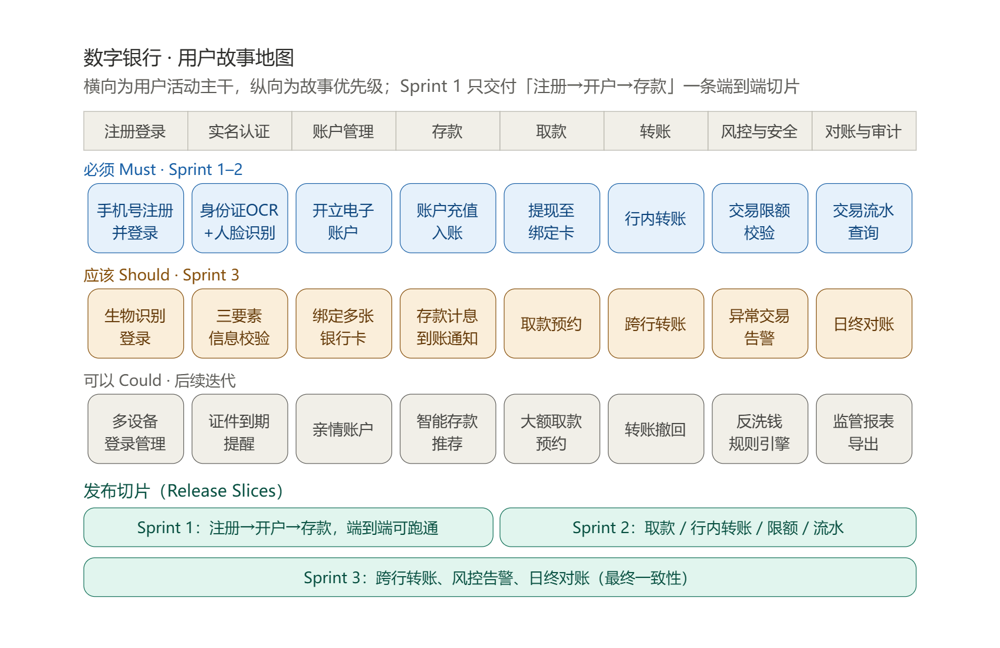
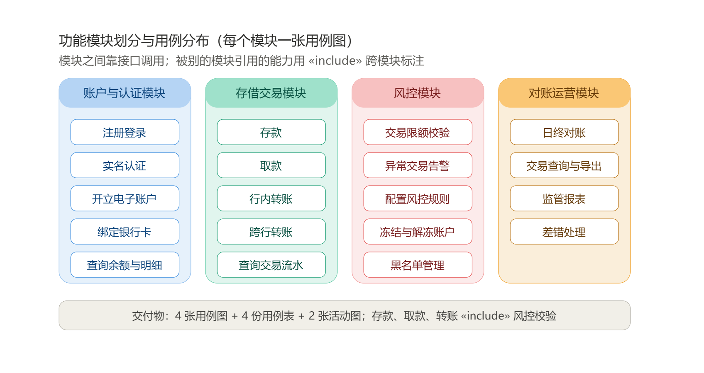
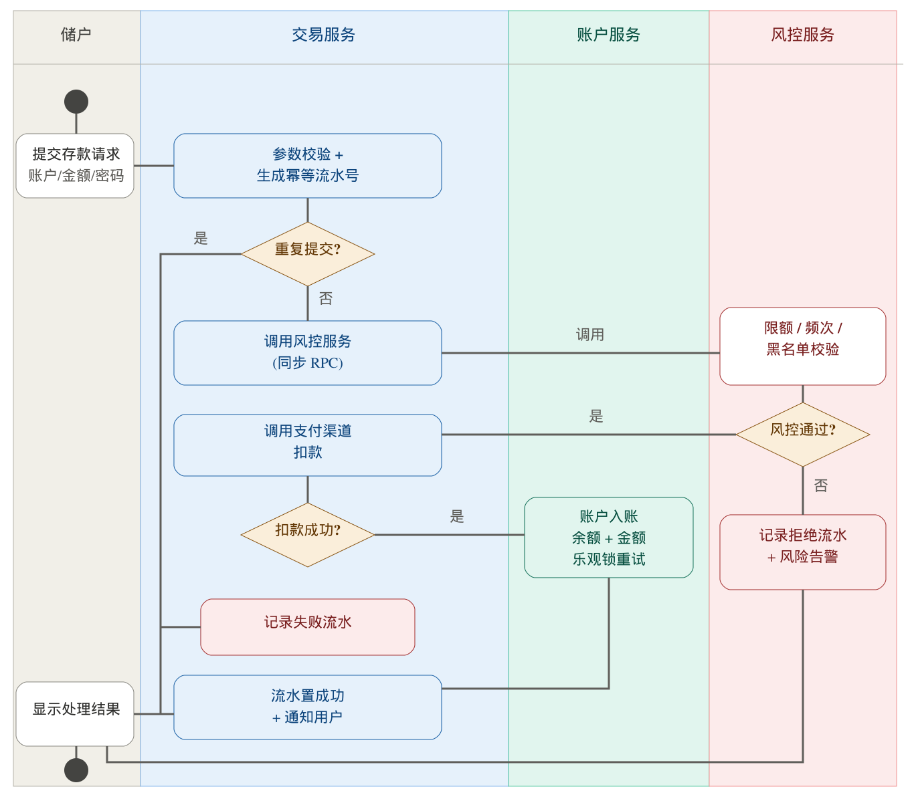
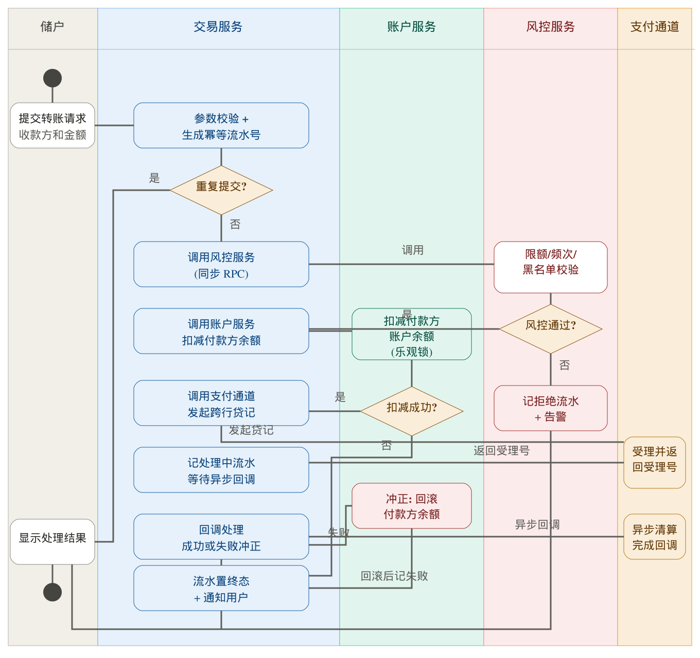

# 数字银行核心业务模拟系统 · 实验一：需求分析与迭代规划

## 一、实验概述

### 1.1 选题与总体描述

本组选择的实验题目是数字银行核心业务模拟系统。这个系统模拟现代数字银行的核心业务。系统涵盖存款、取款、转账和风控等关键金融业务。项目组要搭建一个高内聚、低耦合的微服务架构。这个架构要应对复杂的业务规则和高一致性要求。

实验一的任务是需求分析与迭代规划。本阶段要完成四项工作。第一，调研分析。第二，建立用户故事地图。第三，确定系统需求。第四，用 UML 建立软件问题模型。

### 1.2 团队信息

| 角色 | 姓名 | 分工 |
|------|------|------|
| 组长 | 【组长姓名】 | 统筹进度、需求分析、Git 仓库管理 |
| 成员 | 【成员1姓名】 | 需求分析、用例建模 |
| 成员 | 【成员2姓名】 | 系统设计、领域建模 |
| 成员 | 【成员3姓名】 | 技术选型、原型实现 |
| 成员 | 【成员4姓名】 | 测试用例、文档整理 |

注：姓名和分工在定稿前由组长补齐。

## 二、调研分析

### 2.1 调研方法

本组用了两种调研方法。第一种是竞品调研。本组走查了招商银行 App 和微众银行 App。走查的内容包括功能清单、页面流程和异常提示。第二种是约束调研。本组查阅了银行实名制、反洗钱和支付通道的公开资料。

调研的时间是第 1 周。调研的产出是一份调研记录。调研记录列出了用户角色、核心业务清单和业务约束。

### 2.2 调研结论

调研得出三条结论。

第一条结论关于用户旅程。储户的完整旅程是注册登录、实名认证、开立电子账户、绑定银行卡，然后办理存款、取款和转账，最后查询交易流水。这条旅程就是用户故事地图的主干。

第二条结论关于风控位置。风控校验发生在交易提交之后、资金变动之前。风控是同步调用。被拒绝的交易也要记录流水。

第三条结论关于跨行转账。跨行转账要经过人行或银联的清算通道。通道采用异步清算。这就带来最终一致问题。系统需要对账和冲正能力。

### 2.3 业务约束

| 编号 | 约束 | 说明 | 来源 |
|------|------|------|------|
| C-01 | 实名制 | 开户和交易前必须完成实名认证 | 监管要求 |
| C-02 | 反洗钱 | 大额交易和可疑交易要记录并上报 | 监管要求 |
| C-03 | 支付通道 | 跨行转账必须经过外部清算通道 | 业务规则 |
| C-04 | 交易限额 | 单笔限额和每日累计限额由风控规则决定 | 业务规则 |
| C-05 | 密码安全 | 支付密码不存明文，加盐哈希存储 | 安全要求 |

### 2.4 用户角色

| 角色 | 说明 | 主要目标 |
|------|------|---------|
| 储户 | 系统的个人用户 | 办理存款、取款、转账，查询流水 |
| 风控管理员 | 银行的风控人员 | 配置规则，处理告警，冻结账户 |
| 运营人员 | 银行的运营人员 | 日终对账，查询导出，处理差错 |
| 外部支付通道 | 人行、银联等清算机构（系统外） | 受理跨行贷记，返回清算结果 |
| 外部身份核验服务 | 公安、银联的核验接口（系统外） | 核验身份信息，反馈核验结果 |

## 三、需求拆解与用户故事地图

### 3.1 用户故事地图

本组把需求拆解成用户故事，然后用用户故事地图组织这些故事。故事地图的横轴是用户活动主干。故事地图的纵轴是故事优先级。地图分三层。第一层是必须做的故事。第二层是应该做的故事。第三层是可以做的故事。这个方法来自 Patton 的用户故事映射实践。



地图的第一行是必须故事。这一行对应 Sprint 1 和 Sprint 2。第二行是应该故事。这一行对应 Sprint 3。第三行是可以故事。这一行留到后续迭代。

### 3.2 故事拆解规则

本组用三条规则拆解故事。第一条，每条故事要小，一个 Sprint 内做得完。第二条，每条故事能验收，写得出验收标准。第三条，按优先级分层，必须先做的放第一层。

本组还用 INVEST 原则检查每条故事。这条原则要求故事独立、可商量、有价值、可估算、够小、可测试。检查不通过的故事要重新拆解。

### 3.3 Backlog 管理

本组用 GitHub Projects 看板管理 Backlog。看板设三列。三列分别是待办、进行中和已完成。每条故事做成一张卡片。卡片上写四样内容。四样内容是负责人、验收标准、优先级和所属 Sprint。

Sprint 1 只做「注册到开户到存款」这一竖条。这就是第一个可演示的增量。它也对应实验三要求的端到端业务流程。

### 3.4 Sprint 规划

| Sprint | 周期 | 目标 | 故事范围 | 可演示增量 |
|--------|------|------|---------|-----------|
| Sprint 1 | 第 2 周至第 3 周 | 跑通存款端到端流程 | 手机号注册登录、实名认证、开立电子账户、账户充值入账 | 储户可以完成一次存款，并查到流水 |
| Sprint 2 | 第 4 周至第 5 周 | 完成取款和行内转账 | 提现至绑定卡、行内转账、交易限额校验、交易流水查询 | 储户可以取款和行内转账 |
| Sprint 3 | 第 6 周至第 7 周 | 完成跨行能力和风控告警 | 跨行转账、异常交易告警、日终对账、存款计息、生物识别登录 | 系统具备完整的核心业务闭环 |

注：每个 Sprint 结束时要提交可工作的软件增量。增量的形式是可运行的演示和对应的测试报告。

## 四、系统需求

### 4.1 功能需求

| 编号 | 名称 | 描述 | 优先级 | 验收标准 |
|------|------|------|--------|---------|
| FR-01 | 用户注册 | 储户用手机号和短信验证码注册账号 | Must | 验证码正确即可注册成功，手机号不可重复注册 |
| FR-02 | 用户登录 | 储户用密码或生物识别登录 | Must | 密码错误 3 次锁定 10 分钟，登录成功返回令牌 |
| FR-03 | 实名认证 | 储户上传身份证并完成人脸识别 | Must | 认证通过后账户标记为已实名，认证记录留痕 |
| FR-04 | 开立电子账户 | 已实名储户开立电子账户 | Must | 开户成功后生成唯一账户号，初始余额为零 |
| FR-05 | 绑定银行卡 | 储户绑定和解绑本人银行卡 | Must | 绑定要校验卡号归属，解绑后不可再用于交易 |
| FR-06 | 余额与明细查询 | 储户查询账户余额和交易明细 | Must | 余额实时准确，明细按时间倒序分页展示 |
| FR-07 | 存款 | 储户从绑定卡充值入账 | Must | 扣款成功且入账成功才算交易成功，流水状态正确 |
| FR-08 | 取款 | 储户提现至绑定卡 | Must | 余额充足且风控通过才能出款，失败不产生错误入账 |
| FR-09 | 行内转账 | 储户向本行其他账户转账 | Must | 付款方扣款与收款方入账在同一事务内完成 |
| FR-10 | 跨行转账 | 储户向他行账户转账 | Should | 经由支付通道清算，异步回调后更新流水终态 |
| FR-11 | 交易限额校验 | 风控服务校验单笔和日累计限额 | Must | 超限交易被拒绝，并记录拒绝流水 |
| FR-12 | 异常交易告警 | 风控服务识别异常交易并告警 | Should | 命中规则的交易生成告警单，并推送管理员 |
| FR-13 | 风控规则配置 | 风控管理员增删改风控规则 | Should | 规则保存后立即生效，修改记录留痕 |
| FR-14 | 账户冻结与解冻 | 风控管理员冻结可疑账户 | Should | 冻结后账户不可交易，解冻后恢复 |
| FR-15 | 交易流水查询与导出 | 储户和运营查询流水并导出 | Must | 流水只增不改，导出内容与查询结果一致 |
| FR-16 | 日终对账 | 运营人员与通道核对当日交易 | Should | 差异生成差错单，无差异输出平账报告 |
| FR-17 | 差错处理 | 运营人员登记和处理差错 | Should | 差错单有状态流转，处理结果留痕 |
| FR-18 | 监管报表 | 运营人员生成大额交易报表 | Could | 报表数据与流水一致，可按时生成 |

### 4.2 非功能需求

| 编号 | 类别 | 要求 | 验证方式 |
|------|------|------|---------|
| NFR-01 | 一致性 | 行内余额变动强一致，跨行交易最终一致 | 并发测试加日终对账 |
| NFR-02 | 幂等性 | 同一幂等号的重复请求只生效一次 | 重复提交测试 |
| NFR-03 | 并发 | 并发存款和扣款不丢失更新，余额不为负 | 并发压力测试 |
| NFR-04 | 安全 | 密码加盐哈希存储，传输加密，敏感操作二次认证 | 代码审查加安全测试 |
| NFR-05 | 审计 | 交易流水只增不改，全程留痕 | 日志审查 |
| NFR-06 | 可用性 | 单个服务故障不波及其他交易，具备熔断能力 | 故障注入测试 |
| NFR-07 | 性能 | 存款接口响应时间百分之九十五小于 500 毫秒 | 接口压测 |

### 4.3 约束与假设

本组列出三条假设。第一条，外部支付通道和身份核验服务用模拟实现替代。第二条，系统只处理个人储户业务，不处理对公业务。第三条，实验环境不接入真实资金通道。

## 五、UML 问题模型

### 5.1 功能模块划分

补充要求指出，用例图不能把全系统用例画在一张图里。用例图要按功能模块分别绘制。本组把系统分成四个模块。四个模块分别是账户与认证模块、存借交易模块、风控模块和对账运营模块。划分原则是按业务能力划分，保证模块高内聚、低耦合。模块之间通过接口调用。被别的模块引用的能力用 include 关系跨模块标注。



### 5.2 账户与认证模块

这个模块负责用户身份和账户生命周期。模块包含五个用例。五个用例是注册登录、实名认证、开立电子账户、绑定银行卡和查询余额与明细。实名认证用例调用人脸识别和身份信息核验。注册登录和绑定银行卡调用短信验证码校验。


| 字段 | 内容 |
|------|------|
| 用例编号 | UC-AUTH-02 |
| 用例名称 | 实名认证 |
| 主要参与者 | 储户 |
| 次要参与者 | 外部身份核验服务 |
| 前置条件 | 储户已注册并登录 |
| 基本流 | 1) 储户上传身份证正反面；2) 系统 OCR 识别并回显信息；3) 储户确认信息；4) 系统进行活体人脸检测；5) 系统调用三要素核验；6) 系统记录认证结果，账户状态改为已实名 |
| 备选流 | 4a) 人脸检测不通过，储户重试，最多 3 次；5a) 核验信息不一致，提示认证失败 |
| 异常流 | 2b) OCR 识别失败，储户改为手动输入；5b) 核验服务超时，系统转入异步重试 |
| 后置条件 | 账户实名标记已更新，认证记录已留痕 |
| 业务规则 | 未实名的账户不能开户，也不能办理交易 |

### 5.3 存借交易模块

这个模块负责资金交易。模块包含五个用例。五个用例是存款、取款、行内转账、跨行转账和查询交易流水。存款、取款和转账都调用风控检查，也都调用记录交易流水。跨行转账额外调用支付通道。风控检查属于风控模块，这里用 include 关系跨模块引用。


| 字段 | 内容 |
|------|------|
| 用例编号 | UC-DEP-01 |
| 用例名称 | 存款（账户充值） |
| 主要参与者 | 储户 |
| 次要参与者 | 风控服务、账户服务、外部支付渠道 |
| 前置条件 | 储户已登录并通过实名认证，账户状态正常，已绑定银行卡 |
| 基本流 | 1) 储户选择账户，输入金额和支付密码，提交请求；2) 交易服务校验参数，生成幂等流水号；3) 交易服务调用风控服务做限额和频次检查；4) 交易服务调用支付渠道从绑定卡扣款；5) 账户服务把金额加到账户余额上；6) 交易服务把流水状态改为成功，并通知储户 |
| 备选流 | 2a) 幂等号已存在，直接返回原交易结果；3a) 风控不通过，记录拒绝流水并返回失败原因；4a) 扣款失败，记录失败流水并返回失败原因 |
| 异常流 | 5a) 入账超时，交易服务查单后决定补账或冲正；2b) 网络中断，客户端重试，服务端靠幂等号去重 |
| 后置条件 | 账户余额增加，交易流水已生成，通知已发送 |
| 业务规则 | 单笔限额和每日累计限额由风控规则决定；流水只增不改 |

### 5.4 风控模块

这个模块负责交易风险控制。模块包含五个用例。五个用例是交易限额校验、异常交易告警、配置风控规则、冻结与解冻账户和黑名单管理。交易服务是限额校验和异常告警的调用方。风控管理员负责规则配置和账户冻结。


| 字段 | 内容 |
|------|------|
| 用例编号 | UC-RISK-02 |
| 用例名称 | 异常交易告警 |
| 主要参与者 | 风控管理员 |
| 次要参与者 | 交易服务、通知服务 |
| 前置条件 | 风控管理员已登录，规则引擎已启用 |
| 基本流 | 1) 规则引擎扫描交易流水；2) 交易命中异常规则；3) 系统生成告警单；4) 系统推送通知；5) 风控管理员查看告警单；6) 管理员标记处理结果 |
| 备选流 | 5a) 核实为误报，管理员关闭告警；5b) 确认存在风险，管理员触发冻结账户 |
| 异常流 | 3a) 通知推送失败，系统按策略重试 |
| 后置条件 | 告警单状态已更新，处理记录已留痕 |
| 业务规则 | 告警分三级，分别是高、中、低；高级告警要当日处理 |

### 5.5 对账运营模块

这个模块负责日终核对和差错处理。模块包含四个用例。四个用例是日终对账、交易查询与导出、监管报表和差错处理。日终对账要从外部支付通道获取对账文件。差错处理要登记差错单。


| 字段 | 内容 |
|------|------|
| 用例编号 | UC-OPS-01 |
| 用例名称 | 日终对账 |
| 主要参与者 | 运营人员 |
| 次要参与者 | 外部支付通道、交易服务 |
| 前置条件 | 营业日已结束，当日交易已记账 |
| 基本流 | 1) 运营人员触发日终对账任务；2) 系统获取通道对账文件；3) 系统与本地流水逐笔核对；4) 系统生成对账差异表；5) 无差异时运营人员确认平账 |
| 备选流 | 4a) 存在差异，系统登记差错单并通知运营人员 |
| 异常流 | 2a) 对账文件缺失，系统按策略重试获取 |
| 后置条件 | 对账报告已生成，差错单已登记 |
| 业务规则 | 长款先挂账，短款要追回；差错单未关闭前不可再次平账 |

### 5.6 活动图

存款用例的事件流比较复杂。本组为存款用例绘制了活动图。活动图用泳道表示服务边界。图里画出三个异常分支。第一个分支是重复提交，系统靠幂等号直接返回原结果。第二个分支是风控拒绝。第三个分支是渠道扣款失败。渠道失败时资金未入账，所以不需要冲正。



跨行转账用例的事件流更复杂。跨行转账涉及异步清算和最终一致。本组也为跨行转账绘制了活动图。图里画出冲正分支。回调失败时，账户服务回滚付款方余额。然后交易服务把流水置为失败。



### 5.7 领域模型草案

本组对两个核心实体建模。两个实体是账户和交易流水。账户实体的关键属性有账户号、用户标识、余额、状态和版本号。版本号用于乐观锁。交易流水实体的关键属性有流水号、账户号、交易类型、金额、状态和风控结果。流水号就是幂等号。

| 实体 | 关键属性 | 说明 |
|------|---------|------|
| 用户 User | 用户标识、手机号、密码哈希、实名状态 | 密码哈希加盐存储 |
| 账户 Account | 账户号、用户标识、账户类型、余额、状态、版本号、开户时间 | 状态分正常和冻结；版本号用于乐观锁 |
| 交易流水 Transaction | 流水号、账户号、交易类型、金额、渠道、状态、风控结果、创建时间、完成时间、关联流水号 | 状态分处理中、成功、失败和拒绝；关联流水号指向冲正流水 |

实体之间的关系有三条。第一条，一个用户对应一个账户。第二条，一个账户对应多条交易流水。第三条，一条失败流水可以关联一条冲正流水，这是自关联。

流水的状态流转是这样的。交易提交后进入处理中。风控拒绝后进入拒绝。渠道失败后进入失败。入账成功后进入成功。回调失败并冲正后，流水进入失败。

## 六、迭代规划与团队协作

### 6.1 敏捷流程

本组采用敏捷开发模式。一个 Sprint 是一到两周。每个 Sprint 结束时要提交可工作的软件增量。本组用 GitHub Projects 看板管理任务。看板分待办、进行中和已完成三列。每周开一次短会。短会同步进度和阻塞。每个 Sprint 结束做一次评审和一次回顾。

### 6.2 Git 提交规范

实验要求使用 Git 做版本控制，并且保留清晰规范的提交记录。本组约定提交信息格式。格式是类型加范围加描述加故事编号。

| 类型 | 用途 |
|------|------|
| feat | 新功能 |
| fix | 修缺陷 |
| test | 加测试或改测试 |
| docs | 改文档 |
| refactor | 重构，不改功能 |
| chore | 改构建或辅助工具 |

提交示例：

```text
feat(deposit): 实现存款幂等校验 UC-DEP-01
test(deposit): 补充重复提交测试用例 UC-DEP-01
fix(account): 修复余额更新并发问题 UC-ACC-03
docs: 补充需求调研报告
```

分支策略是这样的。main 分支设保护，不直接推送。每个任务开一个分支，分支名带故事编号。合并走 Pull Request。Pull Request 至少要一个人审查。每人每天至少提交一次有意义的代码。这样做是为了体现协作过程。

### 6.3 组内互评

组长根据两类材料做互评表。第一类是 Git 提交记录，看数量、质量和规范性。第二类是看板任务完成情况，看是否按时完成认领的故事。互评表附在实验报告里。

## 七、AI 工具使用情况说明

实验要求如实注明 AI 使用情况。本组的说明如下。

| 环节 | 使用的工具 | AI 生成的内容 | 人工做的修改 |
|------|-----------|--------------|-------------|
| 需求分析 | AI 对话工具 | 用户故事地图框架、用例表字段结构、活动图分支清单 | 人工补充业务规则、监管约束和异常场景；核对每条故事可验收 |
| 系统设计 | AI 对话工具 | 模块划分草案、领域模型属性清单 | 人工确定服务边界和接口职责；重画全部 UML 图 |
| 编码实现 | AI 代码工具 | 接口代码骨架、单元测试初稿 | 人工重写事务边界，补充幂等去重逻辑，调整锁策略；补写超时和拒绝场景的测试 |
| 文档撰写 | AI 对话工具 | 报告结构和文字初稿 | 人工核对事实，补充小组实际数据，按学校模板调整格式 |

本组确认，所有 AI 生成的内容都经过人工审查、修改和运行验证。本组没有把 AI 输出直接作为最终成果。答辩时，组员可以解释每一处设计决策。

## 八、交付物清单

| 序号 | 交付物 | 形式 | 状态 |
|------|--------|------|------|
| 1 | 调研记录与调研结论 | 报告章节 | 已完成 |
| 2 | 用户故事地图 | 报告插图 | 已完成 |
| 3 | Product Backlog 与 Sprint 规划 | GitHub Projects 看板 | 已完成 |
| 4 | 功能需求与非功能需求清单 | 报告章节 | 已完成 |
| 5 | 模块用例图 4 张 | 报告插图 | 已完成 |
| 6 | 用例表 4 份 | 报告章节 | 已完成 |
| 7 | 活动图 2 张 | 报告插图 | 已完成 |
| 8 | 领域模型草案 | 报告章节 | 已完成 |
| 9 | Git 提交记录与看板截图 | 仓库与附录 | 进行中 |
| 10 | AI 使用情况说明 | 报告章节 | 已完成 |

注：第 9 项随迭代推进持续更新，定稿时由组长导出提交记录。

## 参考文献

Cockburn, Alistair. *Writing Effective Use Cases*. Addison-Wesley, 2001.

Object Management Group. *OMG Unified Modeling Language (OMG UML), Version 2.5.1*. OMG, 2017.

Patton, Jeff. *User Story Mapping: Discover the Whole Story, Build the Right Product*. O'Reilly Media, 2014.
