# 数字银行核心业务模拟系统 · 设计规格说明书

> 实验二：系统设计与技术选型
> 需求基线：《实验一需求规格说明书》整合版 v1.2（BR-01 金额、BR-03 账户状态、BR-04 余额不变式、BR-05 限额、BR-11/12 幂等、BR-15 本行转账、BR-19 资金流水、BR-20 权限）
> 设计范围：实验二"二、设计规格说明书"全部章节，含总体设计、模块设计与数据库设计三部分
> 文档状态：全组汇编版（合并成员 B、C、D、E 的模块交付物）

| 项目   | 内容                                                                                        |
| ---- | ----------------------------------------------------------------------------------------- |
| 系统名称 | 数字银行核心业务模拟系统                                                                              |
| 选题   | 指导书实验选题 1（数字银行核心业务模拟系统）                                                                   |
| 架构风格 | 轻量四服务微服务（gateway + user / account / transaction / risk）                                   |
| 建模工具 | PlantUML（源文件入库，导出图随文）                                                                     |
| 数据库  | MySQL 8.0.16+（InnoDB，`utf8mb4`，金额 `DECIMAL(18,2)`）                                        |
| 汇编说明 | 第 1、2.1、2.4 节取自组长设计基线；2.2.1 与表 2-1 取自成员 B、C；2.2.2 取自成员 C 与组长图 2-10；2.3 取自成员 E；第 3 章取自成员 D |

---

## 1 概述

### 1.1 设计目标与约束

本设计要解决的问题是：在五人小组、两周设计工期的课程约束下，给出一个既能满足"高内聚、低耦合、支撑复杂业务规则与资金一致性"的要求，又能被完整验证、被答辩解释清楚的系统方案。

约束条件有四项，直接决定了后续所有取舍：

1. **资金一致性优先于架构先进性。** 存款、转账的资金结果必须可证明，不能以"最终一致"掩盖中间态。方案选择以"正确性可验证"为第一判据。
2. **人力与工期受限。** 五名成员、两个迭代周期，且成员对中间件的熟悉程度不一致。任何新增组件的部署与调试成本都要计入设计成本，禁止为演示技术而引入无需求支撑的中间件。
3. **交付物包含可部署的物理架构。** 指导书要求部署图体现服务边界与独立节点，因此架构不能退化为单进程三层包结构。
4. **设计与实验三、四衔接。** 设计类要能直接落为可执行 DDL，接口要能直接对应端点，否则实验三会返工。

基于上述约束，本设计把系统划分为用户、账户、交易、风控四个业务子域，经统一网关组织请求；逻辑上采用界面、网关、应用服务、领域模型、基础设施五层；物理上四个服务与数据库分节点部署。资金写入集中在账户服务，交易服务只做受理与编排，不跨服务持有数据库事务。

### 1.2 设计内容与文档结构

| 章节   | 内容        | 主要产出                                          |
| ---- | --------- | --------------------------------------------- |
| 2.1  | 体系结构设计    | 三方案对比、ADR-001/002、图 2-1 包图、图 2-2 部署图          |
| 2.2  | 模块设计      | 图 2-3—图 2-12、表 2-1 设计类清单、关键程序逻辑与状态机           |
| 2.3  | 服务边界与接口契约 | 图 2-13 上下文映射、服务职责与数据所有权、统一响应与错误码              |
| 2.4  | 技术选型      | ADR-004 前端栈、ADR-005 数据库与缓存                    |
| 3    | 数据库设计     | 映射规则、表 2-2 表名清单、表 2-3 全字段清单、索引设计、`schema.sql` |
| 附录 A | 架构决策记录    | ADR-001—ADR-005 合并稿                           |
| 附录 B | 图表索引      | 每张图、每张表的源文件位置                                 |

### 1.3 需求基线与可追溯性

设计结论按 BR 编号回溯到需求，不在设计中新造业务规则：

| 设计点                             | 依据       | 落点                                               |
| ------------------------------- | -------- | ------------------------------------------------ |
| 金额与币种校验（CNY、>0、≤2 位小数）          | BR-01    | 2.2.1.2、2.2.2.1、`transaction.amount` 的 CHECK     |
| 冻结账户禁止新存款、出账与新的行内转入             | BR-03    | 2.2.1.1、2.2.1.6、图 2-11 首判定                       |
| 余额不变式 A=B−R、B≥0、0≤R≤B           | BR-04    | 2.2.1.4、`account` 表约束、`availableBalance()` 为计算操作 |
| 单笔与日累计限额                        | BR-05    | 2.2.2.3、`risk_rule` 表                            |
| 幂等：同身份 + 业务类型 + requestId 只生效一次 | BR-11/12 | 2.2.2.4、三元组唯一索引                                  |
| 本行转账双边同时成立                      | BR-15    | 2.2.2.1、`postInternalTransfer` 同一提交边界            |
| 资金流水只记录实际资金变动                   | BR-19    | `transaction_flow` 只追加，拒绝与释放不写流水                 |
| 权限与审计                           | BR-20    | `AccessService`、`audit_log`、`risk_event`         |

### 1.4 状态字面量口径（汇编时统一）

汇编发现成员交付物对同一状态使用了同义异名。为使本文与可执行 DDL 一致，**全文以数据库设计的字面量为准**，其他文档中的同义写法按下表映射，实验三编码前须一次性替换，不得混用：

| 语义              | 本文与 DDL 取值                           | 成员 B/C 文档中的旧写法   |
| --------------- | ------------------------------------ | ---------------- |
| 账户正常            | `ACTIVE`                             | `NORMAL`         |
| 交易已受理           | `ACCEPTED`                           | `RECEIVED`       |
| 交易成功终态          | `SUCCESS`                            | `SUCCEEDED`      |
| 交易处理中           | `PROCESSING`                         | `PROCESSING`（一致） |
| 外部结果未决          | `UNKNOWN`                            | `PENDING`        |
| 交易失败 / 恢复中 / 拒绝 | `FAILED` / `RECOVERING` / `REJECTED` | 同                |

---

## 2 总体设计

### 2.1 体系结构设计

#### 2.1.1 架构决策与选型

指导书要求至少对比两种架构方案，并说明选择依据。本设计对比三类候选：

| 维度       | 方案 A：微服务（四服务）               | 方案 B：单体分层    | 方案 C：模块化单体 |
| -------- | --------------------------- | ------------ | ---------- |
| 服务边界清晰度  | 高：独立进程与显式接口                 | 低：仅靠包约定      | 中：进程内模块约束  |
| 一致性保障难度  | 跨服务事务较难；把资金写入集中到账户服务可显著降低风险 | 最低：单库本地事务    | 低：单库本地事务   |
| 开发与调试成本  | 高：多进程、网络故障、日志分散             | 最低           | 中等：需维护模块依赖 |
| 部署与运维成本  | 高：多节点、网关、注册与日志              | 最低：单应用       | 较低：单应用多模块  |
| 五人团队匹配度  | 可按四子域并行，但接口协调成本高            | 易上手，代码易相互耦合  | 并行与边界约束较平衡 |
| 两周工期可行性  | 紧张，须严格限制组件、优先打通资金闭环         | 可行           | 可行且有较多余量   |
| 与实验要求的匹配 | 强：能直接展示服务边界与独立部署            | 弱：部署图难以体现分布式 | 中          |

**选定方案：方案 A 的轻量变体——四业务服务 + 网关，组件最小化。**

理由分三点，且必须说明"为什么不选另外两个"：

1. **不选单体分层**，不是因为它不好，而是它无法满足本次交付物的硬性展示要求。指导书要求用部署图表现物理架构，单体分层在图上只能画成一个节点，服务边界无从体现，该章节会失去得分点。就工程成本而言，单体分层其实是五人工期下的最优解。
2. **不选模块化单体**，是因为它虽然兼顾了边界与成本，但四个子域仍运行在同一进程内，"独立部署"这一交付约束无法落地。若允许降低该约束，模块化单体会是本组更稳妥的选择。
3. **选择四服务要付出明确代价**：多出接口定义、网络超时、重复请求、部署与日志排查四类工作；且五个人的接口协调成本高于单体内的方法调用。本设计通过"账户服务独占资金写入"把最难的一致性风险收敛到一个服务内，用架构换取一致性可控，这是该方案在本项目成立的前提。

完整决策过程、后果与需承担的成本见附录 A 的 ADR-001。

#### 2.1.2 系统逻辑架构

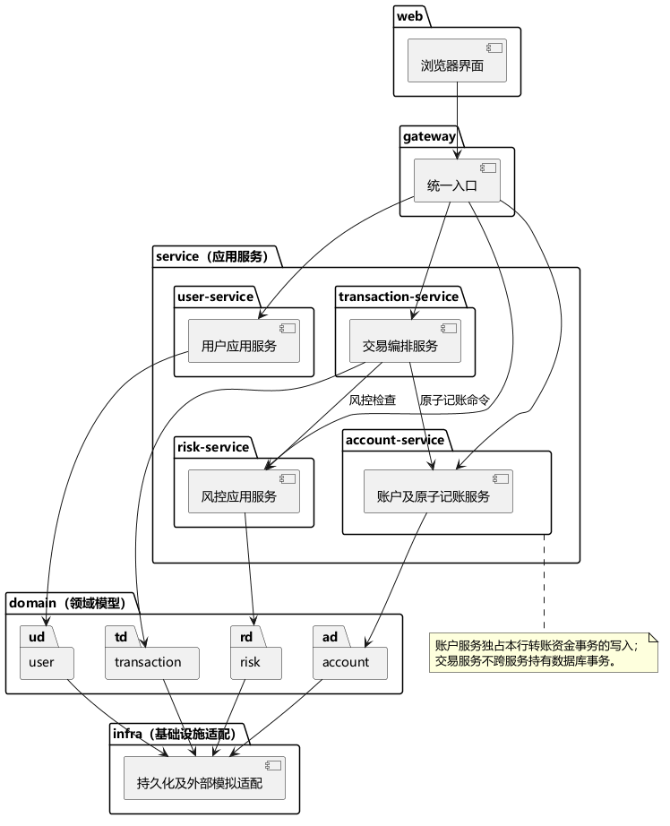

图 2-1 系统逻辑架构（包图）。源文件：`docs/uml/package/logical-arch.puml`。

架构按"分层 + 业务子域"两个维度组织，如图 2-1 所示：

- **web 层**：浏览器界面，只负责展示与表单校验，不承载业务规则。
- **gateway 层**：统一入口，承担路由、会话校验与限流；不做对象级授权，避免网关成为权限逻辑的第二实现。
- **service 层（应用服务）**：按 `user-service`、`account-service`、`transaction-service`、`risk-service` 四个子域组织用例编排。每个服务只编排本子域的用例，跨子域一律走接口。
- **domain 层（领域模型）**：四个子域各自的实体与不变式，如 `Account` 的 A=B−R、`Transaction` 的状态机。
- **infra 层（基础设施适配）**：持久化、模拟渠道、外部回执等适配器。

依赖方向严格单向：`web → gateway → service → domain → infra`，包间不出现环。跨子域只有两条业务依赖：`transaction-service → risk-service`（出账前风控检查）与 `transaction-service → account-service`（原子记账命令）。账户服务独占本行转账的资金事务写入，交易服务不跨服务持有数据库事务，这一约束是 2.1.4 一致性方案在图上的体现。

#### 2.1.3 系统物理架构

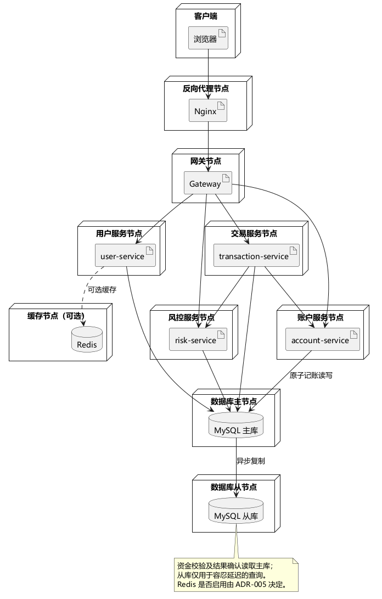

图 2-2 系统物理架构（部署图）。源文件：`docs/uml/deployment/physical-arch.puml`。

如图 2-2 所示，浏览器经 Nginx 反向代理进入网关节点，再由网关分发至四个各自独立的业务服务节点；数据库采用主从分离，主库承担全部资金写入与校验读取，从库异步复制、仅供容忍延迟的查询；Redis 为条件性节点，本迭代不启用（附录 A 的 ADR-005）。

需要说明三点，避免把目标形态误读为已实现状态：

1. 图 2-2 表示的是**目标部署形态**，不表示当前环境已完成容器化部署或主从切换演练。
2. 数据库与服务虽分节点，但四个服务**共用同一数据库实例**，按数据职责限定写入权限；物理分库不属于本迭代范围。
3. 主从异步复制存在延迟，资金判断与结果确认一律读主库；不得声称主从切换无损。

#### 2.1.4 资金一致性策略

资金一致性是影响架构的关键约束，本设计用三条措施叠加，而不是依赖单一机制：

1. **本行转账采用单库本地事务**（ADR-002）。交易服务发出命令，账户服务在主库事务内按固定顺序锁定双方账户与限额记录，复核规则后写入预留、双方余额、双方流水与幂等结果，全部提交或全部回滚。放弃编排式 Saga 与 TCC 的理由是：Saga 的补偿期会暴露中间态，TCC 需要三阶段接口、空回滚与防悬挂，二者在两周工期内的验证成本高于收益。
2. **请求幂等采用数据库唯一约束**（ADR-003）。以 `(identity_id, business_type, request_id)` 三元组唯一索引 + `request_hash` 内容指纹实现"同键同内容返回原结果、同键异内容返回冲突"，不引入 Redis 分布式锁。
3. **状态机与流水分离**。交易状态表达处理进度，资金流水只记录真实发生的资金变动；拒绝、预留、释放都不写流水，避免把"未发生的资金"伪造成账务事实（BR-19）。

跨行转账涉及外部结果未知，单独保留 `UNKNOWN` 清算态与恢复流程，不把超时当作失败；该部分只保留扩展点，不在本迭代实现完整外部清算。

### 2.2 模块设计

#### 2.2.1 用例实现（设计模型）

本节按用例组织设计模型，包含鲁棒图（职责分配）、序列图（交互顺序）与设计类图（静态结构）。用例来源为实验一的 UC-TR-01（存款）、UC-AC-04（余额查询）、UC-TR-03（本行转账）及其风控共享步骤。

##### 2.2.1.1 账户域职责划分与存款鲁棒分析

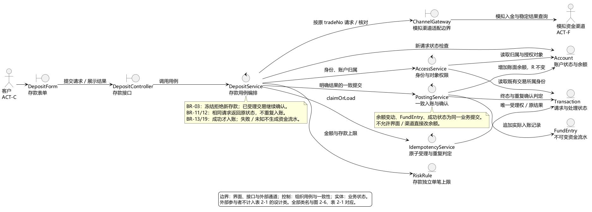

图 2-3 存款鲁棒图。源文件：`docs/uml/robustness/deposit.puml`。

如图 2-3 所示，`DepositForm` 收集账户、币种、金额与 `requestId`，`DepositController` 处理接口接入并把认证后的身份传给 `DepositService`；控制类依次组织授权、幂等、业务准入与渠道请求，界面与模拟渠道都没有直接修改账户实体的路径。

各控制类职责如下：

- `AccessService`：检查身份、业务操作权与对象权限。存款入口传入 `DEPOSIT` 操作范围，只允许客户办理本人账户；余额查询传入 `READ_BALANCE`，后台角色还须满足查询岗位与具体对象授权。"拥有后台查询权"不等于"可以代客户存款"。
- `IdempotencyService`：原子获得处理权，或在重复请求时返回已有请求的当前结果。
- `ChannelGateway`：隔离模拟入金、结果查询与结果来源验证，使渠道差异不渗入领域模型。
- `PostingService`：组织资金提交，保证 `Account` 余额、`FundEntry` 与 `Transaction` 成功状态一致。
- `RiskRule`：为存款提供独立的单笔上限，不得套用出账限额。

##### 2.2.1.2 存款受理与幂等

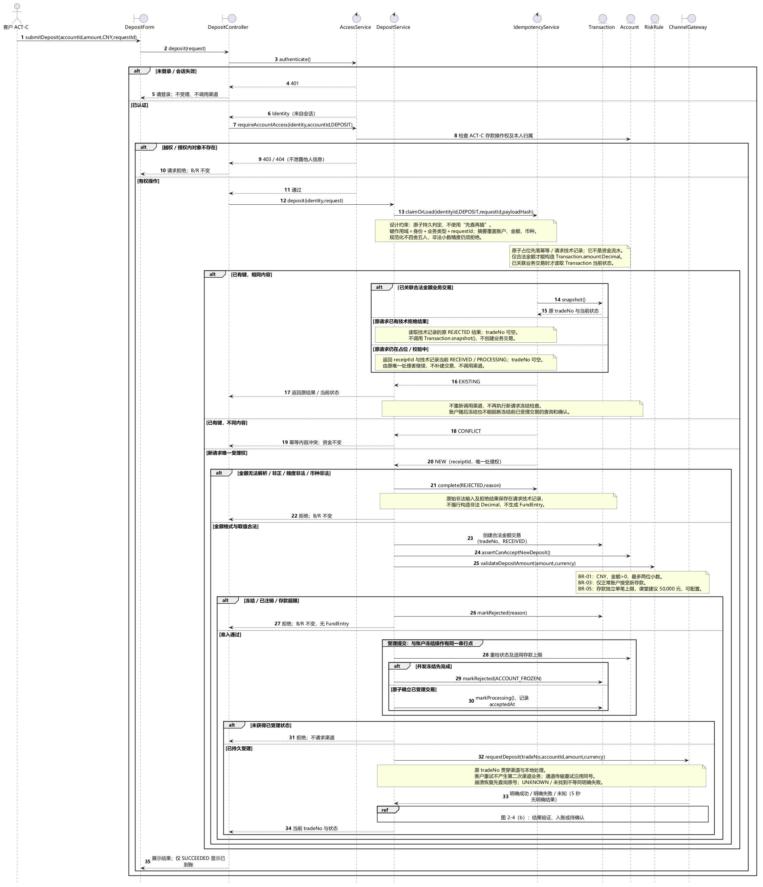

图 2-4（a）存款受理与渠道请求。源文件：`docs/uml/sequence/deposit.puml`（与 (b) 共用）。

受理阶段先验证身份与账户归属，再处理幂等。身份取自会话，不接受客户端自报的身份号。幂等键使用"身份、业务类型、`requestId`"三元组，请求内容摘要覆盖账户、币种与金额，规范化不得把非法精度四舍五入成合法金额。

`claimOrLoad` 必须是持久且原子的占位与判定，不能"先查一次再另行插入"。由此产生三个必须处理的分支：

1. 同键同内容且已形成交易：返回原 `tradeNo` 与当前状态；仅有技术拒绝记录（如非法金额）时直接返回原拒绝结果，`tradeNo` 可为空，不补建交易。
2. 同键不同内容：返回冲突，不覆盖原结果。
3. 占位后、业务交易形成前的第二次同内容请求：返回受理号与当前 `ACCEPTED`/`PROCESSING` 状态，由原唯一处理者继续；不能把"尚无交易记录"误判为新请求。

新存款的准入条件为：CNY、金额为正且最多两位小数、账户状态正常、未超存款单笔上限。需求中的 50,000 元是课堂建议参数，由 `RiskRule` 配置，不作为现实银行标准。存款不要求账户已有可用余额，也不占用用于出账的预留金额。

新受理与冻结操作必须存在同一串行判定点：在确立受理时间、把交易推进 `PROCESSING` 时重检账户状态与规则版本。冻结先完成则拒绝新存款；受理先完成则属于既有业务，随后冻结不得中断其确认。这一并发契约在实验三必须由锁或条件更新落实。

##### 2.2.1.3 渠道结果确认与一致入账

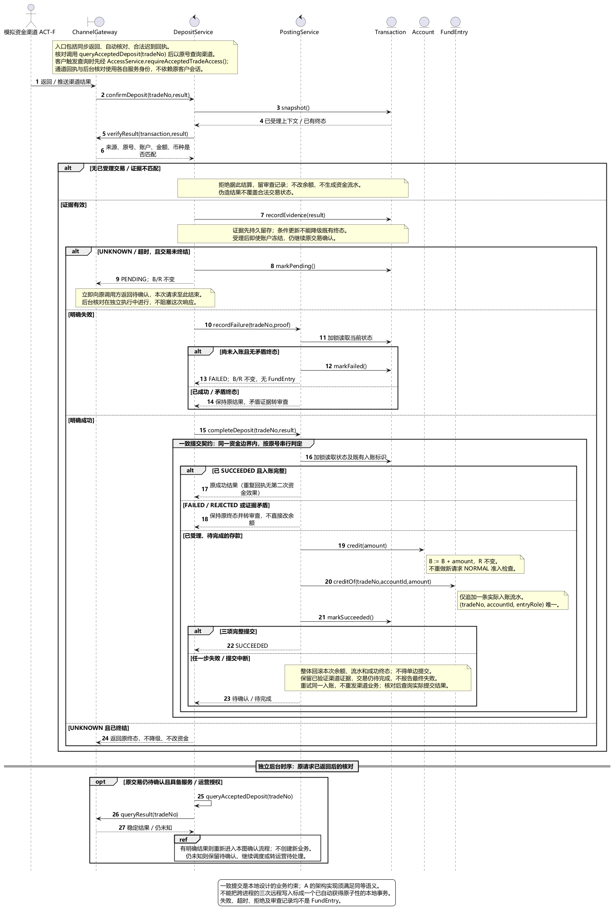

图 2-4（b）渠道结果确认与一次性入账。

直接返回、后续核对与迟到回执统一进入 `confirmDeposit`。结果先核对来源、交易号、账户、金额与币种，只有验证通过的渠道依据才能推动资金处理。客户主动查询需检查原交易权限；自动核对与回执使用服务身份及各自授权，不能因原客户会话过期而永久停止已受理业务。

明确成功时，`PostingService` 在同一个资金一致性边界内重新读取交易状态、增加 `Account.bookBalance`、追加一条 `FundEntry`、把交易标为 `SUCCESS`；预留金额保持原值，不得把其他出账业务的占用清零。流水以"交易号 + 账户 + 资金角色"唯一标识一次资金效果，重复回执返回既有结果而不重复入账。

余额、流水与成功终态必须同时提交或同时不提交。任一步失败时：不能对外报告已到账，也不能把渠道已成功的交易直接判为失败；应保留已验证的渠道依据，以原交易号重试本地资金提交，提交结果未知时先核对本地记录。

终态判断必须防并发：成功回执与超时同时发生时，迟到的"置为未决"不得把 `SUCCESS` 降级；成功后再收到失败、或失败后收到矛盾的成功回执，保留既有终态并转人工审查，不直接改余额。

##### 2.2.1.4 账户查询

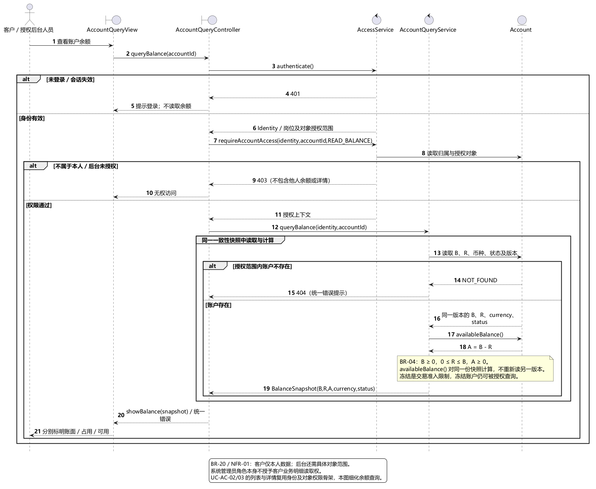

图 2-5 账户查询序列图。源文件：`docs/uml/sequence/account-query.puml`。

`AccountQueryController` 先调用 `AccessService` 检查身份与对象范围，再由 `AccountQueryService` 读取账户。未登录返回 401，越权返回 403；授权范围内不存在的账户统一使用"不存在"提示，避免通过错误信息推断他人账户。系统管理员角色本身不赋予客户业务明细读取权。

余额返回账面余额 B、占用金额 R、可用余额 A、币种与账户状态。`Account.availableBalance()` 是**操作**而非字段，按 A=B−R 计算；B 与 R 在同一版本快照内读取，始终满足 B≥0、0≤R≤B、A≥0。冻结只限制资金准入，不阻止授权范围内的查询。

##### 2.2.1.5 从分析类到设计类

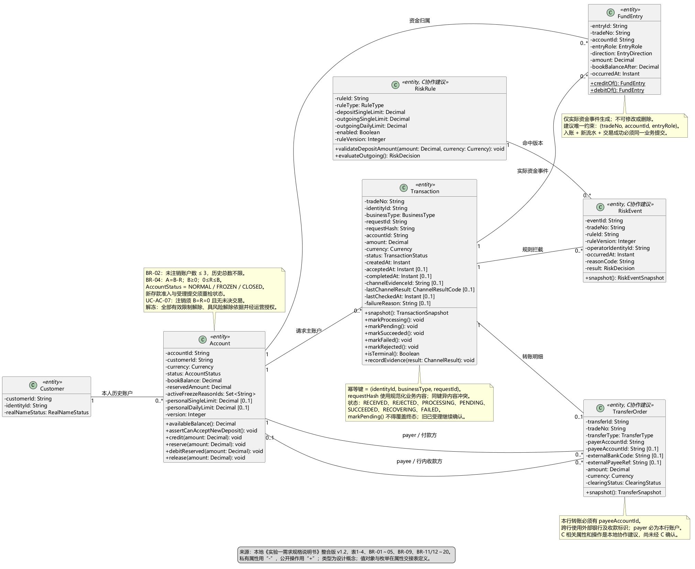

图 2-6（a）核心实体设计。源文件：`docs/uml/class/design-class.puml`。

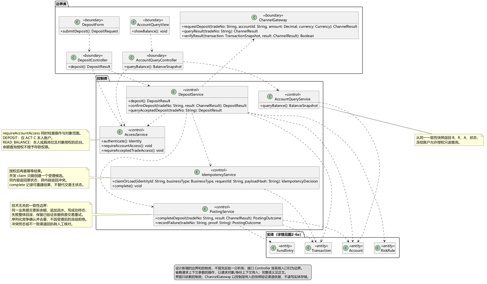

图 2-6（b）边界类与控制类协作。

设计类由实验一的七个核心概念演进而来：(a) 补属性、操作、类型、可见性与关联；(b) 补边界类、控制类及其调用依赖。两个面板共同组成图 2-6，不另占图号。

演进中明确的三处修正：

1. `FundEntry` 同时关联 `Transaction` 与 `Account`，补清分析图中未画出的流水账户归属——否则无法回答"这笔钱的对手方是谁"。
2. `TransferOrder` 以 `payerAccountId`、`payeeAccountId` 区分付款与收款角色，避免把交易的主账户关系误解为"转账只有一方"。
3. `Account.availableBalance()` 建模为操作而非字段；客户可保留多个历史账户，"最多三个"仅约束未注销账户，正常与冻结均计入。

设计类只使用 `Decimal`、`Instant`、枚举与逻辑标识，**不出现物理数据库类型**（`varchar(50)` 一类属第 3 章）。银行卡、告警、独立对账仍为需求阶段的待评审候选，当前模型不将其扩入核心实现。

##### 2.2.1.6 交易域：本行转账

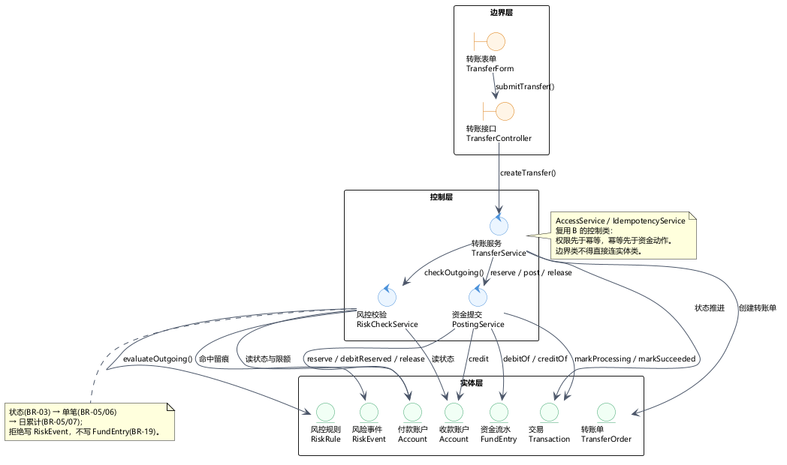

图 2-7 本行转账鲁棒图。源文件：`docs/uml/robustness/transfer.puml`。

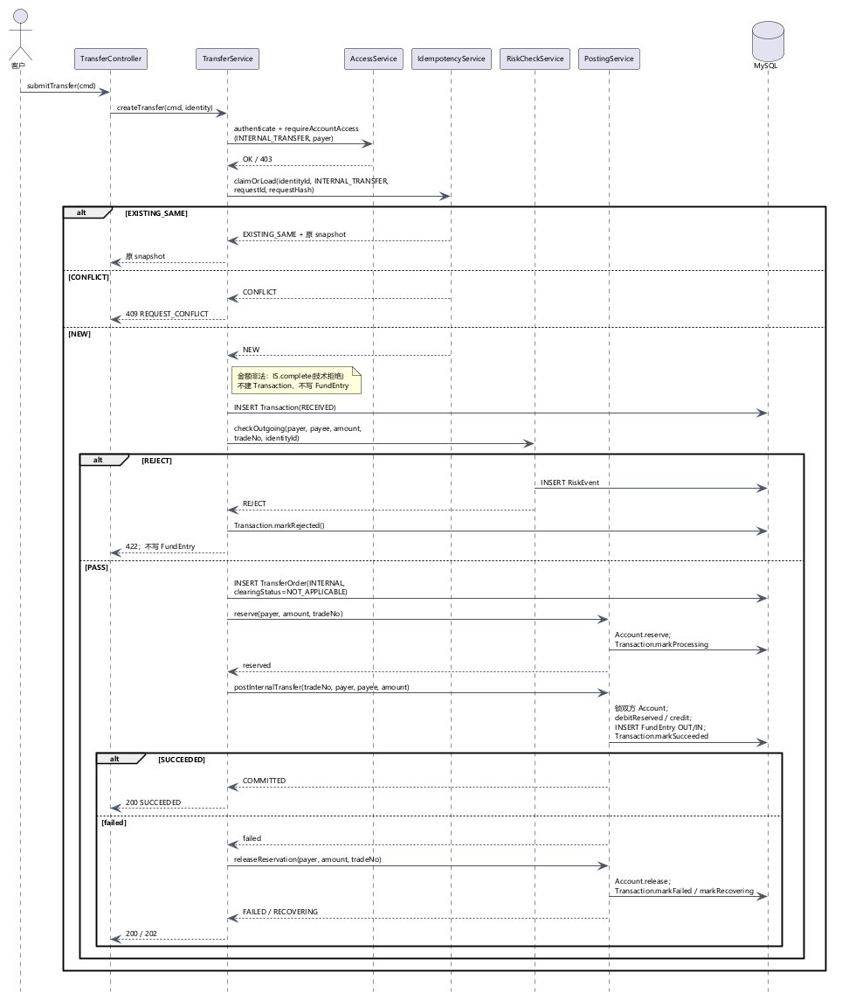

图 2-8 本行转账序列图。源文件：`docs/uml/sequence/transfer.puml`。

主成功路径如图 2-8 所示：

1. `TransferForm` 收集付款账户、收款账户、金额、用途与 `requestId`；`TransferController` 从会话取身份，调用 `AccessService.authenticate()`。
2. `requireAccountAccess(INTERNAL_TRANSFER, payerAccountId)` 校验付款账户归属；`TransferService` 读取收款账户，校验存在、非同一账户、币种一致。
3. `IdempotencyService.claimOrLoad(...)`：`EXISTING_SAME` 返回原交易快照且不重复扣款；`CONFLICT` 返回 409；`NEW` 继续。
4. 金额合法性校验（CNY、>0、≤2 位小数）。非法金额只记录技术拒绝，**不创建交易、不写流水**。
5. 创建 `Transaction(ACCEPTED)`，写入付款主账户、业务类型、`requestId` 与 `requestHash`。
6. `RiskCheckService.checkOutgoing(...)`：账户状态 → 单笔限额 → 日累计限额；命中即写 `RiskEvent` 并把交易置 `REJECTED`，不写流水。
7. 通过后创建 `TransferOrder(INTERNAL, NOT_APPLICABLE)`，付款方、收款方、金额与交易一致。
8. `PostingService.reserve(...)`：`Account.reserve(amount)`（R 增、B 不变）、交易置 `PROCESSING`、记录受理时间，并按受理日占用额度。
9. `PostingService.postInternalTransfer(...)`：同一提交边界内锁定双方账户，付款方 `debitReserved`（B、R 同减）、收款方 `credit`（B 增），写 `TRANSFER_OUT` 与 `TRANSFER_IN` 两条流水，交易置 `SUCCESS`。
10. 返回 `tradeNo` 与终态；双方流水共用同一 `tradeNo`，可按流水追溯。

异常分支如下表（这些分支在图 2-8 中均有对应消息，不是文字补充）：

| 分支             | 触发         | 处理                           | 资金结果                  |
| -------------- | ---------- | ---------------------------- | --------------------- |
| 未认证/越权         | 付款账户非本人    | 401/403，不泄露他人账户              | 无变化                   |
| 幂等重放           | 同三元组、同内容   | 返回原交易快照                      | 不重复                   |
| 幂等冲突           | 同三元组、异内容   | 409 `REQUEST_CONFLICT`       | 无变化                   |
| 金额非法           | BR-01      | 技术拒绝，不建交易                    | 无变化                   |
| 账户不存在/同账户/币种不符 | BR-15/20   | 交易置 `REJECTED`               | 无变化，不写流水              |
| 冻结或注销          | BR-03      | 写 `RiskEvent`，交易置 `REJECTED` | 无变化，不写流水              |
| 超单笔或日累计        | BR-05      | 写 `RiskEvent`，交易置 `REJECTED` | 无变化，不写流水              |
| 双账户提交失败        | 任一步失败      | 提交边界回滚后释放预留                  | 双方 B/R 回到本次之前         |
| 释放失败           | 数据库异常      | 交易置 `RECOVERING`             | R 暂时保留，按 `tradeNo` 重试 |
| 状态落库失败         | 资金已动、状态未更新 | 按 `tradeNo` 对账恢复，不重复扣款       | 由恢复收敛                 |

##### 2.2.1.7 风控拦截

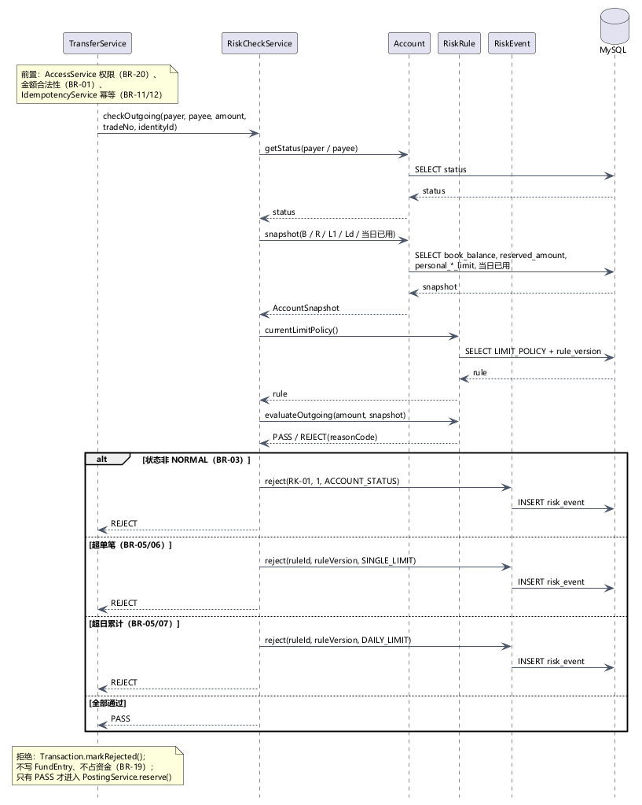

图 2-9 风控拦截序列图（出账前）。源文件：`docs/uml/sequence/risk-check.puml`。

出账前校验按固定短路顺序执行，顺序本身是设计结论，不可调换：

1. 金额合法性（BR-01）：由 `TransferService` 前置完成，非法金额不进入风控、不建交易。
2. 账户状态（BR-03）：读取付款方与收款方状态，非 `ACTIVE` 即写 `RiskEvent(RK-01, ACCOUNT_STATUS, REJECT)`。
3. 单笔限额（BR-05/06）：取系统单笔限额与个人单笔限额的较小值，超限写 `RiskEvent(..., SINGLE_LIMIT, REJECT)`。
4. 日累计限额（BR-05/07）：当日已成功额 + 已占用额 + 本笔 > 取小后的日限额即拒绝，写 `RiskEvent(..., DAILY_LIMIT, REJECT)`。
5. 通过才创建转账单并调用预留。

留痕边界：`RiskEvent` 记录 `ruleId`、`ruleVersion`、`operatorIdentityId`、`occurredAt`、`reasonCode`、`result`；拒绝时交易置 `REJECTED`，**不写资金流水**，B/R 不变。

##### 2.2.1.8 表 2-1 设计类清单

下表汇总全部 21 个实体、控制与边界类（B 的 17 类 + C 补充的 4 类）。接口 Controller 只负责接入，归边界类；业务编排归相应 Service。图中的参与者、数据返回值与枚举不作为独立设计类重复登记。

**表 2-1 设计类清单**

| 序号  | 实体类           | 对应控制类               | 对应边界类                  | 来源  |
| --- | ------------- | ------------------- | ---------------------- | --- |
| 1   | Customer      | —                   | —                      | B   |
| 2   | Account       | —                   | —                      | B   |
| 3   | Transaction   | —                   | —                      | B   |
| 4   | FundEntry     | —                   | —                      | B   |
| 5   | TransferOrder | —                   | —                      | B   |
| 6   | RiskRule      | —                   | —                      | B   |
| 7   | RiskEvent     | —                   | —                      | B   |
| 8   | —             | AccessService       | —                      | B   |
| 9   | —             | DepositService      | —                      | B   |
| 10  | —             | IdempotencyService  | —                      | B   |
| 11  | —             | PostingService      | —                      | B   |
| 12  | —             | AccountQueryService | —                      | B   |
| 13  | —             | —                   | DepositForm            | B   |
| 14  | —             | —                   | DepositController      | B   |
| 15  | —             | —                   | ChannelGateway         | B   |
| 16  | —             | —                   | AccountQueryView       | B   |
| 17  | —             | —                   | AccountQueryController | B   |
| 18  | —             | TransferService     | —                      | C   |
| 19  | —             | RiskCheckService    | —                      | C   |
| 20  | —             | —                   | TransferForm           | C   |
| 21  | —             | —                   | TransferController     | C   |

实体字段、类型、约束与可空性见成员 B 的《交接D-设计类属性清单》与成员 C 的交易/风控属性清单；本表是类名的唯一基准，后文各图与第 3 章的表结构均以此为准。

#### 2.2.2 关键程序逻辑设计

##### 2.2.2.1 本行转账跨账户一致性

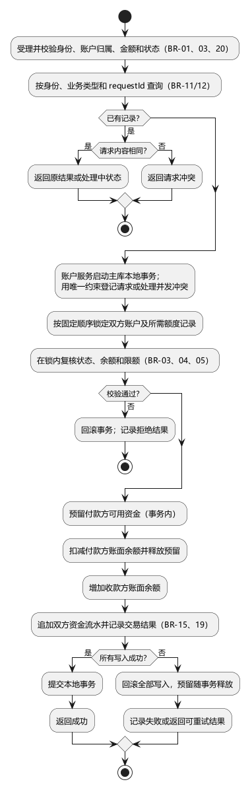

图 2-10 本行转账跨账户一致性活动图。源文件：`docs/uml/activity/transfer-tx.puml`。

如图 2-10 所示，完整链路为：受理与校验 → 幂等查询与判定 → 账户服务启动主库本地事务 → 唯一约束登记请求 → 按固定顺序锁定双方账户及额度记录 → 锁内复核状态、余额与限额 → 预留 → 扣减付款方并释放预留 → 增加收款方余额 → 追加双方流水并记录结果 → 提交或整体回滚。

四个关键设计点：

1. **幂等判定前置于资金动作**，同键同内容直接返回原结果，避免重复预留。
2. **固定顺序加锁**（按账户标识升序），消除双向转账的循环等待死锁。
3. **锁内复核**：状态、余额与限额必须在持锁后重新读取，不能用事务外的快照做判断。
4. **单事务覆盖双账户**：这是"账户服务独占资金写入"的直接后果，也是放弃 Saga 的原因。

图 2-8 只展开服务间交互，图 2-10 表达资金一致性主干；两图冲突时以图 2-10 为准。

##### 2.2.2.2 预留、双账户提交与释放

预留只改 R、不改 B：

```java
@Transactional
public PostingOutcome reserve(String payerAccountId, BigDecimal amount, String tradeNo) {
    Account payer = accountRepository.lockById(payerAccountId);
    if (payer.getStatus() != ACTIVE) {
        return PostingOutcome.reject("ACCOUNT_STATUS_INVALID");        // BR-03
    }
    if (amount.compareTo(payer.availableBalance()) > 0) {
        return PostingOutcome.reject("INSUFFICIENT_AVAILABLE_BALANCE"); // BR-01/04
    }
    if (!riskRule.evaluateOutgoing(amount, payer.snapshot()).isPass()) {
        return PostingOutcome.reject("LIMIT_EXCEEDED");                // BR-05/06/07
    }
    payer.reserve(amount);                          // R += amount; B 不变
    accountRepository.save(payer);
    transactionRepository.markProcessing(tradeNo);  // acceptedAt = now
    return PostingOutcome.ok();
}
```

双账户提交在同一个资金提交边界内完成，锁定顺序与流水追加顺序固定：

```java
@Transactional
public PostingOutcome postInternalTransfer(String tradeNo, String payerId,
                                           String payeeId, BigDecimal amount) {
    // 固定按 accountId 升序加锁，避免双向转账死锁
    Account first  = accountRepository.lockById(min(payerId, payeeId));
    Account second = accountRepository.lockById(max(payerId, payeeId));
    Account payer  = first.getAccountId().equals(payerId) ? first : second;
    Account payee  = first.getAccountId().equals(payeeId) ? first : second;

    if (payer.getReservedAmount().compareTo(amount) < 0) {
        throw new InvalidReservationException(tradeNo);
    }
    payer.debitReserved(amount);   // B -= amount; R -= amount
    payee.credit(amount);          // B += amount

    fundEntryRepository.save(FundEntry.debitOf(tradeNo, payerId, amount, payer.getBookBalance()));
    fundEntryRepository.save(FundEntry.creditOf(tradeNo, payeeId, amount, payee.getBookBalance()));
    transactionRepository.markSucceeded(tradeNo);
    return PostingOutcome.COMMITTED;
}
```

释放只减 R、不写流水（本次没有实际资金变动，BR-19）：

```java
@Transactional
public PostingOutcome releaseReservation(String payerId, BigDecimal amount, String tradeNo) {
    Account payer = accountRepository.lockById(payerId);
    if (payer.getReservedAmount().compareTo(amount) < 0) {
        throw new InvalidReservationException(tradeNo);
    }
    payer.release(amount);          // R -= amount; B 不变
    accountRepository.save(payer);
    return PostingOutcome.RELEASED; // 不写 FundEntry
}
```

失败与恢复的四条规则：提交失败则整体回滚、双方 B/R 不变，随后释放预留；释放失败置 `RECOVERING`，按 `tradeNo` 幂等重试，不得重复释放；资金已动但状态落库失败时，先查该 `tradeNo` 的流水是否已存在，再决定补状态或恢复，禁止二次扣款；冻结发生在受理之后不取消已受理交易，仍按原路径完成或释放。

##### 2.2.2.3 风控规则匹配

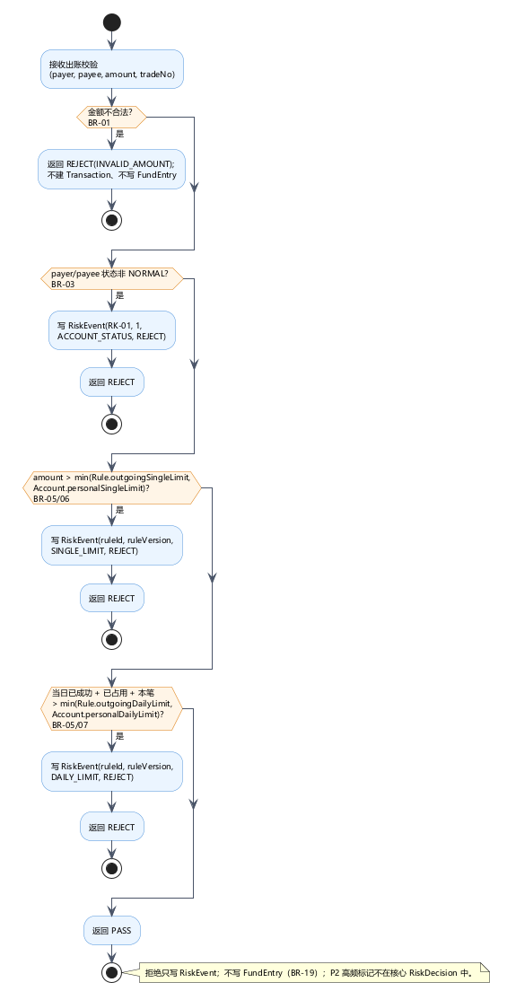

图 2-11 风控规则匹配活动图。源文件：`docs/uml/activity/risk-match.puml`。

```java
public RiskDecision checkOutgoing(Account payer, Account payee, Money amount,
                                  String tradeNo, String identityId) {
    if (!amount.isCny() || amount.value().compareTo(BigDecimal.ZERO) <= 0
            || amount.scale() > 2) {
        return RiskDecision.REJECT_INVALID_AMOUNT;   // 由 TransferService 前置处理
    }
    if (payer.getStatus() != ACTIVE || payee.getStatus() != ACTIVE) {
        riskEventRepository.save(RiskEvent.reject(
            tradeNo, "RK-01", 1, identityId, "ACCOUNT_STATUS"));   // BR-03
        return RiskDecision.REJECT;
    }
    RiskRule rule = riskRuleRepository.currentLimitPolicy();
    RiskDecision decision = rule.evaluateOutgoing(amount, payer.snapshot());
    if (!decision.isPass()) {
        riskEventRepository.save(RiskEvent.reject(
            tradeNo, rule.getRuleId(), rule.getRuleVersion(), identityId,
            decision.getReasonCode()));              // SINGLE_LIMIT / DAILY_LIMIT
    }
    return decision;
}
```

`evaluateOutgoing` 取"系统限额"与"个人限额"的较小值；账户状态是固定前置条件，不依赖可配置规则开关，避免误关规则导致冻结账户出账。图中每个判定节点都标注了对应 BR，便于答辩时逐点解释。

##### 2.2.2.4 幂等校验

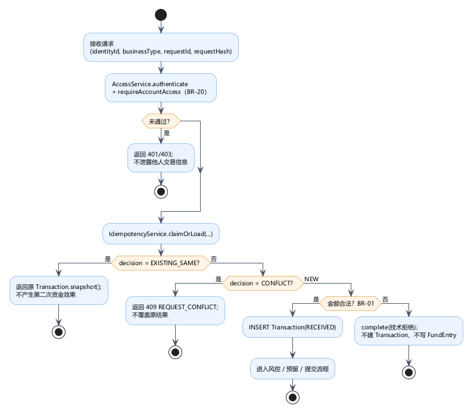

图 2-12 幂等校验活动图。源文件：`docs/uml/activity/idempotency.puml`。

| 情况                   | 返回              | 处理                | 资金效果   |
| -------------------- | --------------- | ----------------- | ------ |
| 无记录                  | `NEW`           | 原子认领，进入金额/账户/风控校验 | 尚未产生   |
| 同三元组、同 `requestHash` | `EXISTING_SAME` | 返回原交易快照；处理中返回当前状态 | 不产生第二次 |
| 同三元组、异 `requestHash` | `CONFLICT`      | 409，不覆盖原结果        | 不产生    |
| 并发同三元组               | 唯一键冲突           | 回查后按上两行处理         | 不产生第二次 |

实现要点：幂等键为三元组，`requestHash` 是规范化业务内容的 SHA-256，`10`、`10.0`、`10.00` 语义相同，`10.001` 不得四舍五入后接受；先鉴权再查重，命中 `requestId` 不能绕过权限检查；终态不可重开，`SUCCESS`/`FAILED`/`REJECTED` 后同一三元组只返回原结果，新业务须用新 `requestId`。

**为什么不是只加唯一索引**：唯一索引只能阻止重复插入交易，不能阻止重复调用资金提交；必须先原子认领，后续资金动作再按 `tradeNo` 幂等一次。

##### 2.2.2.5 交易状态机与错误码

交易状态采用 7 态，`SUCCESS`/`FAILED`/`REJECTED` 为终态：

| 当前状态       | 事件            | 下一状态                          | 资金副作用                 |
| ---------- | ------------- | ----------------------------- | --------------------- |
| ACCEPTED   | 权限/金额/账户/风控拒绝 | REJECTED                      | 无；不写流水                |
| ACCEPTED   | 预留成功          | PROCESSING                    | R 增，B 不变              |
| PROCESSING | 双账户提交成功       | SUCCESS                       | 付款 B/R 同减，收款 B 增，两条流水 |
| PROCESSING | 提交失败且释放成功     | FAILED                        | R 减回，B 不变，不写流水        |
| PROCESSING | 提交失败且释放失败     | RECOVERING                    | R 暂时保留                |
| RECOVERING | 幂等重试释放成功      | FAILED                        | R 减回，不写流水             |
| PROCESSING | 外部结果未知（跨行扩展点） | UNKNOWN                       | 保留 R，不提前扣账            |
| UNKNOWN    | 明确成功/失败/恢复    | SUCCESS / FAILED / RECOVERING | 按对应路径                 |

| HTTP | 错误码                              | 触发           | 依据            |
| ---- | -------------------------------- | ------------ | ------------- |
| 400  | `INVALID_ARGUMENT`               | 金额/币种/账户格式非法 | BR-01         |
| 401  | `UNAUTHENTICATED`                | 未登录或令牌失效     | BR-20         |
| 403  | `FORBIDDEN`                      | 越权访问他人账户     | BR-20         |
| 404  | `ACCOUNT_NOT_FOUND`              | 账户不存在或无权访问   | BR-20         |
| 409  | `REQUEST_CONFLICT`               | 同三元组不同内容     | BR-11/12      |
| 422  | `ACCOUNT_STATUS_INVALID`         | 付款方或收款方冻结/注销 | BR-03         |
| 422  | `INSUFFICIENT_AVAILABLE_BALANCE` | 可用余额 A < 金额  | BR-01/04      |
| 422  | `SINGLE_LIMIT_EXCEEDED`          | 超单笔限额        | BR-05/06      |
| 422  | `DAILY_LIMIT_EXCEEDED`           | 超日累计限额       | BR-05/07      |
| 500  | `INTERNAL_ERROR`                 | 未预期异常        | 不静默丢资金，进入对账恢复 |

### 2.3 服务边界与接口契约

#### 2.3.1 限界上下文与服务划分

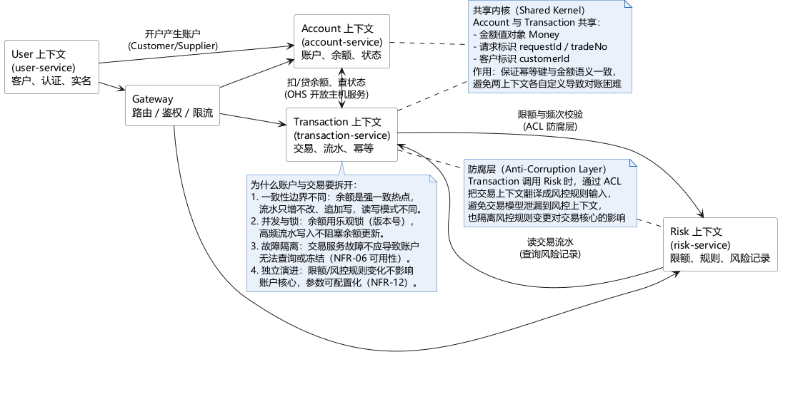

图 2-13 上下文映射图（user / account / transaction / risk）。源文件：`docs/uml/class/context-map.puml`。

四个限界上下文的关系与集成模式如图 2-13 所示：客户上下文向下游提供身份（Customer/Supplier）；账户与交易之间通过开放主机服务（OHS）交换扣贷与状态查询；交易调用风控时经防腐层（ACL）翻译规则输入，避免交易模型泄漏到风控上下文；账户与交易共享 `Money`、`requestId`/`tradeNo`、`customerId` 构成的共享内核。

**为什么账户与交易必须拆开**，理由有四：一致性边界不同（余额是强一致热点，流水是追加写）；并发与锁策略不同（余额用版本号与行锁，流水写入不应阻塞余额更新）；故障隔离（交易服务故障不应导致账户无法查询或冻结）；独立演进（限额与规则变化不应触及账户核心）。

服务职责与数据所有权如下：

| 服务                  | 职责边界                          | 拥有的数据                                       | 对外前缀                               |
| ------------------- | ----------------------------- | ------------------------------------------- | ---------------------------------- |
| gateway             | 路由、会话校验、限流；不做对象级授权            | —                                           | `/api/v1/*`                        |
| user-service        | 注册、登录、会话、客户信息与实名              | customer、credential                         | `/api/v1/auth`、`/api/v1/customers` |
| account-service     | 账户生命周期、余额查询（B/R/A）、**独占资金记账** | account、transaction_flow、account_status_log | `/api/v1/accounts`                 |
| transaction-service | 统一交易受理与编排（存款/取款/转账）、幂等、渠道交互   | transaction、transfer_order                  | `/api/v1/deposits` 等               |
| risk-service        | 限额与账户状态规则求值、风险事件留痕            | risk_rule、risk_event                        | `/api/v1/risk`                     |

四个服务共用同一数据库实例，但按数据职责限定写入权限。`transaction` 是唯一共写表：受理字段由交易服务写入，状态推进字段由账户服务在记账事务内更新，否则会出现"余额已动、状态未更新"。完整的端点清单、内部接口与用例—接口覆盖矩阵见《服务边界与接口清单》。

#### 2.3.2 统一接口约定

- **统一响应体**：`code`（"0" 为成功，非 0 为业务错误码）、`message`、`data`、`requestId`、`traceId`、`timestamp`。
- **幂等约定**：客户端为每次写请求生成 UUID 放入 `X-Request-Id`，网关透传，交易服务以三元组唯一索引落库；同键同内容返回原结果，同键异内容返回 409。
- **错误码分段**：`AUTH-`、`ACC-`、`TRX-`、`RISK-`、`SYS-` 五个域，便于前端与日志按域检索。
- **鉴权**：JWT access token；客户仅能访问本人 `customerId`/`accountNo`，后台按角色与对象范围授权；冻结、解冻、注销、限额变更、核对、恢复均写审计日志。

### 2.4 技术选型

| 决策   | 结论                          | 主要理由                                                                                             |
| ---- | --------------------------- | ------------------------------------------------------------------------------------------------ |
| 前端框架 | Vue 3 + Element Plus + Vite | 组员熟悉度优先；表单校验、表格分页、消息提示组件可直接覆盖账户与交易页面；放弃 React 因部分组员不熟、排错会拖慢工期，放弃 Thymeleaf 因前后端耦合不利于 JWT 集成与复杂交互 |
| 数据库  | MySQL 8（InnoDB，`utf8mb4`）   | 资金原子性依赖本地事务，幂等依赖唯一索引，二者均不需要额外组件；MongoDB 多文档事务与精确小数需额外验证，对两周工期是纯风险                                |
| 缓存   | 不引入 Redis                   | 无明确需求：并发规模为 10 名模拟客户，余额查询可由单库加从库满足；幂等键已由唯一约束实现；引入 Redis 属过度设计                                    |
| 建模工具 | PlantUML                    | 图为文本，可 diff、可 review，与代码同仓，导出 SVG 不失真                                                            |

选型的共同判据是"可验证性优先"：每个决策都要求能在课程环境中被一次性验证，而不是停留在方案描述。

---

## 3 数据库设计

### 3.1 数据库表设计

第 3 章把 2.2 的设计类落为 10 张 InnoDB 表，供实验三直接建库。三条贯穿全章的取舍：

1. **代理主键 + 业务唯一键**：每表保留自增 `id` 作聚集索引主键，同时以业务标识（`customer_id`、`account_id`、`trade_no`、`transfer_id`、`rule_id`、`event_id`）建唯一约束并作为外键，跨服务只传业务标识。
2. **资金数值只用 `DECIMAL(18,2)`**：金额、余额、预留、限额一律不用 `FLOAT/DOUBLE`。
3. **流水与审计只追加**：`transaction_flow`、`risk_event`、`account_status_log`、`audit_log` 不更新、不删除；只有实际资金变动才写流水。

余额不变式 A=B−R 中的 A 是派生值，**不落库**，避免三处余额互相矛盾。

#### 3.1.1 类到表的映射规则

| 映射场景        | 规则                                          | 示例                                           |
| ----------- | ------------------------------------------- | -------------------------------------------- |
| 实体类 → 表     | 一个独立业务实体一张表，表名 = 类名转 snake_case             | `Account` → `account`                        |
| 值对象 → 内嵌列   | 无独立生命周期，不进表                                 | `Money` → `amount` + `currency`              |
| 派生值 → 不落库   | 由查询期计算                                      | `availableBalance()` = B−R                   |
| 状态历史（值对象升格） | 需保留历史与操作人，独立成表                              | `account_status_log`                         |
| 继承          | 本模型无继承；若未来出现交易子类，用单表继承 + `business_type` 判别 | —                                            |
| 多对多         | 本模型无多对多，不建中间表                               | 原草稿 `risk_rule_customer` 已删除                 |
| 一对多         | 多端持外键，指向一端的业务唯一键                            | `account.customer_id → customer.customer_id` |
| 一对一         | 子表业务键加唯一约束                                  | `transfer_order.trade_no`                    |

命名规范：表名与字段名全小写 snake_case、不加业务前缀；主键统一 `id BIGINT UNSIGNED AUTO_INCREMENT`；唯一索引 `uk_<表>_<语义>`，普通索引 `idx_<表>_<字段或语义>`，外键 `fk_<子表>_<父表>`；枚举存 `VARCHAR` 大写英文常量，不用魔法数字；业务标识 `VARCHAR(32)`（身份为 64）；金额 `DECIMAL(18,2)`；时间 `DATETIME`。

公共字段（各表统一）：`id`、`created_at`、`updated_at`、`version`（乐观锁用）。

#### 3.1.2 表 2-2 数据库表名清单

**表 2-2 数据库表名清单**

| 序号  | 中文表名      | 英文表名                 | 表功能说明                     |
| --- | --------- | -------------------- | ------------------------- |
| 1   | 客户表       | `customer`           | 身份（`identity_id`）、实名与客户状态 |
| 2   | 登录凭证表     | `credential`         | 用户名、密码哈希、凭证状态             |
| 3   | 账户表       | `account`            | 账面余额 B、预留 R、状态、个人限额       |
| 4   | 账户状态变更记录表 | `account_status_log` | 冻结/解冻/注销的历史与操作人           |
| 5   | 交易表       | `transaction`        | 受理记录、幂等键、交易状态             |
| 6   | 资金流水表     | `transaction_flow`   | 实际资金变动的只追加流水（BR-19）       |
| 7   | 转账单表      | `transfer_order`     | 本行/跨行转账要素与清算状态            |
| 8   | 风控规则表     | `risk_rule`          | 单笔、日累计限额与账户状态规则           |
| 9   | 风险事件表     | `risk_event`         | 规则命中记录与拒绝结果               |
| 10  | 审计日志表     | `audit_log`          | 关键操作留痕（BR-20）             |

三张非实体表的出处：`credential` 是 `Customer` 登录凭证属性的拆分（凭证有独立生命周期，密码哈希不宜与主数据同表）；`account_status_log` 是 `Account.status` 的历史升格（内嵌只能保留最后一次，丢失审计链）；`audit_log` 无领域类，来源 BR-20 与 NFR-05，因审计对象跨聚合而独立成表。

未建的表及理由：不建 `risk_rule_customer`（类模型无此多对多）；不建 `money`/`account_limit`（值对象内嵌）；不建交易子类表（无继承）。`transaction_flow` 即设计类 `FundEntry`，沿用任务清单表名，避免同一概念两张表。

表间关系：`customer 1—N credential`、`customer 1—N account`、`account 1—N account_status_log`、`account 1—N transaction`、`transaction 1—N transaction_flow`、`transaction 1—1 transfer_order`、`transaction 1—N risk_event`、`risk_rule 1—N risk_event`；`audit_log` 独立，不强绑外键。所有外键 `RESTRICT`，禁止级联删除。

`identity_id` 与 `customer_id` 是两个标识：前者是对外交互与幂等登记口径（`VARCHAR(64)`，建唯一约束），后者是系统内部客户主键（`VARCHAR(32)`，表间外键目标）。`transaction.identity_id`、`risk_event.operator_identity_id` 等属多态身份引用（可由客户、运营或系统发起），**不建外键**，否则会把非客户身份误判为非法。

#### 3.1.3 枚举取值

| 枚举                               | 权威取值                                                                                     | 说明                                         |
| -------------------------------- | ---------------------------------------------------------------------------------------- | ------------------------------------------ |
| `account.status`                 | `ACTIVE` / `FROZEN` / `CLOSED`                                                           | BR-03；与图 2-8、2-9 的判定字面量一致                  |
| `transaction.status`             | `ACCEPTED` / `PROCESSING` / `UNKNOWN` / `SUCCESS` / `RECOVERING` / `FAILED` / `REJECTED` | 7 态；`UNKNOWN` 支撑跨行清算未决，`RECOVERING` 支撑资金恢复 |
| `transaction.business_type`      | `DEPOSIT` / `WITHDRAWAL` / `INTERNAL_TRANSFER` / `EXTERNAL_TRANSFER` / `ACCOUNT_OPEN`    | `ACCOUNT_OPEN` 为开户幂等登记，无资金变动               |
| `transaction_flow.entry_role`    | `TRANSFER_OUT` / `TRANSFER_IN` / `DEPOSIT_IN` / `WITHDRAW_OUT`                           | 一条流水对应一个资金角色                               |
| `transfer_order.clearing_status` | `NOT_APPLICABLE` / `SUBMITTED` / `UNKNOWN` / `CONFIRMED_SUCCESS` / `CONFIRMED_FAILURE`   | 本行固定 `NOT_APPLICABLE`                      |

`ACCOUNT_OPEN` 行的 `amount` 记 0.00，因此金额约束放宽为"`amount > 0` 或（业务类型为 `ACCOUNT_OPEN` 且 `amount = 0`）"。

### 3.2 数据库表详细清单

**表 2-3 各表字段详细清单**。公共字段 `id`、`created_at`、`updated_at`、`version` 在各表重复出现，逐表列出以便直接对照 DDL。

#### 3.2.1 表 2-3-1 `customer` 客户表

| 字段中文名  | 字段英文名              | 类型（宽度/精度）       | 取值约束                                      | 空否  | 默认值               | 主/外键  | 索引                        |
| ------ | ------------------ | --------------- | ----------------------------------------- | --- | ----------------- | ----- | ------------------------- |
| 主键 ID  | `id`               | BIGINT UNSIGNED | 自增                                        | 否   | —                 | PK    | 聚集主键                      |
| 客户业务标识 | `customer_id`      | VARCHAR(32)     | 全局唯一；表间外键口径                               | 否   | —                 | 业务主键  | `uk_customer_customer_id` |
| 身份标识   | `identity_id`      | VARCHAR(64)     | 全局唯一；幂等键取值出处                              | 否   | —                 | 业务唯一键 | `uk_customer_identity_id` |
| 客户名称   | `name`             | VARCHAR(100)    | 非空                                        | 否   | —                 | —     | —                         |
| 手机号    | `phone`            | VARCHAR(20)     | 唯一                                        | 是   | NULL              | —     | `uk_customer_phone`       |
| 邮箱     | `email`            | VARCHAR(100)    | 应用层校验                                     | 是   | NULL              | —     | —                         |
| 实名状态   | `real_name_status` | VARCHAR(16)     | `UNVERIFIED`/`VERIFIED`/`REJECTED`        | 否   | 'UNVERIFIED'      | —     | —                         |
| 客户状态   | `status`           | VARCHAR(16)     | `NORMAL`/`FROZEN`/`CANCELLED`；客户级冻结本迭代不写入 | 否   | 'NORMAL'          | —     | `idx_customer_status`     |
| 创建时间   | `created_at`       | DATETIME        | —                                         | 否   | CURRENT_TIMESTAMP | —     | —                         |
| 更新时间   | `updated_at`       | DATETIME        | —                                         | 否   | CURRENT_TIMESTAMP | —     | —                         |
| 版本号    | `version`          | INT UNSIGNED    | ≥1                                        | 否   | 1                 | —     | —                         |

#### 3.2.2 表 2-3-2 `credential` 登录凭证表

| 字段中文名 | 字段英文名             | 类型              | 取值约束                          | 空否  | 默认值               | 主/外键        | 索引                        |
| ----- | ----------------- | --------------- | ----------------------------- | --- | ----------------- | ----------- | ------------------------- |
| 主键 ID | `id`              | BIGINT UNSIGNED | 自增                            | 否   | —                 | PK          | 主键                        |
| 所属客户  | `customer_id`     | VARCHAR(32)     | 引用 `customer.customer_id`     | 否   | —                 | FK→customer | `idx_credential_customer` |
| 用户名   | `username`        | VARCHAR(50)     | 唯一                            | 否   | —                 | —           | `uk_credential_username`  |
| 密码哈希  | `password_hash`   | VARCHAR(255)    | 不可逆哈希                         | 否   | —                 | —           | —                         |
| 凭证类型  | `credential_type` | VARCHAR(16)     | `USERNAME`/`MOBILE`/`EMAIL`   | 否   | 'USERNAME'        | —           | —                         |
| 凭证状态  | `status`          | VARCHAR(16)     | `NORMAL`/`LOCKED`/`CANCELLED` | 否   | 'NORMAL'          | —           | —                         |
| 创建时间  | `created_at`      | DATETIME        | —                             | 否   | CURRENT_TIMESTAMP | —           | —                         |
| 更新时间  | `updated_at`      | DATETIME        | —                             | 否   | CURRENT_TIMESTAMP | —           | —                         |
| 版本号   | `version`         | INT UNSIGNED    | ≥1                            | 否   | 1                 | —           | —                         |

#### 3.2.3 表 2-3-3 `account` 账户表

| 字段中文名    | 字段英文名                   | 类型              | 取值约束                              | 空否  | 默认值               | 主/外键        | 索引                      |
| -------- | ----------------------- | --------------- | --------------------------------- | --- | ----------------- | ----------- | ----------------------- |
| 主键 ID    | `id`                    | BIGINT UNSIGNED | 自增                                | 否   | —                 | PK          | 主键                      |
| 账户业务标识   | `account_id`            | VARCHAR(32)     | 全局唯一                              | 否   | —                 | 业务主键        | `uk_account_account_id` |
| 所属客户     | `customer_id`           | VARCHAR(32)     | 引用 `customer.customer_id`         | 否   | —                 | FK→customer | `idx_account_customer`  |
| 币种       | `currency`              | CHAR(3)         | 固定 `CNY`                          | 否   | 'CNY'             | —           | —                       |
| 账户状态     | `status`                | VARCHAR(16)     | `ACTIVE`/`FROZEN`/`CLOSED`（BR-03） | 否   | 'ACTIVE'          | —           | `idx_account_status`    |
| 账面余额 B   | `book_balance`          | DECIMAL(18,2)   | ≥0（BR-04）                         | 否   | 0.00              | —           | —                       |
| 预留金额 R   | `reserved_amount`       | DECIMAL(18,2)   | ≥0 且 ≤`book_balance`              | 否   | 0.00              | —           | —                       |
| 个人单笔出账限额 | `personal_single_limit` | DECIMAL(18,2)   | >0；NULL 表示沿用规则                    | 是   | NULL              | —           | —                       |
| 个人日累计限额  | `personal_daily_limit`  | DECIMAL(18,2)   | >0；NULL 表示沿用规则                    | 是   | NULL              | —           | —                       |
| 创建时间     | `created_at`            | DATETIME        | —                                 | 否   | CURRENT_TIMESTAMP | —           | —                       |
| 更新时间     | `updated_at`            | DATETIME        | —                                 | 否   | CURRENT_TIMESTAMP | —           | —                       |
| 版本号      | `version`               | INT UNSIGNED    | ≥1，记账时校验                          | 否   | 1                 | —           | —                       |

可用余额 A 不建列，按 B−R 计算；类模型未定义账户子类，故不设 `account_type`。

#### 3.2.4 表 2-3-4 `account_status_log` 账户状态变更记录表

| 字段中文名 | 字段英文名                  | 类型              | 取值约束                    | 空否  | 默认值               | 主/外键       | 索引                                       |
| ----- | ---------------------- | --------------- | ----------------------- | --- | ----------------- | ---------- | ---------------------------------------- |
| 主键 ID | `id`                   | BIGINT UNSIGNED | 自增                      | 否   | —                 | PK         | 主键                                       |
| 账户    | `account_id`           | VARCHAR(32)     | 引用 `account.account_id` | 否   | —                 | FK→account | 组合索引首列                                   |
| 变更前状态 | `previous_status`      | VARCHAR(16)     | 同账户状态枚举                 | 是   | NULL              | —          | —                                        |
| 变更后状态 | `new_status`           | VARCHAR(16)     | 同账户状态枚举                 | 否   | —                 | —          | —                                        |
| 变更原因  | `change_reason`        | VARCHAR(255)    | —                       | 是   | NULL              | —          | —                                        |
| 操作人身份 | `operator_identity_id` | VARCHAR(64)     | 系统或人工身份                 | 是   | NULL              | —          | —                                        |
| 创建时间  | `created_at`           | DATETIME        | 变更时点                    | 否   | CURRENT_TIMESTAMP | —          | `idx_account_status_log_account_created` |
| 更新时间  | `updated_at`           | DATETIME        | 不更新                     | 否   | CURRENT_TIMESTAMP | —          | —                                        |
| 版本号   | `version`              | INT UNSIGNED    | 仅形式保留                   | 否   | 1                 | —          | —                                        |

#### 3.2.5 表 2-3-5 `transaction` 交易表

| 字段中文名  | 字段英文名                 | 类型              | 取值约束                            | 空否  | 默认值               | 主/外键       | 索引                                                        |
| ------ | --------------------- | --------------- | ------------------------------- | --- | ----------------- | ---------- | --------------------------------------------------------- |
| 主键 ID  | `id`                  | BIGINT UNSIGNED | 自增                              | 否   | —                 | PK         | 主键                                                        |
| 交易流水号  | `trade_no`            | VARCHAR(32)     | 全局唯一；双方流水据此关联                   | 否   | —                 | 业务主键       | `uk_transaction_trade_no`                                 |
| 发起身份   | `identity_id`         | VARCHAR(64)     | 幂等维度之一；多态引用不建外键                 | 否   | —                 | —          | 幂等唯一键首列                                                   |
| 业务类型   | `business_type`       | VARCHAR(24)     | 5 值枚举（见 3.1.3）                  | 否   | —                 | —          | 幂等唯一键次列                                                   |
| 请求号    | `request_id`          | VARCHAR(64)     | 客户端生成；与身份、业务类型共同唯一              | 否   | —                 | —          | `uk_transaction_request`、`idx_transaction_request_lookup` |
| 请求内容摘要 | `request_hash`        | CHAR(64)        | SHA-256；同键异内容判冲突                | 否   | —                 | —          | —                                                         |
| 付款方主账户 | `account_id`          | VARCHAR(32)     | 引用 `account.account_id`；开户时填新账户 | 否   | —                 | FK→account | `idx_transaction_account_created`                         |
| 交易金额   | `amount`              | DECIMAL(18,2)   | >0；`ACCOUNT_OPEN` 允许 0.00       | 否   | —                 | —          | —                                                         |
| 币种     | `currency`            | CHAR(3)         | 固定 `CNY`                        | 否   | 'CNY'             | —          | —                                                         |
| 交易状态   | `status`              | VARCHAR(16)     | 7 态（见 3.1.3）                    | 否   | 'ACCEPTED'        | —          | `idx_transaction_status`                                  |
| 渠道凭证号  | `channel_evidence_id` | VARCHAR(64)     | 模拟渠道回执标识                        | 是   | NULL              | —          | —                                                         |
| 最近渠道结果 | `last_channel_result` | VARCHAR(32)     | 原样保留，不据此改判资金                    | 是   | NULL              | —          | —                                                         |
| 最近查询时间 | `last_checked_at`     | DATETIME        | 未决轮询时间                          | 是   | NULL              | —          | —                                                         |
| 失败原因   | `failure_reason`      | VARCHAR(255)    | 拒绝或失败原因                         | 是   | NULL              | —          | —                                                         |
| 受理时间   | `accepted_at`         | DATETIME        | 幂等登记成功时写入                       | 是   | NULL              | —          | —                                                         |
| 完成时间   | `completed_at`        | DATETIME        | 终态时间                            | 是   | NULL              | —          | —                                                         |
| 创建时间   | `created_at`          | DATETIME        | —                               | 否   | CURRENT_TIMESTAMP | —          | —                                                         |
| 更新时间   | `updated_at`          | DATETIME        | —                               | 否   | CURRENT_TIMESTAMP | —          | —                                                         |
| 版本号    | `version`             | INT UNSIGNED    | ≥1                              | 否   | 1                 | —          | —                                                         |

写入方划分：`trade_no`—`currency` 与 `accepted_at` 属受理段，由交易服务一次写入、之后不改；`status` 此后只按状态机推进；`channel_evidence_id`、`last_channel_result`、`last_checked_at` 属清算回报段；`failure_reason`、`completed_at` 属结局段。任何阶段都不得回填受理段字段。

#### 3.2.6 表 2-3-6 `transaction_flow` 资金流水表

| 字段中文名   | 字段英文名                | 类型              | 取值约束                                                     | 空否  | 默认值               | 主/外键           | 索引                                     |
| ------- | -------------------- | --------------- | -------------------------------------------------------- | --- | ----------------- | -------------- | -------------------------------------- |
| 主键 ID   | `id`                 | BIGINT UNSIGNED | 自增                                                       | 否   | —                 | PK             | 主键                                     |
| 流水标识    | `entry_id`           | VARCHAR(32)     | 全局唯一                                                     | 否   | —                 | 业务主键           | `uk_transaction_flow_entry_id`         |
| 交易流水号   | `trade_no`           | VARCHAR(32)     | 引用 `transaction.trade_no`                                | 否   | —                 | FK→transaction | `idx_transaction_flow_trade_no`        |
| 账户      | `account_id`         | VARCHAR(32)     | 引用 `account.account_id`                                  | 否   | —                 | FK→account     | 组合索引首列                                 |
| 流水角色    | `entry_role`         | VARCHAR(24)     | `TRANSFER_OUT`/`TRANSFER_IN`/`DEPOSIT_IN`/`WITHDRAW_OUT` | 否   | —                 | —              | `uk_transaction_flow_role` 末列          |
| 资金方向    | `direction`          | VARCHAR(8)      | `DEBIT`/`CREDIT`                                         | 否   | —                 | —              | —                                      |
| 变动金额    | `amount`             | DECIMAL(18,2)   | >0（BR-19）                                                | 否   | —                 | —              | —                                      |
| 记账后账面余额 | `book_balance_after` | DECIMAL(18,2)   | ≥0                                                       | 否   | —                 | —              | —                                      |
| 发生时间    | `created_at`         | DATETIME        | 对应 `FundEntry.occurred_at`                               | 否   | CURRENT_TIMESTAMP | —              | `idx_transaction_flow_account_created` |
| 更新时间    | `updated_at`         | DATETIME        | 不更新                                                      | 否   | CURRENT_TIMESTAMP | —              | —                                      |
| 版本号     | `version`            | INT UNSIGNED    | 仅形式保留                                                    | 否   | 1                 | —              | —                                      |

只有实际资金事件才写流水：`debitReserved`、`credit` 成功才写；拒绝、预留、释放都不写。同一 `trade_no` 下 `TRANSFER_OUT` 与 `TRANSFER_IN` 各一条，`uk_transaction_flow_role` 保证不重复。

#### 3.2.7 表 2-3-7 `transfer_order` 转账单表

| 字段中文名   | 字段英文名                | 类型              | 取值约束                            | 空否  | 默认值               | 主/外键           | 索引                              |
| ------- | -------------------- | --------------- | ------------------------------- | --- | ----------------- | -------------- | ------------------------------- |
| 主键 ID   | `id`                 | BIGINT UNSIGNED | 自增                              | 否   | —                 | PK             | 主键                              |
| 转账单标识   | `transfer_id`        | VARCHAR(32)     | 全局唯一                            | 否   | —                 | 业务主键           | `uk_transfer_order_transfer_id` |
| 交易流水号   | `trade_no`           | VARCHAR(32)     | 引用 `transaction.trade_no`，一交易一单 | 否   | —                 | FK→transaction | `uk_transfer_order_trade_no`    |
| 转账类型    | `transfer_type`      | VARCHAR(16)     | `INTERNAL`/`EXTERNAL`           | 否   | —                 | —              | —                               |
| 付款方账户   | `payer_account_id`   | VARCHAR(32)     | 引用 `account.account_id`，不得等于收款方 | 否   | —                 | FK→account     | `idx_transfer_order_payer`      |
| 收款方账户   | `payee_account_id`   | VARCHAR(32)     | 本行必填；跨行必须为空                     | 是   | NULL              | FK→account     | `idx_transfer_order_payee`      |
| 外部银行代码  | `external_bank_code` | VARCHAR(32)     | 跨行必填；本行必须为空                     | 是   | NULL              | —              | —                               |
| 外部收款方引用 | `external_payee_ref` | VARCHAR(64)     | 跨行必填、脱敏存储                       | 是   | NULL              | —              | —                               |
| 转账金额    | `amount`             | DECIMAL(18,2)   | >0，与交易金额一致                      | 否   | —                 | —              | —                               |
| 币种      | `currency`           | CHAR(3)         | 固定 `CNY`                        | 否   | 'CNY'             | —              | —                               |
| 清算状态    | `clearing_status`    | VARCHAR(24)     | 5 值枚举；本行 `NOT_APPLICABLE`       | 否   | 'NOT_APPLICABLE'  | —              | `idx_transfer_order_clearing`   |
| 创建时间    | `created_at`         | DATETIME        | —                               | 否   | CURRENT_TIMESTAMP | —              | —                               |
| 更新时间    | `updated_at`         | DATETIME        | —                               | 否   | CURRENT_TIMESTAMP | —              | —                               |
| 版本号     | `version`            | INT UNSIGNED    | ≥1                              | 否   | 1                 | —              | —                               |

条件约束由 CHECK 表达：本行必须回填 `payee_account_id` 且跨行三列全空；跨行必须 `payee_account_id` 为空且外部两列非空。

#### 3.2.8 表 2-3-8 `risk_rule` 风控规则表

| 字段中文名   | 字段英文名                   | 类型              | 取值约束                            | 空否  | 默认值               | 主/外键 | 索引                              |
| ------- | ----------------------- | --------------- | ------------------------------- | --- | ----------------- | ---- | ------------------------------- |
| 主键 ID   | `id`                    | BIGINT UNSIGNED | 自增                              | 否   | —                 | PK   | 主键                              |
| 规则标识    | `rule_id`               | VARCHAR(32)     | 全局唯一，如 `RK-01`                  | 否   | —                 | 业务主键 | `uk_risk_rule_rule_id`          |
| 规则类型    | `rule_type`             | VARCHAR(24)     | `LIMIT_POLICY`/`ACCOUNT_STATUS` | 否   | —                 | —    | `idx_risk_rule_type_enabled` 首列 |
| 存款单笔限额  | `deposit_single_limit`  | DECIMAL(18,2)   | >0；`LIMIT_POLICY` 必填            | 是   | NULL              | —    | —                               |
| 出账单笔限额  | `outgoing_single_limit` | DECIMAL(18,2)   | >0；`LIMIT_POLICY` 必填            | 是   | NULL              | —    | —                               |
| 出账日累计限额 | `outgoing_daily_limit`  | DECIMAL(18,2)   | >0；`LIMIT_POLICY` 必填            | 是   | NULL              | —    | —                               |
| 是否启用    | `enabled`               | TINYINT(1)      | 0/1；基础资金约束不因关闭失效                | 否   | 1                 | —    | `idx_risk_rule_type_enabled` 次列 |
| 规则版本    | `rule_version`          | INT             | ≥1，命中时随事件固化                     | 否   | 1                 | —    | —                               |
| 创建时间    | `created_at`            | DATETIME        | —                               | 否   | CURRENT_TIMESTAMP | —    | —                               |
| 更新时间    | `updated_at`            | DATETIME        | —                               | 否   | CURRENT_TIMESTAMP | —    | —                               |
| 版本号     | `version`               | INT UNSIGNED    | ≥1                              | 否   | 1                 | —    | —                               |

`ACCOUNT_STATUS`（`RK-01`）行的三个限额必须全空，仅作为风险事件的内置规则登记；`LIMIT_POLICY` 行必须全非空，由 CHECK 保证。

#### 3.2.9 表 2-3-9 `risk_event` 风险事件表

| 字段中文名 | 字段英文名                  | 类型              | 取值约束                                          | 空否  | 默认值               | 主/外键           | 索引                               |
| ----- | ---------------------- | --------------- | --------------------------------------------- | --- | ----------------- | -------------- | -------------------------------- |
| 主键 ID | `id`                   | BIGINT UNSIGNED | 自增                                            | 否   | —                 | PK             | 主键                               |
| 事件标识  | `event_id`             | VARCHAR(32)     | 全局唯一                                          | 否   | —                 | 业务主键           | `uk_risk_event_event_id`         |
| 交易流水号 | `trade_no`             | VARCHAR(32)     | 引用 `transaction.trade_no`                     | 否   | —                 | FK→transaction | `idx_risk_event_trade_no`        |
| 命中规则  | `rule_id`              | VARCHAR(32)     | 引用 `risk_rule.rule_id`                        | 否   | —                 | FK→risk_rule   | `idx_risk_event_rule_created` 首列 |
| 规则版本  | `rule_version`         | INT             | ≥1，取命中时版本                                     | 否   | —                 | —              | —                                |
| 操作身份  | `operator_identity_id` | VARCHAR(64)     | `SYSTEM` 或人工身份                                | 否   | —                 | —              | —                                |
| 原因码   | `reason_code`          | VARCHAR(32)     | `ACCOUNT_STATUS`/`SINGLE_LIMIT`/`DAILY_LIMIT` | 否   | —                 | —              | —                                |
| 判定结果  | `result`               | VARCHAR(16)     | `PASS`/`REJECT`                               | 否   | —                 | —              | —                                |
| 命中时间  | `created_at`           | DATETIME        | 对应 `RiskEvent.occurredAt`                     | 否   | CURRENT_TIMESTAMP | —              | `idx_risk_event_rule_created` 次列 |
| 更新时间  | `updated_at`           | DATETIME        | 不更新                                           | 否   | CURRENT_TIMESTAMP | —              | —                                |
| 版本号   | `version`              | INT UNSIGNED    | 仅形式保留                                         | 否   | 1                 | —              | —                                |

#### 3.2.10 表 2-3-10 `audit_log` 审计日志表

| 字段中文名  | 字段英文名                  | 类型              | 取值约束                                         | 空否  | 默认值               | 主/外键 | 索引                                  |
| ------ | ---------------------- | --------------- | -------------------------------------------- | --- | ----------------- | ---- | ----------------------------------- |
| 主键 ID  | `id`                   | BIGINT UNSIGNED | 自增                                           | 否   | —                 | PK   | 主键                                  |
| 操作者身份  | `operator_identity_id` | VARCHAR(64)     | 系统或人工身份                                      | 否   | —                 | —    | `idx_audit_log_operator_created` 首列 |
| 动作     | `action`               | VARCHAR(32)     | 如 `LOGIN`/`ACCOUNT_FREEZE`/`TRANSFER_REJECT` | 否   | —                 | —    | —                                   |
| 操作对象类型 | `target_type`          | VARCHAR(32)     | 如 `account`/`transaction`                    | 否   | —                 | —    | `idx_audit_log_target` 首列           |
| 操作对象标识 | `target_ref`           | VARCHAR(64)     | 对象业务标识                                       | 是   | NULL              | —    | `idx_audit_log_target` 次列           |
| 原因     | `reason`               | VARCHAR(255)    | —                                            | 是   | NULL              | —    | —                                   |
| 结果     | `result`               | VARCHAR(16)     | `SUCCESS`/`FAILURE`/`REJECT`                 | 是   | NULL              | —    | —                                   |
| 交易流水号  | `trade_no`             | VARCHAR(32)     | 可空；不建外键                                      | 是   | NULL              | —    | `idx_audit_log_trade_no`            |
| 客户端 IP | `ip_address`           | VARCHAR(45)     | 兼容 IPv6                                      | 是   | NULL              | —    | —                                   |
| 创建时间   | `created_at`           | DATETIME        | 操作时间                                         | 否   | CURRENT_TIMESTAMP | —    | `idx_audit_log_operator_created` 次列 |
| 更新时间   | `updated_at`           | DATETIME        | 不更新                                          | 否   | CURRENT_TIMESTAMP | —    | —                                   |
| 版本号    | `version`              | INT UNSIGNED    | 仅形式保留                                        | 否   | 1                 | —    | —                                   |

### 3.3 索引设计

| 表                  | 索引名                                      | 类型   | 字段                                             | 用途            |
| ------------------ | ---------------------------------------- | ---- | ---------------------------------------------- | ------------- |
| customer           | `uk_customer_customer_id`                | 唯一   | `customer_id`                                  | 业务标识、被外键引用    |
| customer           | `uk_customer_identity_id`                | 唯一   | `identity_id`                                  | 幂等键首维取值出处     |
| customer           | `uk_customer_phone`                      | 唯一   | `phone`                                        | 手机号登录         |
| customer           | `idx_customer_status`                    | 普通   | `status`                                       | 按状态筛选         |
| credential         | `uk_credential_username`                 | 唯一   | `username`                                     | 登录名唯一         |
| credential         | `idx_credential_customer`                | 普通   | `customer_id`                                  | 外键 + 按客户查凭证   |
| account            | `uk_account_account_id`                  | 唯一   | `account_id`                                   | 业务标识、被外键引用    |
| account            | `idx_account_customer`                   | 普通   | `customer_id`                                  | 外键 + 客户账户列表   |
| account            | `idx_account_status`                     | 普通   | `status`                                       | 冻结账户筛查        |
| account_status_log | `idx_account_status_log_account_created` | 组合   | (`account_id`, `created_at`)                   | 状态历史倒序        |
| transaction        | `uk_transaction_trade_no`                | 唯一   | `trade_no`                                     | 流水/转账单/风控事件关联 |
| transaction        | `uk_transaction_request`                 | 唯一组合 | (`identity_id`, `business_type`, `request_id`) | 幂等（BR-11/12）  |
| transaction        | `idx_transaction_request_lookup`         | 普通   | `request_id`                                   | 按请求号回查        |
| transaction        | `idx_transaction_account_created`        | 组合   | (`account_id`, `created_at`)                   | 账户交易列表        |
| transaction        | `idx_transaction_status`                 | 普通   | `status`                                       | 未决交易轮询        |
| transaction_flow   | `uk_transaction_flow_entry_id`           | 唯一   | `entry_id`                                     | 流水幂等登记        |
| transaction_flow   | `uk_transaction_flow_role`               | 唯一组合 | (`trade_no`, `account_id`, `entry_role`)       | 防止重复记账        |
| transaction_flow   | `idx_transaction_flow_account_created`   | 组合   | (`account_id`, `created_at`)                   | 账户流水与余额推算     |
| transaction_flow   | `idx_transaction_flow_trade_no`          | 普通   | `trade_no`                                     | 外键 + 按交易查双方流水 |
| transfer_order     | `uk_transfer_order_transfer_id`          | 唯一   | `transfer_id`                                  | 业务标识          |
| transfer_order     | `uk_transfer_order_trade_no`             | 唯一   | `trade_no`                                     | 一对一 + 外键      |
| transfer_order     | `idx_transfer_order_payer`               | 普通   | `payer_account_id`                             | 付款方查询         |
| transfer_order     | `idx_transfer_order_payee`               | 普通   | `payee_account_id`                             | 收款方查询         |
| transfer_order     | `idx_transfer_order_clearing`            | 普通   | `clearing_status`                              | 未决跨行单扫描       |
| risk_rule          | `uk_risk_rule_rule_id`                   | 唯一   | `rule_id`                                      | 业务标识、被外键引用    |
| risk_rule          | `idx_risk_rule_type_enabled`             | 组合   | (`rule_type`, `enabled`)                       | 取当前生效规则       |
| risk_event         | `uk_risk_event_event_id`                 | 唯一   | `event_id`                                     | 业务标识          |
| risk_event         | `idx_risk_event_trade_no`                | 普通   | `trade_no`                                     | 按交易查命中记录      |
| risk_event         | `idx_risk_event_rule_created`            | 组合   | (`rule_id`, `created_at`)                      | 规则命中统计        |
| audit_log          | `idx_audit_log_operator_created`         | 组合   | (`operator_identity_id`, `created_at`)         | 按人查操作         |
| audit_log          | `idx_audit_log_trade_no`                 | 普通   | `trade_no`                                     | 按交易追溯         |
| audit_log          | `idx_audit_log_target`                   | 组合   | (`target_type`, `target_ref`)                  | 按对象追溯         |

**幂等键为什么不是单列 `request_id`**：任务清单原写"唯一索引 `transaction.request_id`"，落库改为三元组组合唯一，原因有三。其一，`request_id` 由客户端生成，不同身份或不同业务类型使用同一字符串完全可能，单列唯一会把无关请求误判为重复，产生"跨用户 409"。其二，幂等语义本身就是"同一身份、同一业务、同一请求号"，组合唯一才与图 2-12 的判定等价。其三，"同键异内容"必须靠 `request_hash` 比较，单列唯一只能在插入时抛错，无法支持"同号同内容返回原结果"的分支。为保留按 `request_id` 检索的能力，另建非唯一索引 `idx_transaction_request_lookup`。

**聚集与非聚集**：InnoDB 以主键 `id` 建立聚集索引，行数据按 `id` 顺序存放，自增保证顺序插入、减少页分裂；唯一索引与普通索引均为二级索引，叶子节点存索引列 + 主键，需要回表。`uk_transaction_trade_no` 等 VARCHAR 业务键索引比 BIGINT 占空间，但换来"跨服务只传业务标识"的收益，属有意取舍。

**外键与删除策略**：所有外键列都有索引（组合索引首列或单列索引），不需要额外建索引；`audit_log.trade_no` 故意不建外键，因为审计要独立留存，不能因交易表维护或归档受约束；全部外键 `RESTRICT`，禁止级联删除，资金与审计数据只追加或状态流转。

### 3.4 建表脚本与执行说明

- 文件：`docs/02-设计规格说明书/s4数据库设计/sql/schema.sql`（随本文提交，可直接执行）。
- 目标环境：MySQL 8.0.16 及以上（`CHECK` 约束自 8.0.16 起真正生效，低于该版本脚本能通过但只解析不校验）。
- 脚本内容：建库（`utf8mb4` / `utf8mb4_unicode_ci`）→ 按外键依赖顺序删表建表 → 恢复外键检查；`transaction` 是 MySQL 关键字，统一用反引号包裹。
- 执行：`mysql -u root -p < docs/02-设计规格说明书/s4数据库设计/sql/schema.sql`
- 校验记录：整脚本语法校验通过；表 2-3 与 DDL 的列名、类型逐列比对一致（10 张表）；结构实测 10 个 `CREATE TABLE`、13 个 `UNIQUE KEY`、11 个外键、34 个 CHECK 约束。
- 脚本只建结构，不插业务数据；`RK-01`（账户状态）、`RK-02`（限额策略）的初始值由实验三的初始化脚本写入。

---

## 附录 A 架构决策记录（ADR-001—ADR-005）

本附录合并原分散在组长、成员 C、成员 E 三份文件中的决策，统一为"已接受"状态。合并时以"结论 + 代价"为准，完整论证过程见各原始文件。

### ADR-001 架构风格：轻量四服务

- **状态**：已接受（全组架构评审通过）
- **背景**：五人组、两周设计工期；需展示四个业务边界与独立节点；资金一致性必须可验证。
- **决策**：采用 user-service、account-service、transaction-service、risk-service 四服务，经 gateway 统一入口；账户服务统一执行本行资金写入；四服务共用数据库实例，按数据职责限定写权限。
- **理由**：单体分层开发成本最低，但部署图无法体现服务边界；模块化单体更适合小团队，却无法直接展示四个独立节点。选择微服务是针对课程交付约束，不代表微服务普遍更优。
- **后果**：可明确接口与部署责任、资金原子操作有单一写入方；代价是多出网络调用、超时与重复请求处理、部署与日志排查成本；共享实例带来耦合与单点，不能据此宣称生产级高可用。

### ADR-002 本行转账一致性：单库本地事务

- **状态**：已接受
- **背景**：BR-15 要求付款扣账、收款入账与双方流水一致；交易与账户分属两个服务，不能假定跨 HTTP 调用存在事务。
- **候选**：单库本地事务 / 编排式 Saga / TCC。
- **决策**：交易服务发命令，账户服务在主库事务内以固定顺序锁定双方账户与限额记录，复核后写入预留、双方余额、双方流水、幂等结果，一起提交或回滚。
- **理由**：两侧账户同属一个资金写入边界，本地事务可直接满足 BR-15 且便于测试；Saga 的补偿期会暴露中间态，TCC 在两周工期内引入过多状态与恢复代码。
- **后果**：原子提交便于验证，失败回滚不留单边变动；代价是账户服务承担记账与结果写入、锁竞争与死锁重试需测试，主从异步复制有延迟，资金判断必须读主库。

### ADR-003 交易幂等：三元组唯一索引 + 内容指纹

- **状态**：已接受
- **背景**：网络重试、超时重发、回执重复都可能造成重复扣款。
- **候选**：三元组唯一索引 + `request_hash` / Redis 分布式锁 / 数据库乐观锁。
- **决策**：`transaction` 表建 `UK(identity_id, business_type, request_id)`，配合 `request_hash` 与 `IdempotencyService.claimOrLoad` 原子认领；`NEW` / `EXISTING_SAME` / `CONFLICT` 三态。
- **理由**：单 MySQL 实例下唯一索引是最小、最直接、最易验证的并发控制，失败模式清楚（冲突→回查）；Redis 锁会引入锁续期、误删、故障等新问题，本项目无明确 Redis 需求；乐观锁不能阻止重复插入，也不能区分同键异内容。
- **后果**：不重复插入可证明、无需新增组件；代价是每次请求多一次写入与哈希计算，`request_hash` 的规范化规则必须固定，唯一索引只在单库有效，资金动作仍需按 `tradeNo` 再幂等一次。

### ADR-004 前端技术栈：Vue 3 + Element Plus

- **状态**：已接受
- **候选**：Vue 3 + Element Plus + Vite / React + Ant Design / Thymeleaf 服务端渲染。
- **决策**：Vue 3 + Element Plus + Vite。
- **理由**：判据顺序为组员熟悉度 > 生态 > 新鲜度。组员多有 Vue 基础；Element Plus 的表单校验、表格分页、消息提示可直接覆盖存款、转账、流水页面；放弃 React 因部分组员不熟、排错拖慢工期，放弃 Thymeleaf 因页面绑死在后端模板，不利于与网关 JWT 集成。
- **后果**：上手快、组件全、与 JSON 接口对接直接；代价是需统一 ESLint 与 Vite 配置，大数据量流水列表要做分页与懒加载。

### ADR-005 数据库与缓存：MySQL 8，不引入 Redis

- **状态**：已接受
- **候选**：MySQL 8 + 无 Redis / MongoDB + Redis / MySQL 8 + Redis 缓存。
- **决策**：MySQL 8（InnoDB、`utf8mb4`、`DECIMAL(18,2)`），不引入 Redis；图 2-2 中 Redis 标注为条件节点且不启用。
- **理由**：三条硬约束都指向关系型数据库——资金原子性靠本地事务，幂等靠唯一索引，金额精度靠 `DECIMAL`；并发规模为 10 名模拟客户、P95≤2s，单库加从库足够；引入缓存会把资金一致性运算带入新的不一致风险，属过度设计。
- **后果**：零新增组件，一致性验证路径单一；代价是并发压力集中在主库，固定顺序加锁在高并发下有竞争，读从库需容忍延迟；若未来并发远超课程量级，需重新评估缓存与分库。

---

## 附录 B 图表索引

### B.1 图索引

| 图号     | 图名                               | 源文件                                      | 本文位置            |
| ------ | -------------------------------- | ---------------------------------------- | --------------- |
| 图 2-1  | 系统逻辑架构（包图）                       | `docs/uml/package/logical-arch.puml`     | 2.1.2           |
| 图 2-2  | 系统物理架构（部署图）                      | `docs/uml/deployment/physical-arch.puml` | 2.1.3           |
| 图 2-3  | 存款鲁棒图                            | `docs/uml/robustness/deposit.puml`       | 2.2.1.1         |
| 图 2-4  | 存款序列图（(a) 受理与渠道请求 / (b) 结果确认与入账） | `docs/uml/sequence/deposit.puml`         | 2.2.1.2、2.2.1.3 |
| 图 2-5  | 账户查询序列图                          | `docs/uml/sequence/account-query.puml`   | 2.2.1.4         |
| 图 2-6  | 设计类图（(a) 核心实体 / (b) 边界与控制）       | `docs/uml/class/design-class.puml`       | 2.2.1.5         |
| 图 2-7  | 本行转账鲁棒图                          | `docs/uml/robustness/transfer.puml`      | 2.2.1.6         |
| 图 2-8  | 本行转账序列图                          | `docs/uml/sequence/transfer.puml`        | 2.2.1.6         |
| 图 2-9  | 风控拦截序列图                          | `docs/uml/sequence/risk-check.puml`      | 2.2.1.7         |
| 图 2-10 | 本行转账跨账户一致性活动图                    | `docs/uml/activity/transfer-tx.puml`     | 2.2.2.1         |
| 图 2-11 | 风控规则匹配活动图                        | `docs/uml/activity/risk-match.puml`      | 2.2.2.3         |
| 图 2-12 | 幂等校验活动图                          | `docs/uml/activity/idempotency.puml`     | 2.2.2.4         |
| 图 2-13 | 上下文映射图                           | `docs/uml/class/context-map.puml`        | 2.3.1           |

### B.2 表索引

| 表号    | 表名                       | 本文位置    |
| ----- | ------------------------ | ------- |
| 表 2-1 | 设计类清单（21 类）              | 2.2.1.8 |
| 表 2-2 | 数据库表名清单（10 张）            | 3.1.2   |
| 表 2-3 | 各表字段详细清单（2-3-1 至 2-3-10） | 3.2     |
