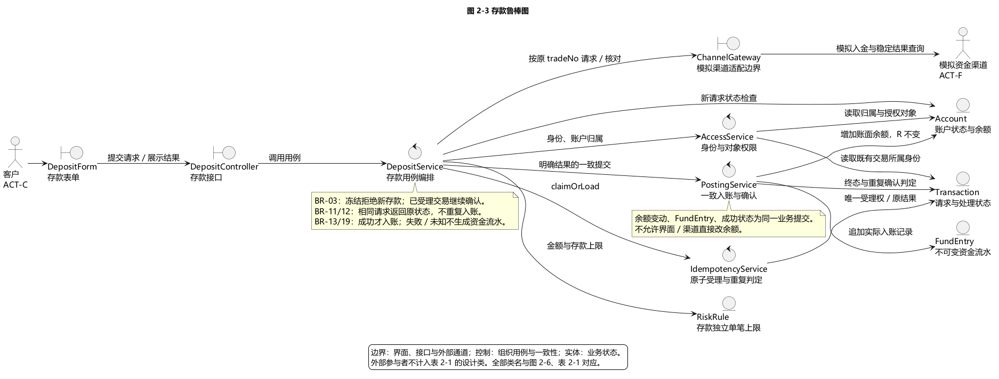
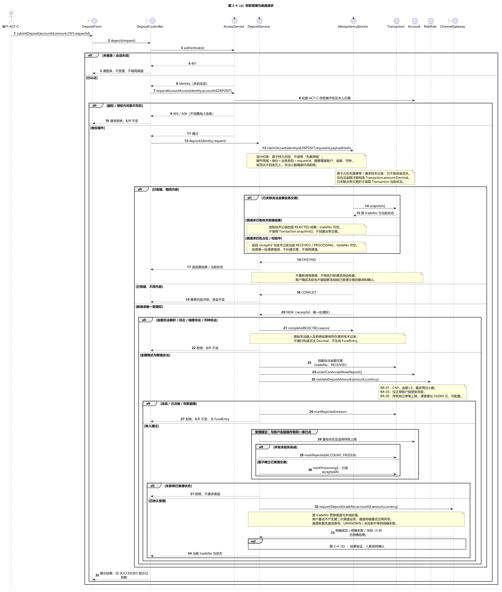
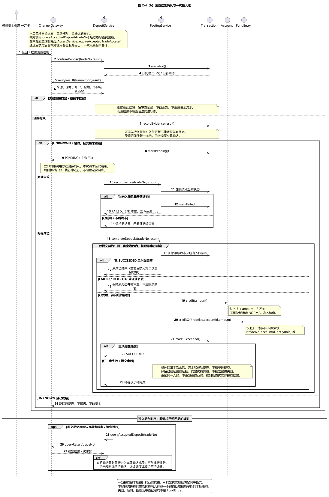
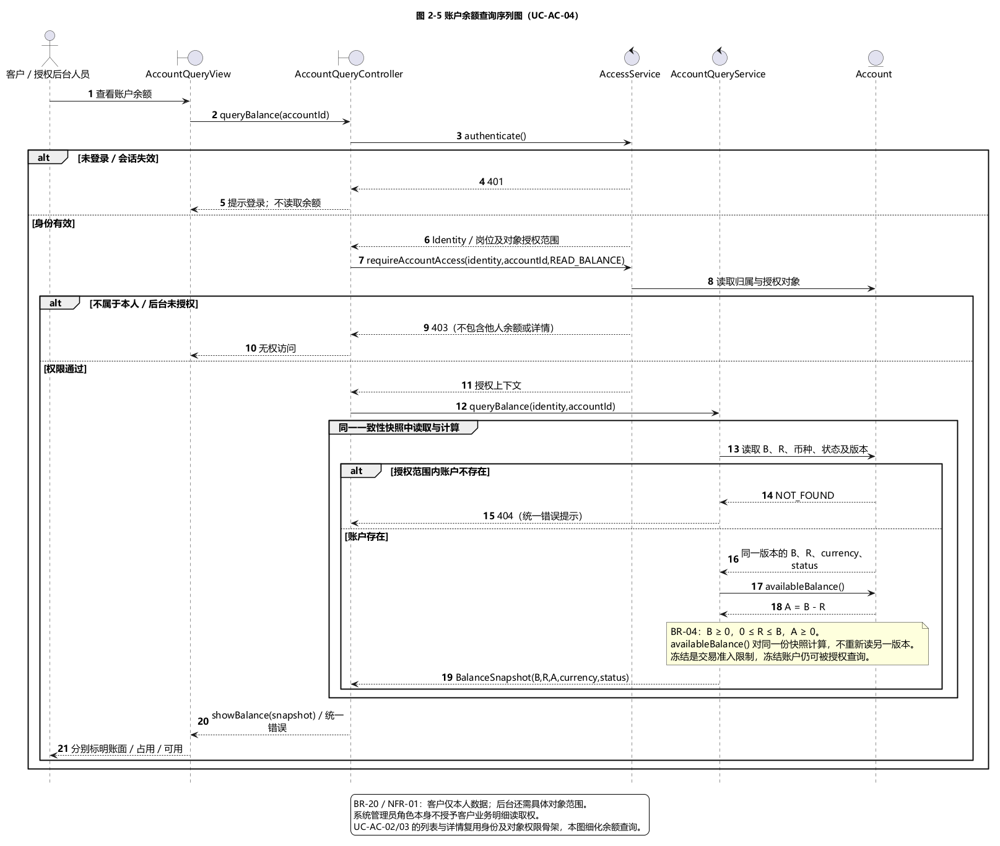
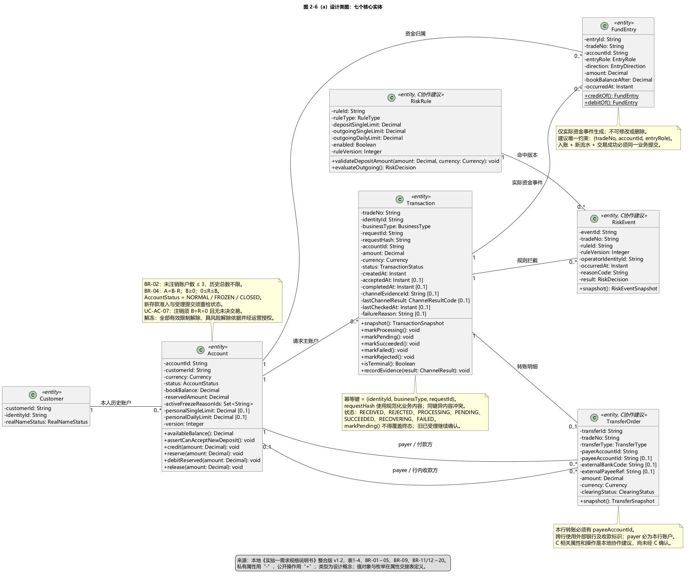
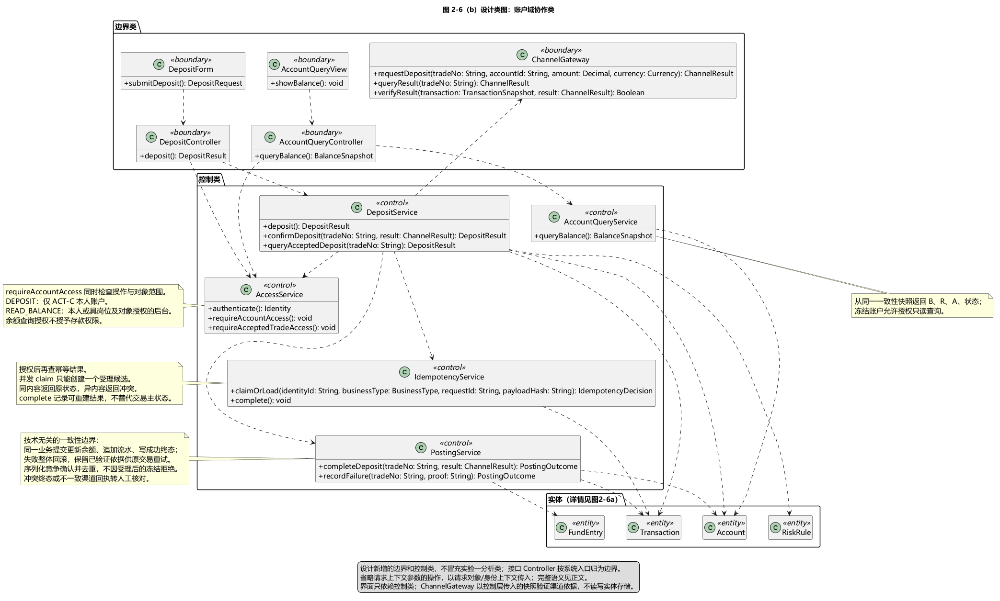

# 2.2.1 账户域用例实现

账户域设计细化存款 UC-TR-01 与账户余额查询 UC-AC-04，并为账户列表 UC-AC-02、账户详情 UC-AC-03 提供共用的授权查询骨架。设计由边界类接收请求，控制类组织身份检查、幂等受理、渠道交互和资金提交，实体类维护业务状态。图 2-3 至图 2-6 分别说明职责、交互顺序与静态结构；表 2-1 是这些图共用的类名清单。

业务依据为本地《实验一需求规格说明书》整合版 v1.2 第 2.2—2.5 节及第 3 节。需求书规定冻结账户拒绝新存款，冻结前已受理交易继续确认；本设计据此使用 BR-03 账户状态、BR-11/12 幂等、BR-13 存款入账、BR-19 资金流水和 BR-20 权限编号。资金流水实体名为 FundEntry；它与 Transaction 的处理状态分开。详细追踪见[需求追踪与基线说明](需求追踪与基线说明.md)。

## 2.2.1.1 职责划分与存款鲁棒分析

如图 2-3 所示，DepositForm 收集账户、币种、金额和 requestId，DepositController 处理接口接入并将认证后的身份传给 DepositService。DepositService 依次组织授权、幂等、业务准入和渠道请求，不让界面或模拟渠道直接修改账户实体。

图 2-3 存款鲁棒图。[SVG](../uml/out/deposit-robustness.svg)；[源文件](../uml/robustness/deposit.puml)。

AccessService 检查身份、业务操作权和对象权限。存款入口传入 DEPOSIT 操作范围，仅允许客户办理本人账户；余额查询传入 READ_BALANCE，后台角色还必须满足查询岗位和具体对象授权。拥有后台查询权不等于可以代客户存款。IdempotencyService 负责原子获得处理权并返回已有请求的当前结果。ChannelGateway 隔离模拟入金、结果查询和结果来源验证。PostingService 组织资金提交，保证 Account 余额、FundEntry 与 Transaction 的成功状态一致。RiskRule 在本用例中提供存款独立单笔上限，不能将出账限额套用于存款。

Account、Transaction、FundEntry 和 RiskRule 通过控制类协作。图中没有边界类直连资金实体的修改路径。外部客户和模拟资金渠道是参与者，不作为表 2-1 的设计类。

## 2.2.1.2 存款受理与幂等

如图 2-4（a）所示，系统先验证身份与账户归属，再处理幂等。身份取自会话，不能信任客户端自行传入的身份号。幂等键使用“身份、业务类型、requestId”的组合；请求内容摘要覆盖账户、币种和金额等业务内容，规范化不能把非法精度舍入成合法金额。

图 2-4（a）存款受理与渠道请求。[SVG](../uml/out/deposit-request.svg)；与（b）共用[存款序列图源文件](../uml/sequence/deposit.puml)。

IdempotencyService 的 claimOrLoad 必须完成持久、原子的占位和判定，不能仅执行一次查询再另行插入。两个同时到达的相同请求只有一个获得新业务处理权。相同键和相同内容返回原处理结果；已经形成业务交易时附原 tradeNo 和当前状态，非法金额等仅有技术拒绝记录时直接返回原 REJECTED 结果，tradeNo 可空，不调用 Transaction.snapshot() 或补建交易。相同键和不同内容返回冲突。返回已有结果前仍须检查对象权限，不能借 requestId 查询他人交易。已有交易应读取当前状态，不将早期“处理中”缓存永久当作结果。

若第二个同内容请求恰在首请求占位后、创建业务交易或形成拒绝结果前到达，则返回 receiptId 与请求技术记录当前的 RECEIVED/PROCESSING，tradeNo 可空，由原唯一处理者继续。不能把“尚无 Transaction”误判成新请求。进程中断后的接管也必须依持久记录和受保护的处理权恢复；若已有渠道提交意图，先按原号核对，不能因占位超时自动另建资金业务。

无法解析、非正或精度非法的金额通过请求技术记录保留原输入摘要与拒绝结果，不强行写入 Transaction.amount:Decimal，也不生成 FundEntry。金额合法的业务请求才构造 Transaction；冻结、注销或存款超限可形成 REJECTED 交易，其 acceptedAt 为空。技术处理记录与不可变资金流水分别保存。

新存款需满足 CNY、正金额、最多两位小数、账户正常和存款单笔上限。需求书的 50,000 元是课堂建议参数，设计由 RiskRule 配置，不能作为现实银行标准。存款不要求账户已有可用余额，也不占用用于出账的 reservedAmount。

新受理与冻结操作必须有同一串行判定点。设计在确立 acceptedAt、将交易推进 PROCESSING 时重检账户状态及适用规则版本：冻结先完成则拒绝新存款；受理先完成则属于既有业务，随后冻结不能中断其确认。准入重检、受理状态与冻结之间的并发控制属于实现时必须满足的契约。

受理持久化后，ChannelGateway 使用原 tradeNo、账户、金额与币种请求模拟渠道。客户重复提交不会创建第二次渠道业务。内部传输重试须沿用原号并依赖模拟渠道同号幂等；崩溃恢复先查询原号，未知或“暂未找到”本身不能作为资金失败证据。

## 2.2.1.3 渠道结果与一致入账

如图 2-4（b）所示，直接返回、后续核对和迟到回执统一进入 confirmDeposit。结果先核对来源、交易号、账户、金额和币种；仅验证通过的渠道依据可以推动资金处理。客户触发查询还需检查原交易权限，自动核对和回执使用服务身份及各自授权，不能因为原客户会话过期而永久停止已受理业务。

图 2-4（b）渠道结果确认与一次性入账。[SVG](../uml/out/deposit-confirmation.svg)。

明确成功时，PostingService 在一个资金一致性边界内重新读取交易状态，增加 Account.bookBalance，追加一条 FundEntry，并将 Transaction 标为 SUCCEEDED。reservedAmount 保持原值；不能把其他出账业务的占用清零。流水以交易号、账户与资金角色标识唯一资金效果。重复回执返回已有完整成功结果，不重复入账。

余额、资金流水和成功终态必须全部提交或全部不提交。任一步失败，不能对外报告已到账，也不能把渠道已经成功的交易直接判为最终失败。保留验证过的渠道依据，以原交易号重试本地资金提交；提交结果未知时先核对本地记录。这里规定的是业务提交契约，具体技术由 A 的架构设计落实；跨进程的多次普通远程写入并不会自动获得本地事务的原子性。

渠道明确失败且原交易尚未入账时，交易进入 FAILED，B/R 不变，不生成入账、退款或冲正流水。外部 5 秒内无明确结果时，交易进入 PENDING，并立即向原请求返回待确认。后续自动查询是独立后台时序，不能让本次接口响应等待核对循环结束；持续未知时转运营待处理。

终态判断与更新必须防并发：成功回执与超时同时发生时，迟到的 markPending 不能把 SUCCEEDED 降级；成功后再收到失败、或失败后再收到矛盾成功时，保留既有终态并转审查，不直接改余额。recordEvidence 记录依据，不意味着可以覆盖已确认的资金事实。

## 2.2.1.4 账户查询

如图 2-5 所示，AccountQueryController 先调用 AccessService 检查身份与对象范围，再由 AccountQueryService 读取账户。未登录返回 401，越权返回 403；授权范围内不存在的账户使用统一不存在提示。系统管理员角色本身不赋予客户业务明细读取权。

图 2-5 账户查询序列图。[SVG](../uml/out/account-query.svg)；[源文件](../uml/sequence/account-query.puml)。

余额返回账面余额 B、占用金额 R、可用余额 A、币种和账户状态。Account.availableBalance() 是操作，按 A=B-R 计算；A 不作为可以独立修改的账户字段。读取 B/R 与计算 A 使用同一版本快照，始终满足 B≥0、0≤R≤B、A≥0。冻结限制资金准入，不阻止授权查询。账户列表及详情复用该授权骨架，不在本图扩展额外用例。

## 2.2.1.5 从分析类到设计类

需求书表 1-4 的七个核心类作为演进起点。图 2-6（a）补属性、操作、类型、可见性和关联，图 2-6（b）补边界类、控制类及调用依赖。各面板共同组成图 2-6，不额外占用其他成员的图号。

图 2-6（a）核心实体设计。[SVG](../uml/out/design-class-core.svg)。

图 2-6（b）边界与控制协作。[SVG](../uml/out/design-class-collaboration.svg)；与（a）共用[设计类图源文件](../uml/class/design-class.puml)。

FundEntry 同时关联 Transaction 和 Account，显式补清分析图中未画出的流水账户归属。TransferOrder 以 payerAccountId、payeeAccountId 区分付款和收款角色，避免把 Transaction 的主账户关系误解为转账只有一方。客户可以保留零到多个历史账户，“最多三个”约束仅作用于未注销账户，正常与冻结均计入。账户注销必须同时满足 B=0、R=0 且无未决业务，依据 UC-AC-07；解冻依 BR-09 解除全部有效限制并满足运营授权及所需风险依据。

类型使用 Decimal、Instant、枚举和逻辑标识，不使用物理数据库类型。TransferOrder、RiskRule、RiskEvent 的细化属性是面向 C 的完整协作建议，尚未经过成员 C 联合评审；这些建议不表示 B 已完成 C 的交易和风控图。银行卡、告警与独立对账仍为需求书中的待评审候选，当前模型不将它们扩入核心实现。

## 表 2-1 设计类清单

本表汇总当前本地设计包的全部 17 个实体、控制与边界类。接口 Controller 在本设计中只负责接入，因此归边界类；业务编排归相应 Service。它是交给 C 继续补充的全局基准初版，不表示其他成员已经确认。图中的参与者、数据返回值和枚举不作为独立设计类重复登记。

| 序号 | 实体类 | 控制类 | 边界类 |
|---|---|---|---|
| 1 | Customer | — | — |
| 2 | Account | — | — |
| 3 | Transaction | — | — |
| 4 | FundEntry | — | — |
| 5 | TransferOrder | — | — |
| 6 | RiskRule | — | — |
| 7 | RiskEvent | — | — |
| 8 | — | AccessService | — |
| 9 | — | DepositService | — |
| 10 | — | IdempotencyService | — |
| 11 | — | PostingService | — |
| 12 | — | AccountQueryService | — |
| 13 | — | — | DepositForm |
| 14 | — | — | DepositController |
| 15 | — | — | ChannelGateway |
| 16 | — | — | AccountQueryView |
| 17 | — | — | AccountQueryController |

七个实体的字段名、设计类型、约束、可空性和需求出处详见[交接 D 的设计类属性清单](交接D-设计类属性清单.md)。该表是库表设计输入，数据库物理类型、表拆分和索引由 D 负责；幂等唯一作用域必须保留身份及业务类型语义，不应在映射时退化为未经论证的全局 requestId 唯一。

## 2.2.1.6 交接与验证范围

交给 C 的内容为表 2-1、七个实体和控制操作契约；交给 D 的内容为属性交接表及一致性、唯一性、不可变流水约束；交给 E 的内容为接口职责、B/R/A 返回口径、错误分支和渲染后的图。A 需将资金一致性与受理/冻结串行点落实到总体架构，技术选择可以调整，但不能改变上述需求结果。

本次本地验证包括 UML 语法渲染、中文可读性、类名/操作一致性、图文链接及需求场景走查。它验证设计交付的一致性，不代替实验三的可运行实现和实验四的并发、故障与性能测试。实际核对结果见[本地验证记录](本地验证记录.md)。
