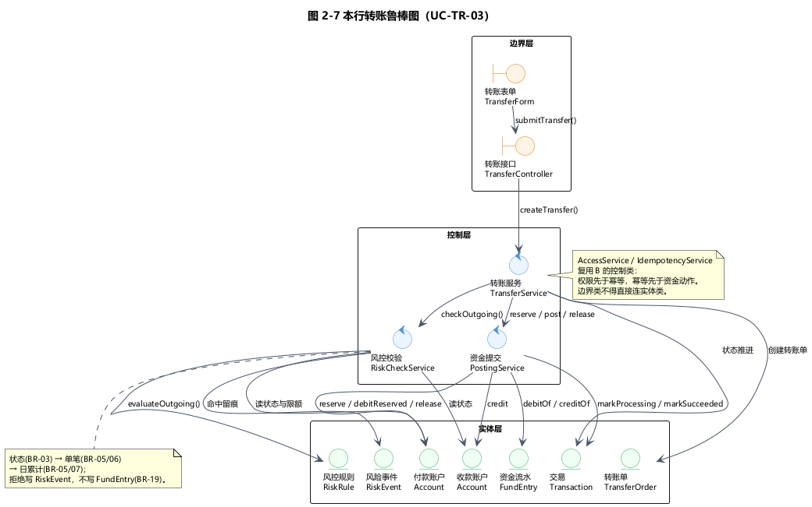
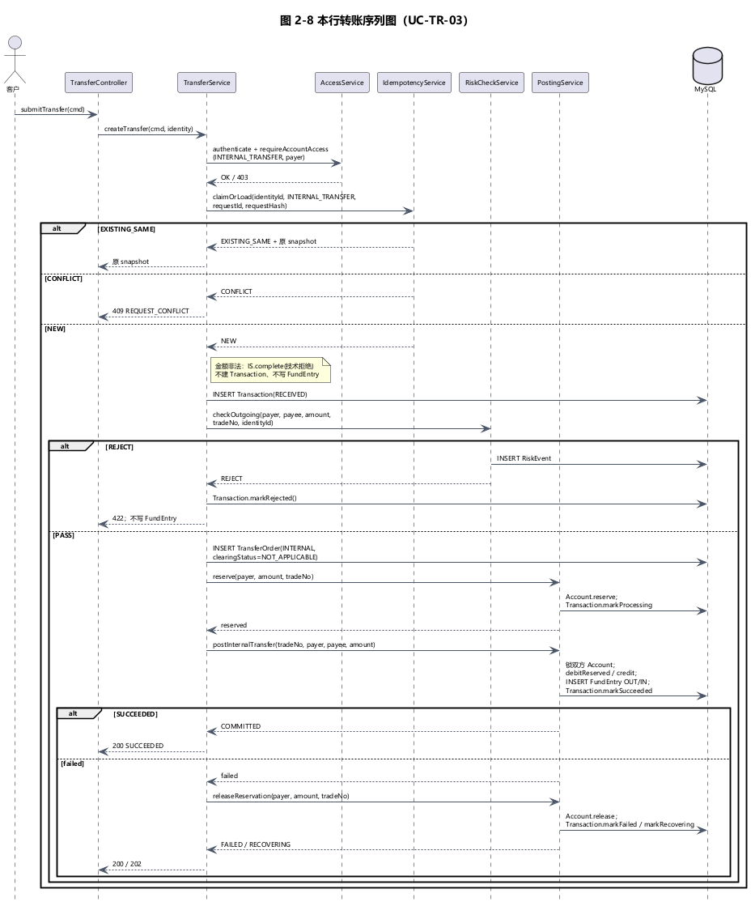
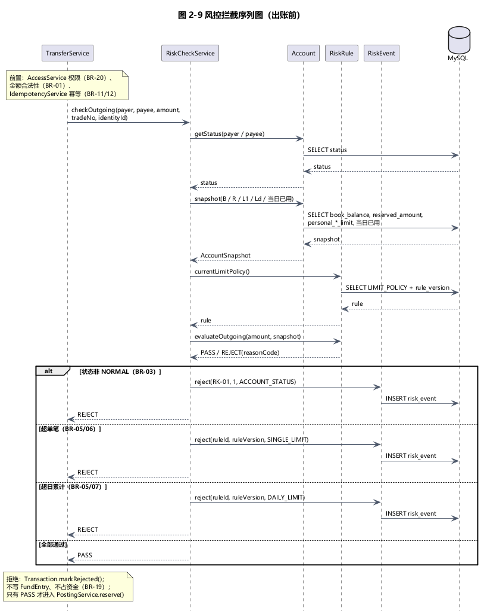
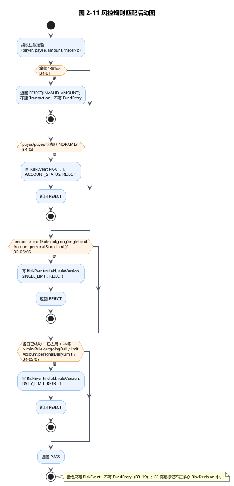
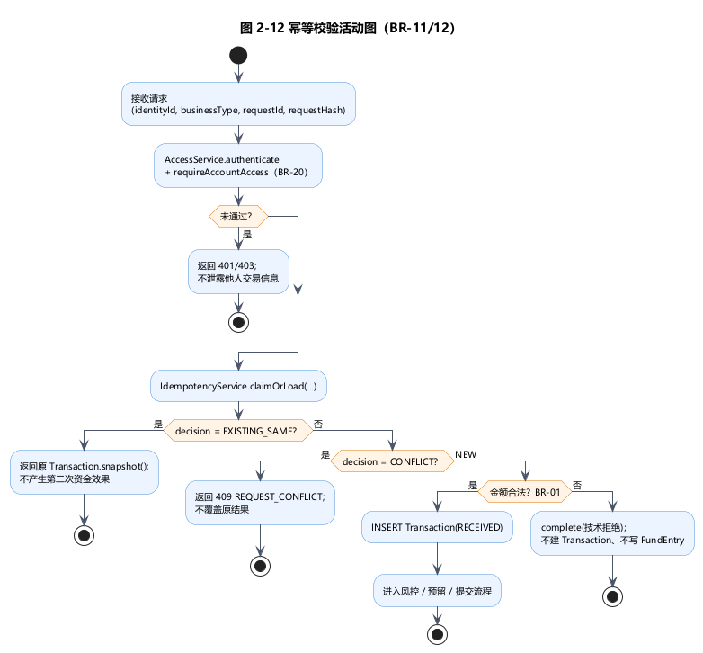

# s3交易与风控域 交付总览

> **先看这个文件。** 下面五张图、模块设计和 ADR 都在本目录里；预览图可以直接双击打开。
>
> **截图友好**：五张预览图已按单页尺寸优化，最大边约 1140px（接近 A4 96dpi），可直接截图贴报告；如果屏幕较小，浏览器/看图软件缩放到 95% 即可完整看到。
>
> **需求口径**：全部按《实验一需求规格说明书》整合版 **v1.2** 表 1-3（沿用 S2 BR 编号）。任务清单 1.1 的 8 条简化编号与 v1.2 冲突，已全部不采用。争议点逐条处理见 [`01-需求口径与争议处理.md`](01-需求口径与争议处理.md)。
>
> **与 B 对齐**：已按 B 的《交接D-设计类属性清单》和表 2-1 统一类名、实体字段、`PENDING/SUCCEEDED`、`TransferOrder.clearingStatus`、`FundEntry.entryRole`；C 新增 4 类，复用 `AccessService`、`IdempotencyService`、`PostingService`，表 2-1 共 21 类。详见第五节。

## 一、交付清单

| 报告图号/章节 | 内容 | 源文件 | 预览 |
|---|---|---|---|
| 图 2-7 | 本行转账鲁棒图 | `01-UML源文件/robustness/transfer.puml` | `03-预览图/transfer-robustness.png` |
| 图 2-8 | 本行转账序列图 | `01-UML源文件/sequence/transfer.puml` | `03-预览图/transfer-sequence.png` |
| 图 2-9 | 风控拦截序列图 | `01-UML源文件/sequence/risk-check.puml` | `03-预览图/risk-check-sequence.png` |
| 图 2-11 | 风控规则匹配活动图 | `01-UML源文件/activity/risk-match.puml` | `03-预览图/risk-match.png` |
| 图 2-12 | 幂等校验活动图 | `01-UML源文件/activity/idempotency.puml` | `03-预览图/idempotency.png` |
| 2.2.1 / 2.2.2 | 交易域模块设计 | `02-设计文档/模块设计-交易与风控域.md` | Markdown 直接打开 |
| 交接 D | 交易域属性清单 | `02-设计文档/交接D-交易与风控域属性清单.md` | Markdown 直接打开 |
| ADR-003 | 交易幂等方案 | `02-设计文档/架构决策记录.md` | Markdown 直接打开 |

## 二、BR 口径（全部来自 v1.2 表 1-3）

| 编号 | 含义 | 本交付中的落点 |
|---|---|---|
| BR-01 | 币种与金额：CNY、金额 > 0、小数 ≤ 2 位、不允许透支 | 图 2-8 金额校验、图 2-11 首个判定节点 |
| BR-03 | 账户状态：冻结账户禁止新存款、取款、转账及接收新的行内转入；已受理交易继续 | 图 2-8 双方状态校验、图 2-9/2-11 状态判定 |
| BR-04 | 余额口径：A = B - R，B ≥ 0、0 ≤ R ≤ B | 图 2-8 余额校验、4.1 不变量 |
| BR-05 | 系统限额：存款单笔 50,000；出账单笔 10,000；每账户自然日累计 50,000 | 图 2-9/2-11、4.2 节 |
| BR-06 | 个人限额 L1/Ld，默认等于系统上限，L1 ≤ Ld | 图 2-9/2-11、4.2 节 |
| BR-07 | 日额度占用：已成功 + 已受理未决均占受理日额度；失败恢复后释放原日额度 | 图 2-9/2-11、4.1 节 |
| BR-09 | 冻结权限：运营/风控按授权冻结并填原因；风控冻结须有解除依据后由运营解冻 | 仅引用，不在本域展开 |
| BR-11/12 | 幂等：同身份 + 业务类型 + requestId 同内容只生效一次；不同内容冲突；tradeNo 贯穿全链路 | 图 2-8 幂等分支、图 2-12、ADR-003 |
| BR-14 | 出账处理：受理后占用资金及额度；成功扣账并释放占用；失败恢复后释放 | 图 2-8 预留/执行/释放、4.1 节 |
| BR-15 | 本行转账：付款扣账、收款入账及双方关联流水一致后才报告成功 | 图 2-8、4.1 节 |
| BR-16/17 | 跨行与恢复：外部成功且本地完成才成功；明确失败且释放完成才失败；未知保持待确认 | 只保留 `PENDING_CONFIRMATION` 扩展点 |
| BR-19 | 资金流水：只记录实际入账、扣账或纠正；拒绝、占用、释放不得伪造成流水 | 图 2-8/2-9 拒绝分支 |
| BR-20 | 权限与审计：客户仅本人数据；后台按角色及对象范围授权；重要操作留痕 | 图 2-8 网关/交易服务二次校验、图 2-12 首步 |

## 三、五张图预览

### 图 2-7 本行转账鲁棒图



边界类只到 `TransferService`，不直接连实体；双侧 `Account`、`Transaction`、`TransferOrder`、`FundEntry` 都由控制类编排。

### 图 2-8 本行转账序列图



主路径：幂等 → 账户/金额校验 → 风控 → 预留（BR-14）→ 双账户入扣账（BR-15）→ 成功；失败时释放预留，释放失败进入 `RECOVERING`。拒绝分支不写 `FundEntry`（BR-19）。

### 图 2-9 风控拦截序列图



出账前短路顺序：账户状态（BR-03）→ 单笔限额（BR-05/06）→ 日累计限额（BR-05/07）；命中写 `RiskEvent`，不占资金、不写流水。

### 图 2-11 风控规则匹配活动图



每个判定节点都标注了 v1.2 的 BR：BR-01、BR-03、BR-05/06、BR-05/07。

### 图 2-12 幂等校验活动图



同 `(身份, 操作类型, requestId)` + 同 `contentHash` → 返回原结果；不同内容 → 409；无记录 → 正常受理并登记 `tradeNo`。

## 四、三个关键设计结论

1. **幂等键**：`IdempotencyService.claimOrLoad(identityId, businessType, requestId, requestHash)`；唯一键 `(identity_id, business_type, request_id)` + `request_hash`。不是单独的 `transaction.request_id`；这是 v1.2 BR-11/12 与 B 的 `IdempotencyService` 契约的共同要求。
2. **本行转账一致性**：`PostingService` 统一完成“预留 → 双账户提交（付款 `debitReserved` + 收款 `credit` + 两条 `FundEntry`）→ 失败释放”；满足 BR-14/15。`TransferService` 只编排，不直接改账户表。
3. **资金流水类**：统一用 `FundEntry`，字段采用 B 的 `entryRole`、`direction`、`bookBalanceAfter`；只记录实际资金变动；拒绝、占用、释放不写流水（BR-19）。物理表建议 `fund_entry`，如 D 沿用任务清单表名可映射为 `transaction_flow`。

## 五、与 B 的交接对齐

已按 B 的《交接D-设计类属性清单》和表 2-1 调整：

- **类名**：C 新增 `TransferForm`、`TransferController`、`TransferService`、`RiskCheckService`；复用 B 的 `AccessService`、`IdempotencyService`、`PostingService`。
- **状态**：`TransactionStatus` 采用 B 的 `PENDING` / `SUCCEEDED`；`TransferOrder` 不设独立订单状态，本行转账使用 `clearingStatus=NOT_APPLICABLE`。
- **实体字段**：`Transaction` 用 `identityId` / `businessType` / `requestId` / `requestHash`；`FundEntry` 用 `entryRole` / `bookBalanceAfter`；`RiskRule` 用 `outgoingSingleLimit` / `outgoingDailyLimit` / `personalSingleLimit`；`RiskEvent` 用 `ruleId` / `ruleVersion` / `operatorIdentityId` / `result`。
- **表 2-1**：B 的 17 类 + C 的 4 类 = **21 类**。
- **C 对 B 的三项细化**：① `Transaction.markRecovering()`；② `RiskRule.ruleType` 增加内置 `ACCOUNT_STATUS`（规则 `RK-01`）；③ `PostingService` 增加 `reserve` / `postInternalTransfer` / `releaseReservation` / `recordTransferFailure`。

## 六、文件目录

```text
s3交易与风控域\
├── 00-交付总览.md          ← 你正在看的文件
├── 01-需求口径与争议处理.md            ← 每一条争议按 v1.2 怎么处理
├── README.md
├── 01-UML源文件\
│   ├── robustness\transfer.puml
│   ├── sequence\transfer.puml
│   ├── sequence\risk-check.puml
│   ├── activity\risk-match.puml
│   └── activity\idempotency.puml
├── 02-设计文档\
│   ├── 模块设计-交易与风控域.md
│   ├── 交接D-交易与风控域属性清单.md
│   └── 架构决策记录.md
└── 03-预览图\
    ├── *.png（可直接双击看）
    └── *.svg（矢量图，打印用）
```

## 七、说明

- 本目录是**给你看的最终副本**，不再往 Git 仓库里加东西。
- 五张 `.puml` 已用 PlantUML 1.2024.7 实际渲染为 SVG/PNG，均无语法错误。
- 如果后面要提交到仓库，把 `01-UML源文件`、`02-设计文档` 按原路径覆盖即可；本目录中的 `README` 和 `00-*` 说明文件不需要提交。
