# 三、系统原型构建与实现

## 1 概述

### 1.1 原型构建思路

本项目采用前后端分离方式实现数字银行核心业务模拟系统。客户通过浏览器注册、登录、管理账户、办理存取款与转账并查询结果；运营和风控人员按授权范围进入后台页面。前端负责输入与反馈，后端负责认证、权限、风控、资金处理和数据保存。系统仅使用教学模拟渠道和实验数据，不连接真实银行，不涉及真实资金。

本报告按照现有页面划分为注册与登录、账户管理、存款、取款、转账、交易查询、个人资料、运营管理、风控管理九项功能。每项依次介绍功能实现、前端界面和核心代码，页面名称、字段及按钮以当前实现为准。

### 1.2 技术环境与页面范围

前端采用 Vue 3、Vite、Element Plus、Vue Router、Pinia 和 Axios；后端采用 Java 21、Spring Boot、Spring Cloud 与 Maven；数据存储使用 MySQL。系统包含网关、用户、账户、交易和风控五个后端应用。金额以字符串提交，在 Java 中使用 BigDecimal，在数据库中使用 DECIMAL(18,2)。

本机前端入口为 http://127.0.0.1:5173，后端网关为 http://127.0.0.1:8090。五个后端应用分别监听 8081、8082、8083、8084 和 8090。上述为本次演示配置，不写成所有部署环境的固定端口。

当前前端已具备注册、本行与跨行转账、个人资料、账户限额与注销、运营管理和风险控制等页面。账户、角色、交易状态和权限仍由服务端核验，页面入口可见不代表业务已成功。

### 1.3 页面展示与验证边界

报告截图于2026年11月21日从运行中的现有页面采集，未采用设计方案图，也未修改页面样式。本次完成演示账号登录和客户页面查看，保存真实截图；未为制作报告新建客户、修改限额、注销账户或发起资金交易。截图中已有交易来自演示库历史记录，不能替代本次业务提交、幂等或异常恢复的完整测试。

运营与风控页面已在源码中实现，当前客户账号不具备相应权限，本报告据页面与接口代码说明其实现，并明确保留授权账号操作截图待补。组员信息及实验完成日期仍由小组据实填写。

## 2 各功能模块实现

### 2.1 注册与登录

#### 2.1.1 功能实现

注册页面包含姓名、证件号、密码和确认密码，注册请求携带 requestId。用户服务校验输入并建立客户与 BCrypt 凭据，以教学模拟方式记录实名状态；这只是格式校验，不代表真实身份认证。注册成功后页面提示用户返回登录。

登录页面以身份标识和密码认证，校验通过后保存会话并进入账户页。身份不存在、密码错误或用户不可用均返回统一提示。服务端在每次请求中核验会话和当前授权，退出后撤销会话；内存会话在服务重启后失效。登录页面的“证件号”字段在本项目中使用 identityId，演示身份为 UID-000001。

#### 2.1.2 前端界面展示

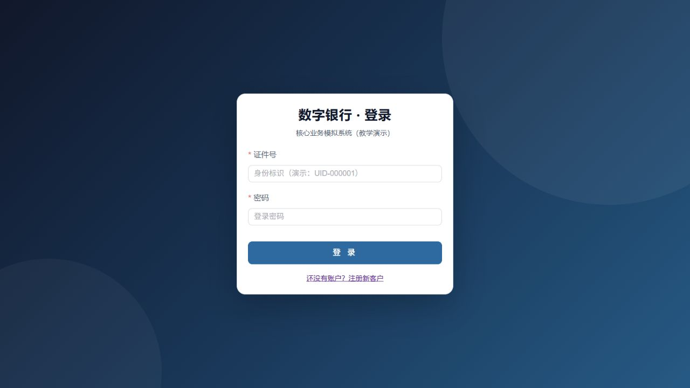

图3-1展示现有登录表单与注册入口，未展示明文密码或会话令牌。

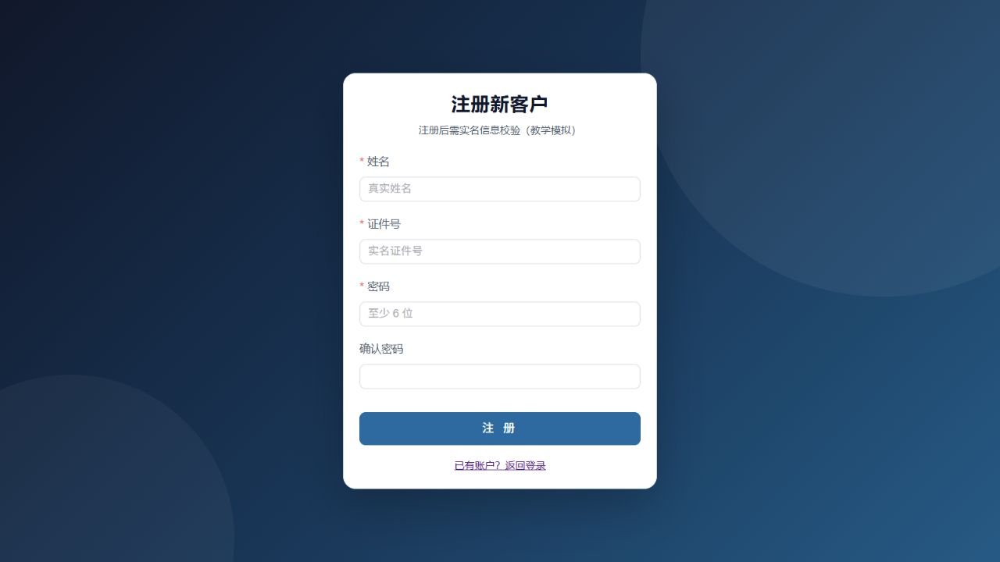

图3-2展示注册字段及教学模拟提示。本次仅查看表单，没有提交注册，不将该图记为注册成功证据。

#### 2.1.3 核心代码

来源：backend/user-service/src/main/java/com/digitalbank/user/service/SessionService.java，以下为当前源码节选。

```java
        Optional<LoginCredential> candidate = findCredential(request.identityId());
        String hash = candidate.map(LoginCredential::passwordHash).orElse(dummyPasswordHash);
        boolean matches = passwordEncoder.matches(request.password(), hash);
        if (candidate.isEmpty() || !candidate.get().isUsable() || !matches) {
            // 不区分用户不存在、密码错误或账号停用，避免泄露用户状态。
            throw new BizException(ErrorCode.UNAUTHENTICATED, "身份标识或密码错误，或用户不可用");
        }
        LoginCredential credential = candidate.get();
        return sessions.issue(credential, authorization.authorize(credential.identity()));
```

代码以 BCrypt 核对密码，并将用户当前的角色和账户范围写入会话。不存在的身份仍使用占位摘要参与校验，避免根据失败分支泄露用户是否存在。

### 2.2 账户管理

#### 2.2.1 功能实现

“我的账户”以账户卡片展示账号、中文状态、可用余额和人民币活期信息，提供“开立新账户”与“查看详情”入口。开户使用请求号避免重复效果，服务端限制每位客户最多三个未注销账户。

账户详情展示账面余额 B、占用金额 R 和可用余额 A，满足 A=B-R；还提供个人交易限额、账户操作记录、注销账户及资金流水区域。限额表单允许提交单笔和日累计限额，空字段由前端保留原值。注销按钮调用确认流程，后端要求本人正常账户、零余额、零占用且无未决业务，不可凭页面按钮直接关闭任意账户。

#### 2.2.2 前端界面展示

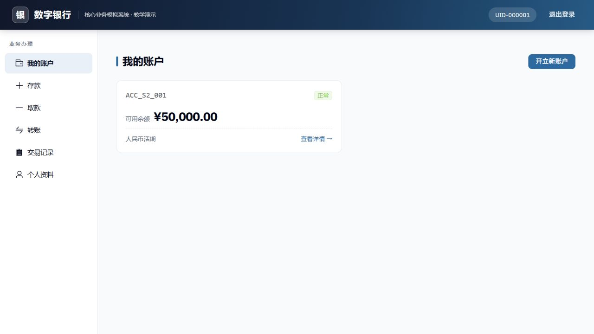

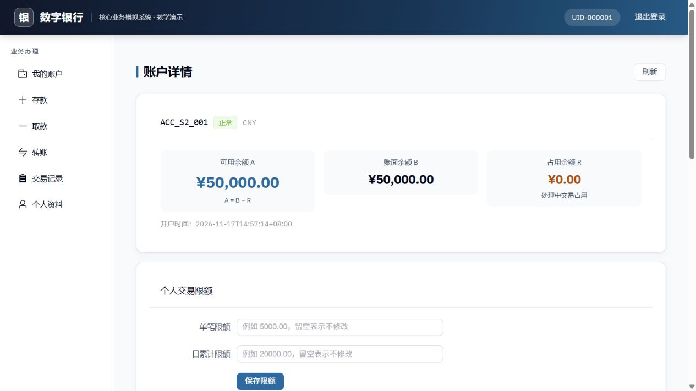

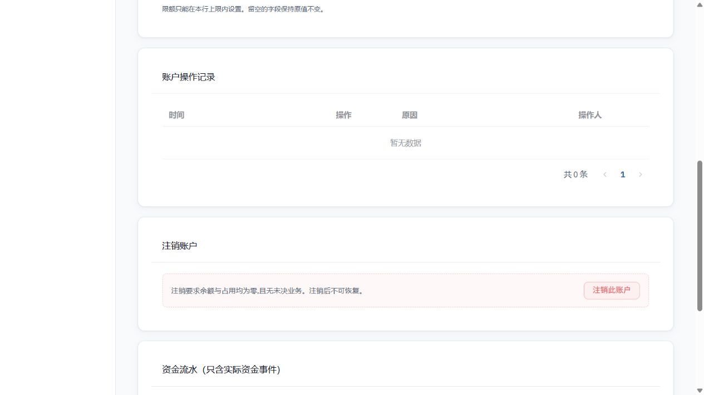

截图中 ACC_S2_001 的账面余额与可用余额均为50,000.00元，占用为0.00元。注销和限额入口已存在，本次没有执行注销或限额变更。

#### 2.2.3 核心代码

来源：backend/account-service/src/main/java/com/digitalbank/account/service/AccountService.java，以下为当前源码节选。

```java
    public BalanceView balance(Actor actor, String accountId) {
        Account account = load(accountId, false);
        requireRead(actor, account);
        return new BalanceView(account.accountId(), account.currency(), account.status(),
                Money.format(account.bookBalance()), Money.format(account.reservedAmount()),
                Money.format(account.availableBalance()));
    }
```

余额查询先读取账户并核验访问权限，再在同一账户视图中返回 B、R、A，避免把冻结状态与资金占用混为一谈。

### 2.3 存款

#### 2.3.1 功能实现

存款页面包含存款账户、存款金额、固定币种“CNY 人民币”及“提交存款”按钮。前端校验金额并规范为两位小数字符串，经确认后提交请求；结果面板显示交易号和业务状态，而不是仅凭外层 SUCCEEDED 判定资金到账。

后端先核验本人账户、解析金额并认领幂等原单，再执行风控、账户受理、模拟渠道及结果上报。渠道明确成功才入账并生成流水，明确失败不入账，未知则保持待确认。相同身份、业务类型和请求号的重试复用原交易，同号不同内容返回冲突。

#### 2.3.2 前端界面展示

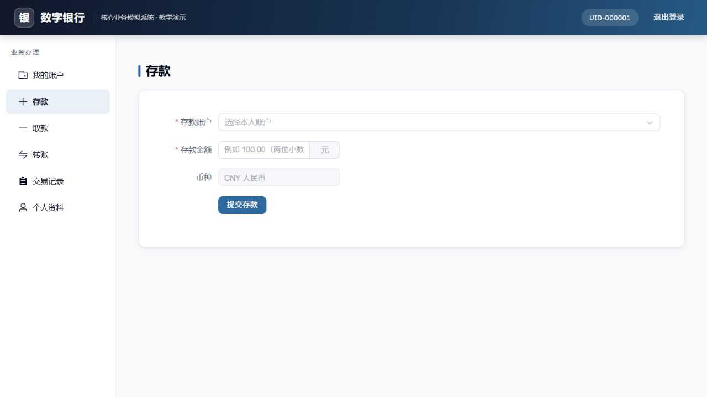

图3-6展示当前输入界面。演示库已有100.00元存款历史，资金流水见图3-11；本次未新提交存款，因此不将表单图当作本次成功结果面板。

#### 2.3.3 核心代码

来源：backend/transaction-service/src/main/java/com/digitalbank/transaction/service/DepositService.java，以下为当前源码节选。

```java
        IdempotencyService.Claim claim = idempotency.claim(actor.identityId(), "DEPOSIT", requestId,
                requestHash, accountId, amount, "CNY");
        if (!claim.isNew()) {
            // 重复请求命中已有原单：只返回当前结果，不再次启动渠道调用
            return currentView(claim.tradeNo(), traceId);
        }
```

只有首次认领者继续编排，重复请求返回原交易状态。账户侧的本地事务负责保证余额、流水和资金状态的一致性。

### 2.4 取款

#### 2.4.1 功能实现

取款页面提供取款账户、金额和“提交取款”按钮。后端检查账户归属、状态、可用余额和适用限额，通过后预留资金，随后调用模拟渠道并把结果上报到账户服务。渠道结果参与最终资金状态的确认。

明确成功时消耗原预留、扣减账面余额并追加 WITHDRAW_OUT 流水；未知结果保留占用等待核对，不能因超时直接退款；失败资金处理依据原渠道回执执行。重复回执和恢复沿原 tradeNo 推进，避免第二次扣款。

#### 2.4.2 前端界面展示

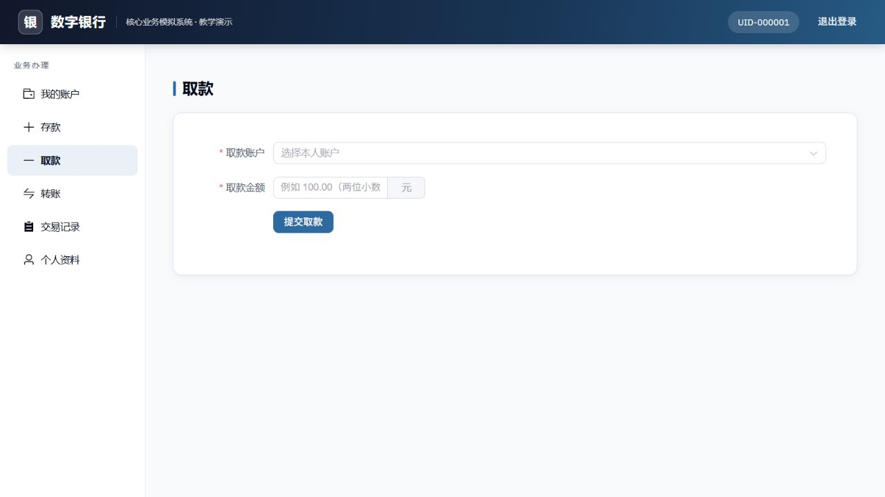

当前可查到演示库已有100.00元取款记录，与账户流水中的支出相对应。余额不足、冻结、超限和未知结果的操作截图仍需在受控演示中补充，本次未通过新交易验证这些分支。

#### 2.4.3 核心代码

来源：backend/transaction-service/src/main/java/com/digitalbank/transaction/service/WithdrawalService.java，以下为当前源码节选。

```java
    public Outcome reportChannelResult(ChannelRow record, String traceId) {
        OffsetDateTime observedAt = record.observedAt() == null ? OffsetDateTime.now(ZONE)
                : record.observedAt().atZone(ZONE).toOffsetDateTime();
        return account.withdrawalResult(new WithdrawalResult(record.tradeNo(), record.accountId(),
                Money.format(record.amount()), record.currency(), record.result(), record.channelRequestId(),
                record.evidenceId(), observedAt, record.reasonCode()), record.tradeNo(), traceId);
    }
```

该方法沿原渠道记录提交账户、金额、结果和凭据，供账户服务校验后推进资金处理。没有明确结果时不能以客户端请求失败替代渠道失败。

### 2.5 本行与模拟跨行转账

#### 2.5.1 功能实现

转账页面通过“本行转账”和“跨行转账”切换收款字段。两种类型共用付款账户、金额、用途及提交确认。请求同时携带兼容字段 accountId、payerAccountId；本行使用 payeeAccountId，跨行使用 externalBankCode 和 externalPayeeRef。

本行收款账户采用可编辑的自动补全输入框，既可选择本人其他账户建议，也能输入他人本行账号；选中后可直接修改或清空，不要求先删除一个下拉选项。收付款账户不得相同，最终由后端核验归属、状态、余额及限额。付款扣账、收款入账和双方流水在账户服务同一事务中完成。

模拟跨行转账已具备前端入口，显示收款银行、收款账号和待确认说明。渠道未知时保留预留，明确成功且本地处理完整后才成功，明确失败后按原依据释放占用。页面提示用于说明未决风险，实际结果仍以 data.status 为准，不能把所有跨行请求一律写成最终待确认。

#### 2.5.2 前端界面展示

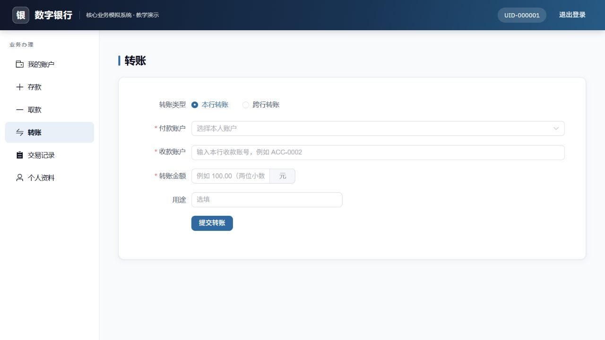

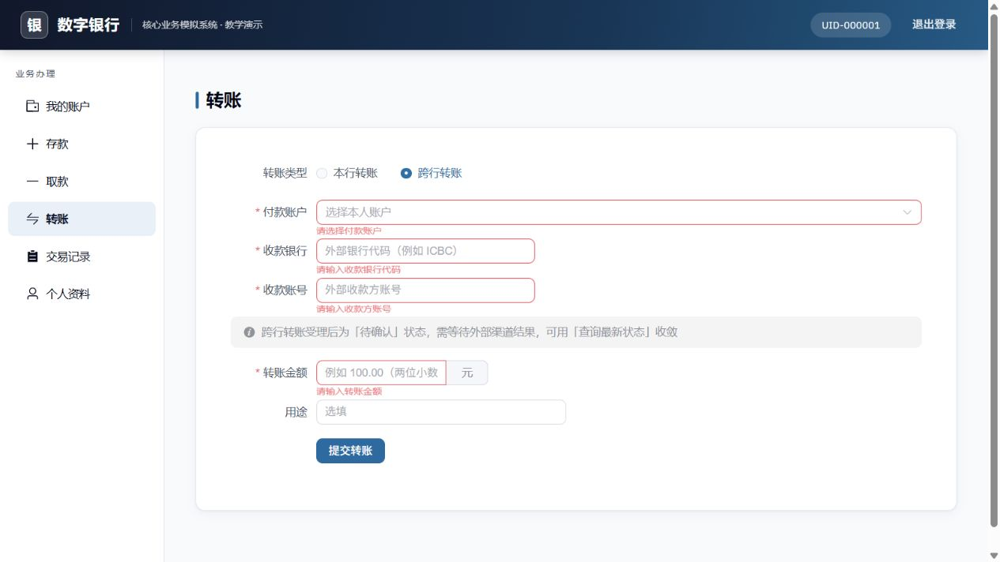

图3-9展示切换转账类型后现有字段、必填反馈与渠道提示。本次只查看两种表单，没有提交转账，不填造双边余额变化或成功截图。

#### 2.5.3 核心代码

来源：frontend/src/views/TransferView.vue，以下为当前源码节选。

```javascript
    if (form.kind === 'INTERNAL') {
      payload.payeeAccountId = form.payeeAccountId.trim()
    } else {
      payload.externalBankCode = form.externalBankCode.trim()
      payload.externalPayeeRef = form.externalPayeeRef.trim()
    }
    return transfer(payload)
```

同一入口按转账类型只提交对应收款字段。付款账户、金额和请求标识仍复用原业务逻辑，自动补全只改善输入方式，不代替服务端校验。

### 2.6 交易记录 资金流水与回单

#### 2.6.1 功能实现

客户在“交易记录”页切换“我发起的交易”和“我收到的款项”，按业务类型和状态筛选并分页。发起记录来自交易原单，收款记录从本人账户资金流水汇总；当前代码会继续读取分页，不再只取每账户首100条。成功交易提供“回单”和“流水”按钮，未终态交易提供查询状态入口。

交易详情查询读取当前状态快照，不因 GET 查询主动发起渠道核对或记账；未决业务由后台扫描或运营显式核对推进。后台查询必须携带原因并检查账户授权范围。回单弹窗展示教学模拟凭证，可查看或下载 JSON；资金流水展示实际入扣账，处理过程和风险拒绝不伪造成资金流水。

#### 2.6.2 前端界面展示

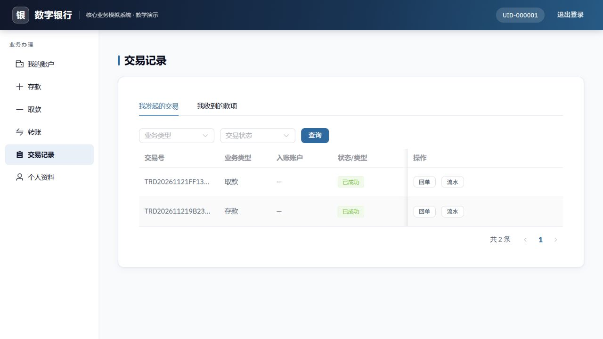

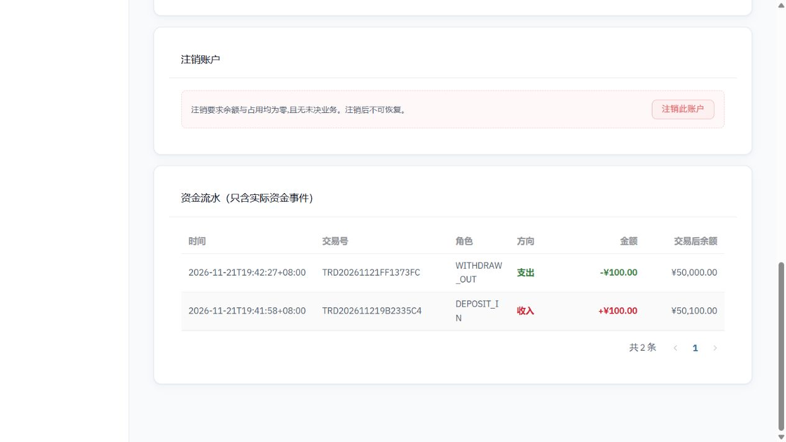

图3-10与图3-11来自本次只读查询。历史存款100.00元的交易后余额为50,100.00元，随后历史取款100.00元的交易后余额为50,000.00元；这是页面中现存记录的对照，不是本次新执行的资金演示。交易原单列表目前统一显示正号，不能据此判断收支方向；资金方向应以流水的收入、支出及 CREDIT/DEBIT 为准，该显示问题列为待完善项。

#### 2.6.3 核心代码

来源：frontend/src/views/TransactionsView.vue，以下为当前源码节选。

```javascript
async function checkStatus(tradeNo) {
  const params = queryParams()
  if (params === null) return
  checking[tradeNo] = true
  try {
    const res = await getTransaction(tradeNo, params)
    if (res.code === 'SUCCEEDED' || res.data) {
      ElMessage.success(`${tradeNo}：${statusLabel(res.data?.status)}（${res.message || '已查询'}）`)
      await load()
    } else {
      ElMessage.error(res.message || '查询失败')
    }
  } catch (e) {
    ElMessage.error(e.message || '网络异常')
  } finally {
    checking[tradeNo] = false
  }
}
```

查询函数先构造必要的后台查询参数，再显示状态并刷新列表；checking 控制单笔按钮反馈。接口响应成功和资金交易成功分开解释，最终资金结果以业务状态为准。

### 2.7 个人资料维护

#### 2.7.1 功能实现

“个人资料”页面分为“基本信息”和“修改联系方式”。基本信息展示客户编号、脱敏身份标识、姓名、实名状态和客户状态；修改区仅提供手机号和邮箱，不能在此修改实名姓名、身份或账户归属。

保存调用本人资料更新接口并携带请求号；成功后刷新脱敏资料。截图中联系方式为掩码值，页面已显示保存入口，本次未更改联系方式，不将查看结果当作资料更新成功证据。

#### 2.7.2 前端界面展示

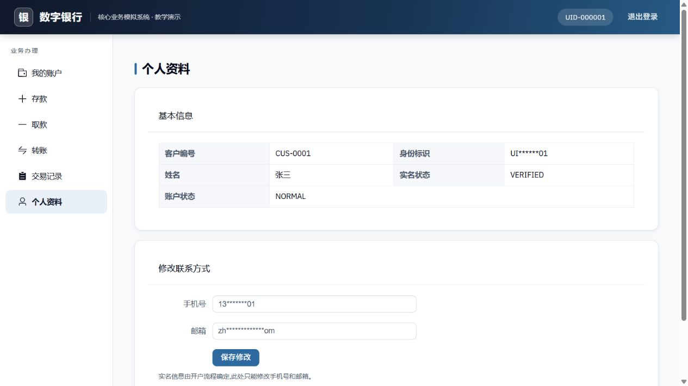

个人资料实拍见图3-12。页面底部保留“实名信息由开户流程确定,此处只能修改手机号和邮箱。”提示；页面仅允许维护联系方式。

#### 2.7.3 核心代码

来源：frontend/src/views/ProfileView.vue，以下为当前源码节选。

```javascript
    const res = await updateMe({
      phone: form.phone || null,
      email: form.email || null,
      requestId: form.requestId
    })
    if (res.code === 'SUCCEEDED') {
      ElMessage.success('资料已更新')
      form.requestId = newRequestId()
      load()
    }
```

前端只提交 phone、email 和 requestId。后端按当前会话定位客户并限制可变字段，资料查询按权限脱敏。

### 2.8 运营管理

#### 2.8.1 功能实现

运营页面提供按原因查询客户、按授权范围查询账户、查看有效冻结限制、冻结和解冻等操作。后台人员不能将“我的账户”当作全行账户列表，必须使用授权范围入口并填写查询原因。交易记录页面另提供运营待处理筛选、人工核对和恢复重试，后台动作由服务端检查角色、对象范围和原失败依据。

解冻前，前端读取当前全部有效限制；若存在尚无解除结论的 RISK 限制，提示先由风控登记依据。运营仍需提交原因及全部限制编号，由后端再次核验。页面还保留“角色与数据范围”对话框，但在线修改授权要求独立 ADMIN 身份，不能把普通 OPERATIONS 账号能冻结账户等同于能分配权限。

#### 2.8.2 前端界面展示

运营界面在 OpsView.vue 中已有实现，菜单按会话及演示身份显示。本次客户账号未获运营权限，待使用有效运营账号补充“查询客户”“按授权范围查账户”和交易人工操作截图。此处不以源码或接口 JSON 代替成功操作截图。

#### 2.8.3 核心代码

来源：frontend/src/views/OpsView.vue，以下为当前源码节选。

```javascript
      const pendingRisk = list.filter((r) => r.source === 'RISK' && !r.releaseApproved)
      if (pendingRisk.length) {
        ElMessage.warning('存在缺少解除结论的风控冻结原因，请先在风险控制模块完成解除审批')
        return
      }
      if (!list.length) {
        ElMessage.warning('该账户没有可解除的有效限制编号')
        return
      }
```

该分支阻止在风控结论缺失或限制编号为空时提交解冻。它是交互预检查，最终权限和限制有效性仍由服务端保证。

### 2.9 风险控制

#### 2.9.1 功能实现

风险控制入口对应“风控管理”页面，包含“风控规则”“变更审批”“风险名单”“风险记录”和“冻结解除审批”五个标签。页面可查看规则、提交限额变更与名单申请、处理审批单、查询风险事件并记录告警处置。按钮可见性受会话权限控制，提交、审批和数据范围仍在服务端校验。

“冻结解除审批”要求填写查询原因，按授权账户读取尚无结论的 RISK 冻结；风控人员填写依据后登记解除结论，由运营在其页面继续解冻。解除结论不直接改余额，也不直接替运营完成解冻。规则、名单及告警的全部异常路径仍需专项测试，不因页面存在就写成已验收。

#### 2.9.2 前端界面展示

RiskView.vue 已实现五个标签、查询条件、表格及变更和处置弹窗。本次未使用风控身份操作，因此保留风控规则、变更审批、风险记录和解除结论截图待补；不把普通客户看不到入口写成未实现。

#### 2.9.3 核心代码

来源：frontend/src/views/RiskView.vue，以下为当前源码节选。

```javascript
    const res = await approveFreezeRelease(row.accountId, row.restrictionId, { basis })
    if (res.code === 'SUCCEEDED') {
      ElMessage.success('解除结论已登记，运营可继续执行解冻')
      loadReleaseRows()
    }
```

登记成功后页面提示运营继续解冻，并刷新待解除列表。该流程把风控解除依据与运营状态变更连接起来，保留岗位边界。
