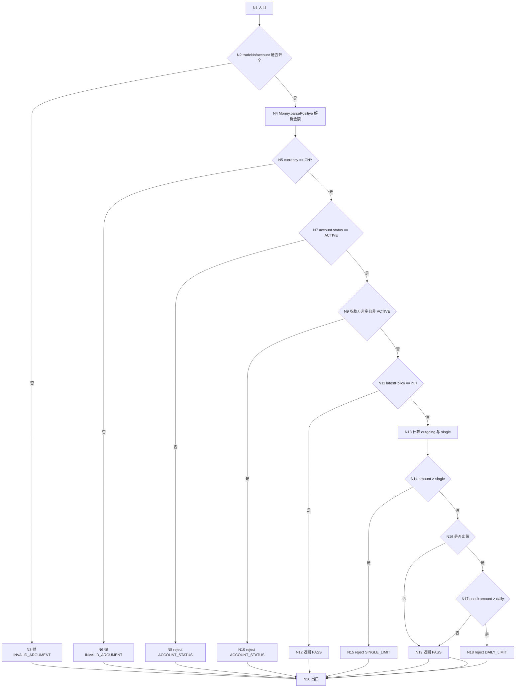

# S3 交易与风控组件测试（基本路径法）

> 模块负责人：S3（交易与风控）。被测提交：`s3_1@a756837`（S3 跨行转账编排实现）之上的 S3 工作区，含本次实验四补充的测试与一处缺陷修复。
> 本文只记录 S3 自己的组件测试，测试结果均可回溯到 `risk-service` 的 Surefire 报告。

## 1. 概述

| 项目 | 内容 |
|---|---|
| 被测模块 | `backend/risk-service`（风控规则求值）、`backend/transaction-service`（存款编排、幂等、模拟渠道） |
| 被测方法 | `RiskCheckService.check(CheckRequest)`（基本路径法）；其余方法与服务作为功能测试对象 |
| 测试工具 | JUnit 5 + Spring Boot Test（`@SpringBootTest` + `@ActiveProfiles("test")`）、H2（`MODE=MySQL`，内存库）、Maven Surefire |
| 测试环境 | JDK 21（Temurin 21.0.13）；数据库为 H2 内存库，schema 见 `backend/risk-service/src/test/resources/schema-test.sql` |
| 进入准则 | 被测服务可编译；风险规则、风险事件、交易、账户四张表在测试库可建可写；限额策略数据已按演示值写入 |
| 退出准则 | 计划内独立路径全部有对应用例并执行；每条路径的判定结果与 `risk_event` 留痕与期望一致；无失败用例 |

### 实际限额配置（本测试依据）

来自 `deploy/sql/init-data.sql` 的演示数据，测试在 `RiskCheckPathTest` 中按同一组值写入：

| 规则 | 类型 | 生效值 |
|---|---|---|
| RK-01 | ACCOUNT_STATUS | 账户/收款方非 `ACTIVE` 即拦截 |
| RK-02 | LIMIT_POLICY | 存款单笔 `50000.00`；出账单笔 `10000.00`；出账日累计 `50000.00` |

短路顺序固定为：**账户状态 → 单笔限额 → 日累计限额**（`RiskCheckService` 注释与接口清单一致）。出账类型为 `WITHDRAWAL`、`INTERNAL_TRANSFER`、`EXTERNAL_TRANSFER`。

## 2. 控制流图

被测方法源码：`backend/risk-service/src/main/java/com/digitalbank/risk/service/RiskCheckService.java#L36-L69`。

节点与判定一览：

| 节点 | 含义 | 是否判定 |
|---|---|---|
| N1 | 入口 | 否 |
| N2 | 交易号/账户视图完整性 | 是 |
| N3 | 抛 `INVALID_ARGUMENT` | 否 |
| N4 | 解析金额（`Money.parsePositive`，非法金额抛异常） | 否 |
| N5 | 币种是否为 CNY | 是 |
| N6 | 抛 `INVALID_ARGUMENT` | 否 |
| N7 | 账户状态是否为 ACTIVE | 是 |
| N8 | 拒绝：账户状态 | 否 |
| N9 | 收款方非空且非 ACTIVE | 是 |
| N10 | 拒绝：收款方状态 | 否 |
| N11 | 是否无启用的限额策略 | 是 |
| N12 | 返回 PASS | 否 |
| N13 | 计算出账标志与单笔上限 | 否 |
| N14 | 是否超单笔限额 | 是 |
| N15 | 拒绝：单笔限额 | 否 |
| N16 | 是否出账（取款/本行转账/跨行转账） | 是 |
| N17 | 是否超日累计限额 | 是 |
| N18 | 拒绝：日累计限额 | 否 |
| N19 | 返回 PASS | 否 |
| N20 | 出口 | 否 |

## 3. 环路复杂度 V(G) 计算

- 节点数 N = 20
- 边数 E = 27（主链 19 条 + 8 个节点到出口 N20 的 8 条）
- 连通分量 P = 1

$$ V(G) = E - N + 2P = 27 - 20 + 2 \times 1 = 9 $$

按判定节点数复核：判定节点为 N2、N5、N7、N9、N11、N14、N16、N17，共 **8 个**，故 $V(G)=8+1=9$。两种算法一致，**独立路径数 = 9**。模板中"4 个判断、复杂度 5"的写法不适用于本方法。

## 4. 独立路径与用例

| 路径编号 | 独立路径 | 覆盖分支 | 对应测试方法 |
|---|---|---|---|
| P1 | N1-N2-N3-N20 | 缺参数 | `path1MissingTradeNoOrAccountIsInvalidArgument` |
| P2 | N1-N2-N4-N5-N6-N20 | 非 CNY | `path2NonCnyIsInvalidArgument` |
| P3 | N1-N2-N4-N5-N7-N8-N20 | 账户非 ACTIVE | `path3InactiveAccountRejectsWithStatusEvent` |
| P4 | N1-N2-N4-N5-N7-N9-N10-N20 | 收款方非 ACTIVE | `path4InactivePayeeRejectsTransfer` |
| P5 | N1-N2-N4-N5-N7-N9-N11-N12-N20 | 无启用策略放行 | `path5NoEnabledLimitPolicyPasses` |
| P6 | N1-N2-N4-N5-N7-N9-N11-N13-N14-N15-N20 | 超单笔限额 | `path6SingleLimitExceededRejectsWithEvent` |
| P7 | N1-N2-N4-N5-N7-N9-N11-N13-N14-N16-N17-N18-N20 | 出账超日累计 | `path7OutgoingDailyLimitExceededRejects` |
| P8 | N1-N2-N4-N5-N7-N9-N11-N13-N14-N16-N17-N19-N20 | 出账在限额内 | `path8OutgoingWithinDailyLimitPasses` |
| P9 | N1-N2-N4-N5-N7-N9-N11-N13-N14-N16-N19-N20 | 存款不走日累计 | `path9DepositSkipsDailyLimitCheck` |

## 5. 表 4-1 组件测试记录

> 结果列：`√` 通过 / `×` 失败 / `—` 未执行。实际输出以测试断言和数据库断言为准，均写入 Surefire 报告。
> 报告路径：`backend/risk-service/target/surefire-reports/com.digitalbank.risk.service.RiskCheckPathTest.txt`（13 项，全部通过）。

| 编号 | 路径标识 | 输入 | 期望输出 | 输出内容 | 发现问题 | 测试结果 | 测试时间 | 测试人 |
|---|---|---|---|---|---|---|---|---|
| CT-S3-001 | P1 | `tradeNo=null`（或 `account=null`） | 抛 `INVALID_ARGUMENT`，无事件 | 抛出 `BizException(INVALID_ARGUMENT)`；`risk_event` 0 条 | 无 | √ | 2026-11-17 | S3 |
| CT-S3-002 | P2 | 金额 `100.00`，币种 `USD` | 抛 `INVALID_ARGUMENT`，无事件 | 抛出 `BizException(INVALID_ARGUMENT)`；`risk_event` 0 条 | 无 | √ | 2026-11-17 | S3 |
| CT-S3-003 | P3 | 存款 `100.00`，账户 `FROZEN` | REJECT，`ACCOUNT_STATUS_INVALID`，落事件 | `result=REJECT`，`reasonCode=ACCOUNT_STATUS_INVALID`，`event_id` 非空，`reason_code=ACCOUNT_STATUS` | 无 | √ | 2026-11-17 | S3 |
| CT-S3-004 | P4 | 转账 `100.00`，收款方 `FROZEN` | REJECT，`ACCOUNT_STATUS_INVALID`，落事件 | `result=REJECT`，`reasonCode=ACCOUNT_STATUS_INVALID`，`event_id` 非空 | 无 | √ | 2026-11-17 | S3 |
| CT-S3-005 | P5 | `enabled=0` 关闭 LIMIT_POLICY，存款 `999999.99` | PASS，无事件 | `result=PASS`，`reasonCode=null`，`risk_event` 0 条 | 无 | √ | 2026-11-17 | S3 |
| CT-S3-006 | P6 | 存款 `50000.01`（单笔上限 50000.00） | REJECT，`SINGLE_LIMIT_EXCEEDED`，落事件 | `result=REJECT`，`reasonCode=SINGLE_LIMIT_EXCEEDED`，`reason_code=SINGLE_LIMIT`，事件 1 条 | 无 | √ | 2026-11-17 | S3 |
| CT-S3-007 | P7 | 取款 `2000.00`，当日已用 `49000.00` | REJECT，`DAILY_LIMIT_EXCEEDED`，落事件 | `result=REJECT`，`reasonCode=DAILY_LIMIT_EXCEEDED`，`reason_code=DAILY_LIMIT` | 无 | √ | 2026-11-17 | S3 |
| CT-S3-008 | P8 | 取款 `2000.00`，当日已用 `48000.00` | PASS，无事件 | `result=PASS`，`reasonCode=null`，事件 0 条 | 无 | √ | 2026-11-17 | S3 |
| CT-S3-009 | P9 | 存款 `100.00`，当日已用 `50000.00` | PASS（存款不校验日累计） | `result=PASS`，事件 0 条 | 无 | √ | 2026-11-17 | S3 |
| CT-S3-010 | 边界 | 存款 `50000.00`（等于单笔上限）；取款 `1000.00` + 已用 `49000.00`（等于日累计） | 均 PASS | 两次均 `result=PASS` | 无 | √ | 2026-11-17 | S3 |
| CT-S3-011 | 边界 | 取款 `10000.00`，`dailyUsedAmount=null` | PASS（null 按 0 处理） | `result=PASS` | 无 | √ | 2026-11-17 | S3 |
| CT-S3-012 | 边界 | 金额 `0.00` / `-1.00` / `100` / `100.0` / `1.234` / `abc` / `null` | 均抛 `INVALID_ARGUMENT`，无事件 | 全部抛出 `BizException(INVALID_ARGUMENT)`，事件 0 条 | 无 | √ | 2026-11-17 | S3 |
| CT-S3-013 | 边界 | 新增 `RK-09`（version=2，限额 100.00），存款 `200.00` | REJECT，采用 RK-09，事件记 `rule_version=2` | `result=REJECT`；`risk_event` 中 `rule_id=RK-09`、`rule_version=2`、`operator_identity_id=identity-risk-path` 各 1 条 | 无 | √ | 2026-11-17 | S3 |

## 6. 组件测试结论

- 9 条独立路径全部覆盖并执行通过；额外 4 条边界用例（等值限额、null 日累计、非法金额、最新规则版本）通过。
- 组件测试合计 **13 执行 / 13 通过 / 0 失败 / 0 未执行**，通过率 100%，执行率 100%。
- 强项：短路顺序（状态 → 单笔 → 日累计）与 `risk_event` 留痕、同单同规则幂等均与接口清单一致；拒绝路径不会产生误放行。
- 弱项/风险：`RiskCheckService.check` 依赖 `latestPolicy()` 从 `risk_rule` 实时取数，若规则被并发变更，判断基准可能变化（当前单测按单条策略求值，未覆盖并发变更）；该点已转交 S1 复核调用身份、S2 复核资金结果时一并关注。
