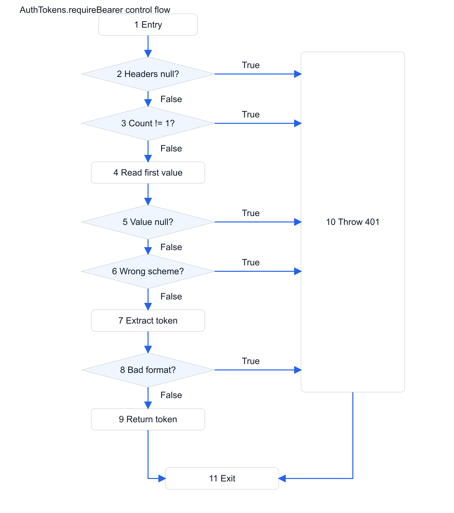

# 数字银行核心业务模拟系统实验四报告

实验名称：软件测试与部署
专业：________　班级：________　组别：________
组长及成员：________　本人角色：S1　指导教师：________
完成日期：2026 年 11 月 17 日

## 1 概述

### 1.1 测试目标与范围

本次对数字银行已实现模块设计并执行测试。S1 负责认证与网关，采用基本路径法验证令牌解析，采用等价类划分法验证登录、身份鉴别和内部接口保护，同时执行全组已有后端自动化回归。目标是检查合法访问能完成、非法访问被拒绝，并保留可追溯的实际输入与输出。

最终后端 JUnit 共 156 例，通过 156 例；独立用户服务与网关的真实 HTTP 用例共 17 例，通过 17 例。前端构建通过。当前结果支持 S1 认证测试结论及已覆盖的组件行为；真实 MySQL、完整资金链路和浏览器业务验收仍有六项待执行场景，不能据此宣布全系统验收完成。

### 1.2 测试基线与环境

被测基线为 4adeb17 加本次工作区修改，关键文件校验值保存于 source-sha256.json。运行环境为 Windows、JDK 21.0.7、Maven 3.9.11、Spring Boot 3.5.7。后端采用 JUnit 5、AssertJ、Spring 测试框架和 H2；真实 HTTP 采用独立 JVM 及 Python 标准 HTTP 客户端。原始请求响应中的密码、服务令牌与会话令牌均已脱敏。

### 1.3 测试过程与完成条件

先固定基线和测试数据，再执行已有测试与新增用例；对发现的问题修复后回归，最后按实际输出汇总。S1 进入条件是 JDK 21、依赖与本机回环网络可用；退出条件是独立路径和认证正反例均有证据、缺陷有处置、回归通过。全组还需完成真实资金业务、数据库核对和部署恢复验证。

S1 本轮新增 AuthTokensPathTest、AuthenticationWebFilterTest、DemoSeedAuthenticationTest，共 25 例；其余为复用后重新执行的已有测试。统计中的测试通过不表示已完成组员人工复核。

## 2 组件测试

### 2.1 被测方法与控制流

被测方法为 backend/common/src/main/java/com/digitalbank/common/auth/AuthTokens.java 中的 requireBearer(List<String>)。方法拒绝缺失或重复的 Authorization 值、不正确的 Bearer 方案，以及长度或字符集不合法的令牌。令牌语法通过之后，会话是否存在和过期由后续 SessionVerifier 判断。

短路条件分别展开为五个判定节点：headers 为 null、列表数量不为 1、首值为 null、方案不匹配、令牌格式不匹配。图中 4 是读取首值，7 是截取令牌，9 是正常返回，10 是所有拒绝分支共用的异常节点，11 是统一出口。这里只统计方法显式控制流，不展开 JDK 方法内部的隐式异常。

图含 N=11 个节点、E=15 条边、一个连通分量，V(G)=E−N+2=15−11+2=6；也等于 5 个二元判定加 1。六条独立路径分别至少增加一条此前未出现的控制流边，CT-S1-001～006 对应 P1～P6。其余七个用例补充重复头、长度、字符集及大小写边界。

### 2.2 独立路径

| 路径 | 节点序列 |
| --- | --- |
| P1 | 1→2→10→11 |
| P2 | 1→2→3→10→11 |
| P3 | 1→2→3→4→5→10→11 |
| P4 | 1→2→3→4→5→6→10→11 |
| P5 | 1→2→3→4→5→6→7→8→10→11 |
| P6 | 1→2→3→4→5→6→7→8→9→11 |

T 表示 43 个 URL 安全字符组成的令牌。拒绝路径检查实际异常类型及 HTTP 状态；成功路径检查返回值与原令牌一致。13 例全部通过，详细自动化实例名及耗时见 junit-results.json。

<!-- landscape -->
### 表4-1 用户令牌模块测试记录

| 编号 | 路径标识 | 输入 | 期望输出 | 输出内容 | 发现问题 | 测试结果 | 测试时间 | 测试人 |
| --- | --- | --- | --- | --- | --- | --- | --- | --- |
| CT-S1-001 | P1 | headers=null | 拒绝，401 | BizException，status=401 | 无 | √ | 2026-11-17 | S1 |
| CT-S1-002 | P2 | headers=[] | 拒绝，401 | BizException，status=401 | 无 | √ | 2026-11-17 | S1 |
| CT-S1-003 | P3 | headers=[null] | 拒绝，401 | BizException，status=401 | 无 | √ | 2026-11-17 | S1 |
| CT-S1-004 | P4 | [Basic T] | 拒绝，401 | BizException，status=401 | 无 | √ | 2026-11-17 | S1 |
| CT-S1-005 | P5 | [Bearer invalid] | 拒绝，401 | BizException，status=401 | 无 | √ | 2026-11-17 | S1 |
| CT-S1-006 | P6 | [Bearer T] | 返回 T | 返回原令牌，断言相等 | 无 | √ | 2026-11-17 | S1 |
| CT-S1-007 | P2 | 两个 Authorization 值 | 拒绝，401 | BizException，status=401 | 无 | √ | 2026-11-17 | S1 |
| CT-S1-008 | P5 | 令牌长 42 字符 | 拒绝，401 | BizException，status=401 | 无 | √ | 2026-11-17 | S1 |
| CT-S1-009 | P5 | 令牌长 44 字符 | 拒绝，401 | BizException，status=401 | 无 | √ | 2026-11-17 | S1 |
| CT-S1-010 | P5 | 令牌包含加号 | 拒绝，401 | BizException，status=401 | 无 | √ | 2026-11-17 | S1 |
| CT-S1-011 | P5 | 令牌末尾多一个空格 | 拒绝，401 | BizException，status=401 | 无 | √ | 2026-11-17 | S1 |
| CT-S1-012 | P6 | bEaReR T | 返回 T | 返回原令牌，断言相等 | 无 | √ | 2026-11-17 | S1 |
| CT-S1-013 | P6 | 43 字符 URL 安全令牌 | 返回原令牌 | 返回原令牌，断言相等 | 无 | √ | 2026-11-17 | S1 |

<!-- portrait -->
## 3 功能测试

### 3.1 等价类划分

| 输入域 | 有效等价类 | 无效等价类与边界 | 关联用例 |
| --- | --- | --- | --- |
| 登录身份与密码 | 存在且可用的身份及正确密码 | 身份不存在、密码错误、缺少字段 | FT-S1-001～004 |
| 密码编码长度 | 不超过 72 个 UTF8 字节 | 超过 72 字节；25 个汉字为 75 字节 | FT-S1-005 |
| 用户令牌 | 单一 Bearer 值，43 个 URL 安全字符，且会话有效 | 缺失、格式非法、重复头、42/44 字符、非法字符 | CT-S1-001～013；FT-S1-006～008 |
| 身份来源 | 由经验证的会话取得身份 | 客户端伪造身份头 | FT-S1-009 |
| 内部服务令牌 | 正确服务令牌与有效用户令牌同时提供 | 缺失、错误、仅服务令牌、从网关访问内部接口 | FT-S1-010～014 |
| 会话状态 | 退出前有效；健康检查可匿名 | 退出后旧令牌；恰好到过期时刻 | FT-S1-015～017；SessionServiceTest |

输入约束按当前 LoginRequest、SessionService、AuthTokens 及内部认证接口实现确定。密码长度按 UTF8 字节处理；短路条件与格式边界由组件用例补充。会话恰好过期的边界通过可控 Clock 测试，退出后失效则另外经真实 HTTP 验证。

<!-- landscape -->
### 表4-2 认证与网关功能测试记录

| 编号 | 功能名称 | 输入内容 | 期望输出 | 输出内容 | 发现问题 | 测试结果 | 测试时间 | 测试人 |
| --- | --- | --- | --- | --- | --- | --- | --- | --- |
| FT-S1-001 | 经网关登录成功 | 正确 identityId 和密码 | HTTP 200 | HTTP 200，SUCCEEDED | 无 | √ | 2026-11-17 | S1 |
| FT-S1-002 | 错误密码 | 有效身份，密码错误 | HTTP 401 | HTTP 401，UNAUTHENTICATED | 无 | √ | 2026-11-17 | S1 |
| FT-S1-003 | 不存在的身份 | 不存在的 identityId | HTTP 401 | HTTP 401，UNAUTHENTICATED | 无 | √ | 2026-11-17 | S1 |
| FT-S1-004 | 缺少登录字段 | 空对象 {} | HTTP 400 | HTTP 400，INVALID_ARGUMENT | 无 | √ | 2026-11-17 | S1 |
| FT-S1-005 | UTF8 密码超过 72 字节 | 25 个汉字，UTF8 长度 75 字节 | HTTP 400 | HTTP 400，INVALID_ARGUMENT | 无 | √ | 2026-11-17 | S1 |
| FT-S1-006 | 未登录访问受保护接口 | 无 Authorization | HTTP 401 | HTTP 401，UNAUTHENTICATED | 无 | √ | 2026-11-17 | S1 |
| FT-S1-007 | 畸形令牌 | Bearer invalid | HTTP 401 | HTTP 401，UNAUTHENTICATED | 无 | √ | 2026-11-17 | S1 |
| FT-S1-008 | 合法令牌读取当前身份 | 合法 Bearer 令牌 | HTTP 200 | HTTP 200，SUCCEEDED，身份仍为测试用户 | 无 | √ | 2026-11-17 | S1 |
| FT-S1-009 | 伪造身份头不能覆盖会话 | 合法令牌加伪造身份头 | HTTP 200 | HTTP 200，SUCCEEDED，身份仍为测试用户 | 无 | √ | 2026-11-17 | S1 |
| FT-S1-010 | 内部认证接口不对网关开放 | 从网关请求内部认证路径 | HTTP 404 | HTTP 404 | 无 | √ | 2026-11-17 | S1 |
| FT-S1-011 | 直连内部接口缺服务令牌 | 直连用户服务，仅用户令牌 | HTTP 401 | HTTP 401，UNAUTHENTICATED | 无 | √ | 2026-11-17 | S1 |
| FT-S1-012 | 直连内部接口错误服务令牌 | 用户令牌加错误服务令牌 | HTTP 401 | HTTP 401，UNAUTHENTICATED | 无 | √ | 2026-11-17 | S1 |
| FT-S1-013 | 服务令牌与用户令牌均合法 | 用户令牌加正确服务令牌 | HTTP 200 | HTTP 200，SUCCEEDED，身份仍为测试用户 | 无 | √ | 2026-11-17 | S1 |
| FT-S1-014 | 仅服务令牌不能代替用户令牌 | 仅正确服务令牌 | HTTP 401 | HTTP 401，UNAUTHENTICATED | 无 | √ | 2026-11-17 | S1 |
| FT-S1-015 | 通过网关退出 | 有效用户令牌退出 | HTTP 200 | HTTP 200，SUCCEEDED | 无 | √ | 2026-11-17 | S1 |
| FT-S1-016 | 退出后旧令牌立即失效 | 退出后重用旧令牌 | HTTP 401 | HTTP 401，UNAUTHENTICATED | 无 | √ | 2026-11-17 | S1 |
| FT-S1-017 | 公共健康检查无需登录 | 不携带登录令牌 | HTTP 200 | HTTP 200，SUCCEEDED | 无 | √ | 2026-11-17 | S1 |

HTTP 实际响应及测试时间见 s1-http-results.json。测试人 S1，由 Codex 辅助执行；本人姓名和人工复核信息须在提交课程材料前确认。测试使用 demo 凭据与随机本机端口，不依赖 MySQL，不代表资金端到端测试。

<!-- portrait -->
### 3.2 资金业务联调范围

账户、记账、交易、幂等与风控已有测试已在本轮执行，但使用 H2 或替身，真实资金功能需要补充下列六项场景。以下结果统一为“—”，未填通过，也未与 S1 的 HTTP 通过数混合。

| 编号 | 功能场景 | 结果 | 未执行说明 |
| --- | --- | --- | --- |
| E2E-S5-001 | 登录→查账户→存款→查结果→余额与流水 | — | 真实 MySQL 及五服务联调待 S4/S5 执行 |
| E2E-S5-002 | 取款成功与可用余额不足 | — | 需真实数据库前后余额、预留和流水证据 |
| E2E-S5-003 | 本行转账成功与冻结账户拒绝 | — | 需双方余额及成对流水证据 |
| E2E-S5-004 | 跨行成功、明确失败及结果未决 | — | 需证明 UNKNOWN 保留预留，不能把超时直接记为失败 |
| E2E-S5-005 | 单笔与日累计限额边界 | — | 需固定真实 risk_rule 配置与执行前累计值 |
| E2E-S5-006 | 同请求同内容重放及不同内容冲突 | — | 需实际交易号、请求号及数据库只入账一次证据 |

## 4 测试结论

### 4.1 执行统计

| 模块或验证类型 | 已执行 | 通过 | 失败或错误 | 未执行 |
| --- | --- | --- | --- | --- |
| account-service | 52 | 52 | 0 | 0 |
| common | 24 | 24 | 0 | 0 |
| gateway | 9 | 9 | 0 | 0 |
| risk-service | 10 | 10 | 0 | 0 |
| transaction-service | 36 | 36 | 0 | 0 |
| user-service | 25 | 25 | 0 | 0 |
| 真实 HTTP 认证联调 | 17 | 17 | 0 | 0 |
| 计划内真实资金业务场景 | 0 | 0 | 0 | 6 |

JUnit 156 例全部执行且通过，失败、错误、跳过均为 0，通过率和本次回归清单执行率均为 100%。其中令牌组件表的 13 例属于该总数，不重复累加。S1 真实 HTTP 17 例全部通过。若把六项待执行资金场景纳入功能计划，功能计划共 23 项，已执行 17 项，执行率 73.9%；已执行项通过率为 100%。这两个口径不能互相替代。

### 4.2 结果分析

已验证的强项是认证正反例、身份头防伪、内部接口保护、令牌撤销，以及现有账户事务、交易幂等和风控组件的回归。认证 HTTP 使用真实网关和用户服务，证明了这两个独立进程间的调用可运行。

当前弱项是尚未完成真实 MySQL 和浏览器资金链路验证、数据库备份恢复与版本回滚，跨行转账前端入口也未接入。组件回归不能覆盖生产数据库差异、真实网络故障和界面行为；这些范围需要 S4/S5 补证。

### 4.3 缺陷与处置

| 编号 | 问题 | 状态 | 修复或处置 |
| --- | --- | --- | --- |
| BUG-S1-001 | 前端代理为 8090，网关默认 8085 | 已修复 | 代理默认改为 8085；支持 GATEWAY_URL；两种配置加载及构建均通过，完整页面联调另验 |
| BUG-S1-002 | 演示凭据为 SHA-256，认证编码器为 BCrypt | 代码与夹具修复已验证 | 更新演示 SQL 的三条 BCrypt 哈希；三个真实夹具兼容性测试通过；MySQL 导入后登录仍待复测 |
| DOC-S1-001 | 部署说明残留合并冲突且账号口径不一致 | 已修复 | 依据 DDL 整理为 13 表、15 外键及真实 identityId；明确初始化脚本清空数据 |
| GAP-S5-001 | 跨行后端已入库，前端跨行入口未接入 | 待 S5 | 单独登记前端范围缺口，不计为本次已通过页面 |
| ENV-S4-001 | Docker 引擎当前未启动 | 待 S4 | 本轮未验证真实 MySQL 部署、备份恢复与资金端到端；不影响本轮 H2 回归和认证 HTTP 联调 |

本轮修复两个功能配置或夹具问题及一处部署文档问题，没有把环境限制计为产品缺陷。数据库演示哈希修复通过真实 SQL 夹具兼容性测试，但 MySQL 导入后的登录仍待执行。完整复现、修复文件和回归依据另见缺陷记录。

## 5 部署方案

### 5.1 部署拓扑与配置

沿用实验二“浏览器→网关→用户、账户、交易、风控服务→MySQL”的微服务划分。开发环境使用 Vite 5173，用户 8081、账户 8082、交易 8083、风控 8084、网关 8085、MySQL 3306。实验二图中的 Nginx、只读从库和可选 Redis 是扩展设计，本次没有实际部署，不作为已验收内容。

认证使用 BANK_INTERNAL_TOKEN；业务服务通过 USER_SERVICE_URL 调用用户服务。MySQL 认证使用 BANK_CREDENTIAL_STORE=mysql 及 BANK_DB_URL、BANK_DB_USERNAME、BANK_DB_PASSWORD。账户、交易、风控分别配置对应 *_DB_URL、*_DB_USER、*_DB_PASSWORD，以及内部调用所需令牌；交易服务的账户和风控令牌与目标服务一致。前端 GATEWAY_URL 默认指向 8085。

### 5.2 启动与健康检查

先准备独立实验 MySQL 和数据，再构建后端，依次启动用户、账户、风控、交易、网关，最后启动前端。当前 Compose 仅启动依赖，不能称作一键部署全部应用。schema.sql 含 DROP TABLE，init-data.sql 含 DELETE，执行前确认目标为可重建实验库，已有数据先备份。已有 Docker 数据卷不会因 SQL 文件变化自动重导。

用户服务 MySQL 模式按 identityId 登录，演示身份为 UID-000001、UID-000002、OPS-ADMIN。前两者实验密码 demo123，后者 admin123。不要把 username 当作 identityId。检查每个服务 /actuator/health 后，还需经网关执行登录、查账户、存款及余额流水核对，健康检查通过不表示资金业务通过。

### 5.3 备份恢复与应用回滚

在受控维护窗口使用 mysqldump --single-transaction --routines --triggers 备份，记录时间、版本与文件校验值，在隔离实例恢复并检查表、余额不变式和未决交易。回滚时暂停新请求，停止新版，恢复上一版 JAR 和兼容配置；数据库不兼容时使用事先验证的恢复方案。当前会话存于进程内存，重启需要重新登录。

本轮仅实际验证用户服务与网关的独立进程认证部署，真实 MySQL 备份恢复、应用版本回滚和完整资金冒烟尚未执行。详细配置和操作顺序见配套部署方案，后续由 S4 补充实际输出。

## 6 AI 使用与提交复核

本轮使用 Codex 检查代码、设计测试、编写自动化脚本、执行测试、修复前端代理端口和演示密码哈希，并整理报告。实际提示包括“实验四我该干什么”和“帮我完成实验四”。未采用旧模板中的固定复杂度、占位方法名、未实现的白名单规则或“跨行超时直接失败”等未经核实结论。

自动生成内容已按代码和实际测试输出进行核对；本人仍需复核代码、测试覆盖与结论，填写姓名、班级和成员信息。不得将 AI 执行写为组员已人工验收。组员互评、个人总结及尚未执行的数据库和页面结果不代填。

证据目录包含 junit-results.json、s1-http-results.json、source-sha256.json、控制流图和执行说明。复现入口是 scripts/run-exp4-tests.ps1。原始日志留在本地并受 .gitignore 排除，最终课程材料只引用脱敏结果。
