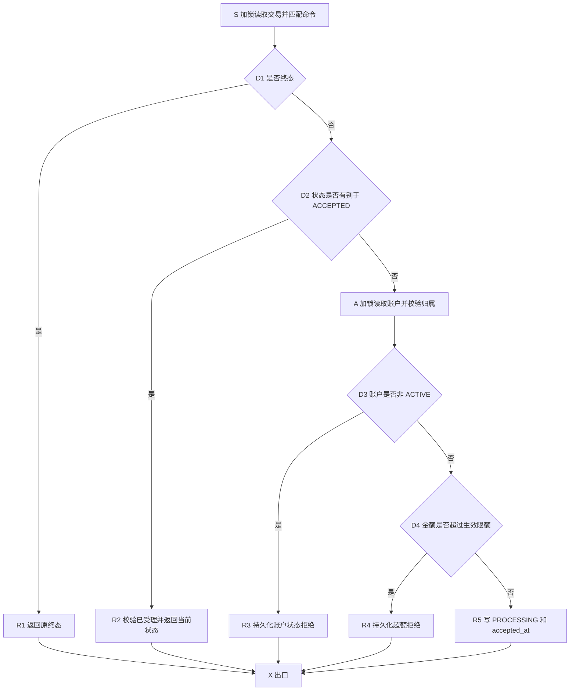

# S2 账户组件测试

被测方法为 `PostingService.acceptDeposit(Command)`，生产源码基线为 `main@1a89c0b`。本地补充用例后，于 2026-11-17 14:20（UTC+8）运行。测试由 Codex 辅助执行，测试人署名为 Yu-some（与 Git 提交作者一致）。 [被测源码](https://github.com/liujiang781/digital-bank-core/blob/1a89c0b57a40a9a88bbee27d69d89b4fbc41f389/backend/account-service/src/main/java/com/digitalbank/account/service/PostingService.java#L37-L52)

## 1. 控制流图

图按被测方法内的显式判断建模。辅助方法内部的判定和异常可单独测试。五个正常的业务返回汇入同一个出口。

节点数 `N = 12`，边数 `E = 15`。连通分量数 `P = 1`，因此 `V(G) = E − N + 2P = 15 − 12 + 2 = 5`。四个二值判断也得出 `V(G) = 4 + 1 = 5`。

## 2. 表 4-1 组件测试记录

测试通过 JDBC 在 H2 准备原单、账户和规则，再调用 Spring 管理的 `PostingService`。金额单位为元。B 为账面余额，R 为预留金额。边界用例明确写入一条启用规则，将生效存款单笔限额设为 `100.00`。

| 编号 | 路径标识 | 输入 | 期望输出 | 实际输出（自动断言） | 发现问题 | 结果 | 时间（UTC+8） | 测试人 |
|---|---|---|---|---|---|---|---|---|
| CT-S2-001 | S→D1→R1→X | `100.00` 原单已成功入账，再次受理同一命令 | 返回原 `SUCCESS`；受理时间、余额与流水保持原值 | `SUCCESS`，`accepted_at` 原值，B=600.00，R=0.00，原单流水 1 条 | — | 通过 | 2026-11-17 14:20 | Yu-some |
| CT-S2-002 | S→D1→D2→R2→X | 原单 `PROCESSING` 且已有 `accepted_at`，再次受理 | 仍为 `PROCESSING`，受理时间保持原值 | `PROCESSING`，`accepted_at` 与首次受理一致 | — | 通过 | 2026-11-17 14:20 | Yu-some |
| CT-S2-003 | S→D1→D2→A→D3→R3→X | `ACCEPTED`，账户 `FROZEN`，`100.00` | `REJECTED / ACCOUNT_STATUS_INVALID`；余额与流水保持原值 | 数据库状态为 `REJECTED`，原因符合预期，B=500.00，R=0.00，流水 0 条 | — | 通过 | 2026-11-17 14:20 | Yu-some |
| CT-S2-004 | S→D1→D2→A→D3→D4→R4→X | `ACCEPTED`，账户 `ACTIVE`，`100.01` | `REJECTED / SINGLE_LIMIT_EXCEEDED`；受理时间为空，余额和流水保持原值 | 数据库状态为 `REJECTED`，原因符合预期，`accepted_at` 为空，B=500.00，R=0.00，流水 0 条 | — | 通过 | 2026-11-17 14:20 | Yu-some |
| CT-S2-005 | S→D1→D2→A→D3→D4→R5→X | `ACCEPTED`，账户 `ACTIVE`，`100.00` | `PROCESSING`；有受理时间，余额和流水保持原值 | 数据库状态为 `PROCESSING`，`accepted_at` 非空，B=500.00，R=0.00，流水 0 条 | — | 通过 | 2026-11-17 14:20 | Yu-some |

## 3. 用例与执行证据

| 用例 | `PostingIntegrationTest` 对应测试 |
|---|---|
| CT-S2-001 | `acceptingASuccessfulDepositReturnsTheExistingOutcomeWithoutPostingAgain` |
| CT-S2-002 | `repeatedAndConcurrentSuccessfulDepositHasOneMoneyEffect` 中的处理中重放 |
| CT-S2-003 | `freezeBeforeAcceptancePersistsRejectionWhileFreezeAfterAcceptanceAllowsConfirmation` 中的先冻结场景 |
| CT-S2-004、CT-S2-005 | `depositAcceptanceAppliesTheEffectiveSingleLimit` 的两个参数行 |

五条路径在 H2 上执行并通过。JDK 21.0.9、Maven 3.9.11、H2 2.3.232（MySQL 兼容模式）。在 `backend/` 执行 `.\mvnw.cmd -s .mvn/central-settings.xml -pl account-service -am test` 可复现。此次运行使用同版本的本地 Maven 和已缓存依赖，详细执行命令见证据。账户测试 profile 使用本地会话校验替身，仍经真实认证过滤器和账户授权逻辑。 [H2 执行证据](证据/S2-H2执行证据.txt)

2026-11-17 14:31（UTC+8），五条路径及记账回归在独立 MySQL 8.4.13（InnoDB）上重跑并通过。 [MySQL 执行证据](证据/S2-MySQL执行证据.txt)

> 版本说明：上表方法名对应测试当时的 `1a89c0b` 基线。远程 `main` 后续已演进，同名场景被重构或拆分为等价/更强的断言（例如成功回执重放现由 `repeatedAndConcurrentSuccessfulDepositHasOneMoneyEffect` 等覆盖，注销资金门槛由 `zeroBalancesDoNotPermitClosingAnAccountWithAnUnresolvedDeposit` 覆盖），故当前 `main` 中部分旧方法名不再存在。本文记录的是本轮实测，测试代码以证据中记录的版本为准。
