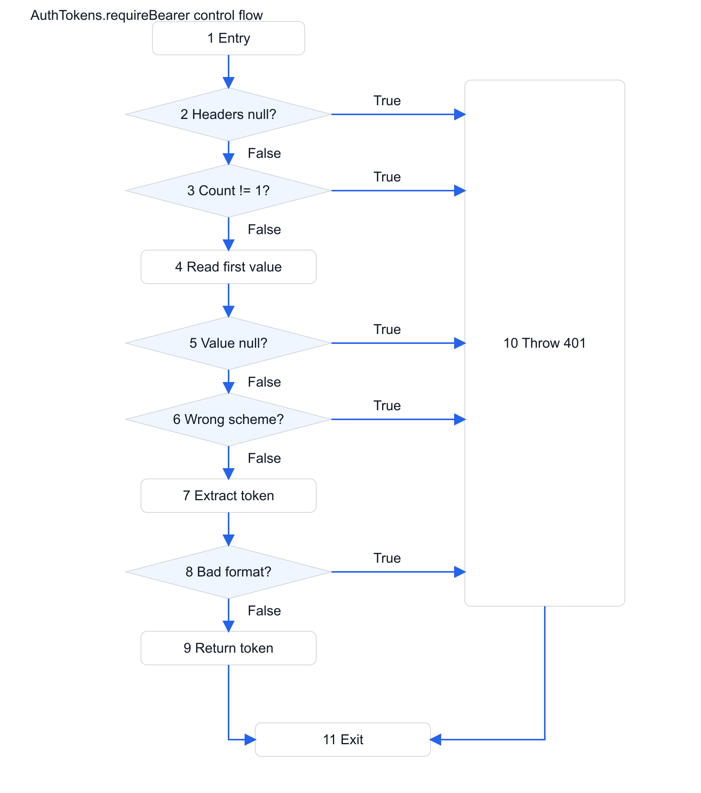

# 数字银行核心业务模拟系统实验四测试报告

## 1 概述

### 1.1 测试目标与汇总结论

本实验围绕数字银行核心业务模拟系统开展组件测试、功能测试、跨服务联调和部署验证。测试关注登录与访问权限、账户生命周期、资金记账一致性、请求幂等、渠道结果三态以及风控拦截，检查业务结果能否与余额、占用和资金流水相互对应。

截至汇总日，S1至S4均已提交测试或部署材料。现有证据支持各自被测版本上的认证与授权、账户记账、存款幂等与渠道处理、数据库约束、五服务健康检查及备份恢复等结论。S1后续批次记录228项后端测试和29个HTTP场景通过；S2有独立MySQL回归与账户核账记录；S3有真实MySQL存款三态联调记录；S4补齐了13项部署验证及后续数据库升级复验。

全组尚未完成当前主干统一回归和浏览器资金业务验收。未找到S5独立端到端测试交付；取款、两类转账以及后续新增运营、风控功能仍需按当前版本补齐完整联调证据。因此，本报告结论为已提交范围在各自记录环境中通过，全组最终验收尚待补充。

### 1.2 版本与统计口径

本次汇总参照本地main提交d76d5d6，收集2026年11月17日至19日的成员执行记录。2026年11月21日仅核对和编写报告，未为本报告重新运行测试。下表中的工作区叠加表示证据针对当时提交及未提交修改，具体文件指纹以成员证据为准。

| 批次             | 被测基线                      | 环境与结果                           |
| -------------- | ------------------------- | ------------------------------- |
| S1初轮，11月17日    | 4adeb17加工作区修改             | H2及独立认证服务；156项JUnit、17项HTTP通过   |
| S1授权补齐，11月17日  | 源文件指纹见staff-auth证据        | H2及用户、账户、网关；166项回归、27项HTTP通过    |
| S1用户管理，11月18日  | 80b44f6加功能分支修改            | 独立共享H2；228项回归、29项HTTP通过         |
| S2账户，11月17日    | 1a89c0b；授权补录994c3da       | H2、独立MySQL 8.4.13及真实服务授权验证      |
| S3组件与功能，11月17日 | a756837加S3工作区修改           | H2、MockMvc及下游桩；记录32条用例通过        |
| S3真实联调，11月17日  | 16034e3加币种校验修复            | MySQL 8.0.13、五服务及网关存款闭环         |
| S4部署与复验，11月19日 | abc6c62及后续75ddc06、e7d3df3 | MySQL从8.0.13升级至8.0.46，补充结构与行为复验 |

不同批次的回归测试包含重复用例，228、166、156等数量不能相加。文档中的用例条目、JUnit实例和HTTP场景属于不同统计单位，也不合并计算一个全组通过率。所有通过结论限定于原记录的版本、环境和范围，不自动延伸至d76d5d6。

### 1.3 分工与方法

S1负责认证、网关、用户管理测试和报告统筹；S2负责账户生命周期、余额、占用与记账一致性；S3负责存款编排、幂等、模拟渠道及风控；S4负责数据库、部署、约束与备份恢复；S5负责浏览器端到端测试及界面证据。

组件测试采用基本路径法，对实际方法建立控制流并推导独立路径；功能测试采用等价类与边界值，覆盖有效输入、无效参数、权限拒绝、重放、冲突及渠道异常。资金结果以交易状态、余额B、占用R、可用余额A和资金流水联合核对，其中A=B-R，且0≤R≤B。

## 2 组件测试

### 2.1 认证令牌解析

S1选择AuthTokens.requireBearer(List<String>)作为基本路径测试对象。缺少或重复Authorization、空值、错误方案及不合法令牌均应拒绝；格式通过后，会话存在性与过期由后续核验处理。原控制流将短路条件展开为五个二元判定，N=11、E=15、P=1，V(G)=E-N+2P=6。

六条独立路径分别为1→2→10→11、1→2→3→10→11、1→2→3→4→5→10→11、1→2→3→4→5→6→10→11、1→2→3→4→5→6→7→8→10→11、1→2→3→4→5→6→7→8→9→11。

表4-1 认证令牌组件测试记录摘要

| 用例编号          | 输入或边界                   | 期望结果   | 实际结果                       |
| ------------- | ----------------------- | ------ | -------------------------- |
| CT-S1-001至003 | headers为null、空列表、首值null | 拒绝，401 | BizException，status=401，通过 |
| CT-S1-004     | Basic方案                 | 拒绝，401 | status=401，通过              |
| CT-S1-005     | Bearer invalid          | 拒绝，401 | status=401，通过              |
| CT-S1-006     | 合法43字符令牌                | 返回原令牌  | 原值相等，通过                    |
| CT-S1-007至011 | 重复头、42或44字符、非法字符、尾空格    | 拒绝，401 | 均拒绝，通过                     |
| CT-S1-012至013 | 方案大小写及合法格式              | 返回原令牌  | 原值相等，通过                    |

以上13条为11月17日JUnit批次的子集。逐条输入、时间、测试人和实例名称见[S1认证报告](s1/实验四报告.md)及[junit-results.json](s1/证据/2026-11-17/junit-results.json)，不重复累计。

### 2.2 账户存款受理

S2选择PostingService.acceptDeposit(Command)。原记录按方法内显式判断建模，包含终态、是否已受理、账户状态与单笔限额四个判定，N=12、E=15、P=1，V(G)=5。辅助方法内部异常不展开到本图中，分别由其他用例验证。

表4-2 账户组件测试记录摘要

| 用例编号      | 输入与路径                    | 期望结果         | 实际结果                       |
| --------- | ------------------------ | ------------ | -------------------------- |
| CT-S2-001 | 已成功原单再次受理                | 返回原终态，无新资金效果 | SUCCESS，B=600、R=0、流水1条     |
| CT-S2-002 | PROCESSING且已有受理时间        | 保持当前状态和受理时间  | PROCESSING，时间不变            |
| CT-S2-003 | ACCEPTED，账户FROZEN        | 拒绝，资金不变      | REJECTED，B=500、R=0、流水0条    |
| CT-S2-004 | ACTIVE，金额100.01，限额100.00 | 超限拒绝，无受理时间   | SINGLE_LIMIT_EXCEEDED，资金不变 |
| CT-S2-005 | ACTIVE，金额100.00，限额100.00 | 写入处理中及受理时间   | PROCESSING，时间非空，尚无资金流水     |

五条路径在H2执行通过，并在独立MySQL 8.4.13上重跑。账户测试使用本地会话核验替身，但保留真实过滤器及账户授权逻辑；不将其描述为全链路认证测试。完整控制流和方法映射见[S2账户组件测试](s2/S2-账户组件测试.md)。

### 2.3 风控规则求值

S3选择RiskCheckService.check(CheckRequest)，按照原记录的显式业务判定建模，N=20、E=27、P=1，V(G)=9。该口径没有继续展开复合条件或辅助方法的内部控制流，不等同于所有底层条件的完整覆盖。九条独立路径包括缺参数、非CNY、付款账户非正常、收款方非正常、无启用策略、超单笔、超日累计、出账限额内及存款跳过日累计。

原记录CT-S3-001至009分别覆盖这九条路径；CT-S3-010至013补充等于限额、累计值为空、非法金额和规则版本选择，共13条通过。典型结果为：存款50000.01元超50000.00元上限时拒绝并生成事件；取款2000.00元加已用49000.00元时拒绝；已用48000.00元时允许；存款不进入出账日累计判定。

完整控制流、独立路径、输入和输出见[S3组件测试](S3-交易风控组件测试.md)。该记录对应历史方法与规则集，当前新增审批、风险名单等功能不能据此认定已覆盖。

## 3 功能测试与跨服务联调

### 3.1 等价类与边界划分

表4-3 功能测试输入域

| 输入域    | 有效类                           | 无效类及边界                         |
| ------ | ----------------------------- | ------------------------------ |
| 登录与会话  | 合法身份、正确密码、有效会话                | 错密码、不存在身份、缺字段、过期或已撤销令牌         |
| 身份与权限  | 本人账户；员工拥有目标范围                 | 未登录、伪造身份头、他人账户、无范围或角色不符        |
| 金额与币种  | 正数两位小数字符串、CNY                 | 零、负数、精度错误、非数字、非CNY；限额等于及超出0.01 |
| 请求幂等   | 新请求；同身份同业务同号同内容               | 同号不同内容冲突；相同请求号在不同身份下独立         |
| 账户生命周期 | 未注销数少于3；零额无未决可注销              | 达到开户上限；冻结、新交易不允许；有余额、占用或未决不得注销 |
| 渠道与资金  | SUCCESS、FAILED、UNKNOWN均为需处理结果 | 未知不能当成功或直接退款；重复回执不得重复资金变动      |
| 资金一致性  | B、R、A一致，资金流水可关联               | 转账中途写入失败；重复入账；释放错误原单占用         |

### 3.2 S1认证及用户管理

11月17日17个真实HTTP认证场景全部通过，覆盖正确与错误登录、缺字段、超长UTF-8密码、匿名访问、畸形令牌、伪造身份头、内部路径不转发、内部令牌缺失或错误、退出与旧会话失效等。用户服务与网关为真实独立进程，未连接MySQL。

后续角色与账户范围补齐后，用户、账户和网关三服务执行27个HTTP授权场景，全部通过；11月18日用户管理批次进一步执行29个场景，覆盖注册重放与冲突、资料脱敏与受保护字段、注册后开户、管理员授予或撤销授权、员工客户范围、伪造角色拒绝、旧令牌失效及管理员业务隔离。此批全后端JUnit共228项通过，失败、错误、跳过均为0。

这些补充使用独立H2 TCP数据库，不冒充真实MySQL验收。结果与被测源文件指纹见[S1用户管理证据](s1/证据/2026-11-18/README.md)。

### 3.3 S2账户与记账

S2功能表共15条，记录已执行15条、通过15条。前14条包含开户、并发开户上限、余额快照、访问边界、冻结解冻、注销、存款重放与内部取款和转账记账；第15条为后补的真实服务授权验证。

表4-4 账户功能典型执行结果

| 原用例           | 操作或输入               | 期望结果           | 实际结果                              |
| ------------- | ------------------- | -------------- | --------------------------------- |
| FT-S2-002     | 已有1个冻结户，8个并发开户请求    | 未注销账户不超过3      | 新开2户，其余拒绝，最终3户                    |
| FT-S2-003     | B=100.00、R=35.25    | A=64.75        | 三值同一快照返回                          |
| FT-S2-006至007 | 零额无未决；有余额、占用或未决     | 仅首类可注销         | 可注销返回CLOSED，其他保持原状并拒绝             |
| FT-S2-008     | 100元，8个并发成功回执       | 只入账一次          | B=500→600，R=0，流水1条                |
| FT-S2-012     | 转账100元，第二条流水写入失败后重试 | 失败整笔回滚，重试仅执行一次 | 失败B=500/20、R=100；成功B=400/120，流水2条 |
| FT-S2-014     | MySQL，经网关存100元并重放   | 原交易不变，只加100元   | B/A=50000→50100，R=0，一条DEPOSIT_IN  |
| FT-S2-015     | 员工角色、范围及冻结解冻        | 合法允许，越权拒绝      | 27项HTTP通过，冻结解冻无资金流水，操作审计3条        |

独立MySQL和H2各运行账户52项、公共认证11项测试，均通过。FT-S2-015的27项HTTP与S1授权证据为同一来源，不作为额外27项全组测试重复累计。内部取款或转账记账测试证明账户侧行为，不能替代完整客户请求、渠道和页面链路。完整记录及原始日志见[S2账户功能测试](s2/S2-账户功能测试记录.md)。

### 3.4 S3存款与风控

S3文档记录组件13条、功能19条，共32条通过，失败和未执行均为0。对应新增或补充自动化实例39项，连同既有S3实例合计85项通过；这些数字是不同层次的统计，32、39、85不能相加。H2接口测试中的账户与风控下游包含桩，真实MySQL联调另行记录。

真实MySQL五服务联调验证登录、查余额、成功存款、同号重放与异内容冲突、渠道明确失败、结果未知及后续收敛，以及超单笔、非法币种和越权查询。

表4-5 真实MySQL存款联调结果摘要

| 场景    | 输入或原交易号                  | 实际业务结果                         | 资金核对                 |
| ----- | ------------------------ | ------------------------------ | -------------------- |
| 成功存款  | 100元，TRD202611179836A6F9 | SUCCESS                        | B=50000→50100，入账流水1条 |
| 同号重放  | 原requestId、原金额           | 返回同一tradeNo                    | B保持50100，未增加流水       |
| 同号异内容 | 原requestId、改为200元        | HTTP 409 REQUEST_CONFLICT      | 原单和余额不变              |
| 渠道失败  | TRD202611174B6065C4      | FAILED，CHANNEL_DECLINED        | B保持50100，不入账         |
| 未决及收敛 | TRD20261117F1EA18F7      | 先UNKNOWN，后SUCCESS              | 未决不入账，明确成功后B=50200   |
| 单笔超限  | 50000.01元                | HTTP 422 SINGLE_LIMIT_EXCEEDED | 不产生资金入账              |
| 非法币种  | USD、100元                 | HTTP 400 INVALID_ARGUMENT      | 参数校验拒绝               |
| 越权查询  | 另一客户查本人成功单               | HTTP 404 TRADE_NOT_FOUND       | 不暴露他人交易              |

以上是11月17日历史执行结果。该记录中通过GET交易查询观察未决收敛的步骤不能直接作为当前版本恢复操作说明：当前交易查询读取状态快照，恢复需由后台扫描或显式核对推进。复测应保存推进动作和前后状态，不能假定GET会主动核对。原始场景与数据库终态见[S3真实MySQL联调记录](S3-实验四真实MySQL联调记录.md)。

## 4 部署与数据库验证

### 4.1 部署方案与环境

采用浏览器经网关访问用户、账户、交易和风控服务的单机实验部署，数据存于MySQL。服务端口为8081至8084；S4后续记录网关统一为8085，历史联调曾使用18080，本机页面演示另有8090配置，均应由实际配置确定，不能将不同端口误认为业务故障。前端通过GATEWAY_URL或代理配置连接网关。

环境包含JDK 21、Maven 3.9.11、Spring Boot 3.5.7；S4使用本机MySQL，11月19日从8.0.13升级到8.0.46。S2独立MySQL 8.4.13和S1的H2是不同执行环境。Redis为可选依赖，本次不能宣称已使用；Nginx、数据库主从和生产级高可用未作为已验证部署。

启动顺序为准备数据库与授权、构建后端、启动各业务服务与网关、检查健康、启动前端，然后验证登录及资金冒烟。S4已实跑start-all.ps1和health-check.ps1；Compose依赖方案没有实测，不将其写成已完成的容器化全应用部署。

### 4.2 部署验证结果

表4-6 S4部署与数据库验证摘要

| 原用例            | 验证对象      | 实际结果与后续补充                      | 状态     |
| -------------- | --------- | ------------------------------ | ------ |
| DEP-S4-001/002 | 建表、外键     | 后续e7d3df3复验21表、16外键            | 该批通过   |
| DEP-S4-003     | CHECK约束   | 8.0.13不强制；升级后非法状态触发3819，后续计数48 | 升级后通过  |
| DEP-S4-004     | 演示数据重跑    | 重复执行后余额仍为50000/30000           | 通过     |
| DEP-S4-005/006 | 幂等与流水唯一约束 | 重复数据触发1062，两类唯一键生效             | 通过     |
| DEP-S4-007     | 余额不变式     | 演示账户B≥R且A=B-R                  | 通过     |
| DEP-S4-008     | SQL记账演练   | 直接写测试原单和流水，余额增加100、流水1条        | 数据库层通过 |
| DEP-S4-009     | 服务账号最小权限  | SHOW GRANTS复核；升级后撤销临时列级授权      | 通过     |
| DEP-S4-010     | 风控参数      | 存款单笔50000、出账单笔10000、日累计50000   | 通过     |
| DEP-S4-011     | 备份恢复演练    | 演练库3行，删除后恢复仍为3行且内容一致           | 通过     |
| DEP-S4-012     | 五服务健康检查   | 5/5健康检查通过，脚本退出码0               | 通过     |
| DEP-S4-013     | 网关存款冒烟    | 88元，SUCCESS，B=50000→50088，流水1条 | 通过     |

DEP-S4-001/002及005/006分别对应两条用例，因此原计划为13条。S4记录13条全部完成；其中CHECK问题的初轮“通过（记录缺陷）”仅能理解为完成问题记录，约束真正生效的结论来自升级后的行为复验。DEP-S4-008是SQL直接写入演练，应用存款闭环应依据DEP-S4-013，二者不混用。

11月19日后续日志第17节保存MySQL 8.0.46的约束行为、登录、健康检查和存款复验；第18节保存合并S3增量后的21表、16外键、48条CHECK复验。上述结构数量限定于当时基线，不冒充当前主干数据库的实时查询值。完整证据见[S4验证记录](s4/S4-部署与数据库验证记录.md)和[验证输出](s4/验证输出-实验四.txt)。

### 4.3 恢复与回滚边界

S4完成隔离演练库的mysqldump备份恢复，验证数据内容一致；该结果不等于完整业务库灾难恢复，也不等于应用版本回滚实测通过。应用回滚仍需验证旧JAR、配置与数据库迁移兼容性，并核对未决交易。内存会话在服务重启后失效，用户需重新登录。

schema.sql与初始化、验证脚本包含重建表或清理、改写演示数据的步骤，复现应使用可重置实验库。验证脚本后的余额不能作为另一轮业务提交前的自然状态，需记录重置时间与新基线。

## 5 缺陷与处置汇总

表4-7 已发现问题与当前证据状态

| 编号              | 问题                    | 处置与证据                   | 当前结论              |
| --------------- | --------------------- | ----------------------- | ----------------- |
| BUG-S1-001      | 代理和网关端口不一致            | 代理支持GATEWAY_URL，配置与构建验证 | 配置修复，完整页面另验       |
| BUG-S1-002      | 演示哈希与BCrypt不兼容        | 夹具验证；S4后续真实MySQL登录成功    | 补齐部署登录证据          |
| GAP-S1-ROLE-001 | 会话缺角色与账户范围            | S1补齐，27个真实HTTP授权场景通过    | 该批已验证             |
| DEF-S3-001      | USD存款被按CNY受理          | 校验币种，单测及MySQL返回400      | 修复并回归             |
| DEF-S4-001      | MySQL 8.0.13不强制CHECK  | 升级8.0.46，非法值被3819拒绝     | S4环境已消除           |
| DEF-S4-003      | 全局SERVER_PORT引起服务端口冲突 | 按服务设置端口，五服务启动复测         | 修复并复测             |
| DEF-S4-004      | 授权表权限与旧版锁读导致登录503     | 补权限并升级数据库，撤销临时列级授权后登录正常 | 修复并复测             |
| GAP-S5-001      | 旧记录称跨行页面未接入           | 当前已有跨行表单，实验三保存实拍图       | 页面缺口描述过期，跨行端到端仍待验 |

旧S1报告中的Docker未启动是当时环境边界。S4已通过本机MySQL完成部署验证，因此不能继续将其作为全组资金测试均未执行的理由；容器方案本身仍未验收。旧文档中的13表、早期MySQL版本、部分测试方法名和GET核对流程按原日期保留追溯，不作为最新运行说明。

缺陷关闭应对应成员记录的修复和复测，自动执行不等于成员人工复核。课程提交前仍需补充统一的复核人、复核时间以及可用的修复提交或Issue关联。

## 6 覆盖情况与待补验证

### 6.1 已有证据支持的范围

认证与网关具备合法及非法访问、会话撤销和内部接口保护证据；账户具备开户、注销、冻结解冻、余额快照、存款重放及事务回滚证据；存款具备真实MySQL成功、失败、未决收敛、重放与冲突证据；部署具备账号权限、约束、健康检查、存款冒烟及隔离备份恢复证据。相比早期总报告，这些范围已有后续交付，不再整体标记为未执行。

### 6.2 当前主干仍需补充的范围

表4-8 后续验证清单

| 事项         | 已有基础               | 待补内容及负责人                      |
| ---------- | ------------------ | ----------------------------- |
| 浏览器存款闭环    | S2/S3/S4接口与数据库证据   | S5在页面执行并关联前后余额、交易号、请求号与流水     |
| 取款成功与余额不足  | 账户侧预留、结算及回滚测试      | S2/S3/S5补齐客户入口、渠道及数据库联合证据     |
| 本行转账与冻结拒绝  | 账户侧双方原子记账断言        | S2/S3/S5验证双方余额、成对流水及页面反馈      |
| 跨行成功、失败、未决 | 后端与页面已存在           | S2/S3/S5验证占用、渠道结果、恢复与最终资金效果   |
| 单笔和日累计边界   | 风控组件及存款超限记录        | S2/S3补齐真实出账累计、并发占用与失败释放       |
| 后续用户与后台功能  | S1 H2用户管理；新运营、风控代码 | S1至S5按新契约验证MySQL迁移、角色范围、审批与审计 |
| 备份恢复与应用回滚  | S4隔离3行数据恢复         | S4补充完整业务数据恢复及应用兼容回滚演练         |
| 当前主干统一回归   | 多个历史批次通过           | S1固定d76d5d6或后续共同基线，汇总重新执行结果   |

实验三中的页面截图证明当前界面可见，已有存取款流水可供展示，但不能补记为S5本次正式端到端测试通过。未取得执行记录的项目维持待补，不按旧报告六个大场景简单推算新的总执行率。

## 7 测试结论

本组已完成多个版本上的组件、功能及部署验证，并形成可追溯的成员记录。历史测试批次未报告未处理的执行失败；测试过程中发现的币种、凭据、权限、数据库约束和启动端口问题已有修复或环境升级后的复测依据。原报告中真实MySQL存款闭环、五服务健康检查和备份恢复“均待执行”的结论已由后续成果更新。

现有证据仍不足以判定当前主干全系统验收通过。主要限制是版本与环境不统一、部分接口行为已经演进、S5浏览器业务记录缺失，以及完整取款、转账、后台新增功能和应用回滚待补。下一阶段应固定共同代码与数据库基线，补齐表4-8，再由成员交叉复核并更新最终验收结论。
